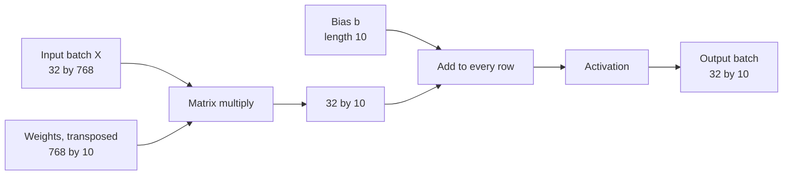

If you learn one operation from this module thoroughly, make it this one. Matrix multiplication is what a neural network layer computes, what attention in a Transformer computes, and what GPUs are built to do as fast as possible. Training and running a large language model is, measured by arithmetic, overwhelmingly matrix multiplication. Unlike the entry-by-entry operations in the [previous lesson](/learn/linear-algebra/matrix-operations), it combines whole rows with whole columns, and that is what lets a matrix transform a vector rather than just rescale its entries.

## The rule: rows times columns

To multiply $A$ by $B$, each entry of the result is a row of $A$ combined with a column of $B$: multiply matching entries and add them up.

$$
C = AB, \qquad C_{ij} = \sum_{k=1}^{n} A_{ik} B_{kj}
$$

Here $A$ is $m \times n$, $B$ is $n \times p$, and $C$ is $m \times p$. The index $k$ runs along row $i$ of $A$ and down column $j$ of $B$ at the same time, which only works if they have the same length $n$.

A worked example with a $2 \times 3$ matrix times a $3 \times 2$ matrix:

$$
\begin{bmatrix} 1 & 2 & 3 \\ 4 & 5 & 6 \end{bmatrix}
\begin{bmatrix} 7 & 8 \\ 9 & 10 \\ 11 & 12 \end{bmatrix}
=
\begin{bmatrix} 58 & 64 \\ 139 & 154 \end{bmatrix}
$$

The top-left entry uses row 1 of $A$ and column 1 of $B$: $1 \times 7 + 2 \times 9 + 3 \times 11 = 7 + 18 + 33 = 58$. The bottom-right uses row 2 and column 2: $4 \times 8 + 5 \times 10 + 6 \times 12 = 32 + 50 + 72 = 154$. Check the other two yourself.

### The shape rule

The inner dimensions must match, and they disappear; the outer dimensions give the result's shape.

$$
\underbrace{(m \times n)}_{A} \; \underbrace{(n \times p)}_{B} \;\to\; (m \times p)
$$

| $A$ | $B$ | $AB$ |
| --- | --- | --- |
| $2 \times 3$ | $3 \times 2$ | $2 \times 2$ |
| $3 \times 2$ | $2 \times 3$ | $3 \times 3$ |
| $32 \times 768$ | $768 \times 10$ | $32 \times 10$ |
| $2 \times 3$ | $2 \times 3$ | undefined |
| $4 \times 4$ | $4 \times 1$ | $4 \times 1$ |

Writing the shapes next to each other and checking the inner pair is the quickest sanity check in all of deep learning. The error "shapes (32,768) and (512,10) not aligned" is this rule being broken.

## Step through it in plain Python

The definition translates directly into three nested loops: $i$ over rows of the result, $j$ over columns of the result, and $k$ along the shared dimension. Step through a $2 \times 2$ example and watch each entry build up.

```trace
{
  "title": "matrix multiplication with three loops",
  "code": [
    "A = [[1, 2], [3, 4]]",
    "B = [[5, 6], [7, 8]]",
    "C = [[0, 0], [0, 0]]",
    "for i in range(2):",
    "    for j in range(2):",
    "        for k in range(2):",
    "            C[i][j] += A[i][k] * B[k][j]",
    "print(C)"
  ],
  "steps": [
    { "line": 3, "vars": { "C": "[[0, 0], [0, 0]]" }, "note": "The result is 2 by 2: rows of A by columns of B. Start it at zero." },
    { "line": 7, "vars": { "i": "0", "j": "0", "k": "0", "C": "[[5, 0], [0, 0]]" }, "note": "C[0][0] starts with row 0 of A and column 0 of B: A[0][0] * B[0][0] = 1 * 5 = 5." },
    { "line": 7, "vars": { "i": "0", "j": "0", "k": "1", "C": "[[19, 0], [0, 0]]" }, "note": "Next pair along the row and down the column: 2 * 7 = 14. C[0][0] = 5 + 14 = 19. That entry is finished." },
    { "line": 7, "vars": { "i": "0", "j": "1", "k": "0", "C": "[[19, 6], [0, 0]]" }, "note": "Same row of A, now column 1 of B: 1 * 6 = 6." },
    { "line": 7, "vars": { "i": "0", "j": "1", "k": "1", "C": "[[19, 22], [0, 0]]" }, "note": "2 * 8 = 16, so C[0][1] = 22. Row 0 of the result is done." },
    { "line": 7, "vars": { "i": "1", "j": "0", "k": "0", "C": "[[19, 22], [15, 0]]" }, "note": "Row 1 of A, column 0 of B: 3 * 5 = 15." },
    { "line": 7, "vars": { "i": "1", "j": "0", "k": "1", "C": "[[19, 22], [43, 0]]" }, "note": "4 * 7 = 28, so C[1][0] = 43." },
    { "line": 7, "vars": { "i": "1", "j": "1", "k": "0", "C": "[[19, 22], [43, 18]]" }, "note": "Row 1 of A, column 1 of B: 3 * 6 = 18." },
    { "line": 7, "vars": { "i": "1", "j": "1", "k": "1", "C": "[[19, 22], [43, 50]]" }, "note": "4 * 8 = 32, so C[1][1] = 50. Eight multiply-adds in total: 2 * 2 * 2." },
    { "line": 8, "vars": { "C": "[[19, 22], [43, 50]]" }, "out": ["[[19, 22], [43, 50]]"], "note": "Each entry of C combined one whole row of A with one whole column of B." }
  ]
}
```

As a reusable function that works for any compatible shapes:

```python
def matmul(A, B):
    m, n = len(A), len(A[0])
    if len(B) != n:
        raise ValueError(f"cannot multiply {m}x{n} by {len(B)}x{len(B[0])}")
    p = len(B[0])
    C = [[0] * p for _ in range(m)]
    for i in range(m):
        for j in range(p):
            for k in range(n):
                C[i][j] += A[i][k] * B[k][j]
    return C

A = [[1, 2, 3], [4, 5, 6]]
B = [[7, 8], [9, 10], [11, 12]]
print(matmul(A, B))
```

```output
[[58, 64], [139, 154]]
```

The loops do $m \times n \times p$ multiply-adds. For two $4096 \times 4096$ matrices that is about 69 billion, which is why nobody does this in pure Python. NumPy, the library we will study properly in Phase 3, hands the work to heavily optimised compiled code. Its operator is `@`:

```python
import numpy as np

A = np.array([[1, 2, 3], [4, 5, 6]])
B = np.array([[7, 8], [9, 10], [11, 12]])
print(A @ B)
print((A @ B).shape)
```

```output
[[ 58  64]
 [139 154]]
(2, 2)
```

## Matrix times vector: a transformation

When $B$ is a single column vector $\mathbf{x}$, the product $A\mathbf{x}$ is a new vector. There are two equally valid ways to read it.

**Row view:** each output entry is a row of $A$ combined with $\mathbf{x}$ (the [dot product](/learn/linear-algebra/dot-product) of that row with $\mathbf{x}$).

**Column view:** the output is a linear combination of the columns of $A$, weighted by the entries of $\mathbf{x}$:

$$
\begin{bmatrix} 1 & 2 \\ 3 & 4 \end{bmatrix} \begin{bmatrix} 5 \\ 6 \end{bmatrix}
= 5 \begin{bmatrix} 1 \\ 3 \end{bmatrix} + 6 \begin{bmatrix} 2 \\ 4 \end{bmatrix}
= \begin{bmatrix} 17 \\ 39 \end{bmatrix}
$$

The column view gives the geometric meaning. The first column of $A$ is where the vector $(1, 0)$ lands, and the second column is where $(0, 1)$ lands. Every other vector is a combination of those two, so it lands at the same combination of the columns. A matrix is therefore a complete description of a **linear transformation**: a way of moving every point in space that keeps straight lines straight and the origin fixed.

| Matrix | Effect on the plane |
| --- | --- |
| $\begin{bmatrix} 2 & 0 \\ 0 & 0.5 \end{bmatrix}$ | Stretch horizontally by 2, squash vertically by half |
| $\begin{bmatrix} 0 & -1 \\ 1 & 0 \end{bmatrix}$ | Rotate 90 degrees anticlockwise |
| $\begin{bmatrix} 1 & 0 \\ 0 & -1 \end{bmatrix}$ | Reflect in the horizontal axis |
| $\begin{bmatrix} 1 & 1 \\ 0 & 1 \end{bmatrix}$ | Shear: slide points sideways in proportion to their height |

```python
import numpy as np

rotate = np.array([[0, -1], [1, 0]])
print(rotate @ np.array([1, 0]))   # the x-axis arrow turns to point up
print(rotate @ np.array([3, 2]))
```

```output
[0 1]
[-2  3]
```

## Order matters

Matrix multiplication is **not commutative**: in general $AB \neq BA$. Sometimes $BA$ is not even defined (a $2 \times 3$ times a $3 \times 4$ works, but not the other way round). Even for square matrices the results usually differ, because the order of transformations matters. $AB\mathbf{x}$ means "apply $B$ first, then $A$", reading right to left.

```python
import numpy as np

stretch = np.array([[2, 0], [0, 1]])
rotate = np.array([[0, -1], [1, 0]])
print(stretch @ rotate)   # rotate first, then stretch
print(rotate @ stretch)   # stretch first, then rotate
```

```output
[[ 0 -2]
 [ 1  0]]
[[ 0 -1]
 [ 2  0]]
```

What does hold: multiplication is **associative**, $(AB)C = A(BC)$, and it **distributes** over addition, $A(B + C) = AB + AC$. Associativity means a chain of transformations can be collapsed into one matrix in advance.

> [!WARNING]
> Never assume `A @ B` equals `B @ A`. If you transpose or reorder operands to make shapes fit, check that the maths still means what you intended. Code that runs is not necessarily code that is right.

## A neural network layer

A fully connected layer takes an input vector $\mathbf{x} \in \mathbb{R}^{n}$, multiplies it by a weight matrix $W \in \mathbb{R}^{m \times n}$, and adds a bias vector $\mathbf{b} \in \mathbb{R}^{m}$:

$$
\mathbf{y} = W\mathbf{x} + \mathbf{b}
$$

Each row of $W$ holds the weights of one neuron, so output $y_i$ is neuron $i$'s weighted sum of the inputs plus its bias. An activation function is then applied, which is covered in [activation functions](/learn/neural-network-fundamentals/activation-functions).

```python
W = [[0.2, -0.5, 1.0],
     [0.7, 0.1, -0.3]]      # 2 neurons, 3 inputs each
b = [0.1, -0.2]
x = [1.0, 2.0, 3.0]

y = [sum(w * xi for w, xi in zip(row, x)) + bi for row, bi in zip(W, b)]
print([round(v, 4) for v in y])
```

```output
[2.3, -0.2]
```

In practice you process a **batch** of examples at once. Stack them as rows of a data matrix $X$ of shape (batch, inputs). The layer becomes one matrix multiplication, with the bias broadcast to every row:

$$
Y = XW^\top + \mathbf{b}
$$



Some libraries store $W$ as (inputs, outputs) and write $XW$; others store (outputs, inputs) and write $XW^\top$. The maths is the same; check the shapes rather than memorising one convention. Stacking layers multiplies more matrices in sequence, and without the non-linear activation between them, associativity would collapse the whole stack into one matrix. That is why activations are essential.

> [!KEY]
> A layer is a matrix multiply plus a bias. Attention in Transformers, convolutions (after rearrangement) and embedding lookups are also matrix multiplications at heart, which is why hardware for AI is designed around this one operation.

## Exercises

**1.** Without code, give the shape of each product or say it is undefined: (a) $(5 \times 2)(2 \times 7)$, (b) $(3 \times 3)(4 \times 3)$, (c) $(1 \times 4)(4 \times 1)$, (d) $(4 \times 1)(1 \times 4)$.

<details>
<summary>Show solution</summary>

(a) $5 \times 7$. (b) Undefined: inner dimensions 3 and 4 differ. (c) $1 \times 1$, a single number: this is the dot product. (d) $4 \times 4$: a row times a column in this order gives a full matrix, called the outer product.

</details>

**2.** Compute $\begin{bmatrix} 2 & 0 \\ 1 & 3 \end{bmatrix}\begin{bmatrix} 1 & 4 \\ 2 & 0 \end{bmatrix}$ by hand, then confirm with the `matmul` function from this lesson.

<details>
<summary>Show solution</summary>

Row 1: $(2 \cdot 1 + 0 \cdot 2,\; 2 \cdot 4 + 0 \cdot 0) = (2, 8)$. Row 2: $(1 \cdot 1 + 3 \cdot 2,\; 1 \cdot 4 + 3 \cdot 0) = (7, 4)$.

```python
print(matmul([[2, 0], [1, 3]], [[1, 4], [2, 0]]))   # [[2, 8], [7, 4]]
```

</details>

**3.** A layer maps 784 inputs (a flattened 28 by 28 image) to 128 outputs, and you feed it a batch of 64 images. Give the shapes of $X$, $W$ (stored as outputs by inputs), $XW^\top$ and $\mathbf{b}$. How many weights does the layer have, including biases?

<details>
<summary>Show solution</summary>

$X$ is $64 \times 784$, $W$ is $128 \times 784$, so $W^\top$ is $784 \times 128$ and $XW^\top$ is $64 \times 128$. $\mathbf{b}$ has length 128. Parameters: $128 \times 784 + 128 = 100{,}480$.

</details>

```quiz
[
  {
    "q": "What is the shape of the product of a 3 by 5 matrix and a 5 by 2 matrix?",
    "options": ["5 by 5", "3 by 2", "2 by 3", "It is undefined"],
    "answer": 1,
    "why": "The inner dimensions (5 and 5) match and drop out; the outer ones give 3 by 2."
  },
  {
    "q": "Which statement about matrix multiplication is true in general?",
    "options": ["`AB` equals `BA`", "`(AB)C` equals `A(BC)`", "It multiplies matching entries", "It needs both matrices to have the same shape"],
    "answer": 1,
    "why": "Matrix multiplication is associative but not commutative, and it combines rows with columns rather than matching entries."
  },
  {
    "q": "In the column view, `A @ x` is:",
    "options": ["A linear combination of the columns of `A`, weighted by the entries of `x`", "The sum of every entry of `A`", "The element-wise product of `A` and `x`", "Always a scalar"],
    "answer": 0,
    "why": "Entry k of x scales column k of A, and the scaled columns are added. This is why columns show where the basis vectors land."
  },
  {
    "q": "In `y = W x + b` for a dense layer, what does each row of `W` hold?",
    "options": ["One training example", "The bias of every neuron", "The weights of one neuron", "One output of the whole batch"],
    "answer": 2,
    "why": "Output y_i is row i of W combined with x, plus b_i, so row i holds neuron i's weights."
  }
]
```
