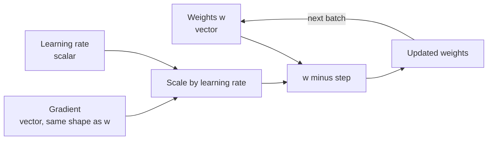

Before matrix multiplication, which gets its own lesson, there is a set of simpler operations that work entry by entry: adding vectors, scaling them, and multiplying them element-wise. They look almost too simple to study, but they are everywhere in AI. Every step of training a model updates millions of weights with one vector subtraction and one scaling. Every layer adds a bias vector. Averaging word embeddings to get a sentence embedding is vector addition followed by scaling. This lesson makes these operations precise, shows what they mean geometrically, and sets out the shape rules that decide when they are allowed.

## Vector addition

Two vectors of the **same length** are added component by component:

$$
\mathbf{a} + \mathbf{b} = \begin{bmatrix} a_1 + b_1 \\ a_2 + b_2 \\ \vdots \\ a_n + b_n \end{bmatrix}
\qquad
\begin{bmatrix} 2 \\ 1 \end{bmatrix} + \begin{bmatrix} 1 \\ 3 \end{bmatrix} = \begin{bmatrix} 3 \\ 4 \end{bmatrix}
$$

**Geometrically**, addition is "tip to tail": draw $\mathbf{a}$ from the origin, then draw $\mathbf{b}$ starting from where $\mathbf{a}$ ends. The sum is the arrow from the origin to where you finish. Walk 2 right and 1 up, then 1 right and 3 up, and you are 3 right and 4 up.

Subtraction works the same way, and $\mathbf{b} - \mathbf{a}$ has a useful picture: it is the arrow that goes **from the tip of $\mathbf{a}$ to the tip of $\mathbf{b}$**. The length of that arrow is the distance between the two points, an idea you will use in [norms and distances](/learn/linear-algebra/norms-and-distances).

Adding vectors of different lengths is undefined. $(1, 2) + (1, 2, 3)$ has no meaning.

## Scalar multiplication

Multiplying a vector by a scalar $c$ multiplies every component:

$$
c\,\mathbf{a} = \begin{bmatrix} c\,a_1 \\ c\,a_2 \\ \vdots \\ c\,a_n \end{bmatrix}
\qquad
3 \begin{bmatrix} 2 \\ 1 \end{bmatrix} = \begin{bmatrix} 6 \\ 3 \end{bmatrix}
$$

Geometrically, scaling stretches or shrinks the arrow without changing the line it lies on. A factor greater than 1 lengthens it, a factor between 0 and 1 shortens it, and a negative factor flips it to point the opposite way. This is why the word is "scalar": a scalar *scales*.

### Linear combinations

Put the two operations together and you get a **linear combination**: scale some vectors and add the results.

$$
c_1 \mathbf{v}_1 + c_2 \mathbf{v}_2 + \dots + c_k \mathbf{v}_k
$$

Linear combinations are the central construction of linear algebra. A weighted average is one. A sentence embedding made by averaging its word embeddings is one (every weight is $1/k$). The output of a neuron, before its activation function, is one. The lesson on [vector spaces](/learn/linear-algebra/vector-spaces) asks which vectors you can reach this way.

## Plain Python first

Since `+` and `*` on lists mean "join" and "repeat", you write vector operations with a loop or a comprehension. `zip` pairs up the components.

```python
def add(a, b):
    if len(a) != len(b):
        raise ValueError(f"length mismatch: {len(a)} vs {len(b)}")
    return [x + y for x, y in zip(a, b)]

def scale(c, a):
    return [c * x for x in a]

a = [2, 1]
b = [1, 3]
print(add(a, b))
print(scale(3, a))
print(add(scale(2, a), scale(-1, b)))   # the linear combination 2a - b
```

```output
[3, 4]
[6, 3]
[3, -1]
```

With NumPy, the library we will study properly in Phase 3, the arithmetic operators already mean vector arithmetic:

```python
import numpy as np

a = np.array([2, 1])
b = np.array([1, 3])
print(a + b)
print(3 * a)
print(2 * a - b)
```

```output
[3 4]
[6 3]
[ 3 -1]
```

The NumPy version is not just shorter. It runs the loop in compiled code, which for vectors with millions of entries is orders of magnitude faster than a Python loop.

## The same operations on matrices

Matrices of the **same shape** are added, subtracted and scaled entry by entry, exactly like vectors:

$$
\begin{bmatrix} 1 & 2 \\ 3 & 4 \end{bmatrix} + \begin{bmatrix} 10 & 20 \\ 30 & 40 \end{bmatrix} = \begin{bmatrix} 11 & 22 \\ 33 & 44 \end{bmatrix}
\qquad
0.5 \begin{bmatrix} 1 & 2 \\ 3 & 4 \end{bmatrix} = \begin{bmatrix} 0.5 & 1 \\ 1.5 & 2 \end{bmatrix}
$$

```python
A = [[1, 2], [3, 4]]
B = [[10, 20], [30, 40]]

total = [[a + b for a, b in zip(row_a, row_b)] for row_a, row_b in zip(A, B)]
print(total)
```

```output
[[11, 22], [33, 44]]
```

These operations obey the rules you would hope for: $A + B = B + A$, $(A + B) + C = A + (B + C)$, and $c(A + B) = cA + cB$.

## Element-wise (Hadamard) product

There is a tempting way to "multiply" two matrices: multiply matching entries. That is the **element-wise** or **Hadamard product**, written $A \odot B$:

$$
\begin{bmatrix} 1 & 2 \\ 3 & 4 \end{bmatrix} \odot \begin{bmatrix} 10 & 20 \\ 30 & 40 \end{bmatrix} = \begin{bmatrix} 10 & 40 \\ 90 & 160 \end{bmatrix}
$$

It is a legitimate and useful operation, but it is **not** matrix multiplication. In NumPy, `A * B` is the element-wise product and `A @ B` is matrix multiplication. Mixing them up is a classic bug, and because both work on square matrices of the same shape, it often runs without error and produces wrong numbers.

```python
import numpy as np

A = np.array([[1, 2], [3, 4]])
B = np.array([[10, 20], [30, 40]])
print(A * B)    # element-wise
print(A @ B)    # matrix multiplication, next lesson
```

```output
[[ 10  40]
 [ 90 160]]
[[ 70 100]
 [150 220]]
```

The element-wise product is used for **masking**. Multiplying by a vector of 0s and 1s keeps some entries and zeroes others. Dropout, a regularisation technique for neural networks, does this with a random mask during training. Gated recurrent networks such as LSTMs use the element-wise product with values between 0 and 1 to decide how much of each component to let through.

```python
activations = [0.8, -1.2, 0.5, 2.0]
mask = [1, 0, 1, 0]
print([a * m for a, m in zip(activations, mask)])
```

```output
[0.8, -0.0, 0.5, 0.0]
```

The `-0.0` is a quirk of floating-point arithmetic: $-1.2 \times 0$ gives negative zero, which compares equal to `0.0`.

## Shape rules

| Operation | Notation | Shapes required | Result shape |
| --- | --- | --- | --- |
| Addition, subtraction | $A + B$, $A - B$ | Identical | Same as inputs |
| Scalar multiplication | $cA$ | Any | Same as $A$ |
| Element-wise product | $A \odot B$ | Identical | Same as inputs |
| Matrix multiplication | $AB$ | Columns of $A$ = rows of $B$ | Rows of $A$ by columns of $B$ |

NumPy relaxes the "identical" rule with **broadcasting**: adding a vector of length $n$ to an $m \times n$ matrix adds it to every row. That is exactly how a bias is added to a whole batch at once. Broadcasting has its own lesson in [the NumPy module](/learn/numpy/broadcasting); in mathematical notation you will usually see it written as if for one example at a time.

## Where these operations appear in AI

The most important use is the **gradient descent update**, the step that trains almost every model. The weights $\mathbf{w}$ form a vector, the gradient $\nabla L$ is a vector of the same length saying how the loss changes with each weight, and the learning rate $\eta$ is a scalar:

$$
\mathbf{w}_{\text{new}} = \mathbf{w} - \eta \, \nabla L
$$

That is one scalar multiplication and one vector subtraction. You will meet the gradient properly in [gradients](/learn/calculus/gradients) and the full algorithm in [gradient descent](/learn/calculus/gradient-descent).



```python
w = [0.5, -0.3, 0.8]
grad = [0.2, -0.1, 0.4]
lr = 0.1

w_new = [wi - lr * gi for wi, gi in zip(w, grad)]
print([round(x, 4) for x in w_new])
```

```output
[0.48, -0.29, 0.76]
```

Each weight moves a little in the direction that reduces the loss. Real models repeat this with vectors of billions of entries, which is why fast vector arithmetic matters.

Other everyday examples:

| Task | Operation |
| --- | --- |
| Adding a bias in a layer | Vector addition |
| Averaging word embeddings into a sentence embedding | Sum, then scale by $1/k$ |
| Feature scaling, such as dividing pixel values by 255 | Scalar multiplication |
| Dropout and attention masks | Element-wise product or addition |
| Blending two embeddings, $0.7\mathbf{a} + 0.3\mathbf{b}$ | Linear combination |

> [!TIP]
> When maths and code disagree about an operation, check the symbol. In papers, $AB$ or $A \cdot B$ usually means matrix multiplication and $\odot$ means element-wise. In NumPy and PyTorch, `@` is matrix multiplication and `*` is element-wise.

## Exercises

**1.** Compute by hand, then check with plain Python: $2\begin{bmatrix}1\\-1\\3\end{bmatrix} - \begin{bmatrix}4\\0\\2\end{bmatrix}$.

<details>
<summary>Show solution</summary>

$2 \times (1, -1, 3) = (2, -2, 6)$, and subtracting $(4, 0, 2)$ gives $(-2, -2, 4)$.

```python
a = [1, -1, 3]
b = [4, 0, 2]
print([2 * x - y for x, y in zip(a, b)])   # [-2, -2, 4]
```

</details>

**2.** Write `mean_vector(vectors)` that averages a list of equal-length vectors, using only plain Python. Use it on three toy word embeddings `[1, 0]`, `[0, 1]` and `[1, 1]`.

<details>
<summary>Show solution</summary>

```python
def mean_vector(vectors):
    n = len(vectors[0])
    total = [0.0] * n
    for v in vectors:
        total = [t + x for t, x in zip(total, v)]
    return [t / len(vectors) for t in total]

print(mean_vector([[1, 0], [0, 1], [1, 1]]))
```

The result is approximately `[0.667, 0.667]`: the sum is `[2, 2]`, scaled by one third.

</details>

**3.** For $A = \begin{bmatrix}1 & 0\\0 & 1\end{bmatrix}$ and $B = \begin{bmatrix}5 & 6\\7 & 8\end{bmatrix}$, compute $A \odot B$. Why is the answer not $B$?

<details>
<summary>Show solution</summary>

$A \odot B = \begin{bmatrix}5 & 0\\0 & 8\end{bmatrix}$. The element-wise product keeps only the entries where $A$ is 1, the diagonal. $A$ here is the identity matrix, which leaves $B$ unchanged under *matrix* multiplication ($AB = B$), but under the element-wise product it acts as a mask.

</details>

```quiz
[
  {
    "q": "Geometrically, what does multiplying a vector by -2 do?",
    "options": ["Rotates it by 90 degrees", "Doubles its length and flips its direction", "Halves its length", "Leaves it unchanged"],
    "answer": 1,
    "why": "Scaling by a negative number reverses the direction, and the magnitude 2 doubles the length."
  },
  {
    "q": "In NumPy, `A * B` for two 3 by 3 arrays computes:",
    "options": ["Matrix multiplication", "The dot product", "The element-wise (Hadamard) product", "An error, because shapes must differ"],
    "answer": 2,
    "why": "`*` multiplies matching entries. Matrix multiplication is `@`."
  },
  {
    "q": "The gradient descent update `w - lr * grad` uses which operations?",
    "options": ["Scalar multiplication and vector subtraction", "Matrix multiplication only", "Element-wise product and addition", "Dot product and scaling"],
    "answer": 0,
    "why": "The scalar learning rate scales the gradient vector, which is then subtracted from the weight vector."
  },
  {
    "q": "Which of these is defined?",
    "options": ["Adding a 2-vector to a 3-vector", "Adding a 2 by 3 matrix to a 3 by 2 matrix", "Element-wise product of a 2 by 2 and a 3 by 3 matrix", "Multiplying a 2 by 3 matrix by the scalar 7"],
    "answer": 3,
    "why": "Scalar multiplication works on any shape. Addition and the element-wise product need identical shapes."
  }
]
```
