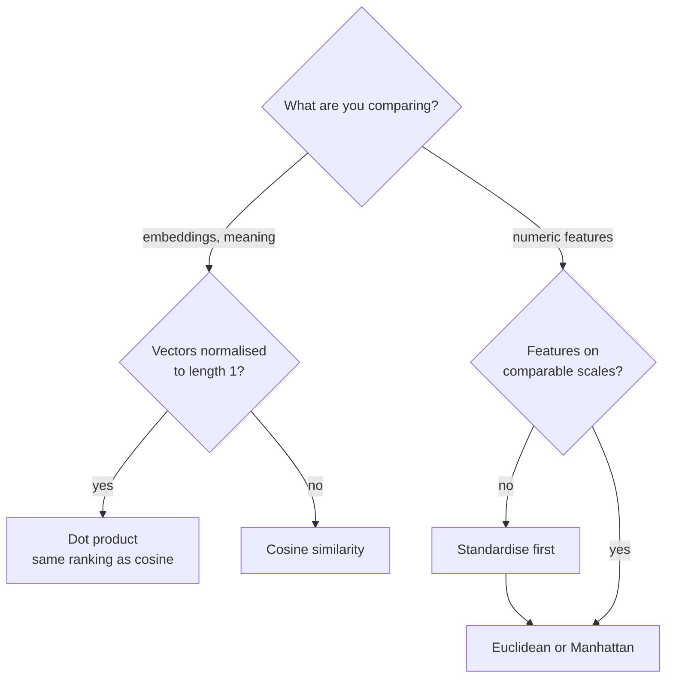

How big is a vector, and how far apart are two vectors? Those two questions sound simple, but they have more than one answer, and the answer you choose changes how a model behaves. A **norm** measures a vector's size. A **distance** measures how far apart two vectors are, usually as the norm of their difference. They decide which neighbours k-nearest-neighbours picks, which documents a vector search returns, how clustering groups points, how regularisation keeps a model's weights in check, and when gradient clipping steps in to stop training blowing up. This lesson covers the norms you will meet constantly, L2, L1 and L-infinity, and how each one is used in AI.

## The L2 (Euclidean) norm

The everyday length of an arrow is the **L2 norm**, also called the Euclidean norm. By Pythagoras:

$$
\lVert \mathbf{x} \rVert_2 = \sqrt{x_1^2 + x_2^2 + \dots + x_n^2} = \sqrt{\mathbf{x} \cdot \mathbf{x}}
$$

For $\mathbf{x} = (3, -4)$: $\sqrt{9 + 16} = 5$. The second form shows its link to the [dot product](/learn/linear-algebra/dot-product): the squared length of a vector is its dot product with itself. When people write $\lVert \mathbf{x} \rVert$ with no subscript, they almost always mean the L2 norm.

## The L1 (Manhattan) norm

The **L1 norm** adds up the absolute values of the components:

$$
\lVert \mathbf{x} \rVert_1 = |x_1| + |x_2| + \dots + |x_n|
$$

For $(3, -4)$ that is $3 + 4 = 7$. It is called the Manhattan or taxicab norm because it is the distance a taxi drives on a grid of streets: 3 blocks across and 4 blocks up, with no cutting diagonally through buildings.

## The L-infinity (max) norm

The **L-infinity norm** is simply the largest absolute component:

$$
\lVert \mathbf{x} \rVert_\infty = \max_i |x_i|
$$

For $(3, -4)$ it is 4. It answers "what is the worst single coordinate?", which is useful when any one entry being too large is the problem. Adversarial robustness research often limits how much an attacker may change any single pixel using this norm.

### The general p-norm

All three are members of one family. For $p \geq 1$:

$$
\lVert \mathbf{x} \rVert_p = \left( \sum_{i=1}^{n} |x_i|^p \right)^{1/p}
$$

$p = 1$ gives L1, $p = 2$ gives L2, and as $p$ grows the largest component dominates more and more, so the limit as $p \to \infty$ is the max norm.

| Norm | Formula | $(3, -4)$ | Geometric shape of all vectors with norm 1 |
| --- | --- | --- | --- |
| L1 | Sum of absolute values | 7 | A diamond, with corners on the axes |
| L2 | Square root of sum of squares | 5 | A circle |
| L-infinity | Largest absolute value | 4 | A square |

The shapes in the last column are the "unit balls" in two dimensions. The corners of the L1 diamond sit exactly on the axes, a fact that will explain why L1 regularisation produces exact zeros.

### Norms in code

In plain Python each norm is one line:

```python
import math

def l2(x):
    return math.sqrt(sum(v * v for v in x))

def l1(x):
    return sum(abs(v) for v in x)

def linf(x):
    return max(abs(v) for v in x)

x = [3, -4]
print(l2(x), l1(x), linf(x))
```

```output
5.0 7 4
```

NumPy, the library we will study properly in Phase 3, provides all of them through `np.linalg.norm` and its `ord` argument:

```python
import numpy as np

x = np.array([3.0, -4.0])
print(np.linalg.norm(x), np.linalg.norm(x, ord=1), np.linalg.norm(x, ord=np.inf))
```

```output
5.0 7.0 4.0
```

Every norm satisfies three properties: it is zero only for the zero vector, scaling a vector by $c$ scales its norm by $|c|$, and the **triangle inequality** holds, $\lVert \mathbf{a} + \mathbf{b} \rVert \leq \lVert \mathbf{a} \rVert + \lVert \mathbf{b} \rVert$ (a detour is never shorter than the direct route).

## From norms to distances

The distance between two points is the norm of the arrow between them, $\mathbf{a} - \mathbf{b}$:

$$
d(\mathbf{a}, \mathbf{b}) = \lVert \mathbf{a} - \mathbf{b} \rVert
$$

With $\mathbf{a} = (1, 2, 3)$ and $\mathbf{b} = (4, 0, 3)$, the difference is $(-3, 2, 0)$, so the **Euclidean distance** (L2) is $\sqrt{9 + 4} = \sqrt{13} \approx 3.606$ and the **Manhattan distance** (L1) is $3 + 2 = 5$.

There is one more measure you have met already. **Cosine distance** is defined as $1 - \cos\theta$, built from cosine similarity. It ignores length and compares only direction. Strictly it is not a norm-based distance (it breaks the triangle inequality), but it is used like one throughout vector search.

| Measure | Formula | Sensitive to length? | Typical use |
| --- | --- | --- | --- |
| Euclidean | $\lVert \mathbf{a} - \mathbf{b} \rVert_2$ | Yes | k-means, k-NN on scaled features |
| Manhattan | $\lVert \mathbf{a} - \mathbf{b} \rVert_1$ | Yes | High-dimensional or grid-like data, robustness to single large differences |
| Cosine distance | $1 - \cos\theta$ | No | Text embeddings, semantic search |
| Dot product (a similarity) | $\mathbf{a} \cdot \mathbf{b}$ | Yes | Normalised embeddings, recommendation |

For vectors normalised to length 1, Euclidean distance and cosine similarity are tied together exactly:

$$
\lVert \mathbf{a} - \mathbf{b} \rVert_2^2 = \lVert \mathbf{a} \rVert^2 + \lVert \mathbf{b} \rVert^2 - 2\,\mathbf{a} \cdot \mathbf{b} = 2 - 2\cos\theta
$$

So once embeddings are normalised, ranking by smallest Euclidean distance and ranking by largest cosine similarity give the same order. This is why vector databases let you choose either and get equivalent results on normalised data.



## Scale matters

Distances add up differences across all components, so a feature measured in large units drowns out the others. Consider three people described by (age, income):

```python
import math

def euclidean(a, b):
    return math.sqrt(sum((x - y) ** 2 for x, y in zip(a, b)))

A, B, C = (25, 50000), (60, 51000), (26, 58000)     # income in units
print(round(euclidean(A, B), 1), round(euclidean(A, C), 1))

A, B, C = (25, 50), (60, 51), (26, 58)              # income in thousands
print(round(euclidean(A, B), 1), round(euclidean(A, C), 1))
```

```output
1000.6 8000.0
35.0 8.1
```

With income in units, B looks closest to A even though B is 35 years older: the income difference swamps age. Express income in thousands and the conclusion flips. Neither is "right"; the point is that an arbitrary choice of units decided the answer. Standardising each feature (subtracting its mean and dividing by its standard deviation) puts them on an equal footing, which is why distance-based models such as [k-nearest neighbours](/learn/supervised-learning-algorithms/k-nearest-neighbors) and k-means need it.

> [!WARNING]
> Always scale numeric features before using a distance-based method. Unscaled features silently turn "nearest neighbour" into "nearest by whichever column has the biggest numbers".

## Norms in training: regularisation

Models with large weights tend to overfit: they bend themselves to fit noise. **Regularisation** adds a penalty on the size of the weights to the loss, and the size is measured with a norm:

$$
L_{\text{ridge}} = L_{\text{data}} + \lambda \lVert \mathbf{w} \rVert_2^2
\qquad
L_{\text{lasso}} = L_{\text{data}} + \lambda \lVert \mathbf{w} \rVert_1
$$

Here $L_{\text{data}}$ is the ordinary loss on the training data and $\lambda \geq 0$ controls how strongly large weights are punished.

- **L2 regularisation** (ridge regression; called **weight decay** in neural networks) shrinks all weights smoothly towards zero but rarely makes any exactly zero. You met its closed form in the [identity matrix](/learn/linear-algebra/identity-matrix) lesson.
- **L1 regularisation** (lasso) pushes unhelpful weights to **exactly** zero, so it also performs feature selection. Geometrically, the corners of the L1 diamond lie on the axes, and the optimum tends to land on a corner, where some coordinates are zero.

You can see the difference with scikit-learn on data where only two of five features matter:

```python
import numpy as np
from sklearn.linear_model import Lasso, Ridge

rng = np.random.default_rng(42)
X = rng.normal(size=(100, 5))
y = 3 * X[:, 0] - 2 * X[:, 1] + rng.normal(scale=0.5, size=100)   # only features 0 and 1 matter

ridge = Ridge(alpha=10.0).fit(X, y)
lasso = Lasso(alpha=0.1).fit(X, y)
print("ridge:", ridge.coef_.round(3) + 0.0)
print("lasso:", lasso.coef_.round(3) + 0.0)
```

```output
ridge: [ 2.623 -1.755 -0.083 -0.058 -0.056]
lasso: [ 2.842 -1.887  0.     0.     0.   ]
```

(scikit-learn calls the regularisation strength `alpha` rather than $\lambda$. Adding `0.0` just tidies negative zeros for display.) Ridge leaves small non-zero weights on the three useless features; lasso removes them entirely. Both shrink the real coefficients, 3 and -2, a little. Regularisation is covered in depth in [regularization](/learn/neural-network-fundamentals/regularization).

## Norms in training: gradient clipping

During training, a gradient occasionally becomes huge and one update wrecks the weights. **Gradient clipping by norm** checks the L2 norm of the gradient and, if it exceeds a threshold, scales the gradient down to that length while keeping its direction:

$$
\mathbf{g} \leftarrow \mathbf{g} \cdot \frac{\text{max norm}}{\lVert \mathbf{g} \rVert_2} \quad \text{if } \lVert \mathbf{g} \rVert_2 > \text{max norm}
$$

```python
import math

def clip_by_norm(g, max_norm):
    norm = math.sqrt(sum(v * v for v in g))
    if norm <= max_norm:
        return g
    return [v * max_norm / norm for v in g]

print(clip_by_norm([3.0, 4.0], 1.0))
print(clip_by_norm([0.3, 0.4], 1.0))
```

```output
[0.6, 0.8]
[0.3, 0.4]
```

The first gradient had length 5 and comes back with length 1, pointing the same way. The second was already short enough and passes through untouched. Deep learning frameworks provide this as a built-in utility, and it is standard practice when training recurrent networks and large Transformers.

> [!KEY]
> A norm measures size and a distance is the norm of a difference. L2 is the default; L1 favours sparsity; L-infinity bounds the worst coordinate. Cosine compares only direction, and on normalised vectors it ranks results the same way as Euclidean distance.

## Exercises

**1.** For $\mathbf{x} = (1, -2, 2)$, compute the L1, L2 and L-infinity norms by hand, then normalise $\mathbf{x}$ to L2 length 1.

<details>
<summary>Show solution</summary>

L1: $1 + 2 + 2 = 5$. L2: $\sqrt{1 + 4 + 4} = 3$. L-infinity: 2. Normalised: $(1/3, -2/3, 2/3)$, whose L2 norm is $\sqrt{(1 + 4 + 4)/9} = 1$.

</details>

**2.** Write `manhattan(a, b)` in plain Python and use it, together with the `euclidean` function from this lesson, to find which of the points $(2, 2)$ and $(0, 3)$ is closer to the origin under each distance.

<details>
<summary>Show solution</summary>

```python
import math

def euclidean(a, b):
    return math.sqrt(sum((x - y) ** 2 for x, y in zip(a, b)))

def manhattan(a, b):
    return sum(abs(x - y) for x, y in zip(a, b))

origin = (0, 0)
for p in [(2, 2), (0, 3)]:
    print(p, round(euclidean(origin, p), 3), manhattan(origin, p))
```

Euclidean: $(2, 2)$ is about 2.828 away and $(0, 3)$ is 3, so $(2, 2)$ is closer. Manhattan: $(2, 2)$ is 4 and $(0, 3)$ is 3, so $(0, 3)$ is closer. The choice of distance changed the nearest neighbour.

</details>

**3.** Two embeddings are normalised to length 1 and their cosine similarity is 0.8. What is the Euclidean distance between them?

<details>
<summary>Show solution</summary>

$\lVert \mathbf{a} - \mathbf{b} \rVert^2 = 2 - 2 \times 0.8 = 0.4$, so the distance is $\sqrt{0.4} \approx 0.632$.

</details>

```quiz
[
  {
    "q": "What is the L1 norm of `(2, -3, 1)`?",
    "options": ["6", "0", "3.742", "3"],
    "answer": 0,
    "why": "L1 adds absolute values: 2 + 3 + 1 = 6. 3.742 is the L2 norm and 3 is the L-infinity norm."
  },
  {
    "q": "Which regularisation tends to set some weights exactly to zero?",
    "options": ["L2 (ridge)", "Weight decay", "L1 (lasso)", "Gradient clipping"],
    "answer": 2,
    "why": "The L1 penalty has corners on the axes, so optima often land where some coordinates are exactly zero. L2 and weight decay shrink weights smoothly."
  },
  {
    "q": "Why should features be scaled before k-nearest neighbours?",
    "options": ["Scaling makes the model train faster but does not change predictions", "Otherwise features with large numeric ranges dominate the distance", "k-NN only accepts values between 0 and 1", "Scaling removes outliers"],
    "answer": 1,
    "why": "Distances sum differences across features, so a column measured in large units swamps the others and decides who the neighbours are."
  },
  {
    "q": "Gradient clipping by norm with max norm 1 is applied to a gradient of length 5. What happens?",
    "options": ["Every component is capped at 1", "The gradient is set to zero", "The gradient is left unchanged", "The gradient is scaled to length 1, keeping its direction"],
    "answer": 3,
    "why": "Clipping by norm rescales the whole vector by 1/5, so its direction is preserved and its L2 norm becomes 1."
  }
]
```
