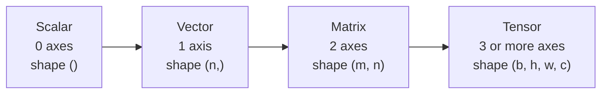

Every piece of data a model touches is turned into numbers first, and those numbers are arranged in a small number of shapes. A learning rate is a single number. A sentence embedding is a list of a few hundred numbers. The weights of one neural network layer are a rectangular grid of numbers. A batch of colour images is a four-dimensional block. Linear algebra is the mathematics of these shapes and of what you can do with them, and it is the language that every machine learning paper, library and error message speaks.

This lesson introduces the three basic objects, scalars, vectors and matrices, plus their generalisation, the tensor. The habit it builds, always knowing the **shape** of your data, will save you more debugging time than any other in this course.

## Scalars

A **scalar** is a single number. In maths it is usually written as a lowercase italic letter: $a$, $\lambda$, $\eta$.

You have already used plenty of scalars in Python. In AI they appear as:

| Scalar | Typical symbol | Example value |
| --- | --- | --- |
| Learning rate | $\eta$ | 0.001 |
| Sampling temperature | $T$ | 0.7 |
| Loss for one batch | $L$ | 2.31 |
| Regularisation strength | $\lambda$ | 0.01 |

When we say a value lives in $\mathbb{R}$ we mean it is a real number: any point on the number line, including negatives and fractions. So "$\eta \in \mathbb{R}$" reads "eta is a real number".

## Vectors

A **vector** is an ordered list of numbers. The order matters: position 1 always means the same thing, position 2 always means the same thing, and so on. A vector with $n$ numbers (its **components** or **entries**) lives in $\mathbb{R}^n$.

$$
\mathbf{x} = \begin{bmatrix} 3 \\ 120 \\ 15 \end{bmatrix} \in \mathbb{R}^3
$$

Here $\mathbf{x}$ might describe a house: 3 bedrooms, 120 square metres, 15 years old. We write vectors in bold lowercase and refer to individual entries with a subscript: $x_1 = 3$, $x_2 = 120$, $x_3 = 15$. Mathematicians count from 1; Python counts from 0, so $x_1$ is `x[0]` in code.

### Two ways to picture a vector

A vector with two or three entries can be drawn, and the pictures carry over to higher dimensions even when you cannot draw them.

- **As a point.** The vector $(3, 2)$ is the point 3 units right and 2 units up from the origin.
- **As an arrow.** The same vector is an arrow from the origin to that point. An arrow has a **direction** and a **length** (its magnitude).

The arrow picture is what makes linear algebra useful in AI. Two vectors whose arrows point in nearly the same direction are "similar", whatever the vectors represent. That idea powers semantic search, recommendation systems and retrieval for LLMs, and you will make it precise in the lessons on the [dot product](/learn/linear-algebra/dot-product) and [norms and distances](/learn/linear-algebra/norms-and-distances).

### Vectors in AI

| Thing | Represented as | Dimension $n$ |
| --- | --- | --- |
| One row of a tabular dataset | Feature vector | Number of columns |
| A word or sentence | Embedding vector | Fixed by the model, often hundreds or thousands |
| A greyscale image, flattened | Pixel vector | Height times width |
| Model output over classes | Probability vector | Number of classes |

An **embedding** is a vector a model produces to represent meaning. Words or documents with related meanings end up with vectors pointing in similar directions. You will study how they are learned in the NLP phase ([word embeddings](/learn/nlp-fundamentals/word-embeddings)); for now, all you need is that an embedding is simply a vector in $\mathbb{R}^n$.

### Vectors in Python

The simplest representation is a Python list:

```python
house = [3, 120, 15]
print(len(house))      # the dimension n
print(house[1])        # the second component, x_2
```

```output
3
120
```

Lists work for small examples, and this module uses them so you can see every step. Real AI code uses **NumPy**, the numerical library you will study properly in Phase 3. A NumPy array stores numbers compactly and does arithmetic on whole arrays at once. You only need two things from it for now: `np.array(...)` creates an array, and `.shape` tells you its shape.

```python
import numpy as np

house = np.array([3, 120, 15])
print(house)
print(house.shape)
```

```output
[  3 120  15]
(3,)
```

The shape `(3,)` means "one axis of length 3": a vector.

## Matrices

A **matrix** is a rectangular grid of numbers with $m$ rows and $n$ columns. We say it is $m \times n$ (read "m by n") and write $A \in \mathbb{R}^{m \times n}$. Matrices are written as uppercase letters, and $A_{ij}$ is the entry in row $i$, column $j$.

$$
A = \begin{bmatrix} 3 & 120 & 15 \\ 2 & 85 & 40 \\ 4 & 150 & 5 \\ 1 & 45 & 60 \end{bmatrix} \in \mathbb{R}^{4 \times 3}
$$

Here $A_{21} = 2$ (row 2, column 1) and $A_{13} = 15$. Rows always come first, both in the shape and in the index.

There are two ways to read a matrix, and you will switch between them constantly:

1. **As a stack of row vectors.** Each row is one house. This is a **data matrix**: by convention in machine learning, rows are examples and columns are features. A dataset of 10,000 houses with 3 features is a $10000 \times 3$ matrix, usually called $X$.
2. **As a transformation.** A matrix can act on a vector to produce a new vector, stretching, rotating or projecting it. A neural network layer is exactly this: a **weight matrix** $W$ that transforms its input. You will see how in [matrix multiplication](/learn/linear-algebra/matrix-multiplication).

### Matrices in Python

In plain Python a matrix is a list of rows:

```python
A = [
    [3, 120, 15],
    [2, 85, 40],
    [4, 150, 5],
    [1, 45, 60],
]

rows, cols = len(A), len(A[0])
print(rows, cols)
print(A[1][0])          # row 2, column 1 in maths notation
print([row[1] for row in A])   # the whole second column
```

```output
4 3
2
[120, 85, 150, 45]
```

Notice that getting a row is easy (`A[1]`) but getting a column needs a loop. NumPy makes both directions equally easy:

```python
import numpy as np

A = np.array([
    [3, 120, 15],
    [2, 85, 40],
    [4, 150, 5],
    [1, 45, 60],
])
print(A.shape)
print(A[1, 0])
print(A[:, 1])
```

```output
(4, 3)
2
[120  85 150  45]
```

`A[:, 1]` means "every row, column index 1".

## Tensors: more than two axes

A **tensor** generalises the pattern to any number of axes. The number of axes is the tensor's **rank** in deep learning jargon (sometimes called its order, or `ndim` in NumPy).



| Object | Axes | Example | Example shape |
| --- | --- | --- | --- |
| Scalar | 0 | Loss value | `()` |
| Vector | 1 | One sentence embedding | `(768,)` |
| Matrix | 2 | Embeddings for a batch of 32 sentences | `(32, 768)` |
| 3-axis tensor | 3 | One RGB image | `(224, 224, 3)` |
| 4-axis tensor | 4 | A batch of 32 RGB images | `(32, 224, 224, 3)` |

The sizes here are illustrative but typical. A word of caution about vocabulary: "rank" in deep learning means the number of axes, but in linear algebra the [rank of a matrix](/learn/linear-algebra/vector-spaces) means something different. Context tells you which.

```python
import numpy as np

images = np.zeros((32, 224, 224, 3))
print(images.ndim, images.shape)
print(images[0].shape)        # one image
print(images[0, :, :, 0].shape)   # the red channel of that image
```

```output
4 (32, 224, 224, 3)
(224, 224, 3)
(224, 224)
```

## Row vectors and column vectors

A vector can be written standing up (a **column vector**, $n \times 1$) or lying down (a **row vector**, $1 \times n$). In maths, $\mathbf{x}$ means a column vector by default, and $\mathbf{x}^\top$ ("x transpose") is the same numbers laid out as a row. The distinction matters as soon as you multiply vectors and matrices together, because the shapes must line up.

$$
\mathbf{x} = \begin{bmatrix} 1 \\ 2 \\ 3 \end{bmatrix} \qquad \mathbf{x}^\top = \begin{bmatrix} 1 & 2 & 3 \end{bmatrix}
$$

NumPy has a third option: the one-axis array of shape `(3,)`, which is neither a row nor a column. NumPy treats it as whichever makes an operation work, which is convenient but occasionally hides a bug. Shapes `(3,)`, `(1, 3)` and `(3, 1)` are three different things.

> [!KEY]
> Before you do anything with an array, know its shape. Most bugs in numerical and deep learning code are shape bugs: a matrix where a vector was expected, rows and columns swapped, or a missing batch axis.

## Pitfalls with plain lists

Lists of lists are not real matrices, and Python will not stop you making mistakes that NumPy would catch:

```python
ragged = [[1, 2, 3], [4, 5]]      # rows of different lengths: not a matrix
nums = [1, 2, 3]
print(nums + nums)                # list concatenation, not vector addition
print(nums * 2)                   # repetition, not scaling
```

```output
[1, 2, 3, 1, 2, 3]
[1, 2, 3, 1, 2, 3]
```

`+` and `*` on lists mean "join" and "repeat". For vector arithmetic you need either a loop or NumPy, which the [next lesson](/learn/linear-algebra/matrix-operations) covers.

## Exercises

**1.** A small dataset records the age, height (cm) and weight (kg) of five patients. What is the shape of its data matrix $X$, using the machine learning convention? What does $X_{42}$ represent?

<details>
<summary>Show solution</summary>

Rows are examples and columns are features, so $X \in \mathbb{R}^{5 \times 3}$ with shape `(5, 3)`. $X_{42}$ is row 4, column 2: the height of the fourth patient. In NumPy that is `X[3, 1]`.

</details>

**2.** Write a plain-Python function `shape(m)` that returns `(rows, cols)` for a list-of-lists matrix and raises `ValueError` if the rows have different lengths.

<details>
<summary>Show solution</summary>

```python
def shape(m):
    cols = len(m[0])
    for row in m:
        if len(row) != cols:
            raise ValueError("rows have different lengths")
    return (len(m), cols)

print(shape([[1, 2, 3], [4, 5, 6]]))   # (2, 3)
```

</details>

**3.** A video clip has 16 frames, each a 112 by 112 RGB image. A batch holds 8 clips. How many axes does the batch tensor have, and what is a sensible shape for it?

<details>
<summary>Show solution</summary>

Five axes: batch, frame, height, width, channel. One sensible layout is `(8, 16, 112, 112, 3)`. Libraries differ in the order they expect (some put channels before height and width), which is why you always check the documentation for the expected shape.

</details>

```quiz
[
  {
    "q": "What is the shape of a matrix with 4 rows and 3 columns?",
    "options": ["`(3, 4)`", "`(4, 3)`", "`(12,)`", "`(4, 3, 1)`"],
    "answer": 1,
    "why": "Shape lists rows first, then columns: 4 by 3."
  },
  {
    "q": "In machine learning's data-matrix convention, what does one row of `X` represent?",
    "options": ["One feature across all examples", "The model's weights", "One example, such as one house or one document", "The labels"],
    "answer": 2,
    "why": "Rows are examples and columns are features. A column holds one feature across every example."
  },
  {
    "q": "A batch of 64 sentence embeddings, each of length 384, is best stored as:",
    "options": ["A matrix of shape `(64, 384)`", "A scalar", "A vector of shape `(64,)`", "A 4-axis tensor"],
    "answer": 0,
    "why": "Each embedding is a vector of length 384; stacking 64 of them as rows gives a 64 by 384 matrix."
  },
  {
    "q": "What does `[1, 2] * 2` produce in plain Python?",
    "options": ["`[2, 4]`", "`4`", "An error", "`[1, 2, 1, 2]`"],
    "answer": 3,
    "why": "Multiplying a list by an integer repeats it. Vector scaling needs a loop or NumPy."
  }
]
```
