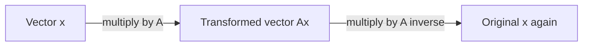

Two operations turn up in almost every formula you will read in machine learning. The **transpose** flips a matrix so its rows become columns. It is mostly bookkeeping, a way to make shapes line up, but it appears so often (in $\mathbf{w}^\top \mathbf{x}$, in $XW^\top$, in attention's $QK^\top$) that you must be fluent with it. The **inverse** undoes a matrix's transformation, the matrix equivalent of dividing. It is how you solve a system of linear equations, and it gives the textbook closed-form solution for linear regression. It also comes with a practical warning, which this lesson ends on: in code you almost never compute an inverse directly.

## The transpose

The transpose of $A$, written $A^\top$, swaps rows and columns. Row $i$ of $A$ becomes column $i$ of $A^\top$:

$$
A = \begin{bmatrix} 1 & 2 & 3 \\ 4 & 5 & 6 \end{bmatrix}
\qquad
A^\top = \begin{bmatrix} 1 & 4 \\ 2 & 5 \\ 3 & 6 \end{bmatrix}
\qquad
(A^\top)_{ij} = A_{ji}
$$

An $m \times n$ matrix becomes $n \times m$. Picture it as flipping the matrix over its main diagonal, the line of entries running from top-left to bottom-right. Entries on that diagonal stay put.

In plain Python, `zip(*A)` regroups the rows column by column, which is exactly a transpose:

```python
A = [[1, 2, 3],
     [4, 5, 6]]

At = [list(col) for col in zip(*A)]
print(At)
```

```output
[[1, 4], [2, 5], [3, 6]]
```

In NumPy, the library we will study properly in Phase 3, it is the `.T` attribute:

```python
import numpy as np

A = np.array([[1, 2, 3], [4, 5, 6]])
print(A.T)
print(A.shape, A.T.shape)
```

```output
[[1 4]
 [2 5]
 [3 6]]
(2, 3) (3, 2)
```

### Rules worth memorising

| Rule | Meaning |
| --- | --- |
| $(A^\top)^\top = A$ | Flipping twice gets you back |
| $(A + B)^\top = A^\top + B^\top$ | Transpose distributes over addition |
| $(cA)^\top = cA^\top$ | Scalars pass straight through |
| $(AB)^\top = B^\top A^\top$ | The order **reverses** |

The last rule trips people up. It has to reverse, because of shapes: if $A$ is $2 \times 3$ and $B$ is $3 \times 4$, then $AB$ is $2 \times 4$ and its transpose is $4 \times 2$. The only way to make a $4 \times 2$ from $B^\top$ ($4 \times 3$) and $A^\top$ ($3 \times 2$) is $B^\top A^\top$.

### Where the transpose appears

**Turning a column into a row.** Vectors are columns by default, so $\mathbf{x}^\top$ is a row. That lets you write the [dot product](/learn/linear-algebra/dot-product) as a matrix product: $\mathbf{w}^\top \mathbf{x}$ is $(1 \times n)(n \times 1) = 1 \times 1$, a single number. When you see $\hat{y} = \mathbf{w}^\top \mathbf{x} + b$ in a paper, it means "weighted sum of the inputs, plus a bias".

**Making shapes fit.** A batch $X$ of shape (batch, inputs) times weights stored as (outputs, inputs) needs $XW^\top$. Attention compares every query with every key using $QK^\top$: both $Q$ and $K$ have one row per token, and the transpose lines them up so that entry $(i, j)$ compares token $i$ with token $j$.

**Symmetric matrices.** A matrix with $A^\top = A$ is **symmetric**: entry $(i, j)$ equals entry $(j, i)$. Distance tables, similarity matrices and covariance matrices are symmetric, and for any matrix $X$, the product $X^\top X$ is always symmetric. Symmetric matrices have especially well-behaved [eigenvectors](/learn/linear-algebra/eigenvalues-and-eigenvectors), which is what makes PCA work.

## The inverse

For ordinary numbers, the inverse of 4 is $\frac{1}{4}$ because $4 \times \frac{1}{4} = 1$. The matrix version replaces 1 with the [identity matrix](/learn/linear-algebra/identity-matrix) $I$, the matrix that leaves every vector unchanged. The inverse of a **square** matrix $A$ is the matrix $A^{-1}$ with

$$
A^{-1}A = AA^{-1} = I
$$

Geometrically, if $A$ transforms space (rotating, stretching, shearing), then $A^{-1}$ is the transformation that puts every point back where it started.



### The 2 by 2 formula

For a $2 \times 2$ matrix there is a short formula:

$$
A = \begin{bmatrix} a & b \\ c & d \end{bmatrix}
\qquad
A^{-1} = \frac{1}{ad - bc} \begin{bmatrix} d & -b \\ -c & a \end{bmatrix}
$$

Swap the diagonal entries, negate the off-diagonal ones, and divide by $ad - bc$. That number is the **determinant**, $\det(A)$. Worked example:

$$
A = \begin{bmatrix} 4 & 7 \\ 2 & 6 \end{bmatrix},
\quad \det(A) = 4 \cdot 6 - 7 \cdot 2 = 10,
\quad A^{-1} = \frac{1}{10}\begin{bmatrix} 6 & -7 \\ -2 & 4 \end{bmatrix} = \begin{bmatrix} 0.6 & -0.7 \\ -0.2 & 0.4 \end{bmatrix}
$$

```python
import numpy as np

A = np.array([[4, 7], [2, 6]])
A_inv = np.linalg.inv(A)
print(A_inv)
print(A_inv @ A)
```

```output
[[ 0.6 -0.7]
 [-0.2  0.4]]
[[1.00000000e+00 6.66133815e-16]
 [0.00000000e+00 1.00000000e+00]]
```

The second result should be the identity, and it is, up to floating-point rounding: `6.66e-16` is 0.000000000000000666. Computers store most decimals approximately, so always compare floating-point results with a tolerance (`np.allclose`) rather than with `==`.

### When there is no inverse

The determinant has a geometric meaning: it is the factor by which $A$ scales areas (volumes in higher dimensions). If $\det(A) = 0$, the transformation squashes the plane onto a line or a point. Many different inputs land on the same output, so there is no way to tell which one you started from, and no inverse exists. Such a matrix is called **singular**.

$$
\begin{bmatrix} 1 & 2 \\ 2 & 4 \end{bmatrix}: \quad \det = 1 \cdot 4 - 2 \cdot 2 = 0
$$

The second row is twice the first, so the two columns point along the same line and the whole plane is flattened onto it.

```python
import numpy as np

S = np.array([[1, 2], [2, 4]])
np.linalg.inv(S)
```

```output
numpy.linalg.LinAlgError: Singular matrix
```

Non-square matrices never have an inverse in this sense: a $3 \times 2$ matrix maps 2-dimensional space into 3-dimensional space, and there is no square "undo" with the right shape on both sides.

| Matrix | Invertible? | Why |
| --- | --- | --- |
| Square, $\det \neq 0$ | Yes | Space is transformed without being flattened |
| Square, $\det = 0$ | No | Some direction is squashed to zero |
| Not square | No | Shapes cannot match on both sides |

## Solving linear equations

The main reason to care about inverses is solving systems of equations. The system

$$
4x + 7y = 1, \qquad 2x + 6y = -2
$$

is the matrix equation $A\mathbf{v} = \mathbf{b}$ with $A$ as above, $\mathbf{v} = (x, y)$ and $\mathbf{b} = (1, -2)$. Multiply both sides on the left by $A^{-1}$:

$$
\mathbf{v} = A^{-1}\mathbf{b} = \begin{bmatrix} 0.6 & -0.7 \\ -0.2 & 0.4 \end{bmatrix}\begin{bmatrix} 1 \\ -2 \end{bmatrix} = \begin{bmatrix} 2 \\ -1 \end{bmatrix}
$$

In code, use `np.linalg.solve`, which finds $\mathbf{v}$ directly without ever forming $A^{-1}$:

```python
import numpy as np

A = np.array([[4, 7], [2, 6]])
b = np.array([1, -2])
print(np.linalg.solve(A, b))
```

```output
[ 2. -1.]
```

> [!WARNING]
> The formula $A^{-1}\mathbf{b}$ is for reasoning on paper. In code, prefer `np.linalg.solve(A, b)`, or `np.linalg.lstsq` when $A$ is not square. Computing the inverse explicitly is slower and amplifies rounding errors, sometimes badly, when the matrix is close to singular.

## Linear regression in closed form

[Linear regression](/learn/supervised-learning-algorithms/linear-regression) fits weights $\mathbf{w}$ so that $X\mathbf{w}$ is as close as possible to the targets $\mathbf{y}$. The best weights satisfy the **normal equation**, which uses both operations from this lesson:

$$
\mathbf{w} = (X^\top X)^{-1} X^\top \mathbf{y}
$$

Here $X$ is the data matrix (one row per example, with a column of 1s so the model can learn an intercept) and $\mathbf{y}$ is the vector of targets. $X^\top X$ is square and symmetric, so it can be inverted as long as no feature is an exact combination of the others.

Take four points that lie exactly on $y = 1 + 2x$:

```python
import numpy as np

x = np.array([1.0, 2.0, 3.0, 4.0])
y = np.array([3.0, 5.0, 7.0, 9.0])
X = np.column_stack([np.ones(4), x])    # first column of 1s for the intercept

w = np.linalg.solve(X.T @ X, X.T @ y)   # the normal equation, solved safely
print(w)
```

```output
[1. 2.]
```

The model recovers the intercept 1 and slope 2. For large or badly conditioned problems, libraries such as scikit-learn use more stable methods than the normal equation, and neural networks use gradient descent instead because no closed form exists for them. But the normal equation is the clearest picture of what "fitting a linear model" means.

> [!KEY]
> Transpose rearranges, inverse undoes. $(AB)^\top = B^\top A^\top$ and, for invertible matrices, $(AB)^{-1} = B^{-1}A^{-1}$: both reverse the order, like taking off socks and shoes in the opposite order you put them on.

## Exercises

**1.** If $A$ is $3 \times 5$ and $B$ is $5 \times 2$, what are the shapes of $AB$, $(AB)^\top$, $B^\top A^\top$ and $A^\top B^\top$?

<details>
<summary>Show solution</summary>

$AB$ is $3 \times 2$, so $(AB)^\top$ is $2 \times 3$. $B^\top A^\top$ is $(2 \times 5)(5 \times 3) = 2 \times 3$, matching as the rule promises. $A^\top B^\top$ is $(5 \times 3)(2 \times 5)$, which is undefined because the inner dimensions 3 and 2 differ.

</details>

**2.** Use the $2 \times 2$ formula to invert $\begin{bmatrix} 2 & 1 \\ 5 & 3 \end{bmatrix}$ in plain Python, then check that multiplying gives the identity.

<details>
<summary>Show solution</summary>

$\det = 2 \cdot 3 - 1 \cdot 5 = 1$, so the inverse is $\begin{bmatrix} 3 & -1 \\ -5 & 2 \end{bmatrix}$.

```python
def inv2(m):
    (a, b), (c, d) = m
    det = a * d - b * c
    if det == 0:
        raise ValueError("matrix is singular")
    return [[d / det, -b / det], [-c / det, a / det]]

A = [[2, 1], [5, 3]]
Ai = inv2(A)
print(Ai)   # [[3.0, -1.0], [-5.0, 2.0]]
print([[sum(Ai[i][k] * A[k][j] for k in range(2)) for j in range(2)] for i in range(2)])
# [[1.0, 0.0], [0.0, 1.0]]
```

</details>

**3.** A dataset has two features, temperature in Celsius and the same temperature in Fahrenheit. Why might the normal equation fail on it?

<details>
<summary>Show solution</summary>

Fahrenheit is $1.8 \times$ Celsius $+ 32$, an exact linear combination of the Celsius column and the column of 1s. The columns of $X$ are dependent, so $X^\top X$ is singular (determinant zero) and has no inverse. In practice, rounding may make it *nearly* singular instead, giving huge, meaningless weights. The fix is to drop one of the duplicate features or add regularisation, as the [identity matrix](/learn/linear-algebra/identity-matrix) lesson shows.

</details>

```quiz
[
  {
    "q": "What is `(AB)` transposed equal to?",
    "options": ["`A^T B^T`", "`B^T A^T`", "`AB`", "`BA`"],
    "answer": 1,
    "why": "The transpose of a product reverses the order. Shapes force this: it is the only arrangement that is defined in general."
  },
  {
    "q": "A square matrix has determinant 0. Which statement is true?",
    "options": ["It has no inverse because it flattens space onto a lower dimension", "Its inverse is the zero matrix", "It is the identity matrix", "Its transpose has no inverse but it does"],
    "answer": 0,
    "why": "A zero determinant means areas are scaled to zero: some direction collapses, so the transformation cannot be undone."
  },
  {
    "q": "To solve `A v = b` in NumPy, which is preferred?",
    "options": ["`np.linalg.inv(A) @ b`", "`b / A`", "`A.T @ b`", "`np.linalg.solve(A, b)`"],
    "answer": 3,
    "why": "`solve` finds v directly, which is faster and more numerically stable than forming the inverse."
  },
  {
    "q": "If `X` has shape (100, 4), what is the shape of `X.T @ X`?",
    "options": ["(100, 100)", "(4, 100)", "(4, 4)", "(100, 4)"],
    "answer": 2,
    "why": "`X.T` is 4 by 100, times 100 by 4, gives 4 by 4. It is square and symmetric, one row and column per feature."
  }
]
```
