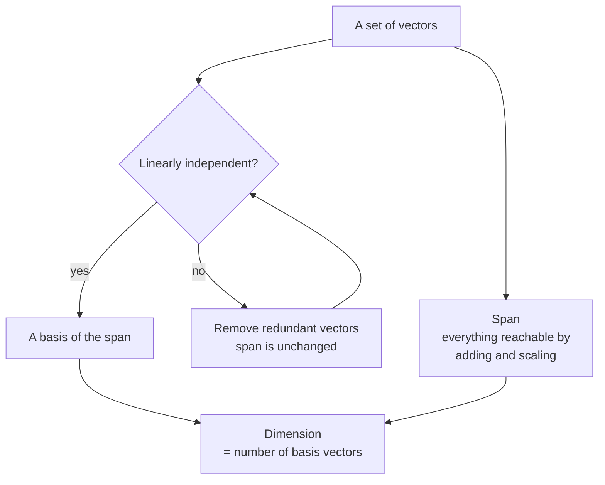

So far you have treated vectors one or two at a time. A **vector space** steps back and looks at the whole collection: every vector you can reach by adding and scaling. This is where the vocabulary of "dimensions", "directions" and "spaces" that AI people use so freely comes from. When someone says an embedding model maps text into a 768-dimensional space, that a dataset has redundant features, or that a fine-tuning method learns a "low-rank update", they are using the ideas in this lesson: span, linear independence, basis, dimension and rank.

## What makes a vector space

A **vector space** is a set of vectors in which you can add any two and scale any one by any number, and always stay inside the set. Formally, a set $V$ is a vector space if for all $\mathbf{u}, \mathbf{v}$ in $V$ and every scalar $c$:

- $\mathbf{u} + \mathbf{v}$ is in $V$ (closed under addition),
- $c\mathbf{v}$ is in $V$ (closed under scalar multiplication),

and the usual arithmetic rules hold (addition is commutative and associative, there is a zero vector, and so on). Closure under scaling by $c = 0$ means every vector space contains the zero vector.

The space you will work in almost all the time is $\mathbb{R}^n$, the set of all lists of $n$ real numbers. Add two 3-vectors and you get a 3-vector; scale one and you get a 3-vector. $\mathbb{R}^3$ is closed under both, so it is a vector space.

Some sets that look similar are **not** vector spaces, and the reason is always a failure of closure:

| Set | Vector space? | Why |
| --- | --- | --- |
| All of $\mathbb{R}^2$ | Yes | Closed under both operations |
| The line $y = 2x$ in $\mathbb{R}^2$ | Yes | Sums and multiples of points on it stay on it |
| The line $y = 2x + 1$ | No | Does not contain $(0, 0)$ |
| Vectors with all entries positive | No | Scaling by $-1$ leaves the set |
| Probability vectors (non-negative, summing to 1) | No | Adding two gives entries summing to 2 |

The last row matters in practice: the outputs of a softmax layer live in a constrained region, not a vector space, so you cannot freely add or scale them and expect another valid probability vector.

## Span: what you can reach

Given some vectors, their **span** is the set of all their [linear combinations](/learn/linear-algebra/matrix-operations):

$$
\operatorname{span}(\mathbf{v}_1, \dots, \mathbf{v}_k) = \{\, c_1\mathbf{v}_1 + c_2\mathbf{v}_2 + \dots + c_k\mathbf{v}_k \;:\; c_1, \dots, c_k \in \mathbb{R} \,\}
$$

Think of each vector as a direction you are allowed to travel, any distance forwards or backwards. The span is everywhere you can get to.

- One non-zero vector in $\mathbb{R}^2$ spans a **line** through the origin.
- Two vectors in $\mathbb{R}^2$ pointing in different directions span the **whole plane**.
- Two vectors on the same line, such as $(1, 2)$ and $(2, 4)$, still span only that line. The second adds nothing new.
- Two non-parallel vectors in $\mathbb{R}^3$ span a **plane** through the origin, not the whole space.

A span is always a vector space itself: a **subspace** of the larger space. Lines and planes through the origin are the typical subspaces of $\mathbb{R}^3$.

## Linear independence

Vectors are **linearly independent** if none of them is a linear combination of the others: each adds a genuinely new direction. Otherwise they are **linearly dependent**, and at least one is redundant.

$$
\mathbf{a} = \begin{bmatrix} 1 \\ 0 \\ 1 \end{bmatrix},\quad
\mathbf{b} = \begin{bmatrix} 0 \\ 1 \\ 1 \end{bmatrix},\quad
\mathbf{c} = \begin{bmatrix} 1 \\ 1 \\ 2 \end{bmatrix}
\qquad
\mathbf{c} = \mathbf{a} + \mathbf{b}
$$

These three are dependent: $\mathbf{c}$ is reachable from $\mathbf{a}$ and $\mathbf{b}$, so together they span only a plane, not all of $\mathbb{R}^3$.

For two vectors in $\mathbb{R}^2$ there is a quick test: they are independent exactly when the matrix with them as columns has a non-zero [determinant](/learn/linear-algebra/transpose-and-inverse), meaning it does not flatten the plane.

```python
def independent_2d(u, v):
    det = u[0] * v[1] - u[1] * v[0]
    return det != 0

print(independent_2d([1, 2], [3, 1]))
print(independent_2d([1, 2], [2, 4]))
```

```output
True
False
```

(With floating-point data, compare against a small tolerance rather than exactly zero.)

## Basis, coordinates and dimension

A **basis** of a space is a set of vectors that is both independent (no redundancy) and spanning (reaches everything). Every vector in the space can then be written as a combination of basis vectors in **exactly one** way. The weights in that combination are the vector's **coordinates** in that basis.

The **standard basis** of $\mathbb{R}^n$ is the columns of the [identity matrix](/learn/linear-algebra/identity-matrix): $\mathbf{e}_1 = (1, 0, \dots)$, $\mathbf{e}_2 = (0, 1, \dots)$, and so on. In that basis, coordinates are just the entries you already write down. But other bases are equally valid. With $\mathbf{b}_1 = (1, 1)$ and $\mathbf{b}_2 = (1, -1)$:

$$
\begin{bmatrix} 5 \\ 1 \end{bmatrix} = 3\begin{bmatrix} 1 \\ 1 \end{bmatrix} + 2\begin{bmatrix} 1 \\ -1 \end{bmatrix}
$$

so the point $(5, 1)$ has coordinates $(3, 2)$ in the new basis. Finding them is solving a linear system:

```python
import numpy as np

B = np.array([[1, 1], [1, -1]])   # basis vectors as columns
print(np.linalg.solve(B, np.array([5, 1])))
```

```output
[3. 2.]
```

Changing basis does not move any points; it changes the description. **PCA** is exactly a change of basis: it switches to the basis of [eigenvectors](/learn/linear-algebra/eigenvalues-and-eigenvectors) of the covariance matrix, in which the first few coordinates carry most of the information.

Every basis of a given space has the same number of vectors. That number is the space's **dimension**. $\mathbb{R}^n$ has dimension $n$; a plane through the origin has dimension 2, whatever space it sits in.



## Rank of a matrix

The columns of a matrix $A$ span a subspace called its **column space**. Because $A\mathbf{x}$ is a combination of the columns, the column space is the set of every possible output of the transformation. The **rank** of $A$ is the dimension of that space: the number of linearly independent columns (which always equals the number of independent rows).

```python
import numpy as np

dependent = np.array([[1, 0, 1],
                      [0, 1, 1],
                      [1, 1, 2]])     # third column = first + second
independent = np.array([[1, 0, 1],
                        [0, 1, 1],
                        [1, 1, 0]])

print(np.linalg.matrix_rank(dependent))
print(np.linalg.matrix_rank(independent))
```

```output
2
3
```

NumPy, the library we will study properly in Phase 3, computes rank with a tolerance, so it handles floating-point noise sensibly.

| Situation | What it means |
| --- | --- |
| Square $n \times n$ matrix with rank $n$ (**full rank**) | Invertible; no direction is flattened |
| Square matrix with rank below $n$ | Singular; outputs fill only a lower-dimensional subspace |
| Data matrix with rank below its number of columns | Some features are exact combinations of others |

The last row is the redundant-feature problem from the [transpose and inverse](/learn/linear-algebra/transpose-and-inverse) exercises: a dataset with temperature in both Celsius and Fahrenheit has a rank-deficient data matrix, which is why the normal equation fails on it.

## Vector spaces in AI

**Embedding spaces.** An embedding model maps every input into $\mathbb{R}^d$ for some fixed $d$. "Similar meaning, similar direction" is a statement about geometry in that space, and operations like averaging embeddings rely on it being closed under addition and scaling. Whether a particular combination is *meaningful* is a separate, empirical question.

**Low rank and efficient fine-tuning.** A matrix of rank $r$ can be written as the product of an $m \times r$ matrix and an $r \times n$ matrix. When $r$ is small, that product needs far fewer numbers than the full $m \times n$ matrix:

```python
import numpy as np

rng = np.random.default_rng(0)
B = rng.normal(size=(6, 2))
A = rng.normal(size=(2, 5))
delta = B @ A

print(delta.shape, np.linalg.matrix_rank(delta))
```

```output
(6, 5) 2
```

A $6 \times 5$ matrix built from two thin factors has rank at most 2. **LoRA** (low-rank adaptation), a widely used method for fine-tuning large language models, freezes the original weights and learns only such a low-rank update $\Delta W = BA$ for selected weight matrices. For a $4096 \times 4096$ matrix (about 16.8 million entries), a rank-8 update needs $2 \times 4096 \times 8 = 65{,}536$ trainable numbers, 256 times fewer. The bet is that the change needed to adapt a model to a new task lives in a low-dimensional subspace.

> [!KEY]
> Span is what you can reach, independence means no redundancy, a basis is a minimal set that reaches everything, and dimension counts it. Rank is the dimension of what a matrix can output.

> [!NOTE]
> Deep learning also uses "dimension" loosely for the length of an axis ("the hidden dimension is 768") and "rank" for the number of axes of a tensor. Neither is the same as the linear algebra meanings here, though the first is related: a 768-long vector lives in a 768-dimensional space.

## Exercises

**1.** Which of these are vector spaces? (a) All vectors $(x, y, z)$ with $z = 0$. (b) All vectors $(x, y)$ with $x \geq 0$. (c) All vectors $(x, y)$ with $x + y = 1$.

<details>
<summary>Show solution</summary>

(a) Yes: it is the $xy$-plane in $\mathbb{R}^3$, closed under addition and scaling, and contains the origin. (b) No: scaling $(1, 0)$ by $-1$ gives $(-1, 0)$, outside the set. (c) No: it does not contain $(0, 0)$, and adding two members gives entries summing to 2.

</details>

**2.** Are $(1, 2, 3)$, $(2, 4, 6)$ and $(0, 1, 0)$ linearly independent? What is the dimension of their span? Confirm with `np.linalg.matrix_rank`.

<details>
<summary>Show solution</summary>

No: $(2, 4, 6) = 2 \times (1, 2, 3)$. Removing it leaves two independent vectors, so the span is a plane, dimension 2.

```python
import numpy as np
M = np.array([[1, 2, 3], [2, 4, 6], [0, 1, 0]])
print(np.linalg.matrix_rank(M))   # 2
```

Rows or columns give the same rank, so stacking the vectors as rows is fine.

</details>

**3.** A weight matrix is $1024 \times 512$. How many numbers does a rank-16 update $BA$ need, with $B$ of shape $1024 \times 16$ and $A$ of shape $16 \times 512$, compared with a full update?

<details>
<summary>Show solution</summary>

$1024 \times 16 + 16 \times 512 = 16{,}384 + 8{,}192 = 24{,}576$, against $1024 \times 512 = 524{,}288$ for a full update: about 21 times fewer.

</details>

```quiz
[
  {
    "q": "Why is the line `y = 3x + 2` not a vector space?",
    "options": ["It has only one dimension", "It is not closed under addition and does not contain the origin", "Lines are never vector spaces", "It contains negative numbers"],
    "answer": 1,
    "why": "Every vector space contains the zero vector. A line through the origin is a vector space; this one is shifted away from it."
  },
  {
    "q": "Vectors `(1, 2)` and `(-2, -4)` in R^2 span:",
    "options": ["The whole plane", "Only the origin", "A line through the origin", "Two separate lines"],
    "answer": 2,
    "why": "The second is -2 times the first, so they are dependent and only reach the line through (1, 2)."
  },
  {
    "q": "What is the rank of a matrix?",
    "options": ["The number of independent columns, the dimension of its column space", "The number of rows", "Its largest entry", "The number of axes of the array"],
    "answer": 0,
    "why": "Rank is the dimension of the space of possible outputs. The number of axes is a different, deep-learning use of the word."
  },
  {
    "q": "What does LoRA exploit?",
    "options": ["That weight matrices are always symmetric", "That every matrix is invertible", "That embeddings have length 1", "That a useful weight update can be expressed as a low-rank product of two thin matrices"],
    "answer": 3,
    "why": "A rank-r update BA needs only (m + n) times r numbers instead of m times n, making fine-tuning far cheaper."
  }
]
```
