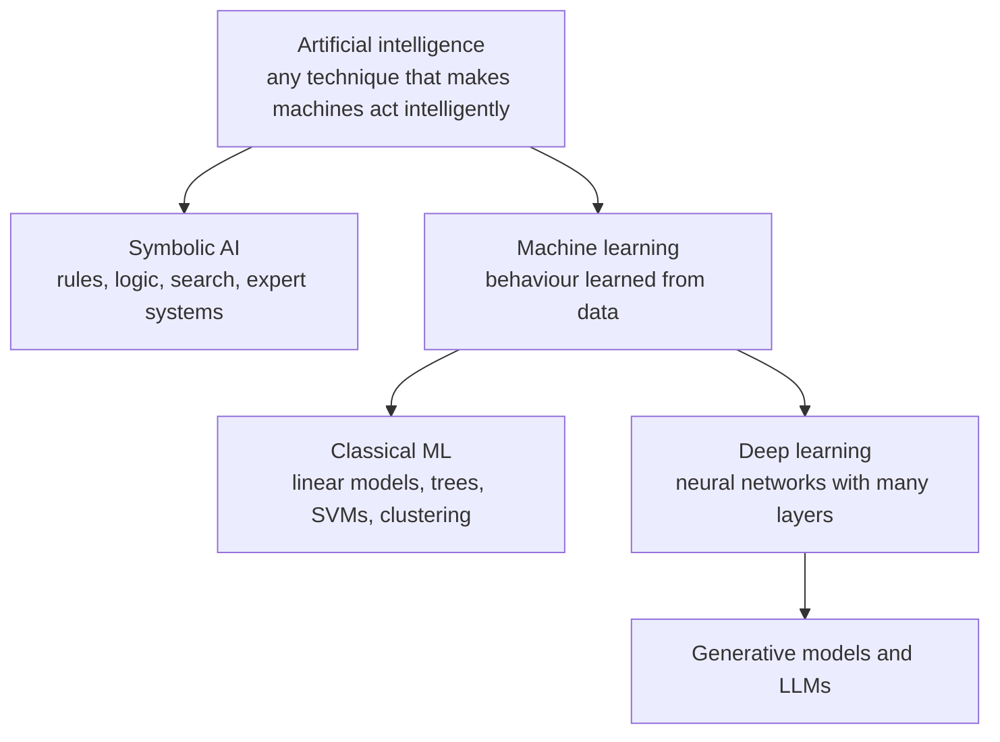
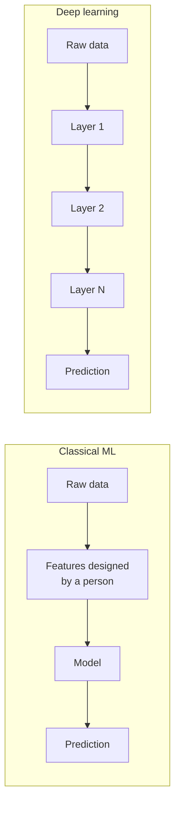

"AI", "machine learning" and "deep learning" are often used as if they meant the same thing. They do not. They are nested fields, each a subset of the one before, and knowing the boundaries helps you pick the right tool, read papers and job descriptions accurately, and explain to colleagues why a large language model is not the answer to every problem.

## Three nested circles



| Field | Core idea | Where the knowledge comes from |
| --- | --- | --- |
| Artificial intelligence | Machines performing tasks that seem to need intelligence | Anywhere: hand-written rules, search, or learning |
| Machine learning | Improve at a task from experience | Data, through an optimisation procedure |
| Deep learning | Learn layered representations with neural networks | Large amounts of data and compute |

Every deep learning system is a machine learning system, and every machine learning system is an AI system. The reverse is not true.

## Artificial intelligence without learning

The early decades of AI research were dominated by **symbolic AI**: representing knowledge as explicit symbols and rules, then reasoning over them. Chess programs searched game trees. **Expert systems** encoded the knowledge of specialists as hundreds or thousands of if-then rules. Route planners still use search algorithms such as A-star, and nobody calls that machine learning.

A rule-based spam filter is a tiny symbolic AI system:

```python
def rule_based_spam(text):
    text = text.lower()
    return any(word in text for word in ["free money", "winner", "click here"])

messages = ["You are a WINNER, claim now", "Lunch at 1?", "Fr3e m0ney inside", "Click here for the agenda"]
for m in messages:
    print(f"{rule_based_spam(m)!s:5}  {m}")
```

```output
True   You are a WINNER, claim now
False  Lunch at 1?
False  Fr3e m0ney inside
True   Click here for the agenda
```

Two of the four answers are wrong. The obfuscated spam slips through, and an innocent meeting reminder is flagged. You could add more rules, but every rule creates new edge cases, and spammers adapt faster than you can write them. This brittleness is what pushed the field toward learning from data.

Symbolic methods are not obsolete. They are transparent, need no training data, and are exact where the domain is exact. Many production AI systems combine them with learned models: an LLM agent that calls a calculator, or a fraud model followed by hard business rules.

## Machine learning: rules from data

Machine learning replaces hand-written rules with parameters fitted to examples, as the [previous lesson](/learn/machine-learning-fundamentals/what-is-machine-learning) showed. In **classical machine learning** (linear and logistic regression, decision trees, random forests, gradient boosting, support vector machines, k-means), a person usually decides what the inputs are. For a spam filter, you might compute word counts, the number of links, whether the sender is in the address book, and the proportion of capital letters. Designing these inputs is called **feature engineering**, and it has its own [lesson](/learn/machine-learning-fundamentals/feature-engineering) later in this module.

Classical ML is the right default for **tabular data**: rows and columns, as in a spreadsheet or SQL table. On that kind of data, tree-based models such as gradient boosting are very hard to beat, train in seconds on a laptop, and are easier to inspect than neural networks.

## Deep learning: learning the features too

**Deep learning** uses neural networks with many layers. Each layer transforms its input into a new representation, and the network learns those transformations itself. Given raw pixels, the early layers of an image model learn to detect edges, middle layers combine edges into textures and parts, and later layers combine parts into objects. Nobody programs "edge detector": it emerges from training.



This **representation learning** is why deep learning took over fields with unstructured data: images, audio, and text. Feature engineering for raw pixels or raw waveforms is extremely hard for people and comparatively natural for a deep network given enough examples. The approach broke through in image recognition in 2012, when a deep convolutional network won the ImageNet competition by a wide margin, and it has since spread to speech, translation and generative models. Modules 17 to 20 cover neural networks, PyTorch and computer vision in depth.

## Comparing them on real data

On small, clean data, deep learning gives no automatic advantage. Here a linear model and a small neural network classify 8 x 8 images of handwritten digits. scikit-learn, the library covered fully in Module 16, includes a basic multilayer perceptron (a simple neural network) that is fine for a demonstration.

```python
from sklearn.datasets import load_digits
from sklearn.model_selection import train_test_split
from sklearn.linear_model import LogisticRegression
from sklearn.neural_network import MLPClassifier

X, y = load_digits(return_X_y=True)          # 1,797 images, 8x8 pixels each
print(X.shape)
X = X / 16.0                                  # pixel values 0-16 -> 0-1
X_train, X_test, y_train, y_test = train_test_split(X, y, test_size=0.3, random_state=0, stratify=y)

linear = LogisticRegression(max_iter=2000).fit(X_train, y_train)
mlp = MLPClassifier(hidden_layer_sizes=(64, 64), max_iter=1000, random_state=0).fit(X_train, y_train)

print(f"logistic regression: {linear.score(X_test, y_test):.3f}")
print(f"neural network (2 hidden layers): {mlp.score(X_test, y_test):.3f}")
```

```output
(1797, 64)
logistic regression: 0.970
neural network (2 hidden layers): 0.970
```

Identical accuracy. These images are tiny, centred and clean, so a linear model on raw pixels is already good. Deep learning's advantage appears with large, high-resolution, messy inputs, such as photographs where the object can be anywhere, at any size, under any lighting, and with enough data to fit millions of parameters.

> [!KEY]
> Start with the simplest model that could work. A strong classical baseline tells you how much a more complex model actually adds, and often it adds less than you expect.

## Where generative AI and LLMs fit

**Generative AI** refers to models that produce new content (text, images, audio, code) rather than a label or a number. Today's large language models are deep neural networks (Transformers), trained first with **self-supervised** learning on huge amounts of text, where the label for each position is simply the next token. They are then refined with supervised fine-tuning and reinforcement learning from human feedback, both covered later in this module and in Module 43.

So an LLM sits in the innermost circle: it is AI, it is machine learning, and it is deep learning. It still obeys everything in this module. It has training, validation and test data; it can overfit; its behaviour depends on the data it learned from.

## Choosing between them

| Consideration | Rules / symbolic | Classical ML | Deep learning |
| --- | --- | --- | --- |
| Data needed | None | Hundreds to millions of rows | Usually large datasets, or a pretrained model |
| Best input type | Well-defined domains | Tabular, engineered features | Images, audio, text, video |
| Compute | Minimal | CPU, seconds to minutes | Often GPUs, minutes to weeks |
| Interpretability | Fully transparent | Moderate to high | Low without special tools |
| Effort goes into | Writing rules | Features and tuning | Data, architecture and training |
| Typical example | Tax calculation | Credit scoring | Speech recognition |

> [!TIP]
> Pretrained models change the "data needed" row. With [transfer learning](/learn/pytorch/transfer-learning) or an LLM API, you can apply deep learning to a problem with very little data of your own, because most of the learning was done by someone else.

## Exercises

**1.** Place each system in the most specific category (symbolic AI, classical ML, or deep learning): (a) a sat-nav route planner using A-star search; (b) a gradient-boosted model predicting house prices from 30 columns; (c) a model that transcribes speech to text; (d) a chatbot built on an LLM.

<details>
<summary>Show solution</summary>

(a) Symbolic AI: search over a graph, nothing is learned. (b) Classical ML on tabular data. (c) Deep learning: raw audio is unstructured, and modern speech recognisers are deep networks. (d) Deep learning, specifically a generative Transformer model.

</details>

**2.** Give two concrete ways the rule-based spam filter above could be fooled, and explain why a learned model is more robust to them.

<details>
<summary>Show solution</summary>

Misspelling trigger phrases ("fr3e m0ney") and avoiding them altogether ("you have been selected for a cash reward") both defeat it. A learned model weights many signals together (vocabulary, links, sender history, formatting), learns new patterns when retrained on fresh labelled spam, and does not depend on any single exact phrase.

</details>

**3.** Rerun the digits comparison with `hidden_layer_sizes=(8,)`. What happens to the neural network's accuracy, and what does that tell you?

<details>
<summary>Show solution</summary>

Accuracy drops to 0.957, now below the logistic regression, because one hidden layer of 8 units squeezes 64 pixels through a narrow bottleneck. Depth and width are design choices: a neural network is not automatically better, and a badly sized one can be worse than a linear model.

</details>

```quiz
[
  {
    "q": "Which statement about the relationship between the fields is correct?",
    "options": [
      "All AI is machine learning",
      "Deep learning is a subset of machine learning, which is a subset of AI",
      "Machine learning is a subset of deep learning",
      "Deep learning and machine learning are unrelated"
    ],
    "answer": 1,
    "why": "The fields are nested: AI contains ML, and ML contains deep learning."
  },
  {
    "q": "What is the main thing deep learning learns that classical ML usually does not?",
    "options": [
      "The labels",
      "The loss function",
      "Useful representations (features) of raw input",
      "The test set"
    ],
    "answer": 2,
    "why": "Deep networks learn their own layered features from raw data, which is why they excel on images, audio and text."
  },
  {
    "q": "You must predict loan default from a table of 40 numeric and categorical columns. What is a sensible first model?",
    "options": [
      "A gradient-boosted tree model",
      "A large convolutional neural network",
      "A hand-written expert system with thousands of rules",
      "A text-generating LLM"
    ],
    "answer": 0,
    "why": "On tabular data, tree ensembles are strong, fast and easy to inspect, so they make an excellent baseline."
  },
  {
    "q": "How is a large language model primarily pretrained?",
    "options": [
      "Unsupervised clustering of documents",
      "Hand-written grammar rules",
      "Reinforcement learning from scratch",
      "Self-supervised next-token prediction on large amounts of text"
    ],
    "answer": 3,
    "why": "Each position's label is the next token in the text itself, so no human labelling is needed for pretraining."
  }
]
```
