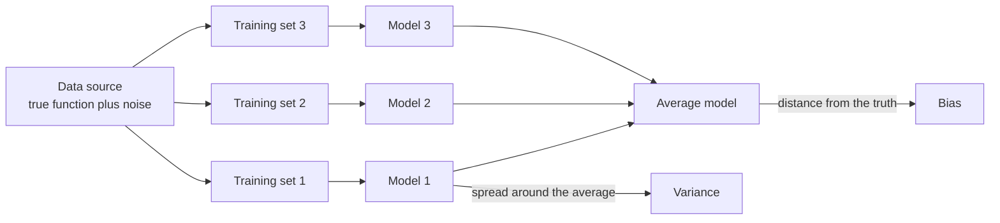
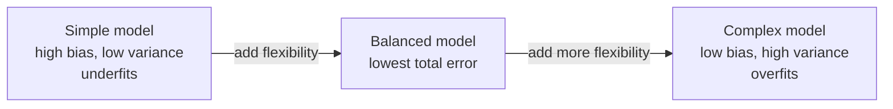

The [previous lesson](/learn/machine-learning-fundamentals/underfitting-and-overfitting) showed underfitting and overfitting as patterns in training and validation error. The bias-variance tradeoff explains *why* those patterns appear. It splits a model's expected error into three parts: error from wrong assumptions (bias), error from sensitivity to the particular training sample (variance), and error nobody can remove (noise). Once you think in these terms, choices such as regularisation strength, ensemble size or how much data to collect become reasoned decisions rather than guesses.

## The intuition: many training sets

Imagine you could draw many different training sets from the same source, train the same kind of model on each, and look at all the resulting models together.

- If the models are all similar but systematically miss the truth, the model has high **bias**. A straight line fitted to a curve misses in the same way no matter which sample you use.
- If the models are right on average but each one is wildly different, the model has high **variance**. A degree-11 polynomial fitted to 15 points changes shape completely when you change a few points.



The classic picture is a dartboard: bias is how far the centre of your cluster of darts is from the bullseye, and variance is how widely the darts scatter.

| | Low variance | High variance |
| --- | --- | --- |
| **Low bias** | The goal: consistent and accurate | Accurate on average, but unreliable for any single training set |
| **High bias** | Consistently wrong in the same way | Wrong and unpredictable |

## The decomposition

Assume the data comes from $y = f(x) + \varepsilon$, where $f$ is the true function and $\varepsilon$ is noise with mean 0 and variance $\sigma^2$. Train a model on a random training set $\mathcal{D}$, giving a prediction $\hat{f}_{\mathcal{D}}(x)$. Because $\mathcal{D}$ is random, so is the prediction. Write $\bar{f}(x) = \mathbb{E}_{\mathcal{D}}[\hat{f}_{\mathcal{D}}(x)]$ for the average prediction over all possible training sets.

Then the expected squared error at a point $x$, averaged over training sets and noise, splits exactly into three terms:

$$
\mathbb{E}\big[(y - \hat{f}_{\mathcal{D}}(x))^2\big] = \underbrace{\big(\bar{f}(x) - f(x)\big)^2}_{\text{bias}^2} + \underbrace{\mathbb{E}_{\mathcal{D}}\big[(\hat{f}_{\mathcal{D}}(x) - \bar{f}(x))^2\big]}_{\text{variance}} + \underbrace{\sigma^2}_{\text{noise}}
$$

- **Bias squared** is the squared gap between the average model and the truth: systematic error from the model's assumptions.
- **Variance** is how much an individual model fluctuates around the average model: error from depending on the particular sample. This is the [variance](/learn/probability-and-statistics/variance-and-standard-deviation) from statistics, applied to predictions.
- **Noise** $\sigma^2$, often called **irreducible error**, comes from randomness in $y$ itself. No model can predict it.

### Where the formula comes from

Write $y - \hat{f} = (f - \bar{f}) + (\bar{f} - \hat{f}) + \varepsilon$, dropping the $x$ and $\mathcal{D}$ for brevity. Square it and take expectations. Each cross term vanishes: $\mathbb{E}[\varepsilon] = 0$ and the noise in a new $y$ is independent of the training set, while $\mathbb{E}_{\mathcal{D}}[\bar{f} - \hat{f}] = 0$ by the definition of $\bar{f}$. What remains are the three squared terms above. Averaging over all $x$ gives the same decomposition for the overall expected error.

> [!KEY]
> Expected test error = bias squared + variance + noise. You can trade bias against variance by changing the model, but you can never get below the noise.

## Measuring bias and variance by simulation

With real data you only have one training set, so you cannot compute the terms directly. With synthetic data you can: draw 500 training sets from the same sine-wave source as the previous lesson, fit a polynomial to each, and measure the terms on a grid of test points. scikit-learn, the library covered fully in [Module 16](/learn/machine-learning-libraries/scikit-learn), does the fitting.

```python
import numpy as np
from sklearn.pipeline import make_pipeline
from sklearn.preprocessing import PolynomialFeatures
from sklearn.linear_model import LinearRegression

rng = np.random.default_rng(0)
f = lambda x: np.sin(2 * np.pi * x)       # the true function
sigma = 0.2                                # noise standard deviation
x_test = np.linspace(0.05, 0.95, 50).reshape(-1, 1)

print("degree  bias^2   variance  sum+noise  measured MSE")
for degree in [1, 3, 5, 7, 9]:
    preds = []
    for _ in range(500):                   # 500 independent training sets
        x = rng.uniform(0, 1, size=(25, 1))
        y = f(x).ravel() + rng.normal(0, sigma, size=25)
        model = make_pipeline(PolynomialFeatures(degree), LinearRegression()).fit(x, y)
        preds.append(model.predict(x_test))
    preds = np.array(preds)                # shape (500, 50)
    y_new = f(x_test).ravel() + rng.normal(0, sigma, size=preds.shape)
    measured = np.mean((preds - y_new) ** 2)   # error on fresh noisy targets
    avg_pred = preds.mean(axis=0)          # the "average model"
    bias2 = np.mean((avg_pred - f(x_test).ravel()) ** 2)
    variance = np.mean(preds.var(axis=0))
    print(f"{degree:6}  {bias2:7.4f}  {variance:8.4f}  {bias2 + variance + sigma**2:9.4f}  {measured:12.4f}")
```

```output
degree  bias^2   variance  sum+noise  measured MSE
     1   0.1534    0.0215     0.2149        0.2137
     3   0.0030    0.0094     0.0524        0.0528
     5   0.0000    0.0249     0.0649        0.0647
     7   0.0003    0.2357     0.2760        0.2750
     9   0.0002    0.8288     0.8691        0.8684
```

The table confirms the theory with real numbers:

- **The decomposition holds.** The "sum+noise" column, bias squared plus variance plus $\sigma^2 = 0.04$, matches the directly measured error to within simulation noise.
- **Bias falls with complexity.** A straight line has large bias (0.1534). From degree 5 upward the average model is essentially the true sine wave.
- **Variance rises with complexity.** It grows from about 0.01 to 0.83. Degree 9 is right on average but each individual fit wobbles badly.
- **The best model balances them.** Degree 3 has a little bias but the lowest variance, and the lowest total error. Degree 5 removes the bias but pays more in variance.

The tiny bias values from degree 5 upward are not exactly zero, partly because 500 training sets give only an estimate of the average model.

## The tradeoff



As flexibility increases, bias falls and variance rises, so total error traces a U-shape. Underfitting is the high-bias side of the U; overfitting is the high-variance side. Nearly every hyperparameter you will tune moves a model along this axis:

| Knob | Towards lower bias (more flexible) | Towards lower variance (more constrained) |
| --- | --- | --- |
| Polynomial degree | Higher | Lower |
| Regularisation strength $\alpha$ (Ridge, Lasso) | Smaller | Larger |
| k in k-nearest neighbours | Smaller k | Larger k |
| Decision tree depth | Deeper | Shallower |
| Neural network | More layers and units, less dropout | Fewer parameters, more dropout, weight decay |
| Training data | | More data reduces variance without adding bias |

The last row is important: more data is the one remedy that lowers variance without raising bias, which is why data collection so often beats clever modelling.

## Ensembles: reducing one side without the other

Ensembles combine many models to beat the tradeoff.

- **Bagging** (as in random forests) trains many high-variance, low-bias models, such as deep trees, on bootstrap resamples of the data and averages them. If $B$ models each have variance $\sigma_m^2$ and pairwise correlation $\rho$, the variance of their average is $\rho \sigma_m^2 + \frac{1 - \rho}{B} \sigma_m^2$. Averaging removes most of the variance as long as the models are not too correlated, while the bias stays low.
- **Boosting** (as in gradient boosting) starts from high-bias, low-variance models, such as shallow trees, and adds them one at a time, each correcting the errors of the ensemble so far. This mainly reduces bias.

Both are covered in [Module 13](/learn/supervised-learning-algorithms/random-forests).

> [!NOTE]
> Very large neural networks sometimes break the simple U-shape: test error can fall again as models grow far past the point where they fit the training data perfectly, a phenomenon called **double descent**. The decomposition itself still holds; what changes is how variance behaves at extreme scale, helped by implicit regularisation from the training procedure. For the classical models in this part of the curriculum, the U-shape is a reliable guide.

## Exercises

**1.** A model's expected test MSE is 0.30, and you know the noise variance is 0.10. A larger, more flexible model has the same total error, but you measure that its bias squared is 0.02. What is its variance, and what would you try next?

<details>
<summary>Show solution</summary>

$0.30 = 0.02 + \text{variance} + 0.10$, so the variance is 0.18. The model is variance-dominated, so try reducing variance: more data, stronger regularisation, or bagging.

</details>

**2.** In k-nearest neighbours regression, predictions are the average of the $k$ closest training labels. Explain why $k = 1$ has high variance and $k = n$ (all training points) has high bias.

<details>
<summary>Show solution</summary>

With $k = 1$, each prediction copies a single noisy label, so changing the training sample changes predictions a lot: high variance. With $k = n$, every prediction is the mean of all labels, the same constant everywhere, regardless of the input: the model cannot follow any pattern, which is high bias.

</details>

**3.** Modify the simulation to use 100 training points per set instead of 25 for degree 9. Before running it, predict what happens to bias squared and to variance.

<details>
<summary>Show solution</summary>

Change `size=(25, 1)` and `size=25` to 100. Bias squared stays close to zero, because the hypothesis class has not changed and can already represent the sine wave. Variance drops sharply, because with four times as much data each fit is pinned down much more firmly. A run with `[9]` as the degree list gives:

```output
degree  bias^2   variance  sum+noise  measured MSE
     9   0.0000    0.0033     0.0433        0.0436
```

Variance falls from 0.8288 to 0.0033, and the total error is now almost exactly the noise floor of 0.04. This is the "more data lowers variance without adding bias" row of the table.

</details>

```quiz
[
  {
    "q": "What does the variance term in the bias-variance decomposition measure?",
    "options": [
      "The spread of the target values",
      "How much the model's predictions change across different training sets",
      "The average error of the model",
      "The noise in the labels"
    ],
    "answer": 1,
    "why": "Variance is the expected squared deviation of a fitted model's predictions from the average model's predictions."
  },
  {
    "q": "Which part of the expected error cannot be reduced by any model?",
    "options": ["Bias squared", "Variance", "Irreducible noise", "None: a perfect model has zero error"],
    "answer": 2,
    "why": "Noise in the target itself is unpredictable from the features, so it sets a floor on the error."
  },
  {
    "q": "A straight line fitted to strongly curved data mainly suffers from:",
    "options": [
      "High bias",
      "High variance",
      "Data leakage",
      "Irreducible error only"
    ],
    "answer": 0,
    "why": "The model's assumption of linearity is wrong, so it misses systematically whatever sample it is trained on."
  },
  {
    "q": "Which action reduces variance without increasing bias?",
    "options": [
      "Lowering the polynomial degree",
      "Increasing the regularisation strength",
      "Using a shallower decision tree",
      "Collecting more training data from the same source"
    ],
    "answer": 3,
    "why": "More data constrains the fit without restricting what the model can represent. The other options reduce variance by adding bias."
  }
]
```
