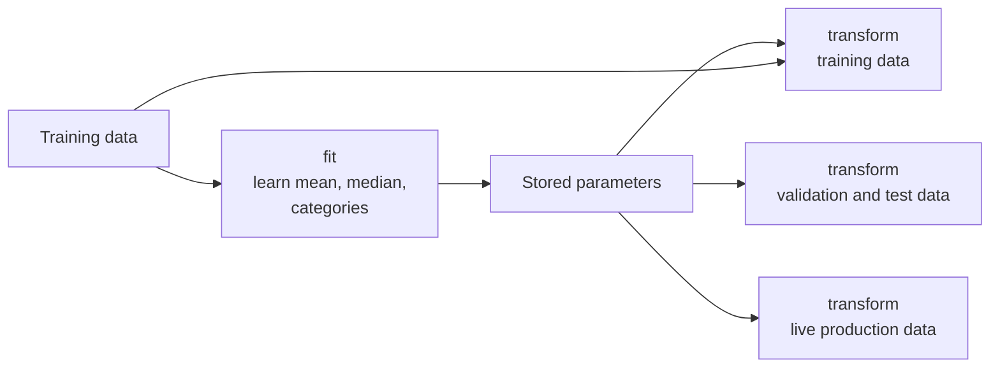
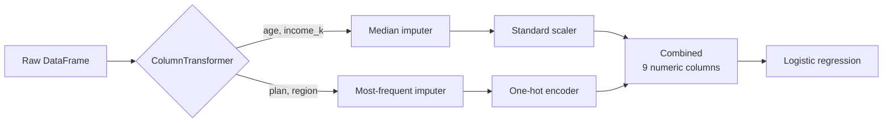

Most algorithms cannot use raw data directly. They need numbers, not strings; no missing values; and, for many models, features on similar scales. Data preprocessing converts cleaned data into that form. You met the data-engineering side in [data preprocessing](/learn/data-engineering-fundamentals/data-preprocessing) and the pandas tools in [handling missing values](/learn/pandas/handling-missing-values). This lesson is about the machine learning side: which transformations models need, and the one rule that keeps them honest, which is that every transformation is fitted on the training data only and then applied unchanged to everything else.

## The fit and transform contract

Every preprocessing step in scikit-learn (the library covered fully in [Module 16](/learn/machine-learning-libraries/scikit-learn)) is a **transformer** with two methods:

- `fit(X)` learns parameters from data: a mean, a median, the list of categories.
- `transform(X)` applies those stored parameters to any data.

`fit_transform(X)` does both at once, and is only for training data. Consider standardisation, which rescales each feature to mean 0 and standard deviation 1:

$$
z = \frac{x - \mu}{\sigma}
$$

where $\mu$ and $\sigma$ are the mean and [standard deviation](/learn/probability-and-statistics/variance-and-standard-deviation) of the feature. The crucial question is: computed from which data?

```python
import numpy as np
from sklearn.preprocessing import StandardScaler

X_train = np.array([[1.0], [2.0], [3.0]])
X_test = np.array([[10.0]])
scaler = StandardScaler().fit(X_train)
print(scaler.mean_, scaler.scale_.round(3))
print(scaler.transform(X_test).round(3))
```

```output
[2.] [0.816]
[[9.798]]
```

The scaler learned $\mu = 2$ and $\sigma \approx 0.816$ from the training rows and applied them to the test row, giving $(10 - 2) / 0.816 \approx 9.8$. That large value correctly says "this test point is far outside anything seen in training". If you had fitted the scaler on all four values, the test point would have influenced its own scaling. That is train-test contamination, a form of the [data leakage](/learn/machine-learning-fundamentals/training-validation-and-testing) you have already met.



> [!KEY]
> Fit on training data, transform everything. In production there is no "full dataset" to fit on, only the parameters you learned during training, so your evaluation must work the same way.

## Scaling numeric features

| Method | Formula | Use when |
| --- | --- | --- |
| Standardisation (`StandardScaler`) | $(x - \mu) / \sigma$ | Default for linear models, SVMs, k-NN, neural networks |
| Min-max scaling (`MinMaxScaler`) | $(x - x_{\min}) / (x_{\max} - x_{\min})$ | A bounded range such as 0 to 1 is needed |
| Robust scaling (`RobustScaler`) | $(x - \text{median}) / \text{IQR}$ | Strong outliers would distort the mean and standard deviation |
| Log transform | $\log(1 + x)$ | Long right tails, such as income or counts |

Here IQR is the interquartile range, the distance between the 25th and 75th percentiles. Whether a model needs scaling depends on how it uses the numbers:

| Model family | Needs scaling? | Why |
| --- | --- | --- |
| Linear and logistic regression with regularisation | Yes | The penalty treats all weights equally, so scale changes which features are penalised |
| k-nearest neighbours, k-means, SVMs | Yes | They rely on distances, which large-scale features dominate |
| Neural networks | Yes | Gradient descent converges much faster on comparable scales |
| Decision trees, random forests, gradient boosting | No | Splits depend only on the order of values, not their scale |

## Missing values

Most scikit-learn models raise an error on `NaN`. `SimpleImputer` replaces missing values with a statistic learned from the training data:

| Strategy | Fills with | Suits |
| --- | --- | --- |
| `"mean"` | Training mean | Roughly symmetric numeric features |
| `"median"` | Training median | Skewed numeric features, outliers |
| `"most_frequent"` | Most common training value | Categorical features |
| `"constant"` | A value you choose, such as `"missing"` | When missingness should be its own category |

Missingness is often informative: a blank "previous employer" field may say something about the applicant. Setting `add_indicator=True` on `SimpleImputer` adds a 0/1 column recording where values were missing, so the model can use that signal.

## Encoding categories

Models need numbers, so categorical columns must be encoded. **One-hot encoding** (`OneHotEncoder`) creates one 0/1 column per category. **Ordinal encoding** (`OrdinalEncoder`) maps categories to integers, which suits genuinely ordered categories such as small, medium, large, and tree models, but misleads linear models on unordered ones by implying that "west" is somehow three times "north".

An encoder fitted on training data knows only the categories it saw. In production, new categories appear: a new product plan, a new country. `OneHotEncoder(handle_unknown="ignore")` encodes an unseen category as all zeros instead of raising an error.

## Putting it together: pipelines

Real datasets mix column types, each needing different steps. `ColumnTransformer` routes columns to the right preprocessing, and `Pipeline` chains preprocessing and model into one object. Here is a synthetic customer churn dataset with gaps in it:

```python
import numpy as np
import pandas as pd

rng = np.random.default_rng(0)
n = 500
df = pd.DataFrame({
    "age": rng.integers(18, 80, n).astype(float),
    "income_k": rng.lognormal(3.5, 0.5, n).round(1),
    "plan": rng.choice(["basic", "plus", "pro"], n, p=[0.6, 0.3, 0.1]),
    "region": rng.choice(["north", "south", "east", "west"], n),
})
logit = -0.08 * (df["age"] - 45) + 1.5 * (df["plan"] == "basic") - 0.04 * (df["income_k"] - 35) - 0.75
df["churned"] = (rng.random(n) < 1 / (1 + np.exp(-logit))).astype(int)
# Real data has holes
df.loc[rng.choice(n, 40, replace=False), "age"] = np.nan
df.loc[rng.choice(n, 25, replace=False), "plan"] = np.nan

print(df.head())
print(df.isna().sum().to_dict())
```

```output
    age  income_k   plan region  churned
0  70.0      36.6  basic  north        0
1  57.0      27.4   plus   east        0
2  49.0     118.7  basic   west        0
3  34.0      28.2    pro   west        1
4  37.0      18.0   plus   east        1
{'age': 40, 'income_k': 0, 'plan': 25, 'region': 0, 'churned': 0}
```

```python
from sklearn.model_selection import train_test_split
from sklearn.compose import ColumnTransformer
from sklearn.pipeline import Pipeline
from sklearn.impute import SimpleImputer
from sklearn.preprocessing import StandardScaler, OneHotEncoder
from sklearn.linear_model import LogisticRegression

X = df.drop(columns="churned")
y = df["churned"]
X_train, X_test, y_train, y_test = train_test_split(X, y, test_size=0.25, stratify=y, random_state=0)

numeric = ["age", "income_k"]
categorical = ["plan", "region"]

preprocess = ColumnTransformer([
    ("num", Pipeline([("impute", SimpleImputer(strategy="median")),
                      ("scale", StandardScaler())]), numeric),
    ("cat", Pipeline([("impute", SimpleImputer(strategy="most_frequent")),
                      ("onehot", OneHotEncoder(handle_unknown="ignore"))]), categorical),
])

model = Pipeline([("preprocess", preprocess), ("clf", LogisticRegression())])
model.fit(X_train, y_train)                    # every step is fitted on training rows only
print(f"test accuracy: {model.score(X_test, y_test):.3f}")
print(model[:-1].get_feature_names_out())

num_steps = model.named_steps["preprocess"].named_transformers_["num"]
print("median age learned from train:", num_steps.named_steps["impute"].statistics_[0])
print("scaler means learned from train:", num_steps.named_steps["scale"].mean_.round(2))

new_customer = pd.DataFrame([{"age": None, "income_k": 52.0, "plan": "enterprise", "region": "north"}])
print("P(churn) for new customer:", model.predict_proba(new_customer)[0, 1].round(3))
```

```output
test accuracy: 0.704
['num__age' 'num__income_k' 'cat__plan_basic' 'cat__plan_plus'
 'cat__plan_pro' 'cat__region_east' 'cat__region_north'
 'cat__region_south' 'cat__region_west']
median age learned from train: 52.0
scaler means learned from train: [50.14 37.12]
P(churn) for new customer: 0.31
```



Read what the pipeline did. `model.fit` fitted the imputers, scaler, encoder and classifier in order, each on the training rows only. The learned median and means come from the 375 training rows; the test rows never influenced them. At prediction time, the new customer's missing age was filled with the training median, income was scaled with the training statistics, and the unseen plan `"enterprise"` became all zeros in the plan columns instead of crashing. The accuracy of 0.704 compares with about 0.50 for always predicting the majority class, since churn is roughly balanced in this data.

Pipelines bring three more benefits:

- **Leakage-proof cross-validation.** Passing the whole pipeline to `cross_val_score` refits every step inside each fold.
- **Tuning preprocessing.** Grid search can tune preprocessing choices, such as the imputation strategy, alongside model hyperparameters, as you will see in [grid search](/learn/model-evaluation/grid-search).
- **One artefact to deploy.** Saving the pipeline (for example with `joblib.dump`) saves the preprocessing with the model, which prevents the training-serving skew described in [feature engineering](/learn/machine-learning-fundamentals/feature-engineering).

> [!WARNING]
> The most common preprocessing bug looks innocent: `X_scaled = StandardScaler().fit_transform(X)` on the whole dataset, followed by `train_test_split(X_scaled, y)`. The split comes too late. Split first, then fit preprocessing on the training part, or better, put everything in a pipeline.

## A preprocessing checklist

1. **Split first.** Set aside test data before any fitting.
2. **Type each column**: numeric, categorical, ordinal, text, date, identifier. Drop identifiers such as customer IDs; they carry no generalisable signal.
3. **Decide on missing values** per column, and consider missingness indicators.
4. **Encode categories**, with `handle_unknown="ignore"` for production robustness.
5. **Scale** numeric features if the model is distance-, gradient- or penalty-based.
6. **Wrap it all in a pipeline** and evaluate the pipeline, not the model alone.

## Exercises

**1.** A colleague writes the code below. What is wrong, and how would you fix it?

```python
from sklearn.impute import SimpleImputer
X_filled = SimpleImputer(strategy="mean").fit_transform(X)
X_train, X_test, y_train, y_test = train_test_split(X_filled, y, test_size=0.2)
```

<details>
<summary>Show solution</summary>

The imputer's means are computed from all rows, including those that become the test set, so test information leaks into training. Split first, then fit the imputer on the training rows only, ideally as a pipeline step:

```python
from sklearn.pipeline import make_pipeline

X_train, X_test, y_train, y_test = train_test_split(X, y, test_size=0.2, random_state=0)
model = make_pipeline(SimpleImputer(strategy="mean"), LogisticRegression())
model.fit(X_train, y_train)
```

</details>

**2.** For each model, say whether you would scale the features and why: (a) k-nearest neighbours; (b) a random forest; (c) logistic regression with L2 regularisation.

<details>
<summary>Show solution</summary>

(a) Yes: k-NN uses distances, so large-scale features would dominate. (b) No: tree splits depend only on the ordering of values, so scaling changes nothing. (c) Yes: the penalty applies equally to all weights, and a feature's weight size depends on its scale, so unscaled features are penalised unevenly. Scaling also helps the solver converge.

</details>

**3.** Add `add_indicator=True` to the numeric imputer in the churn pipeline and print `model[:-1].get_feature_names_out()`. What new column appears, and why only one?

<details>
<summary>Show solution</summary>

```python
SimpleImputer(strategy="median", add_indicator=True)
```

A column named `num__missingindicator_age` appears. The indicator is only added for features that had missing values in the training data, and `income_k` had none, so it gets no indicator.

</details>

```quiz
[
  {
    "q": "What should a `StandardScaler` be fitted on?",
    "options": [
      "The full dataset, before splitting",
      "The training data only",
      "The test data only",
      "The training and test data combined"
    ],
    "answer": 1,
    "why": "The scaler's mean and standard deviation must come from training data, then be applied unchanged to validation, test and production data."
  },
  {
    "q": "Which model typically does NOT need feature scaling?",
    "options": ["k-nearest neighbours", "A support vector machine", "A random forest", "A neural network"],
    "answer": 2,
    "why": "Tree splits depend only on the order of values, so rescaling a feature leaves the trees unchanged."
  },
  {
    "q": "What does `OneHotEncoder(handle_unknown=\"ignore\")` do with a category not seen during fitting?",
    "options": [
      "Encodes it as all zeros in that feature's columns",
      "Raises an error",
      "Assigns it to the most frequent category",
      "Drops the row"
    ],
    "answer": 0,
    "why": "Unknown categories become a row of zeros, so production data with new categories does not crash the model."
  },
  {
    "q": "Why evaluate a whole `Pipeline` with cross-validation rather than preprocessing once and cross-validating the model?",
    "options": [
      "Pipelines train faster",
      "It is required for logistic regression",
      "It produces more features",
      "Every preprocessing step is refitted inside each training fold, preventing leakage"
    ],
    "answer": 3,
    "why": "Preprocessing done once on all data lets validation folds influence the learned statistics."
  }
]
```
