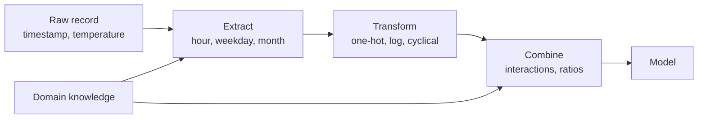

A model can only learn from what you show it. Feature engineering is the work of turning raw data, such as timestamps, categories, free text and transaction logs, into inputs that make the underlying pattern easy for a model to find. On tabular data it is often the single biggest lever on performance, bigger than the choice of algorithm. Even in the age of deep learning and LLMs it matters: retrieval systems combine embeddings with engineered signals such as recency and click counts, and LLM outputs themselves are often turned into features for downstream models.

## What a feature is

A **feature** is one column of the input matrix $X$: a measurable property of each example, expressed as a number. Feature engineering creates new columns from existing ones using domain knowledge. Formally, you choose a transformation $\phi$ that maps a raw record to a feature vector, and the model learns on $\phi(\mathbf{x})$ instead of $\mathbf{x}$:

$$
h(\mathbf{x}) = \mathbf{w}^\top \phi(\mathbf{x}) + b
$$

The model is still linear in its parameters $\mathbf{w}$, but because $\phi$ can be non-linear, the relationship between raw inputs and predictions need not be. You already saw this in the [overfitting lesson](/learn/machine-learning-fundamentals/underfitting-and-overfitting), where `PolynomialFeatures` let a linear model fit a sine wave.



## A worked example: bike rentals

Suppose you run a bike-sharing scheme and want to predict rentals per hour. The raw data is a timestamp and a temperature. The demand pattern, which here we generate synthetically so you can see the truth, has commuter peaks at 8:00 and 17:00 on weekdays, a broad midday bump at weekends, and more rentals on warm days.

```python
import numpy as np
import pandas as pd

rng = np.random.default_rng(0)
n = 2000
df = pd.DataFrame({
    "timestamp": pd.Timestamp("2025-01-01") + pd.to_timedelta(rng.integers(0, 365 * 24, n), unit="h"),
    "temp_c": rng.normal(14, 7, n).round(1),
})
hour = df["timestamp"].dt.hour
weekend = df["timestamp"].dt.day_of_week >= 5
# Hidden truth: commuter peaks at 8:00 and 17:00 on weekdays, warmer days busier
peaks = np.exp(-((hour - 8) ** 2) / 4) + np.exp(-((hour - 17) ** 2) / 4)
df["rentals"] = (50 + 200 * peaks * ~weekend + 60 * weekend * (hour.between(10, 18))
                 + 3 * df["temp_c"] + rng.normal(0, 15, n)).round().astype(int)
print(df.head())
```

```output
            timestamp  temp_c  rentals
0 2025-11-07 11:00:00    14.6      120
1 2025-08-21 11:00:00    20.3      141
2 2025-07-06 13:00:00    29.4      178
3 2025-04-09 11:00:00    19.1      119
4 2025-04-23 08:00:00     4.2      270
```

A model cannot use a timestamp directly. The first step is to **extract** the parts that plausibly matter, using the pandas `.dt` accessor from the [data transformation](/learn/pandas/data-transformation) lesson:

```python
features = pd.DataFrame({
    "hour": df["timestamp"].dt.hour,
    "day_of_week": df["timestamp"].dt.day_of_week,
    "is_weekend": (df["timestamp"].dt.day_of_week >= 5).astype(int),
    "month": df["timestamp"].dt.month,
    "temp_c": df["temp_c"],
})
print(features.head())
```

```output
   hour  day_of_week  is_weekend  month  temp_c
0    11            4           0     11    14.6
1    11            3           0      8    20.3
2    13            6           1      7    29.4
3    11            2           0      4    19.1
4     8            2           0      4     4.2
```

Now compare two versions with a linear model, using cross-validation via scikit-learn (the library covered fully in [Module 16](/learn/machine-learning-libraries/scikit-learn)). The first uses the obvious numeric columns. The second encodes the hour as categories, so each hour can have its own effect, and adds an **interaction**: a separate set of hour effects for weekdays.

```python
from sklearn.linear_model import LinearRegression
from sklearn.model_selection import cross_val_score

ts = df["timestamp"]
y = df["rentals"]

# Version 1: the obvious numeric columns
raw = pd.DataFrame({"hour": ts.dt.hour, "day_of_week": ts.dt.day_of_week, "temp_c": df["temp_c"]})

# Version 2: features that match how demand actually behaves
is_weekend = (ts.dt.day_of_week >= 5).astype(int)
hour_dummies = pd.get_dummies(ts.dt.hour, prefix="h", dtype=int)
hour_x_weekday = hour_dummies.mul(1 - is_weekend, axis=0).add_suffix("_weekday")
engineered = pd.concat([hour_dummies, hour_x_weekday, df[["temp_c"]]], axis=1)
engineered["is_weekend"] = is_weekend

for name, X in [("raw", raw), ("engineered", engineered)]:
    r2 = cross_val_score(LinearRegression(), X, y, cv=5, scoring="r2").mean()
    print(f"{name:10}  {X.shape[1]:2} features  R^2 = {r2:.3f}")
```

```output
raw          3 features  R^2 = 0.131
engineered  50 features  R^2 = 0.950
```

Same algorithm, same data, and the explained variance jumps from 13% to 95%. With `hour` as a single number, a linear model can only say "later hours have more (or fewer) rentals", which cannot express two peaks. One-hot hours let it learn any daily shape, and the weekday interaction lets that shape differ between weekdays and weekends.

> [!KEY]
> Good features encode how the world works. Ask what actually drives the target, then build columns that make that driver visible to the model.

A flexible model such as gradient boosting could learn much of the hourly shape from the raw `hour` column by itself, since trees can split on hour ranges. Feature engineering matters most for simple models, and for patterns that no algorithm can find from the raw columns, such as "days since the customer's last purchase", which requires joining and aggregating other tables.

## Common techniques

| Technique | What it does | Example |
| --- | --- | --- |
| Date and time parts | Extract hour, weekday, month, holiday flags | Timestamp to `hour`, `is_weekend` |
| One-hot encoding | One 0/1 column per category | `plan` to `plan_basic`, `plan_pro` |
| Log transform | Compress long right tails | `log1p(income)` |
| Binning | Turn a number into ranges | Age into 18-25, 26-40, ... |
| Ratios | Divide related quantities | Debt / income, clicks / impressions |
| Interactions | Multiply features whose effects combine | `hour x is_weekday` |
| Aggregations | Summarise related rows per entity | A customer's mean order value in the last 90 days |
| Text features | Counts, lengths, TF-IDF, embeddings | Review length, number of links in an email |

Aggregations are where pandas [grouping and aggregation](/learn/pandas/grouping-and-aggregation) earns its keep: `groupby("customer_id").agg(...)` followed by a merge back onto the main table creates some of the most predictive features in practice.

### Cyclical features

Hour 23 and hour 0 are one hour apart, but as numbers they are 23 apart. Encoding a cycle as a point on a circle fixes that:

$$
\text{hour\_sin} = \sin\left(\frac{2\pi \cdot \text{hour}}{24}\right), \qquad \text{hour\_cos} = \cos\left(\frac{2\pi \cdot \text{hour}}{24}\right)
$$

```python
hours = pd.Series([0, 6, 12, 18, 23])
enc = pd.DataFrame({"hour": hours,
                    "hour_sin": np.sin(2 * np.pi * hours / 24).round(3),
                    "hour_cos": np.cos(2 * np.pi * hours / 24).round(3)})
print(enc)
```

```output
   hour  hour_sin  hour_cos
0     0     0.000     1.000
1     6     1.000     0.000
2    12     0.000    -1.000
3    18    -1.000    -0.000
4    23    -0.259     0.966
```

Hour 23, at (-0.259, 0.966), is now close to hour 0, at (0, 1). Both sine and cosine are needed: with sine alone, hours 0 and 12 would look identical. The `-0.000` is a tiny negative floating-point value rounded for display. The same trick works for day of week (period 7) and month (period 12).

### Encoding categories

One-hot encoding works well for categories with a handful of values. For high-cardinality columns, such as postcode or product ID with thousands of values, it creates thousands of sparse columns. Alternatives include grouping rare categories into "other", **target encoding** (replacing each category with the mean target for that category), or learned embeddings.

> [!WARNING]
> Target encoding uses the labels, so computing it on the full dataset is target leakage. Compute it inside cross-validation, from training folds only, or the model will see a feature that already contains the answer for each validation row.

## Pitfalls

- **Leakage through features.** A feature must be computable at prediction time from information available then. "Total purchases this month" is fine for last month's data and leakage for predicting today's purchase.
- **Training-serving skew.** If features are computed one way in a notebook and another way in production, the model receives different inputs from the ones it learned on. Put feature code in one shared function or pipeline used in both places.
- **Feature explosion.** Interactions and one-hot encodings can create thousands of columns, inviting overfitting. Pair engineering with [feature selection](/learn/machine-learning-fundamentals/feature-selection) or regularisation.

## Exercises

**1.** Add sine and cosine encodings of the hour to the raw feature set (`hour`, `day_of_week`, `temp_c`) and measure cross-validated R² with `LinearRegression`. Does it reach the engineered version's score? Why or why not?

<details>
<summary>Show solution</summary>

```python
raw_cyc = raw.assign(hour_sin=np.sin(2 * np.pi * raw["hour"] / 24),
                     hour_cos=np.cos(2 * np.pi * raw["hour"] / 24))
print(f"{cross_val_score(LinearRegression(), raw_cyc, y, cv=5, scoring='r2').mean():.3f}")
```

```output
0.290
```

It improves on 0.131 but stays far below 0.950. One sine and one cosine can represent a single smooth daily wave, but demand has two sharp weekday peaks and a different weekend shape. The one-hot hours with a weekday interaction can represent that; two cyclical columns cannot.

</details>

**2.** Name a useful engineered feature for each prediction task: (a) whether a loan applicant defaults, given income and monthly debt payments; (b) whether a user will click an ad, given impressions and clicks per user so far; (c) delivery time, given pickup and drop-off coordinates.

<details>
<summary>Show solution</summary>

(a) Debt-to-income ratio, monthly debt divided by monthly income. (b) Historical click-through rate, clicks divided by impressions, ideally smoothed for users with few impressions. (c) Distance between the two points, such as the haversine (great-circle) distance, plus pickup hour.

</details>

**3.** Why is `month` encoded as the numbers 1 to 12 a poor feature for a linear model predicting ice-cream sales, and what would you use instead?

<details>
<summary>Show solution</summary>

A linear model can only make sales rise or fall steadily from January to December, but sales peak in summer and are low at both ends of the year. Use one-hot months, or sine and cosine of `2 * pi * month / 12`, so that the model can represent a seasonal peak and December sits next to January.

</details>

```quiz
[
  {
    "q": "Why did one-hot encoding the hour help a linear model predict bike rentals?",
    "options": [
      "It reduced the number of features",
      "It let each hour have its own effect, so the model could represent two daily peaks",
      "It removed noise from the target",
      "It made the model non-linear in its parameters"
    ],
    "answer": 1,
    "why": "With hour as one number, a linear model can only fit a straight trend over the day. Separate columns let it learn any daily shape."
  },
  {
    "q": "Why use both sine and cosine for a cyclical feature such as hour?",
    "options": [
      "With sine alone, different hours such as 0 and 12 would get the same value",
      "Cosine is required by scikit-learn",
      "It doubles the training data",
      "It removes the need for scaling"
    ],
    "answer": 0,
    "why": "Sine alone is ambiguous: each value (except the extremes) occurs twice per cycle. The pair gives a unique point on a circle."
  },
  {
    "q": "What is training-serving skew?",
    "options": [
      "When the training set is larger than the test set",
      "When the label distribution is imbalanced",
      "When features are computed differently in production than during training",
      "When a model is retrained too often"
    ],
    "answer": 2,
    "why": "The model then receives inputs that differ from the ones it learned on, and its performance silently degrades."
  },
  {
    "q": "When does target encoding cause leakage?",
    "options": [
      "When it is applied to numeric columns",
      "When there are fewer than ten categories",
      "When it is followed by scaling",
      "When the category means are computed using the rows being evaluated"
    ],
    "answer": 3,
    "why": "The encoding then contains each validation row's own label. Compute it from training folds only."
  }
]
```
