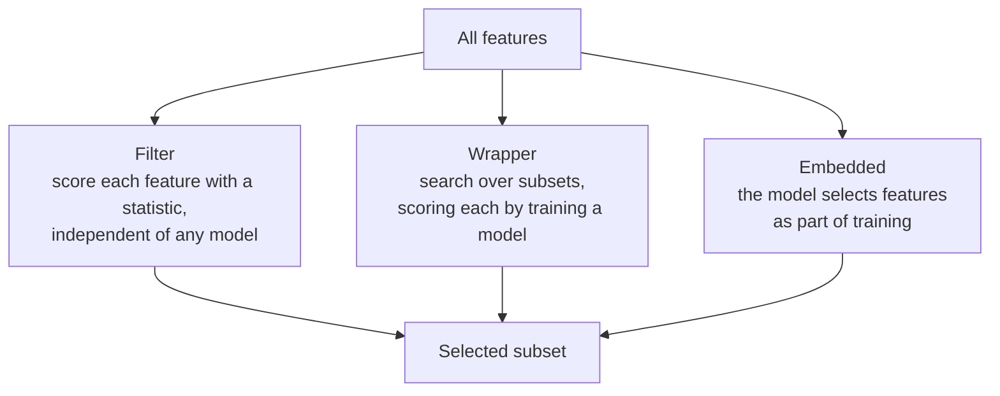

Feature engineering tends to create columns; feature selection removes them. Real datasets often arrive with hundreds of columns, many irrelevant or redundant, and every unnecessary feature adds a little noise for the model to overfit, a little cost to compute and store, and a little confusion when someone asks why the model made a decision. Feature selection chooses a smaller subset that keeps the predictive signal. This lesson covers the three families of methods (filter, wrapper and embedded), shows each one on data where you know the right answer, and explains how to apply them without leaking information.

## Why select features

| Benefit | Why it matters |
| --- | --- |
| Less overfitting | Fewer features means fewer chances to fit noise, especially when rows are scarce |
| Faster training and inference | Matters for large data and low-latency serving |
| Cheaper data pipelines | Every feature in production must be collected, validated and monitored |
| Easier interpretation | A model with 10 inputs is far easier to explain than one with 500 |

Feature selection differs from dimensionality reduction such as [PCA](/learn/machine-learning-fundamentals/unsupervised-learning). PCA builds *new* features as combinations of all the old ones; selection keeps a *subset* of the original columns, so they keep their meaning.

## Three families of methods



To compare them fairly, here is a dataset where the truth is known: ten features, of which only the first three drive the target, plus a near-copy of `x0`, as happens in real data with columns like "price in USD" and "price in EUR".

```python
import numpy as np
import pandas as pd
from sklearn.datasets import make_regression

# 10 features, but only the first 3 actually drive the target
X, y = make_regression(n_samples=300, n_features=10, n_informative=3,
                       noise=10.0, shuffle=False, random_state=0)
X = pd.DataFrame(X, columns=[f"x{i}" for i in range(10)])

# Add a near-duplicate of x0, as happens with "price_usd" and "price_eur"
rng = np.random.default_rng(0)
X["x0_copy"] = X["x0"] + rng.normal(0, 0.05, size=len(X))
print(X.shape)
```

```output
(300, 11)
```

All three methods below use scikit-learn, the library covered fully in [Module 16](/learn/machine-learning-libraries/scikit-learn).

## Filter methods

A **filter** scores each feature on its own with a statistical test against the target, then keeps the best. It never trains the final model, so it is fast and scales to thousands of features.

| Statistic | Target type | Detects |
| --- | --- | --- |
| Variance threshold | Any (ignores the target) | Constant or near-constant columns |
| Pearson [correlation](/learn/probability-and-statistics/correlation-and-covariance) / F-test (`f_regression`) | Numeric | Linear relationships |
| ANOVA F-test (`f_classif`) | Classes | Differences in a feature's mean between classes |
| Chi-squared (`chi2`) | Classes, non-negative features | Dependence between counts and classes |
| Mutual information | Either | Any dependence, including non-linear |

**Mutual information** comes from information theory (see [entropy](/learn/essential-mathematics-for-machine-learning/entropy)). It measures how much knowing a feature reduces uncertainty about the target:

$$
I(X_j; Y) = H(Y) - H(Y \mid X_j)
$$

where $H(Y)$ is the entropy of the target and $H(Y \mid X_j)$ is its entropy once feature $X_j$ is known. It is zero exactly when the feature and target are independent.

```python
from sklearn.feature_selection import SelectKBest, f_regression

selector = SelectKBest(score_func=f_regression, k=4).fit(X, y)
scores = pd.Series(selector.scores_, index=X.columns).sort_values(ascending=False)
print(scores.round(1).head(5))
print("filter keeps:", list(X.columns[selector.get_support()]))
```

```output
x2         234.5
x1         125.7
x0          75.6
x0_copy     75.6
x7           2.5
dtype: float64
filter keeps: ['x0', 'x1', 'x2', 'x0_copy']
```

The scores clearly separate the three real features from the noise (x7, the best noise feature, scores 2.5). But asked for four features, the filter happily keeps both `x0` and `x0_copy`, because each one *individually* is predictive. A filter looks at features one at a time, so it cannot see redundancy, and it can also miss features that are only useful in combination.

## Wrapper methods

A **wrapper** searches over subsets of features, training and evaluating a model on each candidate subset. **Forward selection** starts empty and repeatedly adds the feature that most improves the cross-validated score. **Backward elimination** starts with everything and removes the least useful feature each round. **Recursive feature elimination** (RFE) is a variant of backward elimination that drops the features with the smallest model weights.

```python
from sklearn.feature_selection import SequentialFeatureSelector
from sklearn.linear_model import LinearRegression

# Forward selection: add the feature that most improves 5-fold CV R^2,
# stop when the improvement drops below tol
sfs = SequentialFeatureSelector(LinearRegression(), n_features_to_select="auto",
                                tol=0.01, direction="forward", cv=5)
sfs.fit(X, y)
print("wrapper keeps:", list(X.columns[sfs.get_support()]))
```

```output
wrapper keeps: ['x0', 'x1', 'x2']
```

The wrapper found exactly the three true features, and it decided how many to keep by itself. Once `x0` is in the model, adding `x0_copy` barely changes the cross-validated $R^2$, so it is never chosen. Wrappers judge features in the context of the others, which handles redundancy and interactions.

The price is compute. Forward selection over $d$ features fits on the order of $d^2$ models, each with $k$-fold cross-validation, and with many features the repeated searching can itself overfit the validation folds.

## Embedded methods

**Embedded** methods select features during training. The best-known is the **Lasso**, linear regression with an L1 penalty on the weights:

$$
L(\mathbf{w}) = \frac{1}{2n} \sum_{i=1}^{n} (\mathbf{w}^\top \mathbf{x}_i + b - y_i)^2 + \alpha \sum_{j=1}^{d} \lvert w_j \rvert
$$

Unlike the squared (L2) penalty of Ridge regression, the absolute-value penalty pushes many weights to *exactly* zero, and a feature with zero weight is effectively removed. The strength $\alpha$ controls how many survive.

```python
from sklearn.linear_model import Lasso
from sklearn.preprocessing import StandardScaler
from sklearn.pipeline import make_pipeline

model = make_pipeline(StandardScaler(), Lasso(alpha=1.0)).fit(X, y)
coefs = pd.Series(model[-1].coef_, index=X.columns).round(2)
print(coefs.to_dict())
print("embedded keeps:", list(coefs[coefs != 0].index))
```

```output
{'x0': 55.38, 'x1': 70.43, 'x2': 88.61, 'x3': -0.0, 'x4': -0.0, 'x5': 0.0, 'x6': 0.0, 'x7': 0.0, 'x8': 0.0, 'x9': 0.0, 'x0_copy': 1.5}
embedded keeps: ['x0', 'x1', 'x2', 'x0_copy']
```

The Lasso zeroed all seven noise features and gave almost all of `x0`'s weight to one of the two near-identical copies (55.38 against 1.5). It keeps both because $\alpha = 1$ is a gentle penalty; a larger $\alpha$ tends to drop one of a correlated pair entirely. The standard scaler matters: the penalty treats every weight equally, so features must be on comparable scales.

Tree-based models are the other common embedded approach. Random forests and gradient boosting report a **feature importance** for each column, and `SelectFromModel` can keep only the features above a threshold.

## Comparing the families

| | Filter | Wrapper | Embedded |
| --- | --- | --- | --- |
| How it scores features | Statistic per feature | Model performance on subsets | Model's own weights or importances |
| Speed | Very fast | Slow | Fast (one training run) |
| Handles redundancy | No | Yes | Partly |
| Handles interactions | No | Yes | Depends on the model |
| Tied to a model | No | Yes | Yes |
| Good for | First pass on very wide data | Small to moderate feature counts | Everyday use with linear or tree models |

A common recipe: drop constant and near-duplicate columns with simple filters, then use an embedded method such as Lasso or tree importances, and confirm with a wrapper if the feature count is small.

> [!WARNING]
> Feature selection learns from the labels, so it must happen inside cross-validation, on training folds only. Selecting features on the full dataset and then evaluating produces wildly optimistic scores, as the leakage demonstration in [training, validation and testing](/learn/machine-learning-fundamentals/training-validation-and-testing) showed: 85% accuracy on pure noise. Put the selector in a `Pipeline` with the model.

> [!TIP]
> Low importance does not mean a feature is useless in the world, and high importance does not mean it causes the outcome. Selection tells you what helps *this model* predict on *this data*. With correlated features, importance is shared or shifted between them almost arbitrarily.

## Exercises

**1.** Rerun the Lasso with `alpha=5.0`. Which features survive, and what happens to the weights of `x0`, `x1` and `x2`?

<details>
<summary>Show solution</summary>

```python
model = make_pipeline(StandardScaler(), Lasso(alpha=5.0)).fit(X, y)
print(pd.Series(model[-1].coef_, index=X.columns).round(2).to_dict())
```

```output
{'x0': 51.39, 'x1': 66.31, 'x2': 84.2, 'x3': -0.0, 'x4': -0.0, 'x5': 0.0, 'x6': 0.0, 'x7': 0.0, 'x8': 0.0, 'x9': -0.0, 'x0_copy': 1.43}
```

The same four features survive, but every surviving weight shrinks (55.38 to 51.39 for `x0`). The L1 penalty both selects and shrinks; stronger penalties shrink more, which adds bias.

</details>

**2.** Explain why a filter based on correlation with the target would miss a feature pair like this: the target is 1 when exactly one of two binary features is 1, and 0 otherwise.

<details>
<summary>Show solution</summary>

This is the XOR pattern. Each feature on its own has no correlation with the target: knowing one of them alone tells you nothing, because the target depends on whether the other matches. Only the pair together is predictive. A filter scores features one at a time and so ranks both near zero, while a wrapper with a model capable of capturing interactions (such as a decision tree) would find them.

</details>

**3.** Write a pipeline that selects the 5 best features with `SelectKBest(f_regression)` and then fits a `LinearRegression`, and evaluate it with 5-fold cross-validation, so that selection never sees the validation fold.

<details>
<summary>Show solution</summary>

```python
from sklearn.model_selection import cross_val_score

pipe = make_pipeline(SelectKBest(f_regression, k=5), LinearRegression())
print(f"{cross_val_score(pipe, X, y, cv=5, scoring='r2').mean():.3f}")
```

```output
0.993
```

Because the selector is a pipeline step, `cross_val_score` refits it on each training fold, and the validation fold is used only for scoring.

</details>

```quiz
[
  {
    "q": "What is the main weakness of filter methods?",
    "options": [
      "They are slow on wide datasets",
      "They score features one at a time, so they miss redundancy and interactions",
      "They only work with neural networks",
      "They require a test set"
    ],
    "answer": 1,
    "why": "A filter can keep two near-identical features, and can drop features that are only useful together."
  },
  {
    "q": "Why does Lasso perform feature selection while Ridge does not?",
    "options": [
      "Lasso uses more training data",
      "Ridge cannot be regularised",
      "The L1 penalty drives some weights exactly to zero",
      "Lasso only works on standardised data"
    ],
    "answer": 2,
    "why": "The absolute-value penalty produces sparse solutions. The squared L2 penalty shrinks weights but rarely makes them exactly zero."
  },
  {
    "q": "Forward sequential feature selection is an example of:",
    "options": ["A wrapper method", "A filter method", "An embedded method", "Dimensionality reduction"],
    "answer": 0,
    "why": "It searches over subsets by training and cross-validating a model on each candidate."
  },
  {
    "q": "Where should feature selection happen when you evaluate with cross-validation?",
    "options": [
      "On the full dataset, before splitting",
      "On the test set",
      "After evaluation, to explain the model",
      "Inside each training fold, for example as a pipeline step"
    ],
    "answer": 3,
    "why": "Selection uses the labels. Doing it on all the data leaks validation information and inflates the score."
  }
]
```
