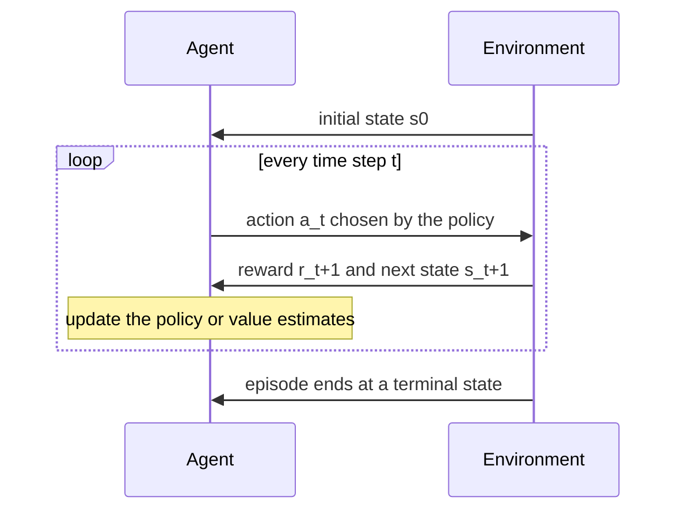
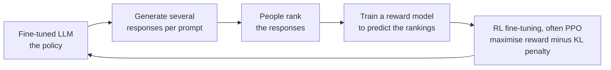

Supervised learning needs the right answer for every example. But for many problems nobody can say what the right action is at each moment, only whether things turned out well in the end. A game is won or lost after hundreds of moves; a robot arm either grasps the cup or drops it. Reinforcement learning (RL) learns from this kind of delayed, evaluative feedback, by trial and error. It is also how modern chat models are tuned to be helpful: reinforcement learning from human feedback (RLHF) is a key stage in training many LLMs.

## The agent-environment loop

RL has two parts. The **agent** is the learner and decision-maker. The **environment** is everything it interacts with. At each time step $t$ the agent observes a **state** $s_t$, chooses an **action** $a_t$, and the environment responds with a **reward** $r_{t+1}$ and a new state $s_{t+1}$.



| Term | Meaning | Chess example | LLM example (RLHF) |
| --- | --- | --- | --- |
| State | What the agent observes | Board position | Prompt plus tokens generated so far |
| Action | A choice the agent makes | A legal move | The next token |
| Reward | A scalar signal of how good the outcome was | +1 win, -1 loss, 0 otherwise | Reward model's score for the full response |
| Policy | The agent's rule for choosing actions | Which move to play in each position | The LLM's next-token distribution |
| Episode | One run from start to finish | One game | Generating one response |

## Rewards, returns and the discount factor

The agent does not try to maximise the next reward but the total reward over time, called the **return**. Future rewards are usually multiplied by a **discount factor** $\gamma$ between 0 and 1:

$$
G_t = r_{t+1} + \gamma r_{t+2} + \gamma^2 r_{t+3} + \dots = \sum_{k=0}^{\infty} \gamma^k r_{t+k+1}
$$

A $\gamma$ near 0 makes the agent short-sighted; near 1, it values the distant future almost as much as the present. Discounting also keeps the sum finite for tasks that never end.

The difficulty RL must overcome is **credit assignment**: when a reward arrives after many actions, which of those actions deserve the credit? A chess game might be lost because of a single mistake on move 12.

> [!WARNING]
> The agent optimises exactly the reward you give it, not what you meant. A boat-racing agent rewarded for hitting targets may learn to circle forever hitting the same targets instead of finishing the race. This is called **reward hacking**, and it is a central concern in RLHF.

## Policies and value functions

A **policy** $\pi(a \mid s)$ gives the probability of taking action $a$ in state $s$. The goal of RL is to find a policy that maximises the expected return.

To judge actions, many algorithms learn a **value function**. The **action-value** $Q^\pi(s, a)$ is the expected return from taking action $a$ in state $s$ and following $\pi$ afterwards. The best possible action-values $Q^*$ satisfy the **Bellman optimality equation**:

$$
Q^*(s, a) = \mathbb{E}\Big[\, r_{t+1} + \gamma \max_{a'} Q^*(s_{t+1}, a') \;\Big|\; s_t = s, a_t = a \Big]
$$

In words: the value of an action is the immediate reward plus the discounted value of the best action available from wherever you land. Once you know $Q^*$, the optimal policy is simply to pick the action with the largest $Q$ in each state.

The formal framework behind all of this is the **Markov decision process** (MDP): a set of states $S$, actions $A$, transition probabilities $P(s' \mid s, a)$, a reward function $R$, and a discount $\gamma$. "Markov" means the next state depends only on the current state and action, not on the full history.

## Exploration versus exploitation

An agent that always takes the action it currently thinks is best may never discover a better one. One that always explores never benefits from what it has learned. The simplest compromise is **epsilon-greedy**: with probability $\epsilon$ take a random action, otherwise take the best-known one.

## Q-learning from scratch

**Q-learning** learns $Q^*$ directly from experience. After each step it nudges its estimate toward the Bellman target:

$$
Q(s, a) \leftarrow Q(s, a) + \alpha \big[\, r + \gamma \max_{a'} Q(s', a') - Q(s, a) \big]
$$

where $\alpha$ is the learning rate and the bracketed term is the **temporal-difference error**: how much better or worse things went than expected. Step through a few updates of a single entry to see how it converges toward its target.

```trace
{
  "title": "repeated Q-learning updates for one state-action pair",
  "code": [
    "alpha, gamma = 0.5, 0.9",
    "q = 0.0              # current estimate of Q(cell 3, right)",
    "reward = -0.01       # small cost for each step",
    "best_next = 0.5      # max over actions of Q(cell 4, a)",
    "for visit in range(3):",
    "    target = reward + gamma * best_next",
    "    q = q + alpha * (target - q)",
    "    print(round(q, 4))"
  ],
  "steps": [
    { "line": 4, "vars": { "alpha": "0.5", "gamma": "0.9", "q": "0.0", "reward": "-0.01", "best_next": "0.5" }, "note": "The agent has never valued moving right from cell 3. The next cell is already estimated to be worth 0.5." },
    { "line": 6, "vars": { "q": "0.0", "target": "0.44" }, "note": "Bellman target: -0.01 + 0.9 * 0.5 = 0.44. This is what the step was actually worth, according to current estimates." },
    { "line": 8, "vars": { "q": "0.22", "target": "0.44" }, "out": ["0.22"], "note": "The TD error is 0.44 - 0 = 0.44. With alpha 0.5, q moves halfway toward the target." },
    { "line": 8, "vars": { "q": "0.33", "target": "0.44" }, "out": ["0.22", "0.33"], "note": "Second visit: error 0.22, so q moves another half of the remaining gap." },
    { "line": 8, "vars": { "q": "0.385", "target": "0.44" }, "out": ["0.22", "0.33", "0.385"], "note": "q converges toward 0.44. In a real run, best_next also improves as cell 4 is updated, so value flows backward from the reward." }
  ]
}
```

Here is the full algorithm on a tiny corridor of six cells. The agent starts in cell 0, can move left or right, pays 0.01 per step, and gets +1 for reaching the treasure in cell 5. It is written in plain NumPy because RL environments do not fit scikit-learn's `fit(X, y)` interface.

```python
import numpy as np

N_STATES, GOAL = 6, 5          # corridor cells 0..5, treasure in cell 5
ACTIONS = [-1, +1]             # 0 = move left, 1 = move right

def step(state, action):
    """The environment: returns (next_state, reward, done)."""
    next_state = min(max(state + ACTIONS[action], 0), N_STATES - 1)
    if next_state == GOAL:
        return next_state, 1.0, True
    return next_state, -0.01, False     # small cost per step

rng = np.random.default_rng(0)
Q = np.zeros((N_STATES, 2))
alpha, gamma, epsilon = 0.5, 0.9, 0.2

for episode in range(200):
    state, done = 0, False
    while not done:
        # epsilon-greedy: mostly exploit, sometimes explore
        if rng.random() < epsilon or Q[state, 0] == Q[state, 1]:
            action = int(rng.integers(2))
        else:
            action = int(np.argmax(Q[state]))
        next_state, reward, done = step(state, action)
        target = reward if done else reward + gamma * np.max(Q[next_state])
        Q[state, action] += alpha * (target - Q[state, action])
        state = next_state

print(Q.round(3))
policy = ["left" if q[0] > q[1] else "right" for q in Q[:GOAL]]
print("greedy policy:", policy)
```

```output
[[0.55  0.622]
 [0.55  0.702]
 [0.622 0.791]
 [0.702 0.89 ]
 [0.791 1.   ]
 [0.    0.   ]]
greedy policy: ['right', 'right', 'right', 'right', 'right']
```

Nobody told the agent to go right. It discovered that from rewards alone. The values also match the Bellman equation exactly: $Q(4, \text{right}) = 1$, then $Q(3, \text{right}) = -0.01 + 0.9 \times 1 = 0.89$, then $-0.01 + 0.9 \times 0.89 = 0.791$, and so on back to the start. The reward has propagated backward through the states, which is how Q-learning solves credit assignment. The last row stays at zero because the episode ends on reaching the goal.

## How RL differs from supervised learning

| | Supervised learning | Reinforcement learning |
| --- | --- | --- |
| Feedback | The correct answer for every example | A scalar reward, often delayed |
| Data | A fixed dataset | Generated by the agent's own actions |
| Examples | Independent of each other | Sequential and correlated |
| Main challenges | Generalisation | Exploration, credit assignment, stability |

Tabular Q-learning only works for small state spaces. **Deep RL** replaces the table with a neural network, and **policy gradient** methods, such as PPO, adjust the policy's parameters directly to make high-return actions more probable.

## RL and large language models: RLHF

After pretraining and supervised fine-tuning, an LLM can follow instructions, but it is hard to write down a supervised target for "the most helpful, honest, harmless answer". People can, however, compare two answers and say which is better. RLHF turns those comparisons into a reward signal.



In RL terms, the LLM is the policy, each token is an action, the prompt and text so far is the state, and the reward model scores the finished response. A **KL penalty** keeps the tuned model close to the original, which stops it drifting into strange text that happens to fool the reward model, a form of reward hacking. Methods such as DPO reach a similar goal without an explicit RL loop. Both are covered in [RLHF fundamentals](/learn/advanced-llm-engineering/rlhf-fundamentals) and [DPO](/learn/advanced-llm-engineering/dpo).

> [!KEY]
> RL is the tool for problems where you can score outcomes but cannot write down the correct action. For LLMs, that describes "be helpful" very well.

## Exercises

**1.** With $\gamma = 0.9$, compute the return $G_0$ for the reward sequence 0, 0, 0, 1 (the episode ends after the fourth reward). Then compute it with $\gamma = 0.5$.

<details>
<summary>Show solution</summary>

$G_0 = 0 + 0.9 \times 0 + 0.9^2 \times 0 + 0.9^3 \times 1 = 0.729$. With $\gamma = 0.5$: $0.5^3 = 0.125$. A smaller discount makes the distant reward much less valuable.

</details>

**2.** In the corridor code, set `epsilon = 0.0`. Why does the agent still learn, and what is the role of the `Q[state, 0] == Q[state, 1]` check?

<details>
<summary>Show solution</summary>

It still learns the all-right policy. With all Q-values starting at zero, the two actions tie in every state, and the tie check makes the agent pick randomly, which is enough exploration to find the goal. Once values differ, it acts greedily. The step cost helps too: every action the agent tries gets a slightly negative value, so untried actions (still at zero) look better and get tried next. If you remove both the tie check and the step cost, `np.argmax` always picks action 0 (left) on ties, nothing ever changes the tie, and the first episode never ends.

</details>

**3.** Using the Bellman equation and the corridor's rewards, compute $Q(2, \text{left})$ once learning has converged. Check it against the printed table.

<details>
<summary>Show solution</summary>

Moving left from cell 2 lands in cell 1 with reward -0.01. The best action there is right, worth 0.702. So $Q(2, \text{left}) = -0.01 + 0.9 \times 0.702 = 0.6218 \approx 0.622$, which matches row 2, column 0.

</details>

```quiz
[
  {
    "q": "In reinforcement learning, what does the policy define?",
    "options": [
      "The reward for each state",
      "How the agent chooses actions given a state",
      "The transition probabilities of the environment",
      "The discount factor"
    ],
    "answer": 1,
    "why": "A policy maps states to actions or action probabilities. The environment defines rewards and transitions."
  },
  {
    "q": "What problem does the discount factor gamma address?",
    "options": [
      "It decides how much future rewards count compared with immediate ones",
      "It sets the exploration rate",
      "It scales the learning rate",
      "It removes negative rewards"
    ],
    "answer": 0,
    "why": "Gamma weights reward k steps ahead by gamma to the power k, and keeps returns finite in continuing tasks."
  },
  {
    "q": "In RLHF, what plays the role of the reward?",
    "options": [
      "The next-token cross-entropy loss",
      "The number of tokens generated",
      "A reward model trained on human preference comparisons",
      "The pretraining dataset"
    ],
    "answer": 2,
    "why": "People rank responses, a reward model learns to predict those rankings, and its score is the reward the LLM policy maximises."
  },
  {
    "q": "Why is a KL penalty used during RLHF?",
    "options": [
      "To speed up generation",
      "To make the reward model larger",
      "To increase exploration",
      "To keep the tuned model close to the original and limit reward hacking"
    ],
    "answer": 3,
    "why": "Without it, the policy can drift into unnatural text that exploits weaknesses in the reward model."
  }
]
```
