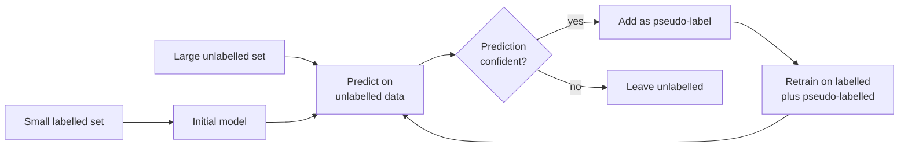

In real projects you rarely have either a fully labelled dataset or a completely unlabelled one. You usually have a small labelled set, because labelling is slow and costly, and a much larger pile of unlabelled examples that cost nothing. Semi-supervised learning uses both. It tries to squeeze extra accuracy out of the unlabelled data, and the same ideas power techniques you will meet later, such as pseudo-labelling for fine-tuning data and LLM-assisted labelling.

## The setting

You have $n_L$ labelled pairs $(\mathbf{x}_i, y_i)$ and $n_U$ unlabelled inputs $\mathbf{x}_j$, usually with $n_U$ much larger than $n_L$. The goal is still supervised: predict $y$ for new inputs. The question is whether the unlabelled inputs can help.



## Why unlabelled data can help

Unlabelled points tell you nothing about which class is which, but they do tell you where the data lives. That helps only if the shape of the data is connected to the labels. Semi-supervised methods rely on one or more of these assumptions:

| Assumption | Statement | Intuition |
| --- | --- | --- |
| Smoothness | Points that are close together probably share a label | Two nearly identical images of a "7" are both 7s |
| Cluster | Data forms clusters, and each cluster tends to be one class | The decision boundary should pass through empty regions, not through dense groups |
| Manifold | High-dimensional data lies near a lower-dimensional surface | Images of handwritten digits occupy a tiny, structured part of all possible pixel grids |

If these assumptions hold, unlabelled points reveal the clusters and gaps, and a handful of labels is enough to name each cluster. If they fail, for example when classes overlap heavily, unlabelled data can mislead the model and make it worse.

## Self-training and pseudo-labels

**Self-training** is the most intuitive method and the one shown in the diagram:

1. Train a model on the labelled data.
2. Predict on the unlabelled data.
3. Treat the most confident predictions as if they were true labels (**pseudo-labels**).
4. Retrain on the enlarged set and repeat until no confident predictions remain.

It works with any classifier that outputs probabilities. Its weakness is **confirmation bias**: if the model is confidently wrong early on, those wrong pseudo-labels are added to the training set and reinforce the mistake.

## Label propagation and spreading

Graph-based methods take the smoothness assumption literally. They build a graph where each point is connected to its nearest neighbours, then let labels flow along the edges from labelled points to unlabelled ones, like dye spreading through water. **Label spreading** adds a parameter that lets the original labels be partly overwritten, which makes it more robust to label noise.

The intuition, for a point $i$ with neighbours $\mathcal{N}(i)$: its label distribution $F_i$ is repeatedly updated toward a weighted average of its neighbours' distributions, while being pulled back toward its own initial label $Y_i$:

$$
F_i \leftarrow \alpha \sum_{j \in \mathcal{N}(i)} S_{ij} F_j + (1 - \alpha) Y_i
$$

Here $S_{ij}$ is a normalised similarity between points $i$ and $j$, $Y_i$ is a one-hot vector for labelled points and all zeros for unlabelled ones, and $\alpha$ between 0 and 1 controls how much neighbours matter compared with the original label.

## Comparing methods on digits

Here is a realistic scenario. The digits dataset has 1,257 training images, but suppose you can afford to label only 50. scikit-learn, the library covered fully in [Module 16](/learn/machine-learning-libraries/scikit-learn), marks unlabelled examples with the label `-1`.

```python
import numpy as np
from sklearn.datasets import load_digits
from sklearn.model_selection import train_test_split
from sklearn.linear_model import LogisticRegression
from sklearn.semi_supervised import SelfTrainingClassifier, LabelSpreading

X, y = load_digits(return_X_y=True)
X = X / 16.0
X_train, X_test, y_train, y_test = train_test_split(X, y, test_size=0.3, random_state=0, stratify=y)

# Hide all but 50 labels: scikit-learn marks "unlabelled" with -1
rng = np.random.default_rng(0)
labelled = rng.choice(len(y_train), size=50, replace=False)
y_partial = np.full_like(y_train, -1)
y_partial[labelled] = y_train[labelled]
print(f"labelled: {np.sum(y_partial != -1)}, unlabelled: {np.sum(y_partial == -1)}")

# 1. Supervised baseline: ignore the unlabelled rows
base = LogisticRegression(max_iter=2000).fit(X_train[labelled], y_train[labelled])
print(f"supervised, 50 labels only: {base.score(X_test, y_test):.3f}")

# 2. Self-training: pseudo-label confident predictions and refit
self_train = SelfTrainingClassifier(LogisticRegression(max_iter=2000), threshold=0.9)
self_train.fit(X_train, y_partial)
print(f"self-training:              {self_train.score(X_test, y_test):.3f}")
print(f"  rows pseudo-labelled: {np.sum(self_train.labeled_iter_ > 0)}")

# 3. Label spreading: propagate labels through a similarity graph
spread = LabelSpreading(kernel="knn", n_neighbors=10).fit(X_train, y_partial)
print(f"label spreading:            {spread.score(X_test, y_test):.3f}")

# Upper bound: every label available
full = LogisticRegression(max_iter=2000).fit(X_train, y_train)
print(f"supervised, all {len(y_train)} labels: {full.score(X_test, y_test):.3f}")
```

```output
labelled: 50, unlabelled: 1207
supervised, 50 labels only: 0.831
self-training:              0.817
  rows pseudo-labelled: 102
label spreading:            0.941
supervised, all 1257 labels: 0.970
```

The results are worth reading carefully:

- **Label spreading** lifts accuracy from 0.831 to 0.941, closing most of the gap to the fully labelled model while using only 4% of the labels. Digits form tight clusters, so the smoothness and cluster assumptions hold well.
- **Self-training** made things slightly *worse*. With only 50 labels, the logistic regression's confident predictions include some mistakes, and training on them reinforced the errors. Only 102 rows ever passed the 0.9 confidence threshold.

> [!KEY]
> Semi-supervised learning is not guaranteed to help. Always compare against the supervised baseline trained on the labelled data alone, using a test set with real labels.

## Related ideas you will meet later

| Approach | How it uses unlabelled data | Where it appears |
| --- | --- | --- |
| Semi-supervised learning | Shares structure between a few labels and many unlabelled points | Classification with scarce labels |
| Self-supervised learning | Creates labels from the data itself (next token, masked word, a hidden image patch) | Pretraining LLMs, BERT and vision models |
| Active learning | The model picks which unlabelled examples a person should label next | Reducing annotation cost |
| Weak supervision | Noisy labels from heuristics, rules or another model | Building training sets quickly |
| Transfer learning | A model pretrained on a large dataset is fine-tuned on a small labelled one | Most modern NLP and vision work |

In practice, the strongest way to use unlabelled data today is often **self-supervised pretraining followed by supervised fine-tuning**: the pretrained model has already learned a representation in which the cluster assumption holds, so a few labels go a long way. Pseudo-labelling also comes back in LLM work, where a large model labels data that is then used to train a smaller one, a form of [distillation](/learn/advanced-llm-engineering/distillation).

> [!WARNING]
> Never put pseudo-labelled examples in your validation or test set. Evaluation must use real, human-verified labels, or the model is being graded against its own guesses.

## Exercises

**1.** Rerun the self-training example with `threshold=0.7`. How many rows are pseudo-labelled now, and what happens to test accuracy? What does this tell you about the threshold?

<details>
<summary>Show solution</summary>

```output
self-training:              0.824
  rows pseudo-labelled: 1082
```

A lower threshold pseudo-labels far more rows (1,082 instead of 102), but accuracy is still below the 0.831 baseline. More pseudo-labels means more data but also more wrong labels. The threshold trades quantity against quality, and neither extreme is reliably good: it should be tuned on a validation set with real labels.

</details>

**2.** Which assumption of semi-supervised learning is most likely violated in a dataset where spam and legitimate emails are written in very similar styles and differ mainly in a single link?

<details>
<summary>Show solution</summary>

The cluster assumption (and smoothness). The two classes do not form separate dense regions in feature space, so nearby points often have different labels. Unlabelled data shows where emails are, but not where the boundary between classes lies.

</details>

**3.** Explain the difference between semi-supervised and self-supervised learning in one or two sentences each.

<details>
<summary>Show solution</summary>

Semi-supervised learning has a real but small set of human-provided labels for the target task and uses unlabelled data to improve it. Self-supervised learning uses no human labels: it invents a prediction task from the data itself (such as predicting the next token) to learn useful representations, usually as pretraining before a supervised step.

</details>

```quiz
[
  {
    "q": "What is a pseudo-label?",
    "options": [
      "A label assigned by a human annotator",
      "A model's confident prediction on unlabelled data, used as if it were a real label",
      "A label of -1 marking missing data",
      "A label taken from the test set"
    ],
    "answer": 1,
    "why": "Self-training adds the model's own high-confidence predictions to the training set as pseudo-labels."
  },
  {
    "q": "Why can self-training make a model worse?",
    "options": [
      "It deletes the original labels",
      "It requires a neural network",
      "Confidently wrong predictions become training labels and reinforce errors",
      "It always overfits the test set"
    ],
    "answer": 2,
    "why": "This confirmation bias is the main risk of pseudo-labelling, especially when the initial model is weak."
  },
  {
    "q": "The cluster assumption says:",
    "options": [
      "Points in the same dense region tend to share a label",
      "Every dataset has exactly k clusters",
      "Labels are independent of features",
      "Clusters must be the same size"
    ],
    "answer": 0,
    "why": "If classes form separate dense regions, unlabelled data reveals those regions and a few labels can name them."
  },
  {
    "q": "How should a semi-supervised model be evaluated?",
    "options": [
      "On the pseudo-labelled examples",
      "By the number of pseudo-labels added",
      "By its training accuracy",
      "On a test set with real labels, compared with a supervised baseline"
    ],
    "answer": 3,
    "why": "Only real labels give an honest measure, and the baseline tells you whether the unlabelled data actually helped."
  }
]
```
