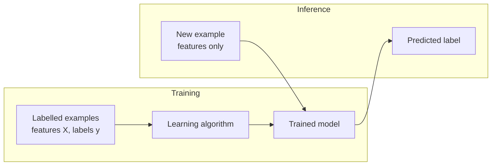

Supervised learning is the workhorse of applied machine learning. Whenever you have examples with the correct answer attached, such as emails marked spam or not, houses with their sale prices, or support tickets tagged by team, you can train a model to produce that answer for new examples. Most production ML systems are supervised, and so is a key stage of building LLMs: supervised fine-tuning teaches a pretrained model to follow instructions by showing it prompts paired with good responses.

## The idea: learning from labelled examples

The name comes from the idea of a teacher. For every training example, the "supervisor" provides the correct output, and the algorithm adjusts the model until its outputs match.



Formally, you are given $n$ pairs $(\mathbf{x}_i, y_i)$ drawn from some unknown distribution, and you want a function $h$ such that $h(\mathbf{x}) \approx y$ for new pairs from the same distribution. Training chooses parameters $\theta$ to minimise the average loss on the training set:

$$
\hat{\theta} = \arg\min_{\theta} \frac{1}{n} \sum_{i=1}^{n} \ell\big(h_\theta(\mathbf{x}_i), y_i\big)
$$

Here $h_\theta$ is the model with parameters $\theta$, $\ell$ is the loss function, and $\arg\min$ means "the value of $\theta$ that achieves the minimum". The labels are what make this possible: without $y_i$ there would be nothing to compute the loss against.

## Classification and regression

Supervised problems come in two main types, distinguished by the kind of label.

| | Classification | Regression |
| --- | --- | --- |
| Label | A category from a fixed set | A real number |
| Examples | Spam or not; tumour benign or malignant; which of 10 digits | House price; delivery time; tomorrow's demand |
| Typical loss | Cross-entropy (log loss) | Mean squared error, mean absolute error |
| Typical metrics | Accuracy, precision, recall, F1 | MAE, RMSE, $R^2$ |
| Model output | A class, usually via a probability per class | A number |

Classification with two classes is **binary classification**; with more, it is **multiclass**. When each example can have several labels at once (a film tagged both "comedy" and "romance"), it is **multilabel** classification.

The losses come straight from the maths module. For regression, mean squared error is

$$
\text{MSE} = \frac{1}{n} \sum_{i=1}^{n} (\hat{y}_i - y_i)^2
$$

and for binary classification, where the model outputs a probability $\hat{p}_i$ that example $i$ belongs to class 1, the [cross-entropy](/learn/essential-mathematics-for-machine-learning/cross-entropy) loss is

$$
\text{CE} = -\frac{1}{n} \sum_{i=1}^{n} \big[ y_i \log \hat{p}_i + (1 - y_i) \log(1 - \hat{p}_i) \big]
$$

Cross-entropy punishes confident wrong answers heavily: predicting 0.01 for an example whose true label is 1 costs $-\log 0.01 \approx 4.6$, while predicting 0.4 costs only about 0.9. The [loss functions](/learn/essential-mathematics-for-machine-learning/loss-functions) lesson explains why these choices follow from [maximum likelihood estimation](/learn/essential-mathematics-for-machine-learning/maximum-likelihood-estimation).

## A classification example

scikit-learn, the library covered fully in [Module 16](/learn/machine-learning-libraries/scikit-learn), ships with small real datasets. The breast cancer dataset has 30 measurements of cell nuclei from 569 biopsies, each labelled malignant (0) or benign (1).

```python
from sklearn.datasets import load_breast_cancer
from sklearn.model_selection import train_test_split
from sklearn.pipeline import make_pipeline
from sklearn.preprocessing import StandardScaler
from sklearn.linear_model import LogisticRegression

X, y = load_breast_cancer(return_X_y=True)
print(X.shape, y[:10])

X_train, X_test, y_train, y_test = train_test_split(X, y, test_size=0.25, random_state=42, stratify=y)
clf = make_pipeline(StandardScaler(), LogisticRegression())
clf.fit(X_train, y_train)

print("predicted classes:", clf.predict(X_test[:5]))
print("P(class 1):       ", clf.predict_proba(X_test[:5])[:, 1].round(3))
print("true classes:     ", y_test[:5])
print(f"test accuracy: {clf.score(X_test, y_test):.3f}")
```

```output
(569, 30) [0 0 0 0 0 0 0 0 0 0]
predicted classes: [1 0 1 1 0]
P(class 1):        [0.969 0.    0.559 0.939 0.175]
true classes:      [1 0 1 1 0]
test accuracy: 0.986
```

Three things to notice. First, `predict_proba` gives a probability, and `predict` simply applies a 0.5 threshold to it. The third example, at 0.559, was a close call; in a medical setting you might send borderline cases to a specialist instead of trusting the model. Second, the scaler and the model are combined in a **pipeline**, so scaling is learned from the training rows only (the [data preprocessing](/learn/machine-learning-fundamentals/data-preprocessing) lesson explains why). Third, accuracy is measured on the held-out test set.

## A regression example

The diabetes dataset has 10 standardised measurements (age, BMI, blood pressure and six blood serum values among them) for 442 patients, and the target is a number measuring disease progression one year later.

```python
from sklearn.datasets import load_diabetes
from sklearn.model_selection import train_test_split
from sklearn.linear_model import LinearRegression
from sklearn.dummy import DummyRegressor
from sklearn.metrics import mean_absolute_error

X, y = load_diabetes(return_X_y=True)
X_train, X_test, y_train, y_test = train_test_split(X, y, test_size=0.25, random_state=42)

baseline = DummyRegressor(strategy="mean").fit(X_train, y_train)
reg = LinearRegression().fit(X_train, y_train)

print(f"baseline MAE: {mean_absolute_error(y_test, baseline.predict(X_test)):.1f}")
print(f"linear   MAE: {mean_absolute_error(y_test, reg.predict(X_test)):.1f}")
```

```output
baseline MAE: 65.5
linear   MAE: 41.5
```

The `DummyRegressor` ignores the features and always predicts the training mean. Comparing against it answers the question "is the model learning anything at all?" Here it is: the average error drops by more than a third. Whether an error of 41.5 is good enough is a question for the people who will use the predictions, not for the algorithm.

> [!TIP]
> Always fit a dummy baseline first: the mean for regression, the most frequent class for classification. A surprising number of impressive-looking models turn out to be barely better than it, especially on imbalanced data.

## The supervised algorithm family

The same `fit` and `predict` interface covers dozens of algorithms. They differ in their hypothesis class, which decides what shapes of relationship they can represent. [Module 13](/learn/supervised-learning-algorithms/linear-regression) covers each one in depth.

| Algorithm | Hypothesis class | Strengths |
| --- | --- | --- |
| Linear / logistic regression | Weighted sums of features | Fast, interpretable, strong baseline |
| k-nearest neighbours | Labels of similar training examples | No training phase, simple |
| Decision tree | Nested if-then splits | Readable, handles mixed data |
| Random forest, gradient boosting | Ensembles of many trees | Best-in-class on most tabular data |
| Support vector machine | Maximum-margin boundaries, optionally with kernels | Good on medium-sized, high-dimensional data |
| Neural network | Compositions of layers | Images, text, audio, very large data |

## Where supervised learning goes wrong

Most failures are about the data, not the algorithm.

- **Label noise.** If 10% of your labels are wrong, the model learns the mistakes too. Check samples of labels by hand before training.
- **Label definitions.** Two annotators who disagree about what counts as "toxic" give the model contradictory targets. Write labelling guidelines and measure agreement.
- **Distribution shift.** A model trained on last year's customers may not apply to this year's. Monitor live data against training data.
- **Proxy labels.** You often cannot label what you really care about, so you use a stand-in: "clicked" for "found useful". The model will optimise the stand-in, including its flaws.

> [!WARNING]
> A label must be available at prediction time only as something to predict, never as an input. If a feature is computed from the outcome (for example "number of refund emails" when predicting a refund), the model will look brilliant in testing and fail in production. This is **target leakage**, covered in [training, validation and testing](/learn/machine-learning-fundamentals/training-validation-and-testing).

## Exercises

**1.** Classify each problem as binary classification, multiclass classification, multilabel classification, or regression: (a) predicting a taxi fare; (b) tagging a news article with every relevant topic; (c) deciding whether a transaction is fraudulent; (d) recognising which of 26 letters is in an image.

<details>
<summary>Show solution</summary>

(a) Regression: the target is a number. (b) Multilabel: an article can have several topics. (c) Binary classification. (d) Multiclass classification with 26 classes.

</details>

**2.** In the breast cancer example, compute the test accuracy of a `DummyClassifier(strategy="most_frequent")`. How much does the logistic regression improve on it?

<details>
<summary>Show solution</summary>

```python
from sklearn.dummy import DummyClassifier

dummy = DummyClassifier(strategy="most_frequent").fit(X_train, y_train)
print(f"{dummy.score(X_test, y_test):.3f}")
```

```output
0.629
```

The dummy always predicts "benign", the majority class, and is right 62.9% of the time. The logistic regression's 98.6% is a large real improvement.

</details>

**3.** Using the cross-entropy formula, compute the loss for a single example with true label 1 when the model predicts 0.9, and when it predicts 0.1.

<details>
<summary>Show solution</summary>

With $y = 1$ only the first term remains: $-\log 0.9 \approx 0.105$ and $-\log 0.1 \approx 2.303$. Being confidently wrong costs about 22 times more than being confidently right costs.

</details>

```quiz
[
  {
    "q": "What makes a learning problem supervised?",
    "options": [
      "A person monitors the training run",
      "Each training example comes with the correct output",
      "The model is a neural network",
      "The data has been cleaned"
    ],
    "answer": 1,
    "why": "Supervision means labels: the loss compares predictions with the known correct answers."
  },
  {
    "q": "Predicting the number of minutes until a delivery arrives is:",
    "options": ["Binary classification", "Clustering", "Regression", "Multilabel classification"],
    "answer": 2,
    "why": "The target is a continuous number, so this is regression."
  },
  {
    "q": "Why compare a model with a `DummyRegressor` or `DummyClassifier`?",
    "options": [
      "To check whether the model has learned anything beyond a trivial guess",
      "To speed up training",
      "Because scikit-learn requires it",
      "To remove outliers"
    ],
    "answer": 0,
    "why": "A dummy baseline ignores the features. If your model barely beats it, the features carry little useful signal or something is wrong."
  },
  {
    "q": "In scikit-learn, what does `predict_proba` return for a binary classifier?",
    "options": [
      "Only the predicted class",
      "The loss for each example",
      "The model's accuracy",
      "A probability for each class, for each example"
    ],
    "answer": 3,
    "why": "It returns an array of shape (n_samples, n_classes); `predict` applies a threshold to these probabilities."
  }
]
```
