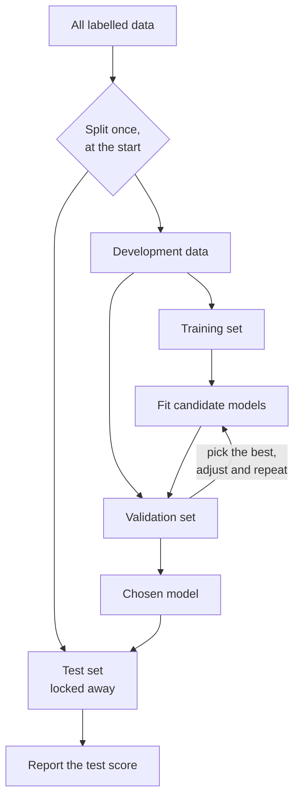

A model that scores 99% on the data it was trained on tells you almost nothing. What matters is how it performs on data it has never seen, and the only way to estimate that is to hold some data back. How you split your data decides whether your evaluation numbers are honest or a comforting illusion. Getting it wrong, usually through **data leakage**, is one of the most common and expensive mistakes in machine learning, and it applies just as much to evaluating LLM applications as to classical models.

## Three sets, three jobs

You split your labelled data into three disjoint parts, each with one job.

| Set | Used for | Typical share | Looked at |
| --- | --- | --- | --- |
| Training set | Fitting the model's parameters | 60-80% | Constantly |
| Validation set | Choosing between models, features and hyperparameters | 10-20% | Many times during development |
| Test set | A final, unbiased estimate of performance | 10-20% | Once, at the very end |

**Parameters** (such as the weights of a linear model) are learned by `fit` on the training set. **Hyperparameters** (such as a polynomial degree, a regularisation strength or the number of trees) are choices *you* make, and you make them by comparing scores on the validation set.



Why not just two sets? Every time you use a score to make a decision, that data leaks a little information into your choices. Try fifty hyperparameter settings and pick the best on the validation set, and the winning score is optimistic: part of its advantage is luck on those particular rows. The test set, untouched by any decision, corrects for that.

> [!KEY]
> The test set estimates how the model will do in the real world only if nothing about the model, including which model you chose, depended on it. Once you tune against the test set, it becomes a second validation set and you no longer have an honest estimate.

## Splitting with scikit-learn

`train_test_split` from scikit-learn (covered fully in [Module 16](/learn/machine-learning-libraries/scikit-learn)) shuffles and splits arrays in one call. To get three sets, split twice:

```python
import numpy as np
from sklearn.datasets import make_classification
from sklearn.model_selection import train_test_split

# 1,000 rows, only about 10% positive: think fraud or rare disease
X, y = make_classification(n_samples=1000, weights=[0.9], random_state=0)

# Step 1: carve off the test set. Step 2: split the rest into train and validation.
X_temp, X_test, y_temp, y_test = train_test_split(X, y, test_size=0.2, stratify=y, random_state=0)
X_train, X_val, y_train, y_val = train_test_split(X_temp, y_temp, test_size=0.25, stratify=y_temp, random_state=0)

for name, labels in [("all", y), ("train", y_train), ("val", y_val), ("test", y_test)]:
    print(f"{name:5} n={len(labels):4}  positive rate={labels.mean():.3f}")
```

```output
all   n=1000  positive rate=0.102
train n= 600  positive rate=0.102
val   n= 200  positive rate=0.105
test  n= 200  positive rate=0.100
```

The second split takes 25% of the remaining 80%, which is 20% of the total, giving a 60/20/20 split. Setting `random_state` makes the split reproducible, which matters when you compare experiments run on different days.

## Stratification

`stratify=y` tells the splitter to preserve the class proportions in every part. Without it, a random split of a small or imbalanced dataset can give a test set with very few, or zero, examples of the rare class:

```python
import numpy as np
from sklearn.model_selection import train_test_split

rng = np.random.default_rng(1)
y = (rng.random(60) < 0.1).astype(int)       # a small, imbalanced dataset
X = rng.normal(size=(60, 3))
print("positives in full data:", y.sum())

for seed in range(3):
    *_, y_plain = train_test_split(X, y, test_size=0.25, random_state=seed)
    *_, y_strat = train_test_split(X, y, test_size=0.25, random_state=seed, stratify=y)
    print(f"seed {seed}: positives in test  plain={y_plain.sum()}  stratified={y_strat.sum()}")
```

```output
positives in full data: 4
seed 0: positives in test  plain=0  stratified=1
seed 1: positives in test  plain=1  stratified=1
seed 2: positives in test  plain=3  stratified=1
```

With seed 0 the plain split puts no positives in the test set, so you could not measure how well the model finds them at all. With seed 2 it puts three of the four there, leaving one for training. Stratification gives the same, representative proportion every time. Use it by default for classification.

## Cross-validation when data is scarce

A single validation split wastes data and gives a noisy estimate. **k-fold cross-validation** splits the development data into $k$ folds, trains $k$ times, each time validating on a different fold, and averages the scores:

$$
\text{CV score} = \frac{1}{k} \sum_{j=1}^{k} \text{score}\big(h^{(-j)}, \text{fold}_j\big)
$$

where $h^{(-j)}$ is the model trained on every fold except fold $j$. Every example is used for validation exactly once. The [cross-validation](/learn/model-evaluation/cross-validation) lesson in Module 15 covers it in detail. Even with cross-validation, keep a separate test set for the final number.

## Data leakage

**Data leakage** is when information that would not be available at prediction time finds its way into training or model selection. The model looks excellent in evaluation and disappoints in production.

| Type | What happens | Example |
| --- | --- | --- |
| Target leakage | A feature is derived from, or recorded after, the label | Using "account closed date" to predict churn |
| Train-test contamination | Test rows influence training | Fitting a scaler or imputer on the full dataset before splitting |
| Duplicate leakage | The same or near-identical example is in both sets | The same customer's records, or the same image resized, on both sides |
| Temporal leakage | The model trains on the future to predict the past | Random split of time-series data |
| Selection leakage | Feature or model selection uses all the data | Choosing the "best" features before cross-validating |

The last row is subtle enough to deserve a demonstration. Here the features are pure noise and the labels are random coin flips, so no model can do better than 50% on new data:

```python
import numpy as np
from sklearn.feature_selection import SelectKBest, f_classif
from sklearn.linear_model import LogisticRegression
from sklearn.model_selection import cross_val_score
from sklearn.pipeline import make_pipeline

rng = np.random.default_rng(0)
X = rng.normal(size=(100, 5000))     # 5,000 features of pure noise
y = rng.integers(0, 2, size=100)     # random labels: nothing to learn

# Wrong: choose the 20 "best" features using ALL rows, then cross-validate
X_selected = SelectKBest(f_classif, k=20).fit_transform(X, y)
leaky = cross_val_score(LogisticRegression(), X_selected, y, cv=5).mean()

# Right: selection happens inside each training fold
pipe = make_pipeline(SelectKBest(f_classif, k=20), LogisticRegression())
honest = cross_val_score(pipe, X, y, cv=5).mean()

print(f"leaky estimate:  {leaky:.2f}")
print(f"honest estimate: {honest:.2f}")
```

```output
leaky estimate:  0.85
honest estimate: 0.48
```

Among 5,000 random features, some correlate with the labels by chance across all 100 rows. Selecting them using every row, validation folds included, bakes that chance correlation into the evaluation and produces a confident 85% on a problem with no signal. Putting the selector inside a pipeline means it is refitted on each training fold only, and the estimate drops to the truth.

> [!WARNING]
> The rule is simple: anything that learns from data, including scalers, imputers, encoders, feature selectors and resamplers, must be fitted on training data only. Pipelines enforce this automatically, as the [data preprocessing](/learn/machine-learning-fundamentals/data-preprocessing) lesson shows.

## Splitting time series and grouped data

Random shuffling assumes examples are independent. Two common cases break that assumption.

**Time series.** If you forecast tomorrow's demand, the model will only ever have the past to work with. Evaluation must respect that: train on earlier periods and validate on later ones. `TimeSeriesSplit` produces expanding training windows, each followed by a validation window:

```python
import numpy as np
from sklearn.model_selection import TimeSeriesSplit

days = np.arange(12)          # 12 consecutive days, in order
tscv = TimeSeriesSplit(n_splits=4, test_size=2)
for fold, (train_idx, test_idx) in enumerate(tscv.split(days)):
    print(f"fold {fold}: train={train_idx.tolist()}  test={test_idx.tolist()}")
```

```output
fold 0: train=[0, 1, 2, 3]  test=[4, 5]
fold 1: train=[0, 1, 2, 3, 4, 5]  test=[6, 7]
fold 2: train=[0, 1, 2, 3, 4, 5, 6, 7]  test=[8, 9]
fold 3: train=[0, 1, 2, 3, 4, 5, 6, 7, 8, 9]  test=[10, 11]
```

The validation rows are always later than every training row. Your final test set should be the most recent period of all.

**Groups.** When several rows come from the same patient, user or document, put all of a group's rows on the same side of the split, or the model can score well by recognising individuals rather than learning the pattern. `GroupKFold` and `GroupShuffleSplit` take a `groups` array for this. The same applies to LLM evaluation: if your evaluation questions were paraphrased from your fine-tuning data, the scores measure memory, not ability.

## Exercises

**1.** You want a 70/15/15 train/validation/test split. The first call to `train_test_split` uses `test_size=0.15`. What `test_size` should the second call use?

<details>
<summary>Show solution</summary>

After the first split, 85% of the data remains. The validation set should be 15% of the total, which is $0.15 / 0.85 \approx 0.176$ of the remainder. So use `test_size=0.15/0.85`.

</details>

**2.** A team predicts hospital readmission. Their features include "number of days in hospital during readmission". Their model scores 97% in testing and poorly in production. What went wrong?

<details>
<summary>Show solution</summary>

Target leakage. That feature only exists if the patient was readmitted, so it effectively encodes the label. It is not available at the moment the prediction is needed (at discharge). Every feature must be something known at prediction time.

</details>

**3.** In the leakage demonstration, change `k=20` to `k=200`. Before running it, predict whether the leaky estimate goes up or down.

<details>
<summary>Show solution</summary>

It goes up, not down:

```output
leaky estimate:  0.99
honest estimate: 0.40
```

With 200 hand-picked noise features and only 100 rows, there is even more chance correlation to exploit, and the selection saw the validation rows. The leaky estimate becomes almost perfect on a task with no signal at all. The honest estimate stays around chance level (0.40 here; with only 20 validation rows per fold, it fluctuates around 0.5).

</details>

```quiz
[
  {
    "q": "What is the validation set used for?",
    "options": [
      "Fitting the model's weights",
      "Choosing between models and hyperparameters",
      "Reporting the final performance number",
      "Replacing missing values"
    ],
    "answer": 1,
    "why": "Validation scores guide development decisions. The test set is reserved for the final, unbiased estimate."
  },
  {
    "q": "Why use `stratify=y` when splitting a classification dataset?",
    "options": [
      "It shuffles the data more thoroughly",
      "It removes duplicate rows",
      "It sorts the data by time",
      "It keeps class proportions the same in each split"
    ],
    "answer": 3,
    "why": "Stratification preserves the label distribution, which matters most for small or imbalanced datasets."
  },
  {
    "q": "Which of these is data leakage?",
    "options": [
      "Fitting a `StandardScaler` on the full dataset before splitting",
      "Using `random_state` in `train_test_split`",
      "Using a larger training set than validation set",
      "Training several candidate models"
    ],
    "answer": 0,
    "why": "The scaler learns means and standard deviations that include test rows, so test information reaches training."
  },
  {
    "q": "For forecasting next week's sales, how should you split the data?",
    "options": [
      "Randomly, with stratification",
      "By customer group",
      "Chronologically: train on the past, validate and test on later periods",
      "Use the same data for training and testing"
    ],
    "answer": 2,
    "why": "Random splits let the model learn from the future. Time-ordered splits mirror how the model will be used."
  }
]
```
