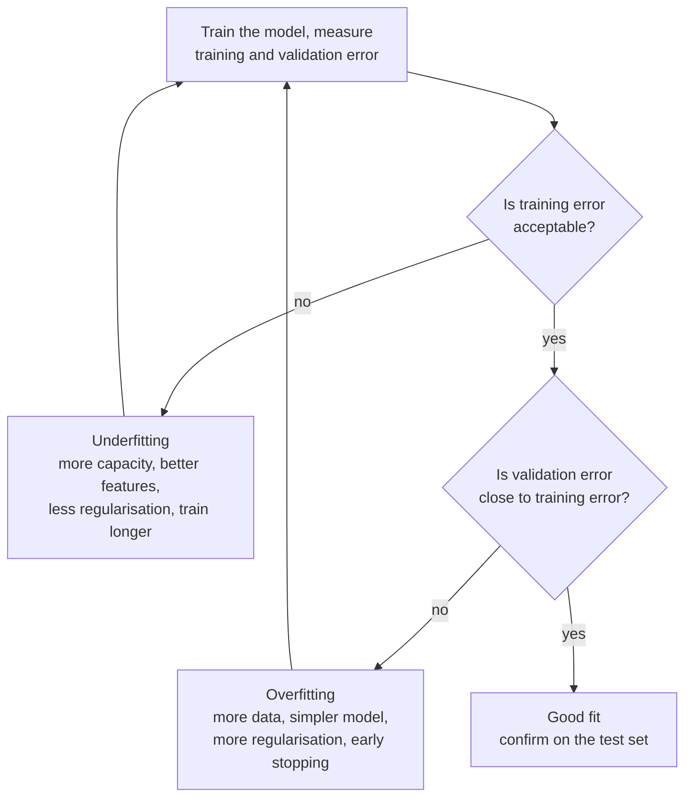

Every model you train will fail in one of two directions. It may be too simple to capture the real pattern, so it does badly everywhere: that is **underfitting**. Or it may be so flexible that it memorises the training data, noise included, and does badly on anything new: that is **overfitting**. Recognising which one you are facing, from numbers you already have, is the most useful diagnostic skill in machine learning. It applies equally to a linear regression, a gradient-boosted model, and an LLM being fine-tuned on a few hundred examples.

## The two failure modes

Recall from [what is machine learning?](/learn/machine-learning-fundamentals/what-is-machine-learning) that training minimises the error on training data, while what you care about is the error on new data. Overfitting and underfitting describe how those two errors relate.

| | Underfitting | Good fit | Overfitting |
| --- | --- | --- | --- |
| Training error | High | Low | Very low |
| Validation error | High | Low, close to training | Much higher than training |
| What the model learned | Too little of the signal | The signal | The signal plus the noise |
| Typical cause | Model too simple, features too weak, too much regularisation | | Model too complex for the amount of data |

The gap between validation and training error is called the **generalisation gap**. A large gap is the signature of overfitting; a high error on both sets, with little gap, is the signature of underfitting.

## An experiment: polynomial degree

The classic demonstration fits polynomials of increasing degree to a small, noisy sample. The true relationship is a sine wave, $y = \sin(2\pi x) + \varepsilon$, where the noise $\varepsilon$ is normally distributed with standard deviation 0.2. A polynomial of degree $p$ is

$$
h(x) = w_0 + w_1 x + w_2 x^2 + \dots + w_p x^p
$$

so higher degrees mean more parameters and more flexible curves. scikit-learn (the library covered fully in [Module 16](/learn/machine-learning-libraries/scikit-learn)) builds this as a pipeline: `PolynomialFeatures` creates the columns $x, x^2, \dots, x^p$, and `LinearRegression` fits the weights.

```python
import numpy as np
from sklearn.pipeline import make_pipeline
from sklearn.preprocessing import PolynomialFeatures
from sklearn.linear_model import LinearRegression
from sklearn.metrics import mean_squared_error

rng = np.random.default_rng(0)

def make_data(n):
    x = rng.uniform(0, 1, size=n)
    y = np.sin(2 * np.pi * x) + rng.normal(0, 0.2, size=n)   # true signal + noise
    return x.reshape(-1, 1), y

X_train, y_train = make_data(15)     # small training set
X_val, y_val = make_data(200)        # fresh data from the same source

print("degree  train MSE  val MSE")
for degree in [1, 3, 5, 9, 11]:
    model = make_pipeline(PolynomialFeatures(degree), LinearRegression())
    model.fit(X_train, y_train)
    train_mse = mean_squared_error(y_train, model.predict(X_train))
    val_mse = mean_squared_error(y_val, model.predict(X_val))
    print(f"{degree:6}  {train_mse:9.4f}  {val_mse:8.4f}")
```

```output
degree  train MSE  val MSE
     1     0.1472    0.3792
     3     0.0171    0.0503
     5     0.0157    0.0523
     9     0.0122    0.3216
    11     0.0117    0.5119
```

Read the table as a story:

- **Degree 1** is a straight line. It cannot bend to follow a sine wave, so both errors are high. This is underfitting.
- **Degrees 3 and 5** capture the curve. Validation error is near its minimum, and close to 0.04, the variance of the noise ($0.2^2$), which no model can beat.
- **Degrees 9 and 11** keep lowering training error, but validation error climbs back up, to ten times its best value. With 10 or 12 parameters and only 15 points, the curve threads through the noisy training points and swings wildly between them. This is overfitting.

> [!KEY]
> Training error almost always falls as model complexity rises. Validation error falls, bottoms out, then rises. The best model sits at the bottom of the validation curve, not the training curve.

## Diagnosing from the numbers

You can decide what to try next from just two numbers: training error and validation error.



What counts as "acceptable" depends on a reference point: a [dummy baseline](/learn/machine-learning-fundamentals/supervised-learning), human-level performance, or a business requirement.

## More data cures overfitting

Overfitting happens when a model has more flexibility than the data can pin down. Holding the model fixed at degree 9 and adding training data shows the effect:

```python
rng = np.random.default_rng(0)
X_val, y_val = make_data(200)
print("n_train  train MSE  val MSE   (degree 9)")
for n in [15, 50, 200, 1000]:
    X_train, y_train = make_data(n)
    model = make_pipeline(PolynomialFeatures(9), LinearRegression()).fit(X_train, y_train)
    print(f"{n:7}  {mean_squared_error(y_train, model.predict(X_train)):9.4f}  {mean_squared_error(y_val, model.predict(X_val)):7.4f}")
```

```output
n_train  train MSE  val MSE   (degree 9)
     15     0.0176  19.7205
     50     0.0420   0.0533
    200     0.0292   0.0459
   1000     0.0392   0.0416
```

With 15 points, this particular sample lets the degree-9 curve explode between points: validation MSE is nearly 20. With 1,000 points the same model has no room to chase noise, and training and validation errors converge on the noise floor of 0.04. Training error *rises* as data grows, because it gets harder to fit every point, while validation error falls. Plotting both against training set size is called a **learning curve**, and the gap between the two curves tells you whether more data will help.

## Regularisation: limiting flexibility

When more data is not available, you can penalise complexity instead. **Ridge regression** adds the squared size of the weights to the loss:

$$
L(\mathbf{w}) = \frac{1}{n} \sum_{i=1}^{n} (h(\mathbf{x}_i) - y_i)^2 + \alpha \sum_{j=1}^{p} w_j^2
$$

The hyperparameter $\alpha \geq 0$ sets the strength. Wild curves need huge weights, so the penalty discourages them. Here a degree-14 polynomial, flexible enough to overfit badly, is tamed by Ridge:

```python
from sklearn.preprocessing import StandardScaler
from sklearn.linear_model import Ridge

rng = np.random.default_rng(0)
X_train, y_train = make_data(15)
X_val, y_val = make_data(200)

print("alpha     train MSE  val MSE   (degree 14)")
for alpha in [1e-8, 1e-4, 1e-2, 1, 100]:
    model = make_pipeline(PolynomialFeatures(14), StandardScaler(), Ridge(alpha=alpha))
    model.fit(X_train, y_train)
    print(f"{alpha:<8g}  {mean_squared_error(y_train, model.predict(X_train)):9.4f}  {mean_squared_error(y_val, model.predict(X_val)):7.4f}")
```

```output
alpha     train MSE  val MSE   (degree 14)
1e-08        0.0116   0.5705
0.0001       0.0136   0.1301
0.01         0.0200   0.0645
1            0.0713   0.2760
100          0.2176   0.4937
```

Tiny $\alpha$ overfits; huge $\alpha$ flattens the curve until it underfits; $\alpha = 0.01$ is close to the degree-3 result. Regularisation strength is itself a hyperparameter, chosen on validation data. The scaler matters: without it, the columns $x^{14}$ and $x$ are on wildly different scales and the penalty would treat them unfairly.

## The toolkit

| Fix underfitting | Fix overfitting |
| --- | --- |
| Use a more flexible model (higher degree, deeper trees, bigger network) | Get more training data, or augment it |
| Add better features ([feature engineering](/learn/machine-learning-fundamentals/feature-engineering)) | Use a simpler model or fewer features ([feature selection](/learn/machine-learning-fundamentals/feature-selection)) |
| Reduce regularisation | Increase regularisation (L2, L1, dropout) |
| Train for longer | Stop training early, when validation loss stops improving |
| | Average many models (ensembles such as random forests) |

In neural network training, overfitting shows up over time: training loss keeps falling while validation loss turns upward after some number of epochs. **Early stopping** keeps the weights from the epoch with the lowest validation loss. The same pattern appears when fine-tuning an LLM on a small dataset: run too many epochs and the model starts reproducing training answers verbatim rather than generalising the style.

> [!WARNING]
> You can also overfit the validation set by trying hundreds of configurations and keeping the best. The winner's validation score is then optimistic, which is why the [test set](/learn/machine-learning-fundamentals/training-validation-and-testing) is kept for one final measurement.

## Exercises

**1.** A model has training accuracy 72% and validation accuracy 71% on a task where people achieve 95%. Is it underfitting or overfitting, and what two things would you try first?

<details>
<summary>Show solution</summary>

Underfitting: training error is high, far from the human reference, and the gap to validation is tiny. Try a more flexible model (for example gradient boosting instead of logistic regression) and better features. More data is unlikely to help much, because the model cannot even fit the data it already has.

</details>

**2.** A model has training accuracy 99.8% and validation accuracy 81%. List three things you could do.

<details>
<summary>Show solution</summary>

This is overfitting: a large generalisation gap. Options: collect more training data or use augmentation; increase regularisation (larger `alpha`, smaller `C`, more dropout); simplify the model (shallower trees, fewer features); use early stopping; or use an ensemble that averages away variance.

</details>

**3.** In the degree experiment, add degree 2 to the list and predict its result before running it. Why might degree 2 do worse than degree 3 on a sine wave?

<details>
<summary>Show solution</summary>

One period of a sine wave between 0 and 1 rises, falls and rises again, so it has two turning points. A quadratic has only one, so it cannot follow the shape: it underfits. In this run degree 2 scores 0.1471 on training and 0.3809 on validation, no better than the straight line. A cubic has up to two turning points, which is exactly enough.

</details>

```quiz
[
  {
    "q": "Which pattern indicates overfitting?",
    "options": [
      "High training error and high validation error",
      "Low training error and much higher validation error",
      "Low training error and equally low validation error",
      "Validation error lower than training error"
    ],
    "answer": 1,
    "why": "A large gap between training and validation error means the model learned patterns specific to the training data."
  },
  {
    "q": "As model complexity increases, what usually happens to training error?",
    "options": [
      "It keeps decreasing or stays flat",
      "It increases steadily",
      "It is U-shaped",
      "It is unaffected"
    ],
    "answer": 0,
    "why": "A more flexible model can always fit the training data at least as well. Validation error, not training error, is U-shaped."
  },
  {
    "q": "In Ridge regression, what happens when `alpha` is set very large?",
    "options": [
      "The model overfits more",
      "Training becomes impossible",
      "The model underfits because the weights are forced towards zero",
      "Nothing changes"
    ],
    "answer": 2,
    "why": "A strong penalty shrinks all weights, so the model becomes nearly constant and cannot follow the data."
  },
  {
    "q": "Which remedy addresses underfitting rather than overfitting?",
    "options": [
      "Collecting more training data",
      "Early stopping",
      "Increasing regularisation",
      "Adding more informative features"
    ],
    "answer": 3,
    "why": "Better features give the model more signal to fit. The other three all reduce effective flexibility, which helps overfitting."
  }
]
```
