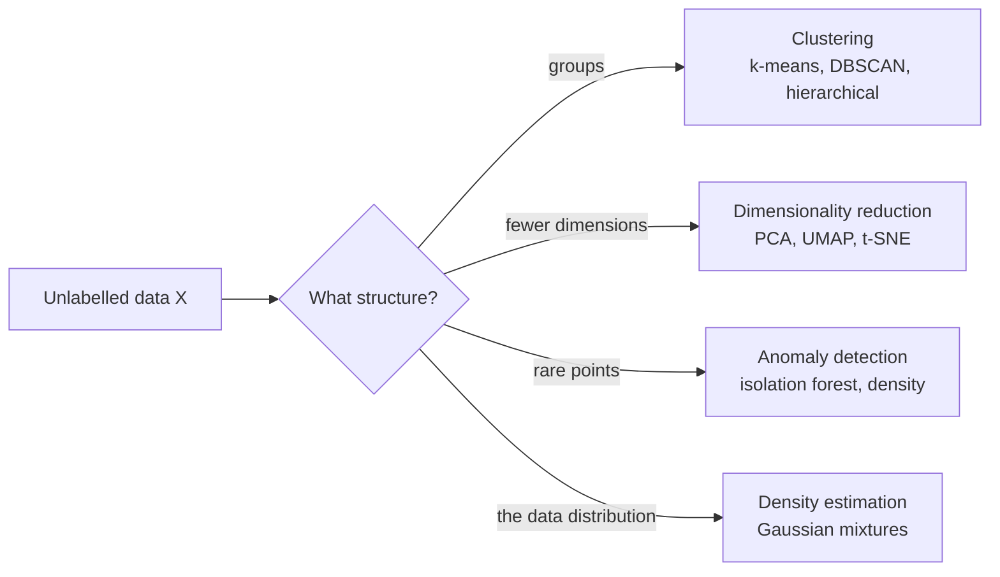

Labels are expensive. Someone has to read every ticket, examine every scan, or wait months to see which customers left. Most of the world's data has no labels at all: server logs, transaction streams, document archives, sensor readings. Unsupervised learning finds structure in such data without being told what to look for. You will use it to segment customers, compress high-dimensional data, spot anomalies, and explore embeddings before you know what questions to ask.

## Learning without answers

In unsupervised learning the dataset is only $\{\mathbf{x}_1, \dots, \mathbf{x}_n\}$, with no $y$. There is no correct output to compare against, so the algorithm instead optimises some measure of structure: how tightly points group together, how much variance a projection keeps, or how probable the data is under a fitted model.



| Task | Question it answers | Example |
| --- | --- | --- |
| Clustering | Which examples belong together? | Customer segments from purchase history |
| Dimensionality reduction | Can I describe each example with fewer numbers? | Compressing 768-dimensional embeddings to 2 for a plot |
| Anomaly detection | Which examples are unusual? | Flagging a suspicious login |
| Density estimation | How likely is this example? | Modelling normal sensor behaviour |

## Clustering with k-means

**k-means** is the simplest and most widely used clustering algorithm. You choose the number of clusters $k$. The algorithm places $k$ centres, assigns each point to its nearest centre, moves each centre to the mean of its assigned points, and repeats until nothing changes.

Formally, it seeks cluster assignments $C_1, \dots, C_k$ and centres $\boldsymbol{\mu}_1, \dots, \boldsymbol{\mu}_k$ that minimise the **inertia**, the total squared distance from each point to its centre:

$$
J = \sum_{j=1}^{k} \sum_{\mathbf{x}_i \in C_j} \lVert \mathbf{x}_i - \boldsymbol{\mu}_j \rVert^2
$$

Here $\lVert \cdot \rVert$ is the Euclidean norm from [norms and distances](/learn/linear-algebra/norms-and-distances). Notice that this is still a loss being minimised; it just does not involve any labels.

With scikit-learn, the library covered fully in [Module 16](/learn/machine-learning-libraries/scikit-learn), unsupervised models use the same interface, except that `fit` takes only `X`:

```python
import numpy as np
from sklearn.datasets import make_blobs
from sklearn.cluster import KMeans

X, true_groups = make_blobs(n_samples=300, centers=3, cluster_std=1.0, random_state=7)

for k in [2, 3, 4, 5]:
    km = KMeans(n_clusters=k, n_init=10, random_state=0).fit(X)
    print(f"k={k}  inertia={km.inertia_:.1f}")

km = KMeans(n_clusters=3, n_init=10, random_state=0).fit(X)
print("cluster sizes:", np.bincount(km.labels_))
print("centres:\n", km.cluster_centers_.round(2))
```

```output
k=2  inertia=3302.8
k=3  inertia=573.4
k=4  inertia=501.4
k=5  inertia=434.8
cluster sizes: [100 100 100]
centres:
 [[-8.55  5.57]
 [ 9.63  0.54]
 [-1.26  4.38]]
```

`make_blobs` generates points around three hidden centres. We keep `true_groups` only to check the result; the algorithm never sees it. `n_init=10` runs k-means from 10 random starting positions and keeps the best, because a single run can get stuck in a poor local minimum.

### Choosing k

Inertia always falls as $k$ grows: with $k = n$, every point is its own cluster and inertia is zero. So you cannot simply pick the $k$ with the lowest inertia. Two common heuristics:

- **The elbow method.** Look for the $k$ after which inertia stops falling steeply. Here the drop from 2 to 3 is huge (3302.8 to 573.4) and later drops are small, so 3 is the elbow.
- **The silhouette score.** For each point, compare its average distance to its own cluster ($a$) with its average distance to the nearest other cluster ($b$). The silhouette is $(b - a) / \max(a, b)$, between -1 and 1; higher means better-separated clusters.

```python
from sklearn.metrics import silhouette_score

for k in [2, 3, 4, 5]:
    labels = KMeans(n_clusters=k, n_init=10, random_state=0).fit_predict(X)
    print(f"k={k}  silhouette={silhouette_score(X, labels):.3f}")
```

```output
k=2  silhouette=0.745
k=3  silhouette=0.790
k=4  silhouette=0.647
k=5  silhouette=0.471
```

Both heuristics agree on 3. With real data they often disagree, and the right $k$ is the one that produces groups useful for your purpose.

> [!WARNING]
> k-means assumes roughly round, similarly sized clusters and uses Euclidean distance, so features on large scales dominate. Standardise features first, and reach for DBSCAN or Gaussian mixtures when clusters are elongated or irregular. [Module 14](/learn/unsupervised-learning/k-means-clustering) covers these algorithms in depth.

## Dimensionality reduction with PCA

**Principal component analysis** (PCA) finds new axes, called principal components, along which the data varies most. The first component is the direction of greatest variance; each later one is the direction of greatest remaining variance at right angles to the earlier ones. Mathematically, the components are the top [eigenvectors](/learn/linear-algebra/eigenvalues-and-eigenvectors) of the data's covariance matrix, and each eigenvalue tells you how much variance its component captures.

Keeping only the first few components compresses the data while losing as little variance as possible:

```python
from sklearn.datasets import load_digits
from sklearn.decomposition import PCA

X, _ = load_digits(return_X_y=True)          # 64 features per image
pca = PCA(n_components=10).fit(X)
print("variance explained by each component:", pca.explained_variance_ratio_[:5].round(3))
print(f"first 10 components together: {pca.explained_variance_ratio_.sum():.3f}")
X_small = pca.transform(X)
print(X.shape, "->", X_small.shape)
```

```output
variance explained by each component: [0.149 0.136 0.118 0.084 0.058]
first 10 components together: 0.738
(1797, 64) -> (1797, 10)
```

Ten numbers per image keep about 74% of the pixel variance that 64 numbers had. Dimensionality reduction is used to speed up downstream models, to remove noise, and above all to visualise high-dimensional data in two or three dimensions.

## Unsupervised learning in AI engineering

These techniques appear constantly in LLM and retrieval work, usually applied to **embeddings**, the vectors that represent text or images:

- **Topic discovery.** Cluster the embeddings of thousands of support tickets to find the main themes before anyone labels them.
- **Deduplication.** Near-identical documents sit close together in embedding space; clustering or nearest-neighbour search finds them.
- **Data inspection.** Projecting embeddings to 2D with PCA reveals whether your categories separate, or whether a batch of data looks different from the rest.
- **Vector search.** Approximate nearest-neighbour indexes, covered in the vector database module, use clustering internally to search millions of vectors quickly.
- **Pretraining.** LLM pretraining is often called self-supervised rather than unsupervised: the labels (next tokens) come from the data itself. It shares the key property of needing no human annotation.

## Evaluating without labels

Evaluation is the hard part. With no ground truth, metrics like inertia and silhouette only measure geometric tidiness, not usefulness. In practice, evaluate unsupervised results by:

1. **Inspecting examples** from each cluster: do they make sense to a domain expert?
2. **Checking stability**: do the clusters survive a different random seed or a resampled dataset?
3. **Measuring downstream impact**: do the segments lead to better targeting, or the PCA features to a better supervised model?

> [!KEY]
> Clustering algorithms always return clusters, even on random noise. The output is a hypothesis about structure, not proof of it.

## Exercises

**1.** Explain why you cannot choose $k$ for k-means by minimising inertia.

<details>
<summary>Show solution</summary>

Inertia decreases every time $k$ increases, because more centres means every point can be closer to one. At $k = n$ it reaches zero with each point in its own cluster, which is useless. You need a criterion that penalises extra clusters, such as the elbow or the silhouette score, or a judgement about usefulness.

</details>

**2.** Using the PCA example, find how many components are needed to keep at least 90% of the variance. Hint: `PCA(n_components=0.90)` chooses the number for you.

<details>
<summary>Show solution</summary>

```python
pca90 = PCA(n_components=0.90).fit(X)
print(pca90.n_components_)
```

```output
21
```

21 of the 64 dimensions keep 90% of the variance.

</details>

**3.** Run k-means with `k=3` on data that has two features: annual income in pounds (tens of thousands) and number of children (0 to 4). Without running it, predict what the clusters will be based on, and say how to fix it.

<details>
<summary>Show solution</summary>

Distances are dominated by income because its numbers are thousands of times larger, so the clusters will be income bands and the number of children will be almost ignored. Standardise both features (for example with `StandardScaler`) before clustering, so each contributes on a comparable scale.

</details>

```quiz
[
  {
    "q": "What distinguishes unsupervised from supervised learning?",
    "options": [
      "Unsupervised learning uses no loss function",
      "Unsupervised learning is always faster",
      "The training data has no target labels",
      "Unsupervised learning only works on images"
    ],
    "answer": 2,
    "why": "Unsupervised methods work on X alone. They still optimise objectives, such as inertia, just not ones based on labels."
  },
  {
    "q": "In k-means, what does inertia measure?",
    "options": [
      "The total squared distance from each point to its assigned centre",
      "The number of iterations until convergence",
      "The distance between cluster centres",
      "The accuracy of the clusters"
    ],
    "answer": 0,
    "why": "Inertia is the k-means objective: within-cluster sum of squared distances."
  },
  {
    "q": "The first principal component of a dataset is:",
    "options": [
      "The feature with the largest values",
      "The direction along which the data varies most",
      "The cluster with the most points",
      "The mean of the data"
    ],
    "answer": 1,
    "why": "PCA's first component is the direction of maximum variance, the top eigenvector of the covariance matrix."
  },
  {
    "q": "You cluster random noise with k-means and k=5. What happens?",
    "options": [
      "scikit-learn raises an error",
      "The algorithm returns one cluster",
      "The silhouette score is guaranteed to be 1",
      "You get 5 clusters anyway"
    ],
    "answer": 3,
    "why": "Clustering algorithms always partition the data, whether or not real groups exist. Validate clusters before trusting them."
  }
]
```
