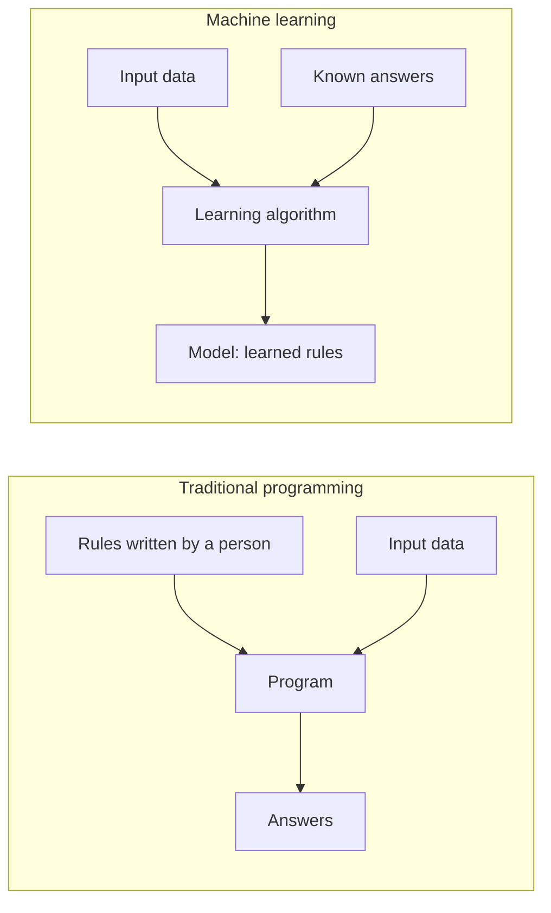
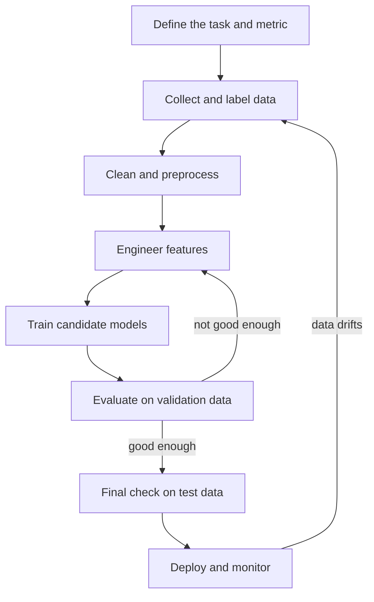

Until now, every program you have written followed rules you typed in yourself. Machine learning turns that around: you supply examples of the behaviour you want, and an algorithm works out the rules. A spam filter, a demand forecast, a face detector and a large language model are all built this way. This lesson sets out what "learning" means precisely, introduces the vocabulary used throughout the rest of the curriculum, and trains your first model.

## Rules versus examples

Suppose you need to flag fraudulent card payments. The traditional approach is to write the logic by hand: if the amount is over some threshold and the country differs from the card's home country, flag it. That works until fraudsters change tactics, and nobody can write rules for the thousands of subtle patterns that separate fraud from normal spending.

The machine learning approach is to collect past payments that were labelled as fraud or not fraud, and let an algorithm find the patterns that separate them.



The output of learning is a **model**: a function that maps new inputs to predictions. Once trained, the model is used like any other function.

> [!KEY]
> Machine learning is worth using when the rules are too complex to write by hand, change over time, or are simply unknown, but examples of correct behaviour are available.

## A working definition

The classic definition comes from Tom Mitchell's 1997 textbook *Machine Learning*:

> A computer program is said to learn from experience E with respect to some class of tasks T and performance measure P, if its performance at tasks in T, as measured by P, improves with experience E.

For the fraud example, the task T is classifying payments, the performance measure P is, say, the fraction of fraud caught at an acceptable false-alarm rate, and the experience E is the archive of labelled payments. The definition is useful because it forces you to name all three before you start. Many failed ML projects never agreed on P.

## The learning setup, formally

You will meet the same handful of symbols in every ML text, so it is worth fixing them now.

Each example is described by a **feature vector** $\mathbf{x} \in \mathbb{R}^d$, a list of $d$ numbers such as amount, hour of day and distance from home. Each example may also have a **label** (or **target**) $y$: a class such as fraud or not fraud, or a number such as a price. A **dataset** of $n$ examples is

$$
\mathcal{D} = \{(\mathbf{x}_1, y_1), (\mathbf{x}_2, y_2), \dots, (\mathbf{x}_n, y_n)\}
$$

In code the features are stacked into a matrix $X$ of shape $(n, d)$, one row per example, and the labels into a vector $y$ of length $n$. This is exactly the layout of a pandas DataFrame from [feature preparation](/learn/pandas/feature-preparation), and of the matrices from [scalars, vectors and matrices](/learn/linear-algebra/scalars-vectors-and-matrices).

A **hypothesis** is a candidate function $h(\mathbf{x})$ that predicts $y$. The learning algorithm searches a **hypothesis class** $\mathcal{H}$, the set of functions it is allowed to consider. For linear regression, $\mathcal{H}$ is all functions of the form $h(\mathbf{x}) = \mathbf{w}^\top \mathbf{x} + b$, and choosing a hypothesis means choosing the **parameters** $\mathbf{w}$ and $b$.

To compare hypotheses you need a **loss function** $\ell(h(\mathbf{x}), y)$ that measures how wrong one prediction is. Squared error $(h(\mathbf{x}) - y)^2$ is a common choice for numbers; [cross-entropy](/learn/essential-mathematics-for-machine-learning/cross-entropy) is the standard for classes. Averaging the loss over the training data gives the **empirical risk**:

$$
\hat{R}(h) = \frac{1}{n} \sum_{i=1}^{n} \ell\big(h(\mathbf{x}_i), y_i\big)
$$

Training means finding the $h \in \mathcal{H}$ that makes $\hat{R}(h)$ small. But that is not what you actually care about. You care about the **true risk**, the expected loss on new examples drawn from the same distribution $P$ that produced the data:

$$
R(h) = \mathbb{E}_{(\mathbf{x}, y) \sim P}\big[\ell(h(\mathbf{x}), y)\big]
$$

The ability of a model to keep its error low on data it has never seen is called **generalisation**. The gap between $\hat{R}(h)$ and $R(h)$ is the central problem of machine learning, and most of this module (validation, overfitting, the bias-variance tradeoff) is about measuring and controlling it.

| Term | Symbol | Fraud example |
| --- | --- | --- |
| Features | $\mathbf{x}$ | Amount, merchant type, hour, distance from home |
| Label | $y$ | 1 for fraud, 0 for legitimate |
| Hypothesis class | $\mathcal{H}$ | All logistic regression models |
| Parameters | $\mathbf{w}, b$ | One weight per feature plus a bias |
| Loss | $\ell$ | Cross-entropy |
| Generalisation | $R(h)$ | Performance on next month's payments |

## Learning is optimisation

How does an algorithm find good parameters? For many models it uses the [gradient descent](/learn/calculus/gradient-descent) you met in the calculus module: start with a guess, compute the gradient of the loss with respect to the parameters, and step downhill. Step through it for the tiny model $h(x) = wx$ trained on three points where the true rule is $y = 2x$.

```trace
{
  "title": "learning one weight by gradient descent",
  "code": [
    "x = np.array([1.0, 2.0, 3.0]); y = np.array([2.0, 4.0, 6.0])",
    "w = 0.0; lr = 0.1",
    "for step in range(3):",
    "    pred = w * x",
    "    loss = np.mean((pred - y) ** 2)",
    "    grad = np.mean(2 * (pred - y) * x)",
    "    w = w - lr * grad",
    "    print(f\"step {step}: loss={loss:.3f} grad={grad:.3f} w={w:.3f}\")"
  ],
  "steps": [
    { "line": 2, "vars": { "w": "0.0", "lr": "0.1" }, "note": "The model knows nothing yet: w starts at zero, so it predicts 0 for everything." },
    { "line": 5, "vars": { "w": "0.0", "pred": "[0, 0, 0]", "loss": "18.667" }, "note": "Errors are -2, -4, -6. Their squares average to 56 / 3 = 18.667." },
    { "line": 6, "vars": { "w": "0.0", "loss": "18.667", "grad": "-18.667" }, "note": "The gradient of the mean squared error with respect to w is negative: increasing w will reduce the loss." },
    { "line": 8, "vars": { "w": "1.867", "loss": "18.667", "grad": "-18.667" }, "out": ["step 0: loss=18.667 grad=-18.667 w=1.867"], "note": "w moves against the gradient by lr times its size: 0 - 0.1 * (-18.667) = 1.867." },
    { "line": 8, "vars": { "w": "1.991", "loss": "0.083", "grad": "-1.244" }, "out": ["step 0: loss=18.667 grad=-18.667 w=1.867", "step 1: loss=0.083 grad=-1.244 w=1.991"], "note": "Now the predictions are close, the gradient is small, and so is the step." },
    { "line": 8, "vars": { "w": "1.999", "loss": "0.000", "grad": "-0.083" }, "out": ["step 0: loss=18.667 grad=-18.667 w=1.867", "step 1: loss=0.083 grad=-1.244 w=1.991", "step 2: loss=0.000 grad=-0.083 w=1.999"], "note": "w has almost reached the true value 2. The program learned the rule from examples alone." }
  ]
}
```

Real models have millions or billions of parameters instead of one, but the loop is the same: predict, measure the loss, compute gradients, update.

## Your first model in scikit-learn

**scikit-learn** is the standard Python library for classical machine learning, covered fully in [Module 16](/learn/machine-learning-libraries/scikit-learn). Every model in it follows the same pattern: create an estimator, call `fit(X, y)` to learn, then `predict(X)` to use it. Here a linear model learns flat prices from floor area, using synthetic data where the true rule is price = 2.5 x size + 40, plus noise.

```python
import numpy as np
from sklearn.linear_model import LinearRegression
from sklearn.model_selection import train_test_split

rng = np.random.default_rng(0)
size = rng.uniform(30, 150, size=200)                 # flat size in square metres
price = 2.5 * size + 40 + rng.normal(0, 15, size=200)  # price in thousands

X = size.reshape(-1, 1)   # features: shape (n_samples, n_features)
y = price                 # labels: shape (n_samples,)

X_train, X_test, y_train, y_test = train_test_split(X, y, test_size=0.25, random_state=0)

model = LinearRegression()
model.fit(X_train, y_train)

print(f"learned slope:     {model.coef_[0]:.3f}")
print(f"learned intercept: {model.intercept_:.3f}")
print(f"prediction for 100 m2: {model.predict([[100]])[0]:.1f}")
print(f"R^2 on unseen test data: {model.score(X_test, y_test):.3f}")
```

```output
learned slope:     2.441
learned intercept: 44.008
prediction for 100 m2: 288.1
R^2 on unseen test data: 0.971
```

The model recovered parameters close to the true 2.5 and 40 without being told them. They are not exact because the noise makes some rules look slightly better than the truth on this particular sample. Notice also that the score is computed on `X_test`, rows the model never saw during `fit`. That is the generalisation question in code form.

> [!NOTE]
> scikit-learn always expects `X` to be two-dimensional, even with a single feature. That is why the code calls `reshape(-1, 1)`, turning 200 numbers into a 200 x 1 matrix.

## The machine learning workflow

Fitting is a small part of the job. A typical project runs through these stages, and loops back often.



The rest of this module walks through these stages. Later modules cover the algorithms ([Module 13](/learn/supervised-learning-algorithms/linear-regression)), evaluation ([Module 15](/learn/model-evaluation/accuracy)) and deployment.

## When not to use machine learning

| Situation | Better choice |
| --- | --- |
| The rule is simple and known (tax brackets, unit conversion) | Ordinary code |
| Every decision must be exactly explainable and auditable | Rules, or a very simple model |
| You have no data, or no way to get labels | Rules first; collect data as you go |
| Mistakes are catastrophic and rare cases dominate | Rules plus human review, ML only as an aid |
| The pattern changes faster than you can retrain | Rethink the problem |

> [!WARNING]
> A model is only as good as the data it learned from. If historical labels encode a bias, such as past loan decisions that were unfair, the model will learn and repeat that bias faithfully.

## Exercises

**1.** For a system that predicts whether a customer will cancel a subscription next month, name the task T, a sensible performance measure P, and the experience E.

<details>
<summary>Show solution</summary>

T: classify each active customer as likely to cancel or not. P: for example, the share of actual cancellers found among the 10% of customers the model ranks as most at risk, since the retention team can only call that many. E: historical customer records with features (usage, tenure, plan, support tickets) and a label saying whether each customer cancelled in the following month.

</details>

**2.** Change the trace's learning rate to `lr = 0.5` and compute the first update by hand. What goes wrong?

<details>
<summary>Show solution</summary>

The first gradient is still -18.667, so `w = 0 - 0.5 * (-18.667) = 9.333`. That overshoots the true value 2 by a long way. The next gradient is large and positive, the step overshoots in the other direction even further, and the loss grows each step instead of shrinking. A learning rate that is too large makes gradient descent diverge.

</details>

**3.** Rerun the scikit-learn example with `size=20` instead of `size=200` in both places that generate data. How do the learned slope and intercept compare, and why?

<details>
<summary>Show solution</summary>

With only 20 examples (15 for training), the noise has a much larger influence and the learned parameters land further from 2.5 and 40. The exact values depend on the random draw. Less data means the empirical risk is a noisier estimate of the true risk, so the model that minimises it is less reliable.

</details>

```quiz
[
  {
    "q": "What does a learning algorithm produce?",
    "options": [
      "A labelled dataset",
      "A model: a function that maps inputs to predictions",
      "A set of hand-written rules",
      "A loss function"
    ],
    "answer": 1,
    "why": "The algorithm takes data (and usually labels) and outputs a model whose parameters encode the learned rules."
  },
  {
    "q": "What is generalisation?",
    "options": [
      "Low loss on the training data",
      "Using the same model for many tasks",
      "Low error on new data from the same distribution as the training data",
      "Using a larger hypothesis class"
    ],
    "answer": 2,
    "why": "Generalisation is about the true risk on unseen examples, not the empirical risk on the training set."
  },
  {
    "q": "In scikit-learn, what shape must `X` have for a dataset of 500 examples with 4 features?",
    "options": ["(4, 500)", "(500,)", "(2000,)", "(500, 4)"],
    "answer": 3,
    "why": "Rows are examples and columns are features, so `X` has shape (n_samples, n_features)."
  },
  {
    "q": "The empirical risk is:",
    "options": [
      "The average loss over the training examples",
      "The expected loss over all possible data",
      "The number of misclassified test examples",
      "The gradient of the loss"
    ],
    "answer": 0,
    "why": "Empirical risk is the sample average of the loss, which training minimises as a stand-in for the true risk."
  }
]
```
