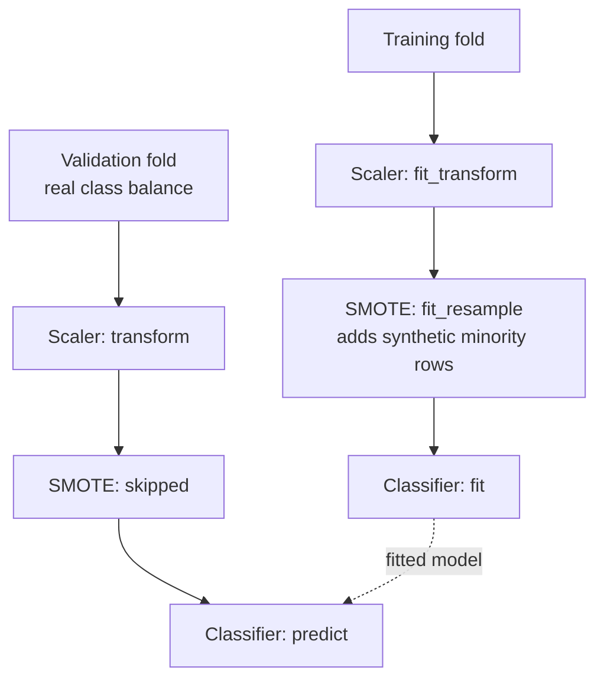
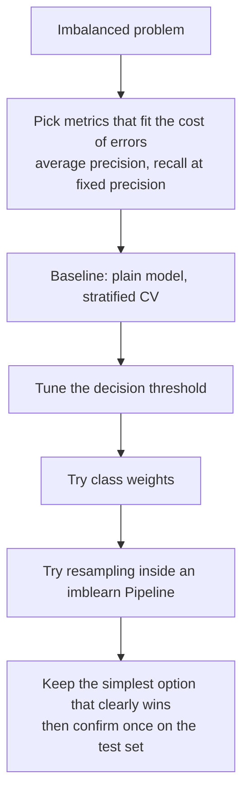

Many of the problems AI engineers are paid to solve are imbalanced: fraudulent transactions, failing machines, rare diseases, customers about to churn. The interesting class might be 1% of the data or less. As the [accuracy lesson](/learn/model-evaluation/accuracy) showed, a model that always predicts "not fraud" scores 99% accuracy and is useless. **Imbalanced-learn** (`imblearn`) is a library, built to work with scikit-learn, that provides resampling methods for this situation. This lesson covers what those methods do, the one rule you must follow when using them (resample only the training data), the simpler alternative of class weights, and how to judge whether any of it helped.

## Installation and a sample problem

```bash
pip install imbalanced-learn
```

The package is installed as `imbalanced-learn` and imported as `imblearn`. Here is a synthetic dataset where about 3% of rows are positive:

```python
import numpy as np
from sklearn.datasets import make_classification
from sklearn.model_selection import train_test_split

X, y = make_classification(n_samples=5000, n_features=10, n_informative=4,
                           weights=[0.97], flip_y=0.01, class_sep=1.0, random_state=0)
X_train, X_test, y_train, y_test = train_test_split(
    X, y, test_size=0.25, stratify=y, random_state=0)

print("class counts (train):", np.bincount(y_train))
print("positive rate:", round(y_train.mean(), 3))
```

```output
class counts (train): [3623  127]
positive rate: 0.034
```

With only 127 positives in the training set, any model sees very few examples of the class you care about, and a learner minimising average loss gains little from getting them right.

## The sampler API: `fit_resample`

Imbalanced-learn adds a new kind of object to the scikit-learn family: the **sampler**. Instead of `transform`, a sampler has `fit_resample(X, y)`, which returns a new `X` and `y` with a different number of rows.

```python
from imblearn.over_sampling import RandomOverSampler, SMOTE
from imblearn.under_sampling import RandomUnderSampler

for sampler in [RandomOverSampler(random_state=0),
                RandomUnderSampler(random_state=0),
                SMOTE(random_state=0)]:
    X_res, y_res = sampler.fit_resample(X_train, y_train)
    print(f"{type(sampler).__name__:18s} {np.bincount(y_res)}")
```

```output
RandomOverSampler  [3623 3623]
RandomUnderSampler [127 127]
SMOTE              [3623 3623]
```

| Sampler | What it does | Cost |
| --- | --- | --- |
| `RandomOverSampler` | Duplicates random minority rows | Exact copies encourage overfitting to those rows |
| `RandomUnderSampler` | Drops random majority rows | Throws away most of your data |
| `SMOTE` | Creates new synthetic minority rows by interpolation | Can create unrealistic points in overlapping regions |

All samplers take a `sampling_strategy` argument. The default balances the classes fully; a float such as `0.5` asks for a minority-to-majority ratio of 1:2 after resampling, which is often a better compromise than full balance.

## SMOTE and its variants

**SMOTE** (Synthetic Minority Over-sampling Technique) creates a new point by picking a minority example $\mathbf{x}_i$, picking one of its $k$ nearest minority neighbours $\mathbf{x}_{nn}$, and placing a point at a random position on the line between them:

$$
\mathbf{x}_{\text{new}} = \mathbf{x}_i + \lambda \, (\mathbf{x}_{nn} - \mathbf{x}_i), \qquad \lambda \sim \text{Uniform}(0, 1)
$$

Here $\mathbf{x}_i$ and $\mathbf{x}_{nn}$ are feature vectors and $\lambda$ is a random number between 0 and 1. The number of neighbours is set by `k_neighbors` (default 5). Because SMOTE uses distances, scale your features first, and remember that interpolating only makes sense for continuous features.

| Variant | Idea | Use when |
| --- | --- | --- |
| `BorderlineSMOTE` | Generates points only near the class boundary | The boundary region is where errors happen |
| `ADASYN` | Generates more points where minority examples are hardest to learn | Similar to Borderline; can amplify noise |
| `SMOTENC` | SMOTE for mixed numeric and categorical data | Some columns are categorical (pass their indices) |
| `SMOTEN` | SMOTE for purely categorical data | All columns are categorical |
| `SMOTETomek`, `SMOTEENN` | SMOTE followed by cleaning of overlapping points | Classes overlap heavily |

The library also has cleaning under-samplers such as `TomekLinks`, `EditedNearestNeighbours` and `NearMiss`, and ensemble models with built-in resampling such as `BalancedRandomForestClassifier` in `imblearn.ensemble`.

## The one rule: resample only the training fold

Resampling changes the data distribution. Your validation and test data must keep the **real** distribution, because that is what the model will meet in production. And synthetic points must never be generated from rows that will later be used for evaluation.

The tempting mistake is to resample the whole training set and then cross-validate. With SMOTE this is especially damaging: synthetic points created from a validation-fold row land in the training folds, so the model is effectively tested on near-copies of what it trained on.

```python
from sklearn.model_selection import StratifiedKFold, cross_val_score
from sklearn.ensemble import RandomForestClassifier
from imblearn.pipeline import make_pipeline

cv = StratifiedKFold(n_splits=5, shuffle=True, random_state=0)
forest = RandomForestClassifier(n_estimators=100, random_state=0, n_jobs=1)

# Wrong: oversample first, then cross-validate
X_smote, y_smote = SMOTE(random_state=0).fit_resample(X_train, y_train)
leaky = cross_val_score(forest, X_smote, y_smote, cv=cv, scoring="recall").mean()

# Right: SMOTE inside an imblearn pipeline, applied to each training fold only
pipe = make_pipeline(SMOTE(random_state=0), forest)
honest = cross_val_score(pipe, X_train, y_train, cv=cv, scoring="recall").mean()

print(f"leaky recall: {leaky:.3f}   honest recall: {honest:.3f}")
```

```output
leaky recall: 0.982   honest recall: 0.566
```

The leaky estimate is not just optimistic, it is fiction: the validation folds were mostly synthetic and balanced, nothing like real data.

The fix is `imblearn.pipeline.Pipeline` (or `make_pipeline`), a drop-in replacement for scikit-learn's. During `fit` it calls `fit_resample` on sampler steps; during `predict` and `score` it **skips** them, so validation and test data pass through untouched.



> [!KEY]
> Use `imblearn.pipeline.Pipeline`, not `sklearn.pipeline.Pipeline`, whenever a sampler is a step. Never resample validation or test data, and never resample before splitting.

## Class weights: the simpler alternative

Instead of changing the data, you can change the loss. Most scikit-learn classifiers accept `class_weight`, which multiplies each example's loss by the weight of its class. With `class_weight="balanced"`, the weight of class $c$ is

$$
w_c = \frac{n}{k \, n_c}
$$

where $n$ is the number of training rows, $k$ the number of classes and $n_c$ the number of rows in class $c$. Rare classes get large weights. On this training set that gives the positive class a weight of about 14.8 and the negative class about 0.52.

| Library | Setting |
| --- | --- |
| scikit-learn | `class_weight="balanced"` or a dictionary such as `{0: 1, 1: 20}` |
| XGBoost | `scale_pos_weight` (around negatives divided by positives) |
| LightGBM | `class_weight="balanced"` in the scikit-learn API, or `is_unbalance=True` natively |
| Any estimator with `sample_weight` | Pass per-row weights to `fit` |

Class weights use all the data, add no synthetic points, are deterministic, and cost nothing extra in training time. Try them before resampling.

## Comparing approaches with the right metrics

To compare fairly, evaluate every option with the same cross-validation splits and with metrics that respect imbalance: [precision](/learn/model-evaluation/precision), [recall](/learn/model-evaluation/recall), balanced accuracy, and **average precision** (the area under the precision-recall curve), which, unlike accuracy, is not dominated by the majority class.

```python
import warnings
from sklearn.model_selection import cross_validate
from sklearn.ensemble import HistGradientBoostingClassifier

warnings.filterwarnings("ignore")   # hide precision warnings from folds with no positive predictions

def hgb(**kw):
    return HistGradientBoostingClassifier(random_state=0, **kw)

candidates = {
    "plain": hgb(),
    "class_weight": hgb(class_weight="balanced"),
    "undersample": make_pipeline(RandomUnderSampler(random_state=0), hgb()),
    "smote": make_pipeline(SMOTE(random_state=0), hgb()),
}
metrics = ["average_precision", "precision", "recall", "balanced_accuracy"]
print(f"{'':13s}" + "".join(f"{m:>19s}" for m in metrics))
for name, model in candidates.items():
    res = cross_validate(model, X_train, y_train, cv=cv, scoring=metrics)
    print(f"{name:13s}" + "".join(f"{res['test_' + m].mean():19.3f}" for m in metrics))
```

```output
               average_precision          precision             recall  balanced_accuracy
plain                      0.653              0.952              0.479              0.739
class_weight               0.638              0.818              0.527              0.761
undersample                0.413              0.100              0.701              0.739
smote                      0.621              0.506              0.606              0.792
```

Read this table carefully, because it shows what resampling really does:

- **Average precision barely moves, or falls.** It measures how well the model *ranks* positives above negatives, independent of any threshold. Rebalancing did not make the model better at ranking; undersampling made it clearly worse by discarding most of the data.
- **Precision and recall trade off.** The plain model predicts positive rarely and is usually right (high precision, low recall). Resampling and weighting push predictions towards the positive class: recall rises and precision falls.

In other words, much of the benefit of resampling is **moving the decision threshold**, and you can often get the same effect more directly by keeping the plain model and choosing a threshold on its predicted probabilities, using the precision-recall trade-off your application needs. Recent scikit-learn versions include `TunedThresholdClassifierCV` for choosing a threshold with cross-validation.

> [!TIP]
> Resampling also distorts predicted probabilities: a model trained on balanced data believes positives are far more common than they are. If downstream code needs calibrated probabilities (for expected cost, or for ranking against other models), prefer class weights or threshold tuning, or recalibrate on real-distribution data.

## A practical recipe



Resampling is a tool, not a default. It helps most with learners that struggle to focus on rare classes and on small datasets; with strong gradient-boosted models and a tuned threshold it often adds little.

## Exercises

**1.** Take the `"smote"` pipeline and change `SMOTE(random_state=0)` to `SMOTE(sampling_strategy=0.3, random_state=0)`. What does `0.3` mean, and which way would you expect precision and recall to move compared with full balancing?

<details>
<summary>Show solution</summary>

`0.3` means that after resampling the minority class should have 30% as many rows as the majority class, rather than equal numbers. Less oversampling pushes the model less towards the positive class, so you would expect higher precision and lower recall than full balancing. On this data, precision rises to about 0.64 and recall falls to about 0.54, against 0.51 and 0.61 for full balancing:

```python
partial = make_pipeline(SMOTE(sampling_strategy=0.3, random_state=0), hgb())
res = cross_validate(partial, X_train, y_train, cv=cv, scoring=metrics)
print({m: round(res["test_" + m].mean(), 3) for m in metrics})
```

</details>

**2.** A colleague scales the data with `StandardScaler`, applies SMOTE to the full dataset, then splits into train and test. List the problems.

<details>
<summary>Show solution</summary>

The scaler was fitted on all data, including the test rows, which leaks their statistics. SMOTE was applied before the split, so synthetic points derived from test rows are in the training set, and the test set contains synthetic points and an artificial class balance. The test score is meaningless. Split first, then put the scaler and SMOTE in an `imblearn` pipeline fitted only on training data.

</details>

**3.** Using the `"plain"` model, fit it on `X_train`, predict probabilities on `X_test`, and find the threshold that gives the highest F1-score. Compare that F1 with the one at the default threshold of 0.5.

<details>
<summary>Show solution</summary>

```python
from sklearn.metrics import f1_score

plain = hgb().fit(X_train, y_train)
proba = plain.predict_proba(X_test)[:, 1]
thresholds = np.linspace(0.05, 0.95, 19)
f1s = [f1_score(y_test, proba >= t) for t in thresholds]
best = thresholds[int(np.argmax(f1s))]
print(f"F1 at 0.5: {f1_score(y_test, proba >= 0.5):.3f}  best threshold: {best:.2f}  F1: {max(f1s):.3f}")
```

Here the F1-score rises from about 0.53 at 0.5 to about 0.59 at a threshold of 0.15, with no resampling at all. Choosing the threshold on the test set, as this exercise does for illustration, makes the best F1 optimistic. In real work, choose it with cross-validation on training data (for example with `TunedThresholdClassifierCV`) and report the test score once.

</details>

```quiz
[
  {
    "q": "What does `imblearn.pipeline.Pipeline` do with a SMOTE step when you call `predict`?",
    "options": [
      "Applies SMOTE to the new data",
      "Skips it, so the data passes through unchanged",
      "Raises an error",
      "Undersamples the new data instead"
    ],
    "answer": 1,
    "why": "Samplers act only during `fit`. Prediction and scoring data keep their real distribution."
  },
  {
    "q": "Why is applying SMOTE before cross-validation especially misleading?",
    "options": [
      "SMOTE is slow",
      "Cross-validation cannot handle more than two classes",
      "SMOTE removes the majority class",
      "Synthetic points interpolated from validation rows end up in the training folds, and validation folds become artificially balanced"
    ],
    "answer": 3,
    "why": "The model is evaluated on data that is partly derived from its own training data and does not reflect the real class balance."
  },
  {
    "q": "With `class_weight=\"balanced\"`, 900 negatives and 100 positives, what weight does the positive class get?",
    "options": [
      "0.1",
      "1",
      "5",
      "9"
    ],
    "answer": 2,
    "why": "w = n / (k n_c) = 1000 / (2 x 100) = 5. The negatives get 1000 / (2 x 900), about 0.56."
  },
  {
    "q": "Resampling raised recall but average precision did not improve. What is the most likely explanation?",
    "options": [
      "Resampling mainly shifted the effective decision threshold rather than improving the ranking",
      "The model became better at ranking positives",
      "Average precision is computed on training data",
      "The data was not scaled"
    ],
    "answer": 0,
    "why": "Average precision is threshold-free. A gain in recall with no gain in ranking quality means the operating point moved, which threshold tuning can also achieve."
  }
]
```
