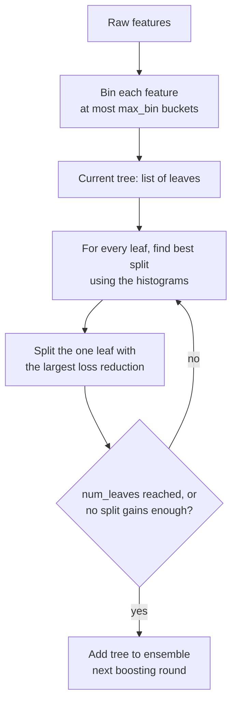

LightGBM is Microsoft's gradient-boosting library. It solves the same problem as [XGBoost](/learn/machine-learning-libraries/xgboost), and the two often reach similar accuracy, but LightGBM was designed from the start for speed and memory efficiency on large tabular datasets. The [LightGBM lesson in Supervised Learning Algorithms](/learn/supervised-learning-algorithms/lightgbm) explained its ideas: histogram-based splits, leaf-wise tree growth and native categorical handling. This lesson shows how to use the library well: its two APIs, early stopping through callbacks, categorical columns, importance, and the parameters that matter most, including the one that most often catches people out, `num_leaves`.

## Installation and first check

```bash
pip install lightgbm
```

Like XGBoost, LightGBM relies on OpenMP; on macOS an import error mentioning `libomp.dylib` is fixed with `brew install libomp`. The standard wheel trains on the CPU. GPU training needs a build with GPU support enabled; the installation guide in the official documentation describes the options for your platform.

```python
import lightgbm as lgb
print(lgb.__version__)
```

The examples in this lesson were run with LightGBM 4.x.

## How LightGBM trains

Two design choices explain most of LightGBM's behaviour and most of its tuning advice.

**Histogram binning.** Before training, each feature is bucketed into at most `max_bin` bins (255 by default). Split finding then scans bins rather than every unique value, which is much faster. XGBoost's `hist` method uses the same idea.

**Leaf-wise growth.** Most tree learners grow level by level: every node at depth 2 is split before any at depth 3. LightGBM instead always splits the single leaf, anywhere in the tree, that reduces the loss the most. For the same number of leaves this usually fits better, but it can grow deep, lopsided trees that overfit small datasets. Tree size is therefore controlled mainly by `num_leaves`, not `max_depth`.



## The scikit-learn API with early stopping

`LGBMClassifier` and `LGBMRegressor` behave like any scikit-learn estimator. Early stopping is configured through a **callback** passed to `fit`. This uses the same synthetic data and splits as the XGBoost lesson, so you can compare:

```python
import numpy as np
import pandas as pd
from sklearn.datasets import make_classification
from sklearn.model_selection import train_test_split
from sklearn.metrics import roc_auc_score

X, y = make_classification(n_samples=5000, n_features=20, n_informative=8,
                           flip_y=0.05, random_state=0)
X = pd.DataFrame(X, columns=[f"f{i}" for i in range(20)])
X_tmp, X_test, y_tmp, y_test = train_test_split(X, y, test_size=0.2, stratify=y, random_state=0)
X_train, X_val, y_train, y_val = train_test_split(X_tmp, y_tmp, test_size=0.2,
                                                  stratify=y_tmp, random_state=0)

clf = lgb.LGBMClassifier(
    n_estimators=2000,
    learning_rate=0.05,
    num_leaves=15,
    min_child_samples=20,
    subsample=0.8,
    subsample_freq=1,        # without this, subsample is ignored
    colsample_bytree=0.8,
    random_state=0,
    n_jobs=1,
    verbose=-1,              # silence training logs
)
clf.fit(X_train, y_train,
        eval_set=[(X_val, y_val)], eval_metric="binary_logloss",
        callbacks=[lgb.early_stopping(50, verbose=False)])

print("best iteration:", clf.best_iteration_)
print("test ROC-AUC:", round(roc_auc_score(y_test, clf.predict_proba(X_test)[:, 1]), 4))
```

```output
best iteration: 371
test ROC-AUC: 0.9692
```

> [!NOTE]
> `eval_set` has been the evaluation argument throughout LightGBM 4.x. The newest releases have started to deprecate it in favour of separate `eval_X` and `eval_y` arguments and emit a deprecation warning when you use it, as the code above may do. If your version warns, switch to the new names; if it rejects them, your version predates the change. Check the documentation for the version you have pinned.

## The native API: Dataset and `lgb.train`

The native API mirrors XGBoost's: wrap data in `lgb.Dataset`, pass a parameter dictionary to `lgb.train`. Pass `reference=dtrain` when building the validation `Dataset` so it reuses the training set's bin boundaries.

```python
dtrain = lgb.Dataset(X_train, label=y_train)
dval = lgb.Dataset(X_val, label=y_val, reference=dtrain)

params = {
    "objective": "binary",
    "metric": "binary_logloss",
    "learning_rate": 0.05,
    "num_leaves": 15,
    "min_data_in_leaf": 20,
    "bagging_fraction": 0.8,
    "bagging_freq": 1,
    "feature_fraction": 0.8,
    "seed": 0,
    "num_threads": 1,
    "verbose": -1,
}
history = {}
booster = lgb.train(params, dtrain, num_boost_round=2000,
                    valid_sets=[dval], valid_names=["val"],
                    callbacks=[lgb.early_stopping(50, verbose=False),
                               lgb.record_evaluation(history)])

print("best iteration:", booster.best_iteration)
print("rounds evaluated:", len(history["val"]["binary_logloss"]))
proba = booster.predict(X_test, num_iteration=booster.best_iteration)
print("test ROC-AUC:", round(roc_auc_score(y_test, proba), 4))
```

```output
best iteration: 371
rounds evaluated: 421
test ROC-AUC: 0.9692
```

`record_evaluation` stores the validation curve, which you can plot to see where improvement stopped. `lgb.log_evaluation(period=100)` prints progress every 100 rounds instead, and `lgb.cv` runs cross-validation with early stopping on a `Dataset`.

LightGBM has many parameter **aliases**: the native names above and the scikit-learn names map onto each other.

| scikit-learn API | Native name | Meaning |
| --- | --- | --- |
| `n_estimators` | `num_boost_round` (argument to `lgb.train`) | Maximum number of trees |
| `min_child_samples` | `min_data_in_leaf` | Minimum rows in a leaf |
| `subsample` + `subsample_freq` | `bagging_fraction` + `bagging_freq` | Row sampling, and how often to resample |
| `colsample_bytree` | `feature_fraction` | Column sampling per tree |
| `reg_alpha`, `reg_lambda` | `lambda_l1`, `lambda_l2` | L1 and L2 regularisation |
| `random_state` | `seed` | Random seed |

> [!WARNING]
> Row subsampling is off unless the frequency is positive. `subsample=0.8` on its own does nothing, because `subsample_freq` defaults to 0. Set both.

## Categorical features

LightGBM handles categorical columns natively. With a pandas DataFrame, any column of `category` dtype is treated as categorical automatically. You can also name columns explicitly with `categorical_feature=[...]` on a `Dataset` (the values must then be non-negative integers).

```python
rng = np.random.default_rng(1)
n = 4000
cities = ["leeds", "york", "bath", "hull", "ely"]
city_type = pd.CategoricalDtype(categories=cities)      # define the categories once

df = pd.DataFrame({
    "city": pd.Series(rng.choice(cities, n)).astype(city_type),
    "income": rng.normal(50, 15, n),
})
effect = df["city"].map({"leeds": 1.0, "york": -0.5, "bath": 0.8,
                         "hull": -1.0, "ely": 0.0}).astype(float)
y_cat = (rng.random(n) < 1 / (1 + np.exp(-(effect + 0.05 * (df["income"] - 50))))).astype(int)

cat_model = lgb.LGBMClassifier(n_estimators=200, learning_rate=0.05, num_leaves=15,
                               random_state=0, n_jobs=1, verbose=-1)
cat_model.fit(df, y_cat)

new = pd.DataFrame({"city": pd.Series(["york", "leeds"]).astype(city_type),
                    "income": [50.0, 50.0]})
print(cat_model.predict_proba(new)[:, 1].round(3))
```

```output
[0.328 0.661]
```

York has a negative effect and Leeds a positive one, and at equal income the model reflects that. Defining `city_type` once and applying it to both training and serving data keeps the category-to-code mapping identical.

Native categorical splits work best when categories have reasonable counts. For very high-cardinality columns with many rare values, the categorical splits can overfit; `min_data_per_group` and `cat_smooth` regularise them, and grouping rare values into an "other" category before training also helps.

## Feature importance

The scikit-learn wrapper's `feature_importances_` uses `importance_type="split"` by default: the number of times each feature was used. The booster can also report `"gain"`, the total loss reduction.

```python
imp = pd.DataFrame({
    "split": booster.feature_importance(importance_type="split"),
    "gain": booster.feature_importance(importance_type="gain").round(1),
}, index=booster.feature_name())
print(imp.sort_values("gain", ascending=False).head(5))
```

```output
     split    gain
f13    374  9106.5
f11    363  6145.3
f3     425  3984.7
f0     287  3746.1
f15    427  2578.1
```

The two rankings disagree: `f15` and `f3` are used most often, yet `f13` contributes the most loss reduction. The same caveats as in the XGBoost lesson apply: split counts favour features with many distinct values, and both measures are computed from training data. Use permutation importance on held-out data when the question is "what does the model rely on for prediction?".

## XGBoost or LightGBM?

| Aspect | XGBoost | LightGBM |
| --- | --- | --- |
| Default tree growth | Depth-wise | Leaf-wise |
| Main size control | `max_depth` | `num_leaves` |
| Categorical support | Yes, with `enable_categorical=True` | Yes, from `category` dtype automatically |
| Early stopping | Constructor argument | Callback |
| Typical strength | Mature, many deployment integrations | Very fast on large data, low memory |

On most problems the honest answer is: try both with early stopping and a small random search, and pick on validation results. The difference between them is usually smaller than the difference good features make.

## Key hyperparameters and a tuning recipe

| Parameter | Typical range | Notes |
| --- | --- | --- |
| `num_leaves` | 15 to 255 | The main complexity control; keep it below $2^{\text{max\_depth}}$ if you also set `max_depth` |
| `min_child_samples` | 10 to 200 | Raise it to fight overfitting on small or noisy data |
| `learning_rate` | 0.01 to 0.1 | Lower is more accurate but needs more trees |
| `subsample`, `subsample_freq` | 0.6 to 1.0, 1 | Row bagging; remember the frequency |
| `colsample_bytree` | 0.5 to 1.0 | Column sampling |
| `reg_lambda`, `reg_alpha` | 0 to 10 | Leaf-weight regularisation |
| `max_bin` | 63 to 255 | Fewer bins are faster and act as mild regularisation |

The recipe mirrors XGBoost's: fix `learning_rate` near 0.05 to 0.1 with early stopping; tune `num_leaves` and `min_child_samples` together; then sampling; then regularisation; finally lower the learning rate and let early stopping find the tree count. Check the result on a test set used only once.

## Exercises

**1.** Retrain the first `LGBMClassifier` with `subsample=0.5` but no `subsample_freq`, and again with `subsample_freq=1`. Which run actually subsamples rows, and how could you tell from the results?

<details>
<summary>Show solution</summary>

Only the run with `subsample_freq=1` subsamples. Without it, `subsample=0.5` is ignored, so the first run gives exactly the same `best_iteration_` and test score as a model with `subsample=1.0`:

```python
for freq in [0, 1]:
    m = lgb.LGBMClassifier(n_estimators=2000, learning_rate=0.05, num_leaves=15,
                           subsample=0.5, subsample_freq=freq, colsample_bytree=0.8,
                           random_state=0, n_jobs=1, verbose=-1)
    m.fit(X_train, y_train, eval_set=[(X_val, y_val)],
          callbacks=[lgb.early_stopping(50, verbose=False)])
    print(freq, m.best_iteration_)
```

</details>

**2.** A model with `num_leaves=255` and `min_child_samples=5` scores far better on training data than on validation data, on a dataset of 3,000 rows. Name two parameter changes you would try first.

<details>
<summary>Show solution</summary>

The model is overfitting through very large, leaf-wise trees with tiny leaves. Reduce `num_leaves` substantially (for example to 15 or 31) and raise `min_child_samples` (for example to 30 or more). Row and column subsampling and `reg_lambda` are the next levers.

</details>

**3.** Why should the validation `Dataset` be built with `reference=dtrain`?

<details>
<summary>Show solution</summary>

LightGBM bins features before training. `reference=dtrain` makes the validation set use the training set's bin boundaries, so feature values map to the same bins the trees were built on. Without it, the validation data could be binned differently.

</details>

```quiz
[
  {
    "q": "What mainly controls tree complexity in LightGBM?",
    "options": [
      "`max_depth`",
      "`n_estimators`",
      "`num_leaves`",
      "`max_bin`"
    ],
    "answer": 2,
    "why": "Trees grow leaf-wise, so the number of leaves, not the depth, is the primary limit on their size."
  },
  {
    "q": "How do you enable early stopping with `LGBMClassifier.fit`?",
    "options": [
      "Pass `early_stopping_rounds=50` to the constructor",
      "Pass `callbacks=[lgb.early_stopping(50)]` together with an evaluation set",
      "Set `n_estimators=\"auto\"`",
      "It is always on"
    ],
    "answer": 1,
    "why": "LightGBM 4 configures early stopping through the `early_stopping` callback; it needs validation data to monitor."
  },
  {
    "q": "You set `subsample=0.7` and leave everything else at defaults. What happens?",
    "options": [
      "Each tree uses 70% of rows",
      "Each tree uses 70% of columns",
      "Training fails with an error",
      "Nothing: row subsampling needs `subsample_freq` greater than 0"
    ],
    "answer": 3,
    "why": "Bagging only runs when its frequency is positive, and `subsample_freq` defaults to 0."
  },
  {
    "q": "How does LightGBM detect categorical columns in a pandas DataFrame by default?",
    "options": [
      "Columns of `category` dtype",
      "Columns with string values",
      "Columns with fewer than 10 unique values",
      "It never does; you must one-hot encode"
    ],
    "answer": 0,
    "why": "With the default `categorical_feature=\"auto\"`, pandas `category` columns are treated as categorical."
  }
]
```
