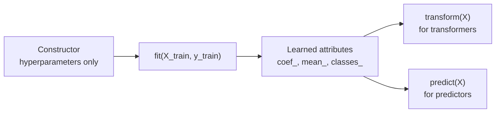
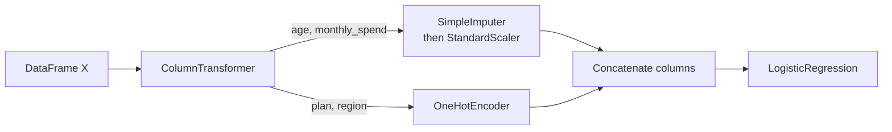

Scikit-learn is the standard Python library for classical machine learning. You have already used it throughout the previous modules to fit [logistic regression](/learn/supervised-learning-algorithms/logistic-regression), [k-means](/learn/unsupervised-learning/k-means-clustering) and [cross-validation](/learn/model-evaluation/cross-validation). This lesson steps back from individual algorithms and looks at the library itself: the small set of conventions every estimator follows, and the tools (`Pipeline`, `ColumnTransformer`, custom transformers, persistence) that turn a notebook experiment into a model you can trust and ship. Most bugs in real scikit-learn code are not in the algorithms; they are in how the pieces are wired together.

## The estimator API

Every object in scikit-learn that learns from data is an **estimator**, and every estimator follows the same contract:

1. **Hyperparameters go in the constructor.** `LogisticRegression(C=0.5)` stores `C` and does nothing else.
2. **Learning happens in `fit`.** `fit(X, y)` (or `fit(X)` for unsupervised models) estimates parameters from data and returns the estimator itself.
3. **Learned state ends in an underscore.** After fitting you get attributes such as `coef_`, `classes_`, `mean_` or `cluster_centers_`. If an attribute ends in `_`, it came from the data.

On top of `fit`, estimators add methods according to what they do:

| Method | Provided by | Returns |
| --- | --- | --- |
| `fit(X, y)` | Every estimator | The fitted estimator (`self`) |
| `predict(X)` | Classifiers, regressors, some clusterers | Labels or values |
| `predict_proba(X)` | Most classifiers | Class probabilities, one column per class in `classes_` order |
| `decision_function(X)` | Linear models, SVMs | Unthresholded scores |
| `transform(X)` | Transformers (scalers, encoders, PCA) | A transformed feature matrix |
| `fit_transform(X)` | Transformers | Same as `fit(X).transform(X)`, sometimes faster |
| `score(X, y)` | Classifiers, regressors | Accuracy or $R^2$ by default |
| `get_params()` / `set_params()` | Every estimator | The constructor arguments as a dictionary |



Because every estimator shares this shape, you can swap a `RandomForestClassifier` for a `LogisticRegression` without touching the rest of your code, and tools such as `GridSearchCV` can work with any model.

## A realistic dataset

Real tabular data mixes numeric and categorical columns and has gaps. Here is a small synthetic churn dataset with exactly those problems:

```python
import numpy as np
import pandas as pd

rng = np.random.default_rng(0)
n = 1000
df = pd.DataFrame({
    "age": rng.integers(18, 80, n).astype(float),
    "monthly_spend": rng.gamma(2.0, 30.0, n).round(2),
    "plan": rng.choice(["basic", "plus", "pro"], n, p=[0.5, 0.3, 0.2]),
    "region": rng.choice(["north", "south", "east", "west"], n),
})
df.loc[rng.random(n) < 0.05, "age"] = np.nan          # about 5% missing
logit = (-1.0 + 0.02 * (df["monthly_spend"] - 60)
         - 0.03 * (df["age"].fillna(45) - 45) + 0.8 * (df["plan"] == "basic"))
df["churned"] = (rng.random(n) < 1 / (1 + np.exp(-logit))).astype(int)

print(df.head())
print("churn rate:", df["churned"].mean())
```

```output
    age  monthly_spend   plan region  churned
0  70.0         123.01  basic   west        1
1  57.0          25.21  basic   east        0
2  49.0          58.91   plus  north        0
3  34.0         108.63   plus   east        0
4  37.0          42.18  basic   east        0
churn rate: 0.371
```

## Pipelines: preprocessing that cannot leak

Scaling, imputing and encoding all **learn** something: a mean, a median, a list of categories. If they learn it from the whole dataset before you split, information from the test set leaks into training and your scores become optimistic. The section on [data preprocessing](/learn/machine-learning-fundamentals/data-preprocessing) explained why; a `Pipeline` is how scikit-learn makes the correct behaviour automatic.

A `Pipeline` chains transformers and ends with a final estimator. Calling `fit` on the pipeline calls `fit_transform` on each step in turn and `fit` on the last one. Calling `predict` calls only `transform` on each step, using what was learned during `fit`.

A `ColumnTransformer` applies different preprocessing to different columns and concatenates the results side by side.



```python
from sklearn.model_selection import train_test_split
from sklearn.pipeline import Pipeline
from sklearn.compose import ColumnTransformer
from sklearn.impute import SimpleImputer
from sklearn.preprocessing import StandardScaler, OneHotEncoder
from sklearn.linear_model import LogisticRegression

X = df.drop(columns="churned")
y = df["churned"]
X_train, X_test, y_train, y_test = train_test_split(
    X, y, test_size=0.2, stratify=y, random_state=42)

numeric = ["age", "monthly_spend"]
categorical = ["plan", "region"]

preprocess = ColumnTransformer([
    ("num", Pipeline([("impute", SimpleImputer(strategy="median")),
                      ("scale", StandardScaler())]), numeric),
    ("cat", OneHotEncoder(handle_unknown="ignore"), categorical),
])
model = Pipeline([("pre", preprocess), ("clf", LogisticRegression(max_iter=1000))])

model.fit(X_train, y_train)
print("test accuracy:", round(model.score(X_test, y_test), 3))
print(model[:-1].get_feature_names_out())
```

```output
test accuracy: 0.715
['num__age' 'num__monthly_spend' 'cat__plan_basic' 'cat__plan_plus'
 'cat__plan_pro' 'cat__region_east' 'cat__region_north'
 'cat__region_south' 'cat__region_west']
```

A few details worth noticing:

- `handle_unknown="ignore"` means a category that appears only in production (a new region) becomes an all-zero row instead of an exception.
- `model[:-1]` slices the pipeline, giving every step except the classifier. `model.named_steps["clf"]` or `model["clf"]` reaches a single step.
- `get_feature_names_out()` tells you which output column is which, essential when you inspect coefficients.

The whole pipeline is one estimator, so it goes straight into cross-validation. Every fold refits the imputer, scaler and encoder on that fold's training part only:

```python
from sklearn.model_selection import cross_val_score

scores = cross_val_score(model, X_train, y_train, cv=5, scoring="roc_auc")
print(scores.round(3), "mean:", scores.mean().round(3))
```

```output
[0.771 0.759 0.778 0.756 0.739] mean: 0.76
```

### Tuning steps inside a pipeline

Hyperparameters of nested steps are addressed with double underscores: `step__param`. This is how [grid search](/learn/model-evaluation/grid-search) reaches inside a pipeline.

```python
from sklearn.model_selection import GridSearchCV

grid = GridSearchCV(
    model,
    param_grid={
        "clf__C": [0.01, 0.1, 1.0],
        "pre__num__impute__strategy": ["mean", "median"],
    },
    cv=5, scoring="roc_auc")
grid.fit(X_train, y_train)
print(grid.best_params_)
```

```output
{'clf__C': 0.1, 'pre__num__impute__strategy': 'median'}
```

> [!KEY]
> If a step learns anything from data, it belongs inside the pipeline. Anything you `fit` outside the pipeline before cross-validation is a potential leak.

## Custom transformers

Sooner or later you need preprocessing that scikit-learn does not provide. For a stateless function, `FunctionTransformer` is enough:

```python
from sklearn.preprocessing import FunctionTransformer

log_spend = FunctionTransformer(np.log1p, feature_names_out="one-to-one")
```

When the transformation must learn something, write a class. Inherit from `BaseEstimator` (which gives you `get_params` and `set_params` for free) and `TransformerMixin` (which gives you `fit_transform`). This transformer clips each column to quantiles learned on the training data:

```python
from sklearn.base import BaseEstimator, TransformerMixin

class QuantileClipper(BaseEstimator, TransformerMixin):
    def __init__(self, lower=0.01, upper=0.99):
        self.lower = lower          # store arguments unchanged, nothing else
        self.upper = upper

    def fit(self, X, y=None):
        X = np.asarray(X, dtype=float)
        self.low_ = np.nanquantile(X, self.lower, axis=0)
        self.high_ = np.nanquantile(X, self.upper, axis=0)
        return self                 # always return self

    def transform(self, X):
        return np.clip(np.asarray(X, dtype=float), self.low_, self.high_)

clipper = QuantileClipper(upper=0.95).fit(X_train[["monthly_spend"]])
print(clipper.high_.round(2), clipper.get_params())
```

```output
[143.69] {'lower': 0.01, 'upper': 0.95}
```

The rules that keep a custom estimator compatible with cloning, grid search and pipelines:

| Rule | Why |
| --- | --- |
| `__init__` only stores its arguments, under the same names | `clone` and `set_params` rebuild the object from `get_params()` |
| No validation or computation in `__init__` | Grid search sets parameters after construction |
| Learned values go in `fit`, named with a trailing `_` | Marks them as fitted state |
| `fit` returns `self` | Enables chaining such as `.fit(X).transform(X)` |
| `transform` uses only fitted state | Otherwise test data influences its own preprocessing |

## Saving and loading models with joblib

A fitted pipeline is a Python object, and the usual way to save it is `joblib`, which handles large NumPy arrays efficiently:

```python
import joblib

joblib.dump(model, "churn_model.joblib")
loaded = joblib.load("churn_model.joblib")
print(loaded.predict_proba(X_test.head(3)).round(3))
```

```output
[[0.365 0.635]
 [0.79  0.21 ]
 [0.907 0.093]]
```

Saving the **whole pipeline**, not just the classifier, matters: the loaded object applies exactly the imputation, scaling and encoding learned at training time.

> [!WARNING]
> `joblib` files are pickles. Loading one can execute arbitrary code, so **never load a model file from a source you do not trust**, such as an unknown download or a user upload. If you must exchange models across a trust boundary, look at the restricted formats offered by projects such as `skops`, or export to a format like ONNX.

Pickled models are also tied to library versions. A model saved with one scikit-learn version is not guaranteed to load, or to behave identically, in another. Record the versions alongside the file (a pinned `requirements.txt` from the [virtual environments](/learn/developer-tools/virtual-environments) lesson does this) and retrain rather than force a load across versions.

## Reproducibility and `random_state`

Many estimators and utilities use randomness: `train_test_split`, `KFold(shuffle=True)`, random forests, `KMeans` initialisation. They all accept `random_state`:

| Value | Behaviour |
| --- | --- |
| `None` (the default) | Fresh randomness every call; results differ run to run |
| An integer such as `42` | Same results every run, on the same versions and platform |
| A `np.random.RandomState` instance | Shared generator; successive calls give different but reproducible results |

Use an integer in experiments you need to compare. Then check that a result does not depend on the seed: retrain with three or four different seeds and look at the spread. A model that is "better" by less than the seed-to-seed variation is not better.

## Common mistakes

The most damaging mistake is leakage through preprocessing fitted outside the pipeline. Here is a dramatic version: choosing the 20 "best" features out of 5,000 pure-noise features using all the data, then cross-validating.

```python
from sklearn.feature_selection import SelectKBest, f_classif
from sklearn.pipeline import make_pipeline

rng = np.random.default_rng(0)
X_noise = rng.normal(size=(100, 5000))
y_noise = rng.integers(0, 2, 100)            # labels unrelated to X

X_sel = SelectKBest(f_classif, k=20).fit_transform(X_noise, y_noise)
leaky = cross_val_score(LogisticRegression(), X_sel, y_noise, cv=5).mean()

pipe = make_pipeline(SelectKBest(f_classif, k=20), LogisticRegression())
honest = cross_val_score(pipe, X_noise, y_noise, cv=5).mean()
print(f"leaky: {leaky:.2f}  honest: {honest:.2f}")
```

```output
leaky: 0.85  honest: 0.48
```

The labels are random, so the true accuracy is 50%. Selecting features outside the folds produced a convincing but fictional result.

| Mistake | Fix |
| --- | --- |
| Fitting a scaler or encoder on all data before splitting | Put it in a `Pipeline` |
| Calling `fit_transform` on the test set | Call only `transform` (or let the pipeline do it) |
| Reading `predict_proba` columns in the wrong order | Check `model.classes_` |
| Tuning on the test set | Tune with cross-validation on training data; touch the test set once |
| Forgetting `stratify=y` on imbalanced labels | Pass `stratify=y` to `train_test_split` |
| Comparing models trained with different splits | Fix `random_state` and use the same CV splitter |

## Exercises

**1.** Add a `FunctionTransformer(np.log1p)` step before the scaler for `monthly_spend` only, keeping `age` imputed and scaled as before. Compare the cross-validated ROC-AUC with the original pipeline.

<details>
<summary>Show solution</summary>

Give each numeric column its own branch in the `ColumnTransformer`:

```python
preprocess2 = ColumnTransformer([
    ("age", Pipeline([("impute", SimpleImputer(strategy="median")),
                      ("scale", StandardScaler())]), ["age"]),
    ("spend", Pipeline([("log", FunctionTransformer(np.log1p)),
                        ("scale", StandardScaler())]), ["monthly_spend"]),
    ("cat", OneHotEncoder(handle_unknown="ignore"), categorical),
])
model2 = Pipeline([("pre", preprocess2), ("clf", LogisticRegression(max_iter=1000))])
print(cross_val_score(model2, X_train, y_train, cv=5, scoring="roc_auc").mean().round(3))
```

This prints a mean of about 0.761, essentially the same as the original 0.76. The data was generated with spend entering the logit linearly, so there was little for the log transform to fix. A difference this small is well within fold-to-fold noise: measure, and do not adopt a change that does not clearly help.

</details>

**2.** Use `QuantileClipper` inside the numeric branch of the pipeline and tune its `upper` parameter over `[0.95, 0.99, 1.0]` with `GridSearchCV`. What is the parameter name in the grid?

<details>
<summary>Show solution</summary>

If the numeric branch is `Pipeline([("impute", ...), ("clip", QuantileClipper()), ("scale", ...)])` inside the step named `num` of the step named `pre`, the name is `pre__num__clip__upper`. This works only because `QuantileClipper.__init__` stores `upper` under the same name, so `set_params` can change it.

</details>

**3.** A colleague loads `model.joblib` sent by email from an external contractor. What two risks should you raise?

<details>
<summary>Show solution</summary>

First, security: loading a pickle can run arbitrary code, so a file from an untrusted source should not be loaded at all. Second, compatibility: the file may have been saved with different library versions and might fail to load or behave differently. Ask for the training code and pinned versions, and retrain.

</details>

```quiz
[
  {
    "q": "After `scaler.fit(X_train)`, where does `StandardScaler` store the learned means?",
    "options": [
      "`scaler.mean`",
      "`scaler.params['mean']`",
      "`scaler.mean_`",
      "It does not store them"
    ],
    "answer": 2,
    "why": "Attributes learned from data end in an underscore, such as `mean_` and `scale_`."
  },
  {
    "q": "Why should an imputer live inside a `Pipeline` rather than be fitted before cross-validation?",
    "options": [
      "So that each fold learns its fill values from that fold's training data only",
      "Because pipelines make imputation faster",
      "Because `SimpleImputer` cannot be used on its own",
      "So that missing values in the target are also filled"
    ],
    "answer": 0,
    "why": "Fitting outside the folds lets statistics from validation rows influence training, which inflates scores."
  },
  {
    "q": "In a pipeline with a step `pre` containing a `ColumnTransformer` branch `cat` that is a `OneHotEncoder`, how do you address the encoder's `min_frequency` in a grid?",
    "options": [
      "`cat.min_frequency`",
      "`pre__cat__min_frequency`",
      "`pre.cat.min_frequency`",
      "`min_frequency__cat__pre`"
    ],
    "answer": 1,
    "why": "Nested parameters are joined with double underscores from the outermost step inwards."
  },
  {
    "q": "What is the main security concern with `joblib.load`?",
    "options": [
      "It sends the model to a remote server",
      "It disables `random_state`",
      "It stores passwords in plain text",
      "It can execute arbitrary code embedded in the file"
    ],
    "answer": 3,
    "why": "joblib files are pickles, and unpickling can run code, so only load files from trusted sources."
  }
]
```
