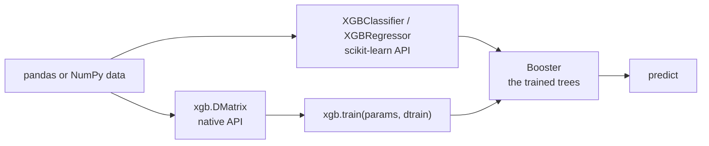
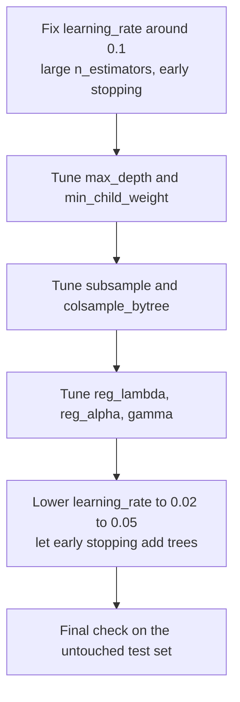

XGBoost is one of the most widely used libraries for gradient-boosted decision trees, and for tabular data (rows and columns, the shape of most business data) boosted trees are often the strongest model you can train without a large research effort. The [XGBoost lesson in Supervised Learning Algorithms](/learn/supervised-learning-algorithms/xgboost) covered how the algorithm works: trees added one at a time, each correcting the previous ensemble, with regularisation in the objective. This lesson is about the library: installing it, its two APIs, early stopping, categorical data, reading feature importance without fooling yourself, and a practical tuning recipe.

## Installation

```bash
pip install xgboost
```

The package ships compiled wheels for the common platforms, so there is usually nothing to build. Two practical notes:

- XGBoost uses OpenMP for multithreading. On macOS, if `import xgboost` fails with an error mentioning `libomp.dylib`, install the runtime with `brew install libomp`.
- GPU support depends on the build. The pip wheels for Linux on x86-64 are generally built with CUDA support; on other platforms check the installation page of the official documentation, or use the conda-forge package.

Check what you have before relying on a feature:

```python
import xgboost as xgb
print(xgb.__version__)
```

The examples in this lesson were run with XGBoost 3.x. The core API shown here has been stable for several major versions, but parameter defaults do change between releases, so pin the version in your requirements file.

## Two APIs, one engine

XGBoost exposes the same training engine through two interfaces.



| | scikit-learn API | Native API |
| --- | --- | --- |
| Entry point | `XGBClassifier`, `XGBRegressor`, `XGBRanker` | `xgb.train(params, dtrain, ...)` |
| Data | DataFrames or arrays directly | Wrapped in `xgb.DMatrix` |
| Number of trees | `n_estimators` | `num_boost_round` |
| Learning rate | `learning_rate` | `eta` (alias `learning_rate`) |
| Works with `Pipeline`, `GridSearchCV`, `cross_val_score` | Yes | No |
| Best for | Most projects | Custom objectives, fine control, reusing a `DMatrix` |

The scikit-learn wrapper still uses the native engine underneath; `model.get_booster()` returns the native `Booster`. Start with the scikit-learn API unless you have a reason not to.

## Training with early stopping

Boosting keeps adding trees, and after a point new trees fit noise. **Early stopping** watches a validation set and stops when the validation metric has not improved for a given number of rounds. You then set `n_estimators` high and let early stopping choose the actual number.

You need three sets: training data for fitting the trees, a validation set for early stopping, and a test set you have not touched for the final estimate. Early stopping uses the validation set to make a decision, so its score on that set is slightly optimistic.

```python
import numpy as np
import pandas as pd
from sklearn.datasets import make_classification
from sklearn.model_selection import train_test_split
from sklearn.metrics import roc_auc_score

X, y = make_classification(n_samples=5000, n_features=20, n_informative=8,
                           flip_y=0.05, random_state=0)
X = pd.DataFrame(X, columns=[f"f{i}" for i in range(20)])
X_tmp, X_test, y_tmp, y_test = train_test_split(X, y, test_size=0.2, stratify=y, random_state=0)
X_train, X_val, y_train, y_val = train_test_split(X_tmp, y_tmp, test_size=0.2,
                                                  stratify=y_tmp, random_state=0)

clf = xgb.XGBClassifier(
    n_estimators=2000,          # an upper bound; early stopping picks the real number
    learning_rate=0.05,
    max_depth=4,
    subsample=0.8,
    colsample_bytree=0.8,
    eval_metric="logloss",
    early_stopping_rounds=50,
    random_state=0,
    n_jobs=1,
)
clf.fit(X_train, y_train, eval_set=[(X_val, y_val)], verbose=False)

print("best iteration:", clf.best_iteration)
print("best val logloss:", round(clf.best_score, 4))
print("test ROC-AUC:", round(roc_auc_score(y_test, clf.predict_proba(X_test)[:, 1]), 4))
```

```output
best iteration: 276
best val logloss: 0.2025
test ROC-AUC: 0.9678
```

Training ran 50 rounds past the best iteration, then stopped. When early stopping was used, the scikit-learn wrapper's `predict` and `predict_proba` use the trees up to the best iteration automatically.

> [!WARNING]
> In current versions `early_stopping_rounds` and `eval_metric` are constructor arguments. Older tutorials pass them to `fit()`, which recent versions reject. Never use the test set as the `eval_set`: that turns your test score into a tuned, optimistic number.

## The native API: DMatrix and `xgb.train`

A `DMatrix` is XGBoost's internal data structure. Building one converts and stores the data once, which helps when you train many models on the same data.

```python
dtrain = xgb.DMatrix(X_train, label=y_train)
dval = xgb.DMatrix(X_val, label=y_val)
dtest = xgb.DMatrix(X_test)

params = {
    "objective": "binary:logistic",
    "eta": 0.05,
    "max_depth": 4,
    "subsample": 0.8,
    "colsample_bytree": 0.8,
    "eval_metric": "logloss",
    "seed": 0,
    "nthread": 1,
}
booster = xgb.train(params, dtrain, num_boost_round=2000,
                    evals=[(dtrain, "train"), (dval, "val")],
                    early_stopping_rounds=50, verbose_eval=False)

print(booster.best_iteration, booster.num_boosted_rounds())
proba = booster.predict(dtest, iteration_range=(0, booster.best_iteration + 1))
print("test ROC-AUC:", round(roc_auc_score(y_test, proba), 4))
```

```output
276 327
test ROC-AUC: 0.9678
```

Note the difference from the wrapper: the booster contains all the trees it built, including the 50 after the best one, and you choose how many to use with `iteration_range`. Early stopping watches the **last** entry in `evals`, which is why `dval` comes last. The native API also offers `xgb.cv` for cross-validation directly on a `DMatrix`.

## Categorical features

Older workflows one-hot encoded every categorical column. XGBoost can instead split on categories natively: give the column the pandas `category` dtype and set `enable_categorical=True` (with the `hist` tree method, the default in recent versions).

```python
rng = np.random.default_rng(0)
n = 4000
df = pd.DataFrame({
    "city": pd.Categorical(rng.choice(["leeds", "york", "bath", "hull", "ely"], n)),
    "income": rng.normal(50, 15, n),
    "noise_id": rng.random(n),            # pure noise, unrelated to the target
})
effect = df["city"].map({"leeds": 1.0, "york": -0.5, "bath": 0.8,
                         "hull": -1.0, "ely": 0.0}).astype(float)
logit = effect + 0.05 * (df["income"] - 50)
y_cat = (rng.random(n) < 1 / (1 + np.exp(-logit))).astype(int)

Xc_train, Xc_test, yc_train, yc_test = train_test_split(df, y_cat, test_size=0.25, random_state=0)

cat_model = xgb.XGBClassifier(n_estimators=300, max_depth=6, learning_rate=0.1,
                              enable_categorical=True, tree_method="hist",
                              random_state=0, n_jobs=1)
cat_model.fit(Xc_train, yc_train)
print(cat_model.predict_proba(Xc_test.head(3)).round(3))
```

```output
[[0.311 0.689]
 [0.692 0.308]
 [0.974 0.026]]
```

Category codes must be consistent between training and prediction. If you build the `category` dtype separately on the training and serving data, the same city can receive a different internal code. Define the categories once (for example `pd.CategoricalDtype(categories=[...])`) and apply that dtype everywhere.

## Feature importance and its pitfalls

`get_booster().get_score(importance_type=...)` reports importance in several ways:

| Type | Measures | Bias |
| --- | --- | --- |
| `weight` | Number of times a feature is used to split | Favours continuous and high-cardinality features, which offer many split points |
| `gain` | Average loss reduction when the feature is used | Better, but still computed on training data |
| `cover` | Average number of samples affected by its splits | Hard to interpret on its own |
| `total_gain`, `total_cover` | Sums instead of averages | As above |

The model above was trained with a deliberately useless `noise_id` column. Compare what the built-in scores say with **permutation importance** measured on held-out data:

```python
from sklearn.inspection import permutation_importance

b = cat_model.get_booster()
for kind in ["weight", "gain"]:
    scores = b.get_score(importance_type=kind)
    print(kind, {k: round(v, 1) for k, v in scores.items()})

r = permutation_importance(cat_model, Xc_test, yc_test, scoring="roc_auc",
                           n_repeats=10, random_state=0)
for col, mean, std in zip(df.columns, r.importances_mean, r.importances_std):
    print(f"permutation {col:9s} {mean:.3f} +/- {std:.3f}")
```

```output
weight {'city': 1077.0, 'income': 3485.0, 'noise_id': 3459.0}
gain {'city': 2.7, 'income': 1.4, 'noise_id': 1.1}
permutation city      0.099 +/- 0.013
permutation income    0.071 +/- 0.019
permutation noise_id  -0.000 +/- 0.007
```

By `weight`, the noise column is as "important" as income, because a deep model found plenty of splits on it while overfitting. Permutation importance asks the question you actually care about (how much does held-out performance drop if this column is scrambled?) and correctly puts the noise column at zero.

> [!KEY]
> Built-in importances describe how the model was built, not what matters for prediction. For decisions, use permutation importance on validation or test data, or SHAP values (covered later in the curriculum), and remember that correlated features share credit unpredictably.

The `feature_importances_` attribute on the wrapper reports one of these types, chosen by the `importance_type` constructor argument. Set it explicitly rather than trusting a default.

## Speed and GPUs

| Setting | Effect |
| --- | --- |
| `tree_method="hist"` | Histogram-based split finding; fast and the default in recent versions |
| `device="cuda"` | Train on an NVIDIA GPU, if your build supports it |
| `n_jobs` / `nthread` | CPU threads; leave unset to use all cores |
| `max_bin` | Number of histogram bins; fewer is faster and slightly coarser |

Older code uses `tree_method="gpu_hist"`; in current versions the equivalent is `tree_method="hist"` with `device="cuda"`. GPU training pays off on large datasets; for a few thousand rows the CPU is usually just as quick.

## Key hyperparameters and a tuning recipe

| Parameter | Typical range | Effect of increasing it |
| --- | --- | --- |
| `learning_rate` (`eta`) | 0.01 to 0.3 | Each tree counts more; fewer trees needed, higher overfitting risk |
| `n_estimators` | Set high, use early stopping | More trees |
| `max_depth` | 3 to 10 | More complex interactions, more overfitting |
| `min_child_weight` | 1 to 20 | More conservative splits |
| `subsample` | 0.5 to 1.0 | Uses more rows per tree; lower values add randomness |
| `colsample_bytree` | 0.5 to 1.0 | Uses more columns per tree |
| `reg_lambda`, `reg_alpha` | 0 to 10 or more | Stronger L2 / L1 penalty on leaf weights |
| `gamma` | 0 to 5 | Minimum loss reduction required to split |
| `scale_pos_weight` | About negatives / positives | Upweights the positive class in imbalanced problems |

A recipe that works well in practice:



Use [random search](/learn/model-evaluation/random-search) or a Bayesian optimiser for the middle steps rather than a full grid, and keep early stopping on throughout so that the number of trees adapts to every candidate.

## Exercises

**1.** Retrain the first `XGBClassifier` with `learning_rate=0.2`. Predict how `best_iteration` will change, then check.

<details>
<summary>Show solution</summary>

A larger learning rate means each tree takes a bigger step, so fewer trees are needed and `best_iteration` should fall substantially:

```python
fast = xgb.XGBClassifier(n_estimators=2000, learning_rate=0.2, max_depth=4,
                         subsample=0.8, colsample_bytree=0.8, eval_metric="logloss",
                         early_stopping_rounds=50, random_state=0, n_jobs=1)
fast.fit(X_train, y_train, eval_set=[(X_val, y_val)], verbose=False)
print(fast.best_iteration,
      round(roc_auc_score(y_test, fast.predict_proba(X_test)[:, 1]), 4))
```

The test score is usually similar or slightly worse: a small learning rate with more trees tends to generalise a little better, at the cost of training time.

</details>

**2.** Why does the native API need `iteration_range` at prediction time while the scikit-learn wrapper does not?

<details>
<summary>Show solution</summary>

`xgb.train` returns a booster containing every tree it built, including those added after the best iteration while early stopping waited for improvement. The wrapper records `best_iteration` and applies it in `predict` for you. With the native API you pass `iteration_range=(0, best_iteration + 1)` yourself.

</details>

**3.** A model's `weight` importance ranks a customer ID column first. What do you conclude, and what do you do?

<details>
<summary>Show solution</summary>

An ID has a unique value per row, giving the trees endless split points, so `weight` importance rewards it even though it should carry no real signal. Either it is overfitting noise or it leaks information (for example IDs assigned in time order). Check permutation importance on held-out data, and drop the column unless you can justify it.

</details>

```quiz
[
  {
    "q": "Which data should be passed as `eval_set` for early stopping?",
    "options": [
      "The test set",
      "A validation set separate from training and test",
      "The training set",
      "The full dataset"
    ],
    "answer": 1,
    "why": "Early stopping makes a decision based on the eval set, so it must not be the test set you report results on."
  },
  {
    "q": "In the native API, which parameter sets the number of boosting rounds?",
    "options": [
      "`n_estimators` in params",
      "`iteration_range`",
      "`max_depth`",
      "`num_boost_round` in `xgb.train`"
    ],
    "answer": 3,
    "why": "`xgb.train(params, dtrain, num_boost_round=...)` sets the maximum number of trees; `n_estimators` is the wrapper's name."
  },
  {
    "q": "Why can `weight` importance be misleading?",
    "options": [
      "It counts splits, so it favours features with many possible split points regardless of their usefulness",
      "It is computed on the test set",
      "It is always zero for categorical features",
      "It ignores the first tree"
    ],
    "answer": 0,
    "why": "Continuous and high-cardinality features offer many thresholds, so they get used often even when they add little predictive value."
  },
  {
    "q": "What is the current way to request GPU training in XGBoost?",
    "options": [
      "`tree_method=\"gpu_hist\"` only",
      "`n_jobs=-1`",
      "`device=\"cuda\"`",
      "`gpu=True`"
    ],
    "answer": 2,
    "why": "Recent versions use the `device` parameter; `gpu_hist` is the older, deprecated spelling."
  }
]
```
