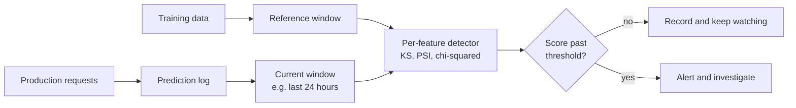

A model learns from one slice of the world: the data you had when you trained it. The world it serves keeps moving. A marketing campaign brings in younger customers, a new phone model changes image resolution, a product launch fills your support chatbot with questions it has never seen. When the distribution of the inputs changes, the model is being asked to work somewhere it was never tested. This is **data drift**, and detecting it early, often before you have any labels to measure accuracy, is one of the core jobs of a monitoring system.

This lesson defines drift precisely, then implements the three workhorse detectors yourself: the Kolmogorov-Smirnov test for numeric features, the Population Stability Index, and the chi-squared test for categorical features. You will run each one on synthetic data where you know the truth, so you can see what the numbers mean.

## What exactly drifts

Write a model's world as a joint distribution $P(x, y)$ over inputs $x$ and labels $y$. It factorises in two useful ways:

$$
P(x, y) = P(y \mid x)\,P(x) = P(x \mid y)\,P(y)
$$

| Name | What changes | What stays the same | Example |
| --- | --- | --- | --- |
| **Covariate shift** (data drift in the narrow sense) | $P(x)$, the input distribution | $P(y \mid x)$, the relationship | More mobile users than desktop users, but each user behaves as before |
| **Label shift** (prior shift) | $P(y)$, how common each class is | $P(x \mid y)$, what each class looks like | Flu season: more positive cases, but a flu case still presents the same way |
| **Concept drift** | $P(y \mid x)$, the relationship itself | Possibly nothing | Fraudsters change tactics, so yesterday's safe pattern is today's fraud |

This lesson is about detecting changes in $P(x)$, which you can measure the moment requests arrive. Label shift and concept drift, which need labels or proxies, are the subject of [model drift](/learn/mlops/model-drift).

> [!KEY]
> Data drift is a statement about inputs, not about performance. A drifted feature may not hurt the model at all (if the model barely uses it), and a model can degrade badly with no input drift (concept drift). Drift detection is an early-warning signal to investigate, not a verdict.

## The detection setup

Every drift detector compares two samples: a **reference** window (usually the training or validation data, or a known-good period of production) and a **current** window (for example, the last day of requests).



Let us build synthetic data with a known answer. The reference has an `age` feature centred on 40. One current window comes from the same distribution; another has shifted to a mean of 45.

```python
import numpy as np
from scipy import stats

rng = np.random.default_rng(42)
reference = rng.normal(loc=40, scale=10, size=5000)
current_same = rng.normal(loc=40, scale=10, size=2000)
current_shifted = rng.normal(loc=45, scale=10, size=2000)

for name, sample in [("reference", reference), ("same", current_same), ("shifted", current_shifted)]:
    print(f"{name:9s} mean={sample.mean():6.2f} std={sample.std():5.2f}")
```

```output
reference mean= 39.80 std= 9.99
same      mean= 40.32 std=10.22
shifted   mean= 44.87 std= 9.90
```

## The Kolmogorov-Smirnov test

The two-sample **Kolmogorov-Smirnov (KS) test** compares the empirical cumulative distribution functions (CDFs) of the two samples. For each sample, $F(t)$ is the fraction of values less than or equal to $t$. The KS statistic is the largest vertical gap between the two curves:

$$
D = \sup_t \left| F_{\text{ref}}(t) - F_{\text{cur}}(t) \right|
$$

where $\sup_t$ means the largest value over all thresholds $t$. $D$ is between 0 (identical CDFs) and 1 (no overlap at all). The test also returns a p-value: the probability of seeing a gap at least this large if both samples came from the same distribution. If you need a refresher on p-values, see [hypothesis testing](/learn/probability-and-statistics/hypothesis-testing).

```python
for name, sample in [("same", current_same), ("shifted", current_shifted)]:
    result = stats.ks_2samp(reference, sample)
    print(f"{name:8s} D={result.statistic:.4f} p={result.pvalue:.3g}")
```

```output
same     D=0.0323 p=0.0997
shifted  D=0.2091 p=3.8e-55
```

The unshifted window gives a small gap (about 0.03) and a p-value above the usual 0.05 cut-off: no evidence of drift, although notice that even pure sampling noise produces a non-zero $D$. The shifted window gives a gap of about 0.2 and a vanishingly small p-value. KS is non-parametric (it assumes no particular distribution shape) and is sensitive to changes in location, spread and shape, which makes it a sensible default for continuous features.

## The Population Stability Index

The **Population Stability Index (PSI)** comes from credit scoring, where it has long been used to check whether the applicant population has moved since a scorecard was built. It bins the feature, then compares the share of each sample in each bin. With $e_i$ the reference share and $a_i$ the current share in bin $i$:

$$
\text{PSI} = \sum_{i=1}^{k} (a_i - e_i)\,\ln\!\left(\frac{a_i}{e_i}\right)
$$

Each term is non-negative (both factors always have the same sign), so PSI is zero only when every bin matches. It is a symmetrised form of the Kullback-Leibler divergence. Bin edges are usually the deciles of the reference, so each reference bin holds about 10% of the data. A small $\epsilon$ guards against empty bins, where $\ln 0$ would be undefined.

```python
def psi(reference, current, n_bins=10, eps=1e-4):
    # Bin edges from reference quantiles; the outer edges are open-ended
    edges = np.quantile(reference, np.linspace(0, 1, n_bins + 1))
    edges[0], edges[-1] = -np.inf, np.inf
    ref_share = np.histogram(reference, bins=edges)[0] / len(reference)
    cur_share = np.histogram(current, bins=edges)[0] / len(current)
    ref_share = np.clip(ref_share, eps, None)
    cur_share = np.clip(cur_share, eps, None)
    return float(np.sum((cur_share - ref_share) * np.log(cur_share / ref_share)))

print(f"PSI same:    {psi(reference, current_same):.4f}")
print(f"PSI shifted: {psi(reference, current_shifted):.4f}")
```

```output
PSI same:    0.0128
PSI shifted: 0.2545
```

The unshifted window scores close to zero; the five-year shift scores about 0.25. Practitioners often read PSI with a rule of thumb: below 0.1 is little change, 0.1 to 0.25 is a moderate shift worth a look, above 0.25 is a major shift. Treat these as a convention inherited from credit risk, not a law; calibrate them on your own history of "normal" days.

### Stepping through one PSI calculation

```trace
{
  "title": "PSI with three bins",
  "code": [
    "ref = [0.50, 0.30, 0.20]",
    "cur = [0.30, 0.30, 0.40]",
    "total = 0.0",
    "for e, a in zip(ref, cur):",
    "    total += (a - e) * math.log(a / e)",
    "print(round(total, 4))"
  ],
  "steps": [
    { "line": 2, "vars": { "ref": "[0.5, 0.3, 0.2]", "cur": "[0.3, 0.3, 0.4]" }, "note": "Bin shares already computed. Bin 1 has lost mass, bin 3 has gained it." },
    { "line": 5, "vars": { "e": "0.5", "a": "0.3", "total": "0.1022" }, "note": "(0.3 - 0.5) * ln(0.6) = (-0.2) * (-0.5108) = 0.1022. A loss of mass still adds a positive amount." },
    { "line": 5, "vars": { "e": "0.3", "a": "0.3", "total": "0.1022" }, "note": "Bin 2 is unchanged, so its term is exactly zero." },
    { "line": 5, "vars": { "e": "0.2", "a": "0.4", "total": "0.2408" }, "note": "(0.4 - 0.2) * ln(2) = 0.2 * 0.6931 = 0.1386." },
    { "line": 6, "vars": { "total": "0.2408" }, "out": ["0.2408"], "note": "PSI is about 0.24: a moderate shift on the usual rule of thumb, close to the major boundary." }
  ]
}
```

## Categorical features: the chi-squared test

KS and quantile bins need ordered numbers. For a categorical feature such as `plan` or `country`, count how often each category appears in each window and run a **chi-squared test of independence** on the table. The null hypothesis is that the category shares do not depend on which window a row came from.

```python
categories = ["basic", "pro", "enterprise"]
ref_plan = rng.choice(categories, size=5000, p=[0.6, 0.3, 0.1])
cur_plan = rng.choice(categories, size=2000, p=[0.5, 0.3, 0.2])

table = np.array([
    [np.sum(ref_plan == c) for c in categories],
    [np.sum(cur_plan == c) for c in categories],
])
print(table)
chi2, p, dof, expected = stats.chi2_contingency(table)
print(f"chi2={chi2:.1f} dof={dof} p={p:.3g}")
```

```output
[[2977 1541  482]
 [ 972  615  413]]
chi2=165.8 dof=2 p=1.02e-36
```

The enterprise share doubled, and the test flags it decisively. Two practical cautions: categories that appear only in the current window (a new country code) need handling before you build the table, and the test is unreliable when expected counts in a cell fall below about 5, so group rare categories into an "other" bucket. PSI also works for categoricals: use the categories as bins.

## The large-sample trap

Statistical tests answer "is there *any* difference?", and with enough data the answer is always yes. Production systems log hundreds of thousands of rows a day. Watch what happens with a shift of 0.3 years in mean age, which no one would care about:

```python
big_ref = rng.normal(40.0, 10, size=200_000)
big_cur = rng.normal(40.3, 10, size=200_000)
result = stats.ks_2samp(big_ref, big_cur)
print(f"KS D={result.statistic:.4f} p={result.pvalue:.3g}")
print(f"PSI={psi(big_ref, big_cur):.4f}")
```

```output
KS D=0.0129 p=6.61e-15
PSI=0.0010
```

The p-value screams drift; the effect size says nothing meaningful happened. Two habits follow:

- **Alert on effect size**, such as the KS statistic $D$, PSI or a [Wasserstein distance](https://docs.scipy.org/doc/scipy/reference/generated/scipy.stats.wasserstein_distance.html), with thresholds tuned on historical data. Use p-values mainly with modest, fixed-size samples.
- **Correct for many features.** Testing 200 features at a significance level of 0.05 gives about 10 false alarms by chance alone. Use a stricter per-feature threshold (a Bonferroni-style correction divides 0.05 by the number of tests) or alert only when a share of features drifts.

> [!WARNING]
> Drift scores depend on window size. A one-hour window is noisy; a 30-day window reacts slowly. Daily and weekly cycles are also real changes in $P(x)$ that are entirely normal, so compare like with like (this Monday against last Monday) or choose a reference window that covers a full cycle.

## Drift in LLM and unstructured inputs

Text, images and embeddings have no single column to test. Common approaches:

| Signal | How to compute it | What it catches |
| --- | --- | --- |
| Simple text statistics | KS or PSI on prompt length in tokens, language share, share of non-text characters | New user segments, pasted documents, a client sending malformed input |
| Embedding drift | Embed requests, then compare the distance of each to the reference centroid, or run a classifier that tries to tell reference from current | Topic shift: users asking about a new product |
| Topic or intent share | Cluster or classify queries, then chi-squared on the topic counts | A new intent your prompt or retrieval index does not cover |
| Retrieval statistics (RAG) | Distribution of top retrieval similarity scores | Questions your knowledge base cannot answer |

The "domain classifier" idea generalises well: label reference rows 0 and current rows 1, train a quick classifier, and check its [ROC AUC](/learn/model-evaluation/roc-auc). An AUC near 0.5 means the windows are indistinguishable; well above 0.5 means something changed, and the classifier's feature importances tell you what.

## Exercises

**1.** Compute the PSI and KS statistic between `reference` and a current window drawn from `rng.normal(40, 15, size=2000)`: same mean, larger spread. Which detector notices, and why would a test that only compared means miss it?

<details>
<summary>Show solution</summary>

```python
wider = np.random.default_rng(7).normal(40, 15, size=2000)
print(f"PSI={psi(reference, wider):.4f}")
print(f"KS D={stats.ks_2samp(reference, wider).statistic:.4f}")
```

```output
PSI=0.2034
KS D=0.1092
```

Both notice. More values land in the outer deciles, which PSI sees as mass moving into the end bins, and the CDFs cross, which opens a gap that KS measures. A comparison of means (a t-test) would see two means near 40 and report nothing.

</details>

**2.** Write a function `drift_report(ref_df, cur_df, numeric, categorical)` that returns a dictionary of `{column: score}` using PSI for numeric columns and the chi-squared p-value for categorical ones.

<details>
<summary>Show solution</summary>

```python
import pandas as pd

def drift_report(ref_df, cur_df, numeric, categorical):
    out = {}
    for col in numeric:
        out[col] = round(psi(ref_df[col].to_numpy(), cur_df[col].to_numpy()), 4)
    for col in categorical:
        cats = sorted(set(ref_df[col]) | set(cur_df[col]))
        table = [[(ref_df[col] == c).sum() for c in cats],
                 [(cur_df[col] == c).sum() for c in cats]]
        out[col] = float(stats.chi2_contingency(table)[1])
    return out

ref_df = pd.DataFrame({"age": reference[:2000], "plan": ref_plan[:2000]})
cur_df = pd.DataFrame({"age": current_shifted, "plan": cur_plan})
print(drift_report(ref_df, cur_df, ["age"], ["plan"]))
```

```output
{'age': 0.2919, 'plan': 1.7567653755238297e-19}
```

The union of categories means a brand-new category in the current window gets a zero count in the reference row rather than being dropped. Keep in mind the warning about tiny expected counts.

</details>

**3.** Your monitoring flags strong drift in `user_agent` (browser version) every few weeks, but model accuracy never moves. What should you change?

<details>
<summary>Show solution</summary>

Browser versions change constantly as browsers auto-update, so this feature will always drift. Options: stop monitoring it for alerts (keep it on a dashboard), map it to a stable coarser feature (browser family), or weight alerts by feature importance so drift in features the model barely uses does not page anyone. If the model does use it heavily, that is a sign the feature is brittle and should be re-engineered.

</details>

```quiz
[
  {
    "q": "Covariate shift means which part of the joint distribution has changed?",
    "options": ["$P(y \\mid x)$", "$P(x)$", "$P(y)$ only", "Nothing; only the model changed"],
    "answer": 1,
    "why": "Covariate shift is a change in the input distribution $P(x)$ while the relationship $P(y \\mid x)$ stays the same."
  },
  {
    "q": "What does the two-sample KS statistic measure?",
    "options": [
      "The difference between the two sample means",
      "The ratio of the two variances",
      "The largest vertical gap between the two empirical CDFs",
      "The share of rows that changed between windows"
    ],
    "answer": 2,
    "why": "$D = \\sup_t |F_{ref}(t) - F_{cur}(t)|$, so it reacts to changes in location, spread and shape."
  },
  {
    "q": "With 200,000 rows per window, a KS test returns p = 1e-12 but PSI is 0.002. What is the most sensible reading?",
    "options": [
      "A statistically detectable but practically negligible shift",
      "Severe drift; retrain immediately",
      "The PSI implementation must be wrong",
      "The model's accuracy has dropped"
    ],
    "answer": 0,
    "why": "Large samples make tiny differences significant. Effect sizes such as PSI or D tell you whether the change matters."
  },
  {
    "q": "Which test suits a categorical feature such as `country`?",
    "options": [
      "Two-sample KS test on the raw strings",
      "Pearson correlation",
      "A paired t-test",
      "Chi-squared test on a table of category counts per window"
    ],
    "answer": 3,
    "why": "Categories have no order, so CDF-based tests do not apply. A contingency table of counts with a chi-squared test (or PSI with categories as bins) does."
  }
]
```
