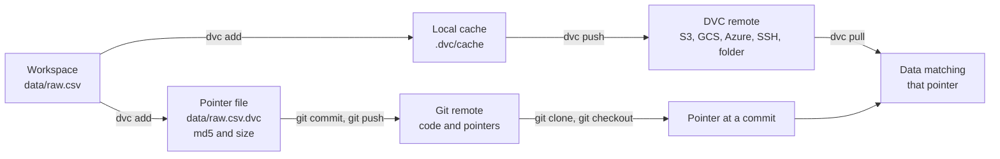
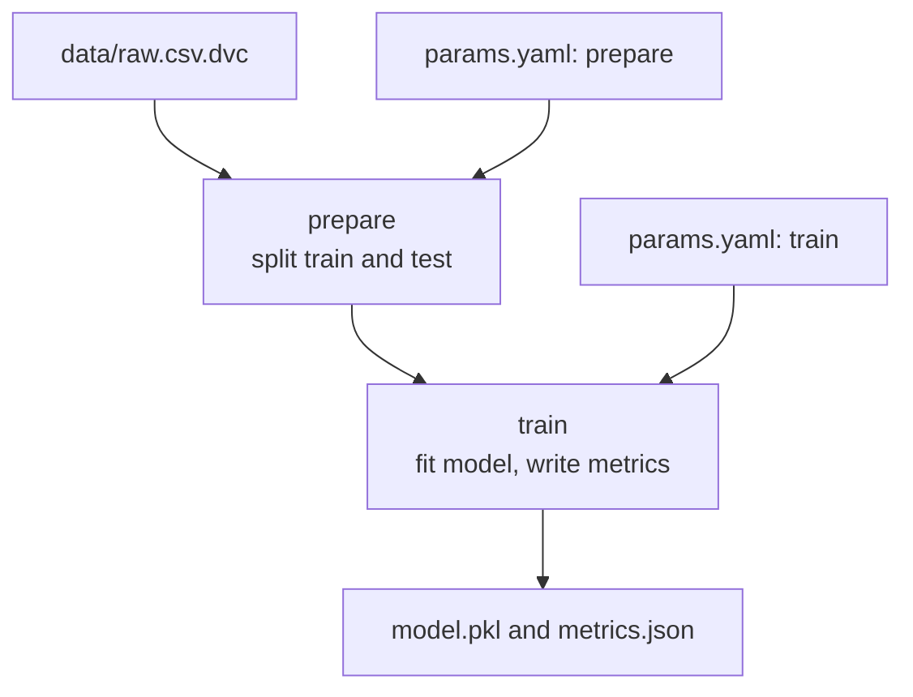

Git is excellent at versioning code and terrible at versioning a 5 GB dataset or a 2 GB model checkpoint: the repository balloons, cloning takes forever, and hosting services reject large files. Yet the data is exactly what you most need to version, because a model is only reproducible if you can get back the exact data it was trained on. **DVC** (Data Version Control) solves this by keeping large files out of Git while keeping small, human-readable pointers to them inside Git. It also adds lightweight pipelines that rerun only the stages whose inputs changed. Every command in this lesson was run for real in a scratch repository with DVC 3.x, and the outputs shown are what it printed.

## How DVC pairs with Git



Git stores the **pointer** (a few lines of YAML with the file's hash). DVC stores the **content** in a cache and, when you push, in a remote storage location. Checking out an old Git commit gives you old pointers; `dvc checkout` or `dvc pull` then restores the matching data. The combination gives you one history for code and data.

## Initialising and tracking data

Start inside an existing Git repository:

```bash
pip install dvc            # add extras for cloud remotes, e.g. "dvc[s3]"
git init
dvc init
git status --short
```

```output
A  .dvc/.gitignore
A  .dvc/config
A  .dvcignore
```

`dvc init` creates a `.dvc/` directory with configuration and stages it in Git. (It also prints a notice about anonymous usage analytics, which you can disable with `dvc config core.analytics false`.)

Now track a data file:

```bash
dvc add data/raw.csv
cat data/raw.csv.dvc
cat data/.gitignore
```

```output
To track the changes with git, run:

	git add data/raw.csv.dvc data/.gitignore

To enable auto staging, run:

	dvc config core.autostage true
outs:
- md5: a84731e7e0647c6665296c0a912f3d55
  size: 318570
  hash: md5
  path: raw.csv
/raw.csv
```

DVC hashed the file, moved its content into `.dvc/cache`, wrote the pointer `raw.csv.dvc`, and added the real file to a `.gitignore` so you cannot commit it to Git by accident. Commit the pointer, not the data:

```bash
git add data/raw.csv.dvc data/.gitignore
git commit -m "Track raw data with DVC"
```

When the data changes, run `dvc add` again: the pointer gets a new hash, and committing it records a new version of the data in Git history.

> [!KEY]
> Git versions the pointer; DVC stores the bytes. Any Git commit therefore identifies an exact data version, and checking out that commit plus `dvc checkout` restores it.

## Remotes: sharing data

The cache is local. To share data with teammates and CI, configure a **remote** and push to it. Remotes can be cloud object storage, SSH servers, or even a local or network folder, which is what this example uses:

```bash
dvc remote add -d localstore /path/to/dvcstore
dvc push
```

```output
Setting 'localstore' as a default remote.
5 files pushed
```

The `-d` flag makes it the default remote, recorded in `.dvc/config`, which you commit so collaborators get the same setting. A teammate then runs:

```bash
git clone <repo-url> && cd <repo>
dvc pull          # fetch the data for the current commit from the remote
```

To test the round trip, the raw file and the entire local cache were deleted, then pulled back:

```output
A       data/raw.csv
5 files fetched and 1 file added
```

Credentials for cloud remotes belong in `.dvc/config.local` (which is not committed) or in the usual cloud environment variables, never in the committed config.

## Pipelines: `dvc.yaml` and `dvc repro`

Tracking files is half of DVC. The other half is describing how data flows through your scripts, so DVC can rerun exactly what is needed. A pipeline lives in `dvc.yaml`; each **stage** has a command, dependencies, parameters and outputs:

```yaml
stages:
  prepare:
    cmd: python src/prepare.py
    deps:
      - data/raw.csv
      - src/prepare.py
    params:
      - prepare
    outs:
      - data/prepared
  train:
    cmd: python src/train.py
    deps:
      - data/prepared
      - src/train.py
    params:
      - train
    outs:
      - model.pkl
    metrics:
      - metrics.json:
          cache: false
```

Parameters come from `params.yaml`, which the scripts also read, so the config lives in one versioned file:

```yaml
prepare:
  test_size: 0.25
  seed: 42
train:
  C: 1.0
```

Run the pipeline:

```bash
dvc repro
```

```output
'data/raw.csv.dvc' didn't change, skipping
Running stage 'prepare':
> python src/prepare.py
Generating lock file 'dvc.lock'
Updating lock file 'dvc.lock'

Running stage 'train':
> python src/train.py
Updating lock file 'dvc.lock'
```

DVC then prints the `git add` command for the files it changed and a reminder to `dvc push` (omitted here). It also writes `dvc.lock`, which records the hash of every dependency, parameter value and output for each stage. Commit it: it is the precise record of what produced the current outputs. Running `dvc repro` again with nothing changed does nothing:

```output
'data/raw.csv.dvc' didn't change, skipping
Stage 'prepare' didn't change, skipping
Stage 'train' didn't change, skipping
Data and pipelines are up to date.
```



`dvc dag` prints this graph in the terminal.

## Changing a parameter

Change `C` from 1.0 to 0.01 in `params.yaml`. `dvc status` shows exactly which stage is now out of date, and `dvc repro` reruns only that stage:

```output
train:
	changed deps:
		params.yaml:
			modified:           train
```

```output
'data/raw.csv.dvc' didn't change, skipping
Stage 'prepare' didn't change, skipping
Running stage 'train':
> python src/train.py
Updating lock file 'dvc.lock'
```

`prepare` was skipped because none of its dependencies or parameters changed. On a real project, where preparation might take an hour, that saving matters. Then compare against the last commit:

```bash
dvc params diff
dvc metrics diff
```

```output
Path         Param    HEAD    workspace
params.yaml  train.C  1.0     0.01

Path          Metric    HEAD    workspace    Change
metrics.json  accuracy  0.996   0.992        -0.004
```

Stronger regularisation slightly lowered accuracy on this synthetic data, so you might revert. Every experiment is just a Git commit (or branch) with its `params.yaml`, `dvc.lock` and metrics, and DVC can diff any two. DVC also has an experiments feature (`dvc exp run`, `dvc exp show`) that records such variations without making a commit for each.

## A pitfall: pushing every version

While testing this lesson, an older commit was checked out after the local cache had been deleted. `dvc checkout` restored the data but failed for the old model:

```output
ERROR: Checkout failed for following targets:
model.pkl
Is your cache up to date?
<https://error.dvc.org/missing-files>
```

The old `model.pkl` had been produced but never pushed before the cache was wiped, so no copy existed anywhere. The lesson: `dvc push` after every commit that changes tracked data or outputs, ideally enforced in CI or a Git hook. A pointer in Git is only useful if the content it points to was pushed.

> [!WARNING]
> Git and DVC history can diverge silently. A `git push` without a `dvc push` leaves teammates with pointers to data that only exists on your laptop. DVC can install Git hooks (`dvc install`) that help keep the two in step.

## LLMOps uses

DVC is not only for tabular training data. In LLM projects it is a natural home for eval sets, fine-tuning datasets, RAG source corpora and LoRA adapter checkpoints. A pipeline stage can build the vector index from a versioned corpus, and another can run the eval suite and write scores to a metrics file, so `dvc metrics diff` shows how a prompt or retrieval change moved quality.

## Exercises

**1.** Your teammate cloned the repository and their training script fails because `data/raw.csv` does not exist. What do they need to run, and why was the file missing?

<details>
<summary>Show solution</summary>

`dvc pull`. Git only contains the pointer `data/raw.csv.dvc`; the file itself is in `.gitignore` and lives in the DVC remote. `dvc pull` downloads the content matching the pointer at the current commit.

</details>

**2.** You edit `src/prepare.py` to drop duplicate rows. Which stages will `dvc repro` run, and why?

<details>
<summary>Show solution</summary>

Both. `src/prepare.py` is a dependency of `prepare`, so it reruns. If its output `data/prepared` changes (which it will, if any duplicates existed), `train` depends on that output and reruns too. If the output happened to be byte-identical, DVC would skip `train`.

</details>

**3.** How would you restore the exact data and model from a commit three weeks ago?

<details>
<summary>Show solution</summary>

```bash
git checkout <commit>
dvc checkout      # or dvc pull, if the content is not in your local cache
```

Git restores the code, `params.yaml`, `dvc.lock` and pointers from that commit; DVC restores the data and outputs those pointers describe, provided they were pushed.

</details>

```quiz
[
  {
    "q": "After `dvc add data/raw.csv`, what should you commit to Git?",
    "options": [
      "`data/raw.csv` itself",
      "`data/raw.csv.dvc` and `data/.gitignore`",
      "The whole `.dvc/cache` directory",
      "Nothing; DVC commits for you"
    ],
    "answer": 1,
    "why": "Git tracks the small pointer file and the ignore rule; the data goes to the DVC cache and remote."
  },
  {
    "q": "What does `dvc.lock` record?",
    "options": [
      "Which user is currently running the pipeline",
      "The hashes of each stage's dependencies, parameters and outputs from the last run",
      "The DVC remote password",
      "A list of stages that failed"
    ],
    "answer": 1,
    "why": "The lock file pins exactly what produced the current outputs, and DVC compares against it to decide what to rerun."
  },
  {
    "q": "You change only `train.C` in `params.yaml`. What does `dvc repro` do?",
    "options": [
      "Reruns every stage",
      "Reruns only the stages that depend on the `train` parameters, such as `train`",
      "Nothing, because parameters are not tracked",
      "Deletes the old model"
    ],
    "answer": 1,
    "why": "Stages declare which params they use; only stages whose dependencies changed are rerun."
  },
  {
    "q": "A colleague can see your latest commit but `dvc pull` fails for the new data. What did you most likely forget?",
    "options": ["`git push`", "`dvc init`", "`dvc push`", "`dvc dag`"],
    "answer": 2,
    "why": "The pointer reached Git, but the content was never uploaded to the DVC remote."
  }
]
```
