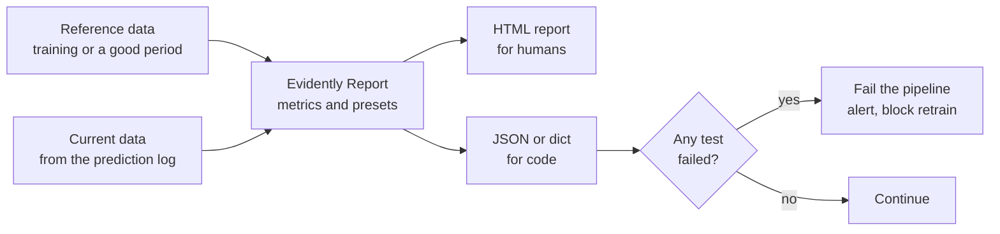

In the [data drift](/learn/mlops/data-drift) lesson you implemented KS tests, PSI and chi-squared tests by hand. That is the right way to understand them, but in production you want the same checks across dozens of columns, sensible defaults chosen per column type, a readable report for humans and a pass/fail result for pipelines. **Evidently** (often called Evidently AI, after the company that maintains it) is an open-source Python library that does exactly this: it compares a reference dataset with a current one and produces drift and data quality **reports**, plus **tests** with thresholds that can fail a pipeline. It also has evaluation features for LLM outputs and an optional monitoring service.

## A warning about versions first

Evidently's API changed substantially across releases. Code from tutorials and blog posts may not run on the version you install.

| Version family | Imports look like | Status |
| --- | --- | --- |
| Before 0.7 (the 0.4 to 0.6 series, widely used in older tutorials) | `from evidently.report import Report`, `from evidently.metric_preset import DataDriftPreset`, `from evidently.test_suite import TestSuite` | The older API. In 0.7 it moved under `evidently.legacy` |
| 0.7 and later | `from evidently import Report`, `from evidently.presets import DataDriftPreset`, tests attached to metrics | The current API, used in this lesson |

The code below was checked against an Evidently 0.7.x release. It is deliberately minimal. Before using it, check the [Evidently documentation](https://docs.evidentlyai.com/) for the version you install, pin that version in your lock file, and expect to adjust imports when you upgrade. Also check compatibility with your pandas version: at the time of writing, the installed 0.7 release would not import under pandas 3 and needed pandas 2.x.

> [!WARNING]
> Pin the Evidently version in production pipelines. Because the API has changed across releases, an unpinned upgrade can break a monitoring job, and a broken monitoring job often fails silently: no alerts, and nobody notices.

## Where Evidently fits



You use it in three places: ad hoc in a notebook to explore a dataset shift, as a scheduled batch job over the prediction log (daily drift reports), and as a gate inside a training or retraining pipeline (refuse to train on data that fails quality checks).

## A drift report

Set up synthetic data where you know the answer: `age` and `plan` shift, `income` does not.

```python
import numpy as np
import pandas as pd

rng = np.random.default_rng(0)
reference = pd.DataFrame({
    "age": rng.normal(40, 10, 2000),
    "income": rng.normal(50_000, 10_000, 2000),
    "plan": rng.choice(["basic", "pro"], 2000, p=[0.7, 0.3]),
})
current = pd.DataFrame({
    "age": rng.normal(46, 10, 2000),              # shifted
    "income": rng.normal(50_000, 10_000, 2000),   # unchanged
    "plan": rng.choice(["basic", "pro"], 2000, p=[0.5, 0.5]),  # shifted
})
```

With the 0.7-style API, a report is a list of metrics or presets. Running it returns a **snapshot**, which you can save as HTML or convert to a dictionary or JSON:

```python
from evidently import Report
from evidently.presets import DataDriftPreset

report = Report([DataDriftPreset()])
snapshot = report.run(current_data=current, reference_data=reference)
snapshot.save_html("drift_report.html")
```

Open the HTML file in a browser to see a per-column summary of drift scores and distribution plots. On this data, `age` and `plan` are flagged as drifted and `income` is not, matching how the data was generated.

Evidently chooses a drift method per column automatically based on column type and sample size (for example, a KS test for smaller numeric samples, and distance measures such as normalised Wasserstein distance for larger ones), and you can override it. The exact defaults have changed between versions, so read the report's stated method rather than assuming.

> [!KEY]
> Everything Evidently computes for drift is a statistic you have already met: KS, PSI, chi-squared, Wasserstein and similar. The library's value is consistent application across columns, sensible defaults, and output in forms that both humans and pipelines can use, not new mathematics.

## Declaring column types

Evidently infers column types, but explicit is safer: a numeric-looking ZIP code should be categorical, and an id column should be ignored. Wrap DataFrames in a `Dataset` with a `DataDefinition`:

```python
from evidently import Dataset, DataDefinition

schema = DataDefinition(numerical_columns=["age", "income"], categorical_columns=["plan"])
ref_ds = Dataset.from_pandas(reference, data_definition=schema)
cur_ds = Dataset.from_pandas(current, data_definition=schema)
```

## Tests: turning a report into a gate

Older versions had a separate `TestSuite` class. In the 0.7-style API, you attach **tests** (conditions such as `lte`, `eq`, `gt`) directly to metrics. Each test produces a status, which code can read:

```python
from evidently.metrics import DriftedColumnsCount, MissingValueCount, ValueDrift
from evidently.tests import eq, lte

checks = Report([
    DriftedColumnsCount(tests=[lte(1)]),             # at most one drifted column
    MissingValueCount(column="age", tests=[eq(0)]),  # no missing ages
    ValueDrift(column="income", method="psi"),       # report PSI for one column
])
result = checks.run(current_data=cur_ds, reference_data=ref_ds).dict()

failed = [t["name"] for t in result["tests"] if t["status"].value == "FAIL"]
if failed:
    raise SystemExit(f"Data checks failed: {failed}")
```

On this data, two columns drift, so the drifted-columns test fails and the script exits with an error, which stops a CI job or an orchestrator task such as an [Airflow](/learn/data-engineering-fundamentals/basic-apache-airflow) step. Presets can also generate a default set of tests (`Report([DataDriftPreset()], include_tests=True)`), which is a reasonable starting point before you tune thresholds.

For comparison, the pre-0.7 equivalent of a drift gate looked roughly like this. You will see it in older code:

```python
# Older API (before 0.7); in 0.7+ these modules live under evidently.legacy
from evidently.test_suite import TestSuite
from evidently.test_preset import DataDriftTestPreset

suite = TestSuite(tests=[DataDriftTestPreset()])
suite.run(reference_data=reference, current_data=current)
suite.save_html("drift_tests.html")
```

## LLM evaluation with Evidently

Evidently also evaluates text and LLM outputs. **Descriptors** compute per-row properties of text columns (length, sentiment, whether a pattern or word appears, or a score from an LLM judge), and the same reports and tests then run over those properties. This lets you monitor an LLM application's responses for drift in length or tone, a rise in refusals, or a fall in judge scores, using the same machinery as tabular drift. The descriptor API is one of the areas that has changed most between versions, so start from the current documentation's LLM evaluation guide.

## Choosing between the tools in this module

The four tools covered in this module overlap less than it first appears. Most teams combine two or three.

| | MLflow | Weights & Biases | DVC | Evidently |
| --- | --- | --- | --- | --- |
| Main job | Tracking, model packaging, registry | Tracking, sweeps, artefacts, collaboration | Data and pipeline versioning with Git | Drift, data quality and evaluation reports and tests |
| Lifecycle stages | Train, evaluate, register, deploy | Train, evaluate, register | Data, train (pipelines), reproducibility | Monitor, data validation, evaluate |
| Hosting | Open source; local, self-hosted or managed | Hosted service; self-managed option | Open source CLI; your own storage remote | Open source library; optional hosted platform |
| Model registry | Yes, with aliases | Yes, built on artefacts | Via versioned files and Git tags | No |
| Hyperparameter search | Integrates with external tuners | Built-in sweeps | Experiments with parameter variations | No |
| LLMOps features | Prompt registry, tracing, GenAI evaluation | Weave tracing and evaluation | Version eval sets, corpora, adapters | Text descriptors, LLM output evaluation |
| Typical pairing | With DVC for data, Evidently for monitoring | With DVC or artefacts for data | With MLflow or W&B for tracking | With any tracker; feeds alerts and retraining |

A common open-source stack is DVC for data and pipelines, MLflow for tracking and the registry, and Evidently for scheduled drift and quality checks. Teams doing a lot of deep learning research often prefer W&B for tracking and sweeps.

## Exercises

**1.** Modify the `checks` report so that the pipeline fails if more than 5% of `income` values are missing, rather than any missing values in `age`. Should the test look at the count of missing values or their share?

<details>
<summary>Show solution</summary>

`MissingValueCount` computes both a count and a share. In the 0.7 release used here, `tests` apply to the count and `share_tests` apply to the share:

```python
checks = Report([
    DriftedColumnsCount(tests=[lte(1)]),
    MissingValueCount(column="income", share_tests=[lte(0.05)]),
])
```

The parameter names may differ in your release, so confirm them in the documentation. The important design point is to test a **share** rather than a count, so that the threshold works whatever the batch size. A count threshold of 100 means something very different on a batch of 1,000 rows than on 1,000,000.

</details>

**2.** Your daily Evidently job flags drift in nearly every column every Monday. Using what you know about how drift tests behave, give two likely causes.

<details>
<summary>Show solution</summary>

A weekly cycle: if the reference is a weekday period, weekend-influenced Monday data genuinely differs, so compare with the same weekday or use a reference covering whole weeks. Large sample sizes: with very large batches, p-value-based methods flag tiny, harmless differences, so switch to distance-based methods with tuned thresholds.

</details>

**3.** Explain why a team might use both DVC and Evidently in the same retraining pipeline, and at which steps.

<details>
<summary>Show solution</summary>

DVC versions the training data and defines the pipeline stages, so each retrain is reproducible and tied to a commit. Evidently runs as a stage before training (data quality and drift tests on the new data against the previous training set) and as a scheduled monitoring job in production. A failed Evidently test stops the DVC pipeline before a model is trained on bad data.

</details>

```quiz
[
  {
    "q": "Why does this lesson insist on pinning the Evidently version?",
    "options": [
      "Newer versions are slower",
      "The API has changed significantly across releases, so upgrades can break monitoring code",
      "Evidently only works with one pandas version ever released",
      "Pinning makes drift detection more accurate"
    ],
    "answer": 1,
    "why": "Imports and classes moved between version families, and a broken monitoring job can fail silently."
  },
  {
    "q": "What does an Evidently report compare?",
    "options": [
      "Two models' weights",
      "A reference dataset and a current dataset",
      "Training loss and validation loss",
      "Two Git commits"
    ],
    "answer": 1,
    "why": "Drift and data quality metrics compare current data with a reference such as the training data or a known-good period."
  },
  {
    "q": "How do you make an Evidently check stop a pipeline?",
    "options": [
      "Open the HTML report and decide by eye",
      "Attach tests with thresholds, read their statuses in code, and exit with an error if any failed",
      "Set the reference data to None",
      "Increase the number of columns"
    ],
    "answer": 1,
    "why": "Tests give machine-readable pass or fail results; failing the process stops the CI job or orchestrator task."
  },
  {
    "q": "Which tool in this module is primarily designed to version data alongside Git and rerun pipeline stages?",
    "options": ["Evidently", "MLflow", "DVC", "Weights & Biases"],
    "answer": 2,
    "why": "DVC stores data pointers in Git, content in remotes, and runs `dvc.yaml` pipelines with `dvc repro`."
  }
]
```
