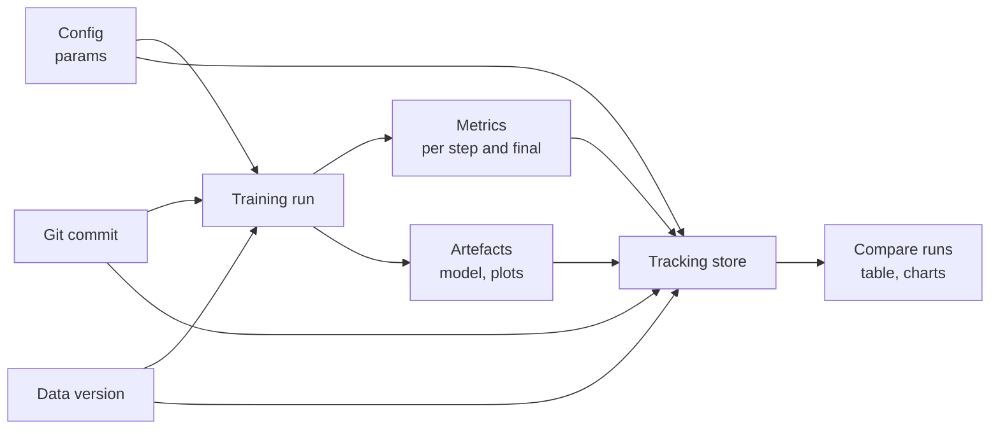

Three weeks into a project you will have trained dozens of models. One of them, from somewhere around last Thursday, was the best. Which learning rate did it use? Was that before or after you fixed the feature bug? Which version of the dataset? If the answers live in notebook cell outputs, file names like `model_final_v3_really.pkl` and your memory, you will not find out. **Experiment tracking** means recording every training run, automatically and in a consistent structure, so that runs can be compared, reproduced and promoted with confidence.

## What a run should record

A **run** is one execution of your training or evaluation code. An **experiment** groups related runs (for example, all runs for the churn model). For each run, record enough to answer "what went in?" and "what came out?".

| Category | Examples | Why |
| --- | --- | --- |
| Parameters | Learning rate, tree depth, `C`, batch size, prompt version | What you chose |
| Metrics | Validation F1, loss per epoch, latency, cost per 1,000 calls | What happened |
| Artefacts | Model file, confusion matrix plot, predictions file | What it produced |
| Code version | Git commit hash, whether the working tree had uncommitted changes | Which code ran |
| Data version | Dataset hash or DVC version, row count | Which data it saw |
| Environment | Python and library versions, hardware | Where it ran |
| Tags and notes | `baseline`, `bugfix-leakage`, free text | Why you ran it |



> [!KEY]
> Log from code, not by hand. A tracker is only trustworthy if every run is recorded automatically, including the failed and embarrassing ones. Hand-picked spreadsheets record only the runs you remembered to copy.

## A tracker in thirty lines

Tools such as [MLflow](/learn/mlops/mlflow) and [Weights & Biases](/learn/mlops/weights-and-biases) do this at scale, with a UI. Building a tiny one yourself shows there is no magic: a run is a dictionary appended to a file.

```python
import json, platform, tempfile, time, uuid
from pathlib import Path

class Tracker:
    def __init__(self, root):
        self.path = Path(root) / "runs.jsonl"

    def log_run(self, experiment, params, metrics, tags=None):
        record = {
            "run_id": uuid.uuid4().hex[:8],
            "experiment": experiment,
            "start_time": time.time(),
            "params": params,
            "metrics": metrics,
            "tags": tags or {},
            "python": platform.python_version(),
        }
        with self.path.open("a") as f:
            f.write(json.dumps(record) + "\n")
        return record["run_id"]

    def load(self):
        return [json.loads(line) for line in self.path.read_text().splitlines()]

tracker = Tracker(tempfile.mkdtemp())
```

Now use it for a small hyperparameter sweep. Note that every run is logged, not just the good ones.

```python
from sklearn.datasets import load_breast_cancer
from sklearn.ensemble import RandomForestClassifier
from sklearn.metrics import f1_score
from sklearn.model_selection import train_test_split

X, y = load_breast_cancer(return_X_y=True)
X_tr, X_val, y_tr, y_val = train_test_split(X, y, test_size=0.25, random_state=0)

for max_depth in [2, 4, None]:
    for n_estimators in [20, 100]:
        params = {"max_depth": max_depth, "n_estimators": n_estimators, "random_state": 0}
        model = RandomForestClassifier(**params).fit(X_tr, y_tr)
        metrics = {
            "train_f1": f1_score(y_tr, model.predict(X_tr)),
            "val_f1": f1_score(y_val, model.predict(X_val)),
        }
        tracker.log_run("breast-cancer-rf", params, metrics, tags={"data": "sklearn-v1"})

print(len(tracker.load()), "runs logged")
```

```output
6 runs logged
```

## Comparing runs

Because each run has the same structure, comparison is a table operation. Flatten the records with pandas and sort:

```python
import pandas as pd

runs = pd.json_normalize(tracker.load())
cols = ["params.max_depth", "params.n_estimators", "metrics.train_f1", "metrics.val_f1"]
table = runs[cols].sort_values("metrics.val_f1", ascending=False)
print(table.round(4).to_string(index=False))
```

```output
 params.max_depth  params.n_estimators  metrics.train_f1  metrics.val_f1
              NaN                  100            1.0000          0.9775
              4.0                   20            0.9926          0.9721
              4.0                  100            0.9944          0.9721
              2.0                   20            0.9704          0.9718
              2.0                  100            0.9686          0.9663
              NaN                   20            1.0000          0.9605
```

Unlimited depth (`None`) shows as `NaN` after flattening. Logging training as well as validation scores exposes the train-validation gap, which tells you how much each setting [overfits](/learn/machine-learning-fundamentals/underfitting-and-overfitting). Also notice that several settings are close, and that unlimited depth is both the best and the worst row depending only on the number of trees: with a validation set of 143 rows, a difference of one misclassified example moves F1 by a fraction of a percentage point. Tracking makes it tempting to crown the top row; good practice is to confirm the winner with [cross-validation](/learn/model-evaluation/cross-validation) or several seeds before believing a small gap.

> [!WARNING]
> If you pick the best run by validation score across many runs, that validation score is now optimistically biased: you have tuned on it. Keep a held-out test set that you evaluate only on the final chosen run, and log that evaluation as its own run.

## Metrics over time

Final numbers are not enough for neural networks. Log metrics **per step or epoch** so you can see curves: a validation loss that turns upward signals overfitting, a loss that becomes `nan` points to an exploding gradient, a flat line suggests the learning rate is too low. Every tracking tool accepts a `step` argument for this, and stores metrics as a series rather than a single value.

## Tracking LLM experiments

With LLM applications, an experiment is usually a **prompt or configuration variant evaluated on an eval set**. The structure is the same: parameters are the prompt version, model identifier, temperature and retrieval settings; metrics are pass rate, judge scores, latency and token cost.

Here a stub stands in for a real model call so the example runs anywhere. It shows the shape of the loop:

```python
eval_set = [
    {"input": "Refund for order 1182?", "expected_intent": "refund"},
    {"input": "My parcel never arrived", "expected_intent": "delivery"},
    {"input": "Cancel my subscription please", "expected_intent": "cancel"},
    {"input": "Where is my package?", "expected_intent": "delivery"},
]

def fake_llm(prompt_version, text):
    # Stand-in for an API call: v2 knows about the word "package"
    keywords = {"refund": "refund", "arrived": "delivery", "cancel": "cancel"}
    if prompt_version == "v2":
        keywords["package"] = "delivery"
    intent = next((v for k, v in keywords.items() if k in text.lower()), "other")
    tokens = 40 + len(text.split()) + (15 if prompt_version == "v2" else 0)
    return intent, tokens

for version in ["v1", "v2"]:
    results = [fake_llm(version, ex["input"]) for ex in eval_set]
    correct = sum(intent == ex["expected_intent"] for (intent, _), ex in zip(results, eval_set))
    tokens = sum(t for _, t in results)
    tracker.log_run("intent-prompt", {"prompt_version": version, "model": "stub-model"},
                    {"accuracy": correct / len(eval_set), "total_tokens": tokens})

llm_runs = pd.json_normalize([r for r in tracker.load() if r["experiment"] == "intent-prompt"])
print(llm_runs[["params.prompt_version", "metrics.accuracy", "metrics.total_tokens"]].to_string(index=False))
```

```output
params.prompt_version  metrics.accuracy  metrics.total_tokens
                   v1              0.75                   176
                   v2              1.00                   236
```

The longer prompt fixed one failure and cost more tokens per call. Tracking both quality and cost side by side is what lets you make that trade-off deliberately.

### Tracing: tracking inside a single call

For multi-step LLM pipelines (retrieval, then generation, then a tool call), a single run-level metric hides where time and errors come from. **Tracing** records each step as a **span** with its inputs, outputs, duration and token usage, nested under one trace per request. MLflow, Weights & Biases (through its Weave library) and OpenTelemetry-based tools all offer tracing. Treat traces as the per-request log and runs as the per-experiment summary.

## Exercises

**1.** Extend `Tracker.log_run` to also record the current Git commit hash when the code is inside a Git repository, and `None` otherwise.

<details>
<summary>Show solution</summary>

```python
import subprocess

def git_commit():
    try:
        out = subprocess.run(["git", "rev-parse", "HEAD"], capture_output=True, text=True, check=True)
        return out.stdout.strip()
    except (subprocess.CalledProcessError, FileNotFoundError):
        return None
```

Call `git_commit()` inside `log_run` and store it as `record["git_commit"]`. A careful tracker also records whether `git status --porcelain` is non-empty, because a commit hash means little if the working tree had uncommitted edits.

</details>

**2.** From the random forest runs, select the run with the smallest gap between `train_f1` and `val_f1` among runs with `val_f1` of at least 0.95.

<details>
<summary>Show solution</summary>

```python
runs["gap"] = runs["metrics.train_f1"] - runs["metrics.val_f1"]
ok = runs[(runs["experiment"] == "breast-cancer-rf") & (runs["metrics.val_f1"] >= 0.95)]
best = ok.sort_values("gap").iloc[0]
print(best["params.max_depth"], best["params.n_estimators"], round(best["gap"], 4))
```

```output
2.0 20 -0.0014
```

</details>

**3.** A colleague tracks experiments by writing results into a shared spreadsheet at the end of each day. Name two specific failure modes.

<details>
<summary>Show solution</summary>

Runs that looked bad are often not recorded, so the record is biased towards success. Parameters are typed by hand and can be wrong or incomplete (the code version and data version are almost never recorded). Metrics cannot be linked back to the model file that produced them.

</details>

```quiz
[
  {
    "q": "Which of these is a parameter rather than a metric?",
    "options": ["Validation F1", "Training loss at epoch 5", "Prompt template version", "Mean latency per call"],
    "answer": 2,
    "why": "Parameters are inputs you choose; the prompt version is a choice. The others are measured outcomes."
  },
  {
    "q": "Why should a tracker log failed and poor runs too?",
    "options": [
      "To make the database larger",
      "So the record is complete and comparisons are not biased towards runs you chose to keep",
      "Because tracking tools refuse to log only good runs",
      "Failed runs are always the most accurate"
    ],
    "answer": 1,
    "why": "Selective logging hides what you tried, making it impossible to judge how much tuning produced the best result."
  },
  {
    "q": "After choosing the best of 50 runs by validation score, what is the honest way to report performance?",
    "options": [
      "Report the best validation score",
      "Report the average validation score across all runs",
      "Evaluate the chosen run once on a held-out test set and report that",
      "Report the training score"
    ],
    "answer": 2,
    "why": "Selection on validation makes that score optimistic. An untouched test set gives an unbiased estimate."
  },
  {
    "q": "In an LLM pipeline, what is a span?",
    "options": [
      "One step inside a traced request, with its inputs, outputs, timing and token usage",
      "The maximum context length of a model",
      "A range of hyperparameters in a sweep",
      "The time between two training runs"
    ],
    "answer": 0,
    "why": "Traces are made of nested spans, one per step such as retrieval, generation or a tool call."
  }
]
```
