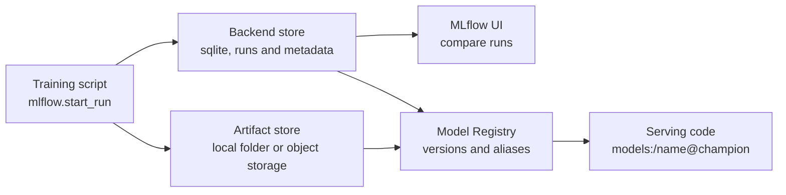

**MLflow** is an open-source platform for the machine learning lifecycle, and probably the most widely deployed tool in this module. It covers experiment tracking, a model packaging format, a model registry with aliases and, in recent versions, prompt management and tracing for LLM applications. You can run it entirely on your laptop with a local database, self-host it as a shared server, or use it as a managed service from several cloud and data platforms. This lesson runs a real local example end to end, so every output below comes from an actual run.

## The pieces of MLflow

| Component | What it does | Lesson that explains the concept |
| --- | --- | --- |
| Tracking | Logs runs: parameters, metrics, tags, artefacts | [Experiment tracking](/learn/mlops/experiment-tracking) |
| Models | A standard directory format with the model, its environment and signature, loadable through "flavours" such as `mlflow.sklearn` and the generic `pyfunc` | [Model versioning](/learn/mlops/model-versioning) |
| Model Registry | Named models, numbered versions, aliases, tags | [Model registry](/learn/mlops/model-registry) |
| Prompt registry and tracing | Versioned prompt templates; spans for LLM calls | [Model monitoring](/learn/mlops/model-monitoring) |



MLflow separates the **backend store** (run metadata, parameters, metrics, registry entries; a database) from the **artifact store** (model files, plots; a folder or object storage such as S3). Locally, both live in your project directory.

## Setting up locally

```bash
pip install mlflow
```

Point MLflow at a local SQLite database. Older tutorials use a plain `./mlruns` folder as the tracking store; in recent MLflow 3 releases that file backend is in maintenance mode and raises an error unless you opt back in, so a SQLite file is the simplest local choice. Model files are still written under `./mlruns` by default.

> [!NOTE]
> MLflow changes quickly. The examples here were run with MLflow 3.x. If a call behaves differently in your version, check the [MLflow documentation](https://mlflow.org/docs/latest/) for that release.

## Tracking runs

The pattern is: choose an experiment, open a run with `mlflow.start_run`, log inside it, and the run closes when the `with` block ends (marked failed if an exception escapes).

```python
import mlflow
import mlflow.sklearn
from sklearn.datasets import load_breast_cancer
from sklearn.linear_model import LogisticRegression
from sklearn.metrics import accuracy_score, f1_score
from sklearn.model_selection import train_test_split

mlflow.set_tracking_uri("sqlite:///mlflow.db")
mlflow.set_experiment("cancer-classifier")

X, y = load_breast_cancer(return_X_y=True)
X_train, X_test, y_train, y_test = train_test_split(X, y, test_size=0.25, random_state=0)

for C in [0.01, 1.0]:
    with mlflow.start_run(run_name=f"logreg-C{C}"):
        mlflow.log_param("C", C)
        mlflow.log_param("max_iter", 5000)
        mlflow.set_tag("data_version", "sklearn-breast-cancer")

        model = LogisticRegression(C=C, max_iter=5000).fit(X_train, y_train)
        preds = model.predict(X_test)
        mlflow.log_metric("accuracy", accuracy_score(y_test, preds))
        mlflow.log_metric("f1", f1_score(y_test, preds))

        mlflow.sklearn.log_model(model, name="model", input_example=X_test[:2])
        print(f"C={C}: accuracy={accuracy_score(y_test, preds):.4f}")
```

```output
C=0.01: accuracy=0.9441
C=1.0: accuracy=0.9510
```

| Call | Logs |
| --- | --- |
| `mlflow.log_param(key, value)` / `log_params(dict)` | Inputs; immutable within a run |
| `mlflow.log_metric(key, value, step=n)` / `log_metrics(dict)` | Numeric results; pass `step` to build a curve, for example one value per epoch |
| `mlflow.set_tag(key, value)` | Free-form labels such as data version or purpose |
| `mlflow.log_artifact(path)` / `log_dict` / `log_figure` | Files, dictionaries, matplotlib figures |
| `mlflow.sklearn.log_model(model, name=...)` | The model in MLflow format, plus its environment and, with `input_example`, an inferred signature |

`mlflow.sklearn.autolog()` (or `mlflow.autolog()` for all supported libraries) logs parameters, metrics and the model automatically when you call `fit`. It is a quick start; explicit logging gives you control over names and extra metrics such as slice results.

## Comparing runs

Start the UI in the same directory and open the address it prints:

```bash
mlflow ui --backend-store-uri sqlite:///mlflow.db
```

The UI lists runs in a sortable table with charts for comparing them. The same data is available in code as a pandas DataFrame, which is better for automated decisions:

```python
runs = mlflow.search_runs(
    experiment_names=["cancer-classifier"],
    order_by=["metrics.f1 DESC"],
)
print(runs[["params.C", "metrics.accuracy", "metrics.f1"]].round(4).to_string(index=False))
```

```output
params.C  metrics.accuracy  metrics.f1
     1.0            0.9510       0.960
    0.01            0.9441       0.954
```

`search_runs` also accepts a `filter_string` such as `"metrics.f1 > 0.95 and params.C = '1.0'"`. Parameters are stored as strings, so compare them with quoted values.

## The Model Registry and aliases

Register the best run's model under a name. Each registration creates a new immutable version; an alias then marks which version serving should use.

```python
from mlflow import MlflowClient

best_run_id = runs.iloc[0]["run_id"]
logged = mlflow.search_logged_models(
    experiment_ids=[runs.iloc[0]["experiment_id"]],
    filter_string=f"source_run_id = '{best_run_id}'",
    output_format="list",
)[0]
version = mlflow.register_model(logged.model_uri, "cancer-classifier")
print("registered version:", version.version)

client = MlflowClient()
client.set_registered_model_alias("cancer-classifier", "champion", version.version)

served = mlflow.sklearn.load_model("models:/cancer-classifier@champion")
print(type(served).__name__, "with C =", served.C)
```

```output
registered version: 1
LogisticRegression with C = 1.0
```

The serving application only ever loads `models:/cancer-classifier@champion`. Promoting a new version, or rolling back, is a single `set_registered_model_alias` call; the serving code does not change. You can also register at logging time with `log_model(..., registered_model_name="cancer-classifier")`.

> [!TIP]
> In MLflow 3, each `log_model` call creates a **logged model** with its own id, and its `model_uri` (of the form `models:/m-...`) is the most direct thing to register. Keep the object returned by `log_model` (`info = mlflow.sklearn.log_model(...)`, then `info.model_uri`) to avoid searching afterwards.

## LLMOps with MLflow: prompts and traces

MLflow treats prompts as registry entries too. Register a template, give a version an alias, and load it by alias in the application:

```python
prompt = mlflow.genai.register_prompt(
    name="support-reply",
    template="You are a support agent. Answer in at most {{ max_words }} words.\n\nQuestion: {{ question }}",
    commit_message="Initial version",
)
mlflow.genai.set_prompt_alias("support-reply", alias="production", version=prompt.version)

loaded = mlflow.genai.load_prompt("prompts:/support-reply@production")
print(loaded.format(max_words=50, question="How do I reset my password?"))
```

```output
You are a support agent. Answer in at most 50 words.

Question: How do I reset my password?
```

Templates use double-brace variables. Editing the prompt later creates version 2; production keeps using version 1 until someone moves the alias, ideally after the new version passes your eval set.

For tracing, decorate functions with `@mlflow.trace`. Each call is recorded as a trace with nested spans, inputs, outputs and timing, viewable in the UI's traces tab. Several LLM client libraries also have autologging integrations that record calls without decorators; check the docs for the libraries you use.

```python
@mlflow.trace
def retrieve(question: str) -> list[str]:
    return ["Passwords can be reset under Settings > Security."]

@mlflow.trace
def answer(question: str) -> str:
    context = retrieve(question)          # becomes a child span
    return f"Based on our docs: {context[0]}"

print(answer("How do I reset my password?"))
```

```output
Based on our docs: Passwords can be reset under Settings > Security.
```

## Running MLflow for a team

A local SQLite file is perfect for learning and solo work. For a team, run a tracking server with a shared database (PostgreSQL or MySQL) and an object-store artefact location, then point every client at it with `mlflow.set_tracking_uri("http://your-server:5000")` or the `MLFLOW_TRACKING_URI` environment variable. Put authentication in front of it: by default an open tracking server lets anyone who can reach it read and modify runs and models.

> [!WARNING]
> Loading an MLflow model can involve unpickling and installing its recorded dependencies. Only load models from registries you control, for the same reasons you never unpickle untrusted files.

## Exercises

**1.** Add a third run with `C=100.0`, log the number of iterations the solver used (`model.n_iter_[0]`) as a metric, and rerun the comparison table. Does larger `C` help?

<details>
<summary>Show solution</summary>

```python
with mlflow.start_run(run_name="logreg-C100"):
    model = LogisticRegression(C=100.0, max_iter=5000).fit(X_train, y_train)
    preds = model.predict(X_test)
    mlflow.log_params({"C": 100.0, "max_iter": 5000})
    mlflow.log_metrics({
        "accuracy": accuracy_score(y_test, preds),
        "f1": f1_score(y_test, preds),
        "n_iter": int(model.n_iter_[0]),
    })

runs = mlflow.search_runs(experiment_names=["cancer-classifier"], order_by=["metrics.f1 DESC"])
print(runs[["params.C", "metrics.f1"]].round(4).to_string(index=False))
```

```output
params.C  metrics.f1
   100.0      0.9659
     1.0      0.9600
    0.01      0.9540
```

On this split, weaker regularisation (larger `C`) gives the best F1 of the three. The difference is a few test examples, so confirm it with cross-validation before trusting it. Look at the logged `n_iter` too: it is 5000, the limit, and scikit-learn prints a `ConvergenceWarning`. The solver did not converge on these unscaled features, which is exactly the kind of detail that logging an extra metric surfaces. Adding a `StandardScaler` in a pipeline would fix it.

</details>

**2.** Write the two lines that roll the `champion` alias back to version 1 and confirm which version it now points to.

<details>
<summary>Show solution</summary>

```python
client.set_registered_model_alias("cancer-classifier", "champion", "1")
print(client.get_model_version_by_alias("cancer-classifier", "champion").version)
```

```output
1
```

</details>

**3.** Why log the prompt alias resolution (the actual prompt version number) with every traced LLM call, rather than just the alias name?

<details>
<summary>Show solution</summary>

The alias moves over time. A trace that only records `production` cannot tell you, a week later, which template produced the answer. Recording the resolved version number makes every output attributable to an exact prompt.

</details>

```quiz
[
  {
    "q": "In MLflow, where do model files go compared with run metrics?",
    "options": [
      "Both go into the same SQLite table",
      "Metrics and params go to the backend store; model files go to the artifact store",
      "Model files go to Git; metrics go to the artifact store",
      "MLflow does not store model files"
    ],
    "answer": 1,
    "why": "MLflow separates metadata (backend store, a database) from large files (artifact store, a folder or object storage)."
  },
  {
    "q": "What does `mlflow.log_metric(\"loss\", value, step=epoch)` let you do that a single final metric does not?",
    "options": [
      "Register the model",
      "Plot the metric as a curve over training steps",
      "Hide the metric from the UI",
      "Make the metric a parameter"
    ],
    "answer": 1,
    "why": "Logging with a step stores a series, so you can see learning curves and spot overfitting or divergence."
  },
  {
    "q": "Which URI should a production service use to load the current approved model?",
    "options": [
      "`runs:/<run_id>/model`",
      "`models:/cancer-classifier/1`",
      "`models:/cancer-classifier@champion`",
      "`file:///home/me/model.pkl`"
    ],
    "answer": 2,
    "why": "Loading by alias lets promotion and rollback happen in the registry without changing serving code."
  },
  {
    "q": "In recent MLflow 3 releases, what is the simplest working local tracking backend?",
    "options": [
      "A plain `./mlruns` folder with no configuration",
      "A local SQLite database such as `sqlite:///mlflow.db`",
      "A Git repository",
      "A CSV file"
    ],
    "answer": 1,
    "why": "The file-based backend is in maintenance mode and requires an explicit opt-in; SQLite works out of the box."
  }
]
```
