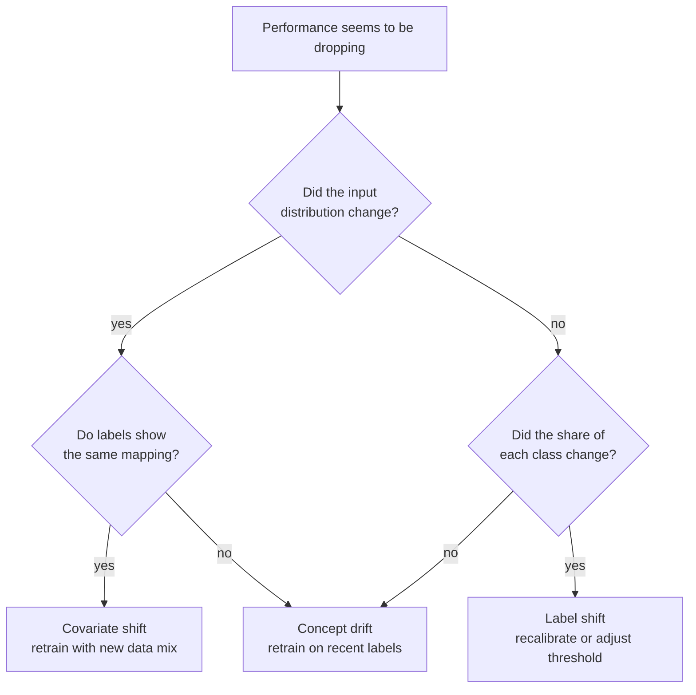
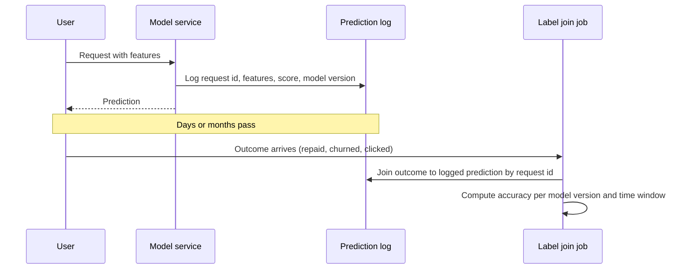

A model that scored well at launch can quietly get worse. Nothing in the code changes, no error is raised, the service stays green on every infrastructure dashboard, and yet the predictions are less useful each week. **Model drift** (also called model decay) is this loss of predictive performance over time. The previous lesson, [data drift](/learn/mlops/data-drift), looked at changes in the inputs alone. This lesson looks at the changes that actually break models, how to tell them apart, and how to monitor performance when the true labels arrive late or never.

## Three kinds of shift, revisited

Write the world as a joint distribution $P(x, y)$ of inputs $x$ and labels $y$. A model approximates $P(y \mid x)$. Performance can change for three different reasons:

| Shift | Formal change | Is the learned mapping still right? | Visible without labels? |
| --- | --- | --- | --- |
| Covariate shift | $P(x)$ changes, $P(y \mid x)$ fixed | Yes, but now applied to regions it saw rarely in training | Yes, in the inputs |
| Label shift | $P(y)$ changes, $P(x \mid y)$ fixed | The scores still rank well, but calibration and thresholds are off | Partly, through the prediction distribution |
| Concept drift | $P(y \mid x)$ changes | No: the same input now means something different | Often not at all |



Concept drift also comes in different temporal shapes, which affects how you respond:

- **Sudden**: a policy change or a new law changes the meaning of a pattern overnight.
- **Gradual or incremental**: user tastes slowly evolve, so error creeps up over months.
- **Recurring**: seasonal behaviour such as holiday shopping returns each year. A model trained on a window that includes past seasons copes better than one that only saw summer.

## Concept drift you cannot see in the inputs

The most dangerous case is a change in $P(y \mid x)$ with no change in $P(x)$. Here a model learns that a customer churns when $x_1 + x_2 > 0$. Later the rule becomes $x_1 - x_2 > 0$, while the inputs keep exactly the same distribution.

```python
import numpy as np
from scipy import stats
from sklearn.linear_model import LogisticRegression
from sklearn.metrics import accuracy_score

rng = np.random.default_rng(0)

def make_data(n, rule):
    X = rng.normal(size=(n, 2))
    noise = rng.normal(scale=0.3, size=n)
    if rule == "old":
        y = (X[:, 0] + X[:, 1] + noise > 0).astype(int)
    else:
        y = (X[:, 0] - X[:, 1] + noise > 0).astype(int)
    return X, y

X_train, y_train = make_data(5000, "old")
model = LogisticRegression().fit(X_train, y_train)

X_before, y_before = make_data(2000, "old")
X_after, y_after = make_data(2000, "new")

print(f"accuracy before: {accuracy_score(y_before, model.predict(X_before)):.3f}")
print(f"accuracy after:  {accuracy_score(y_after, model.predict(X_after)):.3f}")
for j in range(2):
    d = stats.ks_2samp(X_train[:, j], X_after[:, j]).statistic
    print(f"feature {j} KS D = {d:.3f}")
```

```output
accuracy before: 0.932
accuracy after:  0.503
feature 0 KS D = 0.018
feature 1 KS D = 0.018
```

Accuracy collapses to roughly a coin flip, yet both features pass a drift check. Now look at what the model outputs:

```python
p_before = model.predict_proba(X_before)[:, 1]
p_after = model.predict_proba(X_after)[:, 1]
print(f"mean score before: {p_before.mean():.3f}, after: {p_after.mean():.3f}")
print(f"KS on scores: D = {stats.ks_2samp(p_before, p_after).statistic:.3f}")
```

```output
mean score before: 0.500, after: 0.505
KS on scores: D = 0.016
```

The prediction distribution is also unchanged, because the model is seeing the same kind of inputs and responding the same way. Only labels reveal this failure.

> [!KEY]
> Input drift and prediction drift are cheap early warnings, but neither can detect pure concept drift. Some flow of ground-truth labels, even a small sampled one, is the only reliable defence.

## Label shift: visible in the predictions

Label shift is different. Suppose fraud rises from 10% to 30% of transactions, but each fraudulent transaction looks as it always did.

```python
def make_prior(n, pos_rate):
    y = (rng.random(n) < pos_rate).astype(int)
    X = rng.normal(size=(n, 2)) + y[:, None] * 1.5   # positives sit higher
    return X, y

X_tr, y_tr = make_prior(5000, 0.10)
clf = LogisticRegression().fit(X_tr, y_tr)

for rate in [0.10, 0.30]:
    X_now, y_now = make_prior(4000, rate)
    pred = clf.predict(X_now)
    print(f"true rate {rate:.2f} | predicted positive rate {pred.mean():.3f} "
          f"| accuracy {accuracy_score(y_now, pred):.3f}")
```

```output
true rate 0.10 | predicted positive rate 0.069 | accuracy 0.931
true rate 0.30 | predicted positive rate 0.171 | accuracy 0.843
```

The predicted positive rate more than doubles, so you can see something happened before any labels arrive. Accuracy also falls, because the decision threshold was tuned for a 10% world. Here the fix is often not a full retrain but re-weighting or adjusting the threshold for the new class balance.

## Monitoring when labels are late or missing

In many systems the true outcome arrives long after the prediction: a loan defaults months later, a churn label exists only at contract renewal, and for a chatbot answer there may never be a definitive label at all.



The design rule is to log every prediction with a stable **request id**, the model version and the features used, so that labels can be joined back whenever they appear. Meanwhile, you lean on **proxy metrics**:

| Proxy | What it suggests | Weakness |
| --- | --- | --- |
| Input drift (KS, PSI) | The model is seeing unfamiliar data | Blind to concept drift |
| Prediction drift | Output mix changed: possible label shift or a broken feature | Blind to pure concept drift |
| Confidence distribution | More low-confidence predictions: the model is unsure more often | Models can be confidently wrong |
| Early behavioural signals | Clicks, overrides by staff, refunds, complaint tickets | Noisy, may be biased |
| Sampled human labels | A small random sample reviewed by people | Costs money and time, but is ground truth |

> [!TIP]
> Sample for labelling **at random**, not only the low-confidence cases. Active-learning style sampling helps you improve the model, but only a random sample gives an unbiased estimate of current accuracy.

## Drift in LLM applications

LLM systems drift too, often for reasons outside your control:

- **User drift**: people start asking about a new product, in a new language, or with longer pasted documents. Track query topics and prompt lengths as input-drift signals.
- **Knowledge drift**: facts change. A RAG system stays current only if its index is refreshed; a model answering from its weights is frozen at its training cutoff.
- **Provider changes**: if you call a model alias that the provider updates, the model under your prompt can change. Pin a dated model snapshot where the provider offers one and record the exact model identifier with every logged call.
- **Quality proxies**: thumbs-up and thumbs-down rates, regeneration rate, conversations escalated to a human, LLM-as-judge scores on a sample of live traffic (see [model evaluation](/learn/working-with-llms/model-evaluation)), and a fixed **eval set** that you re-run on a schedule, so a drop shows up as a regression against a known baseline.

Feedback such as thumbs-down clicks is the LLM equivalent of a delayed, partial label: biased (unhappy users click more) but invaluable when joined back to the full trace of the call.

## Exercises

**1.** In the concept drift example, retrain a model on 2,000 rows drawn with the new rule and report its accuracy on `X_after`. What does this tell you about the fix for concept drift?

<details>
<summary>Show solution</summary>

```python
X_new, y_new = make_data(2000, "new")
model_new = LogisticRegression().fit(X_new, y_new)
print(f"retrained accuracy: {accuracy_score(y_after, model_new.predict(X_after)):.3f}")
```

```output
retrained accuracy: 0.926
```

Accuracy returns to its pre-drift level, because the problem was never the model class, only the mapping it learned. The fix for concept drift is fresh labelled data from the new regime, which is why the label pipeline matters.

</details>

**2.** For each scenario, name the most likely kind of shift: (a) a spam filter's inputs look normal but spammers have started writing like ordinary users; (b) a medical test sees more positive cases during an outbreak; (c) a credit model starts receiving applications from a new country.

<details>
<summary>Show solution</summary>

(a) Concept drift: the same kind of text now carries a different label. (b) Label shift: $P(y)$ rose, while what a positive case looks like is unchanged. (c) Covariate shift: $P(x)$ moved into a region with little training data, though the relationship may also differ there, so check with labels.

</details>

**3.** Your product only learns whether a loan defaulted 12 months after approval. List three things you would monitor in the first month after a new model goes live.

<details>
<summary>Show solution</summary>

Input drift per feature against the training window (PSI or KS), the distribution of predicted default probabilities and the approval rate (prediction drift), and early-payment signals such as missed first instalments as a proxy label. Also confirm that every decision is logged with request id and model version so the 12-month labels can be joined back later.

</details>

```quiz
[
  {
    "q": "Which kind of shift changes $P(y \\mid x)$?",
    "options": ["Covariate shift", "Label shift", "Concept drift", "Sampling bias"],
    "answer": 2,
    "why": "Concept drift is a change in the relationship between inputs and labels; the same input now maps to a different outcome."
  },
  {
    "q": "In the lesson's concept drift example, accuracy fell to about 50% while feature KS statistics stayed small. Why?",
    "options": [
      "The KS test was applied incorrectly",
      "The input distribution $P(x)$ did not change; only the labelling rule did",
      "The model was overfitting",
      "The sample size was too small"
    ],
    "answer": 1,
    "why": "Inputs were drawn from the same distribution before and after, so input drift detectors had nothing to find."
  },
  {
    "q": "Why should part of your labelling budget go to a uniformly random sample of predictions?",
    "options": [
      "Random samples are cheaper to label",
      "It gives an unbiased estimate of current accuracy",
      "Random samples always contain more errors",
      "It is required by the KS test"
    ],
    "answer": 1,
    "why": "Sampling only uncertain cases over-represents hard examples. A random sample estimates performance on real traffic."
  },
  {
    "q": "What must every logged prediction include so delayed labels can be used later?",
    "options": [
      "A stable request id and the model version",
      "The full training dataset",
      "The p-value of a drift test",
      "The user's password"
    ],
    "answer": 0,
    "why": "The request id lets you join the outcome back to the prediction, and the model version tells you which model to attribute the result to."
  }
]
```
