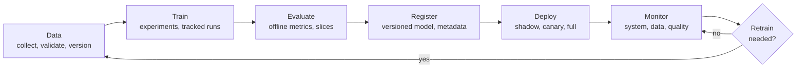
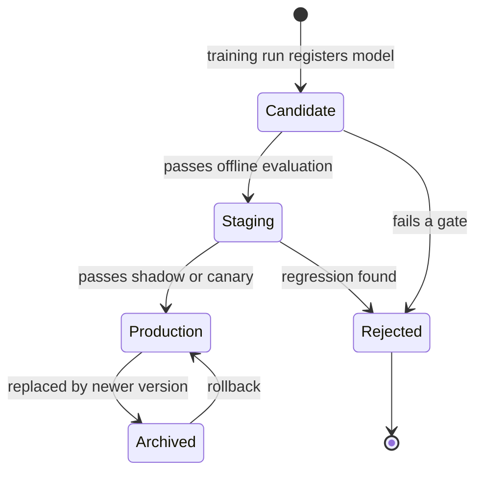

Training a model in a notebook is the easy part. The hard part is everything around it: knowing which data and code produced the model now in production, deciding when a new model is good enough to replace it, noticing when it starts to fail, and replacing it safely. **MLOps** (machine learning operations) is the set of practices and tools that make this loop routine instead of heroic. **Model lifecycle management** is the backbone of MLOps: a clear picture of the stages every model passes through, what each stage produces, and who or what decides when a model moves on.

This module walks the whole loop. Concept lessons come first (tracking, versioning, registries, monitoring, drift, retraining, reproducibility), then the tools most teams use for them: MLflow, Weights & Biases, DVC and Evidently AI. Throughout, you will see the **LLMOps** version of each idea, because applications built on large language models have the same lifecycle with different artefacts: prompts, eval sets and traces instead of, or as well as, trained weights.

## Why ML needs its own operations discipline

Traditional software has one thing that changes: code. A machine learning system has three, and any of them can break it.

| Changes in | Software example | ML example |
| --- | --- | --- |
| Code | A bug fix | A new feature transformation |
| Data | (rare) | New training data, a changed upstream schema, drifting inputs |
| Model | (not applicable) | Retrained weights, new hyperparameters, a different LLM or prompt |

A model can also fail **silently**. A web server that breaks returns errors; a model that degrades keeps returning confident predictions that are slightly more wrong every week. That is why ML operations put so much weight on lineage (where did this come from?) and monitoring (is it still working?).

## The lifecycle loop



| Stage | Main question | Typical artefacts | Lesson |
| --- | --- | --- | --- |
| Data | Is the data correct and do we know exactly which data we used? | Dataset snapshot, schema, validation report | [DVC](/learn/mlops/dvc), [data validation](/learn/data-engineering-fundamentals/data-validation) |
| Train | Which settings did we try, and what happened? | Runs with params, metrics, logs | [Experiment tracking](/learn/mlops/experiment-tracking) |
| Evaluate | Is it better than what we have, on every slice that matters? | Evaluation report, eval set results | [Model evaluation](/learn/model-evaluation/accuracy) |
| Register | Which exact artefact are we promoting? | Model version with lineage and approval status | [Model registry](/learn/mlops/model-registry) |
| Deploy | How do we release it without risk? | Serving config, rollout plan | [Model retraining](/learn/mlops/model-retraining) |
| Monitor | Is it still working on real traffic? | Dashboards, drift reports, alerts | [Model monitoring](/learn/mlops/model-monitoring) |
| Retrain | When and how do we refresh it? | Trigger rules, new candidate | [Model retraining](/learn/mlops/model-retraining) |

The arrow from monitoring back to data is what makes this a lifecycle rather than a project. A model is never "done"; it is in production until it is retired.

## Model states and promotion

Inside the loop, each model version moves through a small set of states. Making those states explicit, and allowing only certain transitions, stops accidents such as an unevaluated model going straight to production.



You can encode the same rules in a few lines. Real registries do this for you, but writing it once makes the idea concrete:

```python
ALLOWED = {
    "candidate": {"staging", "rejected"},
    "staging": {"production", "rejected"},
    "production": {"archived"},
    "archived": {"production"},
    "rejected": set(),
}

class ModelVersion:
    def __init__(self, name, version):
        self.name, self.version, self.state = name, version, "candidate"
        self.history = ["candidate"]

    def move_to(self, new_state):
        if new_state not in ALLOWED[self.state]:
            raise ValueError(f"{self.name} v{self.version}: cannot go {self.state} -> {new_state}")
        self.state = new_state
        self.history.append(new_state)

m = ModelVersion("churn-model", 7)
m.move_to("staging")
m.move_to("production")
print(m.history)

try:
    ModelVersion("churn-model", 8).move_to("production")
except ValueError as err:
    print(err)
```

```output
['candidate', 'staging', 'production']
churn-model v8: cannot go candidate -> production
```

> [!KEY]
> Lifecycle management is mostly about **traceability**: for any prediction made in production, you should be able to answer which model version made it, which code and data trained that model, how it was evaluated, and who approved it.

## Who does what

Lifecycle stages are often owned by different people, which is exactly why handovers need explicit artefacts rather than shared memory.

| Role | Owns | Hands over |
| --- | --- | --- |
| Data engineer | Pipelines, data quality | Versioned, validated datasets |
| Data scientist or ML engineer | Experiments, model choice | A registered model version with metrics and lineage |
| ML platform or MLOps engineer | Training infrastructure, registry, serving, monitoring | Reliable deployment and alerting |
| Product owner or reviewer | Business sign-off | Approval to promote |

In a small team one person may hold every role, but the artefacts still matter: the person reading the registry six months from now is usually you.

## Maturity: from manual to automated

Teams usually progress through recognisable levels of automation:

1. **Manual.** Notebooks, a model file copied to a server, no record of how it was built. Fine for a prototype, fragile for anything users depend on.
2. **Automated training pipeline.** Training is a script or pipeline that can be re-run from versioned data and config; runs are tracked; models are registered. Retraining is a button, not a project.
3. **Automated delivery.** Code, pipeline and model changes flow through CI/CD with automated tests and evaluation gates; deployment and rollback are routine; monitoring can trigger retraining.

You do not need level 3 for every model. Match the investment to how often the model changes and how costly its failures are. The [CI/CD module](/learn/ci-cd/continuous-integration) covers the delivery side.

## The LLMOps lifecycle

For an application built on a hosted or open-weight LLM, you often never train anything, yet the loop is the same with different artefacts:

| ML lifecycle | LLMOps equivalent |
| --- | --- |
| Training data | Eval set of representative inputs with expected behaviour; few-shot examples; RAG corpus |
| Hyperparameters | Prompt template, model identifier, temperature, max tokens, retrieval settings |
| Trained model | The combination of prompt version, model version and pipeline config |
| Offline evaluation | Running the eval set with automatic checks and LLM-as-judge scoring |
| Monitoring | Traces of every call: latency, token usage, cost, errors, user feedback |
| Retraining | Prompt revisions, switching or upgrading the model, refreshing the index, fine-tuning |

> [!TIP]
> Treat a prompt like a model: give it a version, store it in a registry or in Git rather than in a string scattered through your code, evaluate every change against a fixed eval set, and log the prompt version with every call. The lessons that follow show how.

## Exercises

**1.** Using the `ModelVersion` class, simulate a rollback: version 7 goes to production, version 8 replaces it (version 7 is archived), then version 8 misbehaves and version 7 is restored. Which transitions do you call, and does the current `ALLOWED` table permit them all?

<details>
<summary>Show solution</summary>

```python
v7, v8 = ModelVersion("churn-model", 7), ModelVersion("churn-model", 8)
for state in ["staging", "production"]:
    v7.move_to(state)
for state in ["staging", "production"]:
    v8.move_to(state)
v7.move_to("archived")
# v8 misbehaves: archive it and restore v7
v8.move_to("archived")
v7.move_to("production")
print(v7.history)
print(v8.history)
```

```output
['candidate', 'staging', 'production', 'archived', 'production']
['candidate', 'staging', 'production', 'archived']
```

Every transition is allowed. In a real system, you would probably also want a separate `rolled_back` state for v8 so that it is clearly marked as faulty rather than merely replaced.

</details>

**2.** List three questions you could not answer about a production model if your team skipped the "Register" stage and copied model files straight to the server.

<details>
<summary>Show solution</summary>

Examples: Which training run and data produced the file now serving? What were its evaluation metrics, and did anyone approve it? What was the previous version, and where is it, so that we can roll back? Is the file on server A the same as on server B?

</details>

**3.** A team's chatbot answers got noticeably worse last Tuesday. They had changed nothing in their code. Using the LLMOps table, list where in the lifecycle the change might have come from.

<details>
<summary>Show solution</summary>

The provider may have updated the model behind an unpinned alias; a colleague may have edited the prompt template outside version control; the RAG corpus may have been re-indexed with different chunking; or the user questions themselves may have shifted (input drift). Logging the model identifier, prompt version and index version with every trace makes this a five-minute investigation.

</details>

```quiz
[
  {
    "q": "Which three things can change and break a machine learning system?",
    "options": [
      "Code, data and model",
      "Code, servers and users",
      "Only the model weights",
      "Only the training data"
    ],
    "answer": 0,
    "why": "Unlike ordinary software, an ML system can break because of code changes, data changes or model changes."
  },
  {
    "q": "Why is the lifecycle drawn as a loop rather than a line?",
    "options": [
      "Because training is always repeated every day",
      "Because monitoring in production feeds back into data and retraining",
      "Because deployment must happen before evaluation",
      "Because models are retrained randomly"
    ],
    "answer": 1,
    "why": "Monitoring detects degradation or new data, which triggers a new pass through data, training and evaluation."
  },
  {
    "q": "In LLMOps, what plays the role that offline test-set evaluation plays in classical ML?",
    "options": [
      "Counting tokens in the prompt",
      "Running a fixed eval set of representative inputs and scoring the outputs",
      "Measuring GPU utilisation",
      "Asking the model whether it is correct"
    ],
    "answer": 1,
    "why": "A versioned eval set, scored by automatic checks and judges, is the regression test for prompts and model choices."
  },
  {
    "q": "What is the main goal of restricting which state transitions a model version can make?",
    "options": [
      "To speed up training",
      "To reduce storage costs",
      "To prevent unevaluated or rejected models from reaching production",
      "To make models more accurate"
    ],
    "answer": 2,
    "why": "Explicit allowed transitions encode the promotion gates, so a candidate cannot skip evaluation."
  }
]
```
