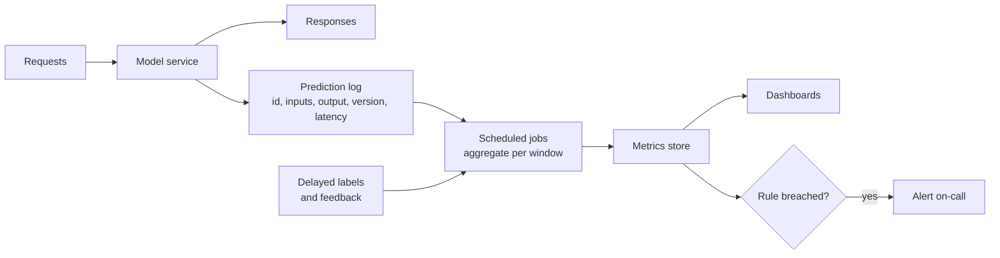

Deployment is not the finish line. A model in production is exposed to data it has never seen, upstream systems that change without warning and users who behave in ways no test set predicted. Because models fail quietly, by returning plausible but worse answers rather than errors, you need monitoring that looks beyond "is the server up?". **Model monitoring** is the practice of continuously measuring the health of the service, the data flowing into it, the predictions coming out of it and the outcomes those predictions lead to, and alerting a human when something moves.

This lesson builds on general [error monitoring](/learn/software-engineering/error-monitoring) and [logging](/learn/software-engineering/logging) from the software engineering module, and adds the layers that are specific to models.

## Four layers of monitoring

| Layer | Question | Example signals | Needs labels? |
| --- | --- | --- | --- |
| System | Is the service healthy? | Request rate, error rate, latency percentiles, CPU, GPU memory | No |
| Data | Is the input what we expect? | Schema violations, missing-value rates, out-of-range values, [data drift](/learn/mlops/data-drift) | No |
| Model | Are the predictions sensible and accurate? | Prediction distribution, confidence, accuracy or error once labels arrive | Partly |
| Business | Is the model doing its job? | Conversion, fraud losses, tickets resolved, user satisfaction | No, but delayed |

Problems usually show up in a lower layer first. A broken upstream join shows as a jump in missing values (data) long before anyone notices fewer sales (business). Monitoring all four lets you catch issues early and explain them later.



The **prediction log** is the foundation. Log, for every request: a request id, timestamp, model version, the input features (or a reference to them), the output, latency and any error. Every other signal can be computed from it later; signals you never logged cannot.

## System metrics: percentiles, not averages

Latency distributions have long tails. The mean hides the users who wait longest, so monitor **percentiles**: p50 (the median), p95 and p99. The p99 is the latency that 1 request in 100 exceeds.

```python
import numpy as np

rng = np.random.default_rng(1)
# Most requests are fast, a few hit a slow path (cache miss, long input)
fast = rng.lognormal(mean=np.log(120), sigma=0.25, size=9_700)
slow = rng.lognormal(mean=np.log(900), sigma=0.40, size=300)
latency_ms = np.concatenate([fast, slow])

print(f"mean {latency_ms.mean():7.1f} ms")
for q in [50, 95, 99]:
    print(f"p{q:<3} {np.percentile(latency_ms, q):7.1f} ms")
```

```output
mean   149.1 ms
p50    120.8 ms
p95    198.8 ms
p99   1066.1 ms
```

The mean looks acceptable and the median looks great, yet 1% of users wait over a second. A service-level objective such as "p95 below 300 ms" is far more meaningful than one about the mean.

## Data quality checks

Before drift statistics, check the basics on each batch of logged inputs: the schema, the share of missing values, and values outside the range seen in training. These catch the most common real incident, a broken upstream pipeline.

```python
import pandas as pd

train_ranges = {"age": (18, 95), "income": (0, 500_000)}
batch = pd.DataFrame({
    "age": [34, 51, None, 29, 230, 45, None, 38],
    "income": [42_000, 88_000, 51_000, None, 61_000, -1, 70_000, 39_000],
})

for col, (lo, hi) in train_ranges.items():
    missing = batch[col].isna().mean()
    present = batch[col].dropna()
    out_of_range = ((present < lo) | (present > hi)).mean()
    print(f"{col:7s} missing={missing:.0%} out_of_range={out_of_range:.0%}")
```

```output
age     missing=25% out_of_range=17%
income  missing=12% out_of_range=14%
```

An age of 230 and an income of -1 are classic signs of sentinel values or unit bugs upstream. Compare these rates with their usual levels rather than with zero: some missingness is normal, a sudden jump is not. The [data validation](/learn/data-engineering-fundamentals/data-validation) lesson covers schema checks in more depth.

## Model quality, with and without labels

When labels arrive (clicks, confirmed fraud, human review), join them to the prediction log by request id and compute the same metrics you used offline, per model version and per time window. Until then, use proxies: the distribution of predicted classes or scores, the share of low-confidence predictions, and input drift. The [model drift](/learn/mlops/model-drift) lesson explains which kinds of failure each proxy can and cannot see.

Always slice. An overall accuracy that holds steady can hide a collapse in one country, device type or customer segment, especially a small one.

## Monitoring LLM applications

For LLM-based systems, the same four layers apply, with some signals that matter far more than for classical models:

| Signal | Why it matters | How to measure |
| --- | --- | --- |
| Latency, including time to first token | Users feel the wait before streaming starts | Timestamps in each traced call |
| Tokens per request (input and output) | Drives cost and latency; spikes suggest prompt bloat or runaway generations | Usage fields returned by the API |
| Cost per request and per day | Budget control; a bug can multiply spend quickly | Tokens times your provider's current prices |
| Error and rate-limit rate | Provider outages and quota limits | HTTP status codes, retries |
| Quality score on sampled traffic | Answers can degrade with no error | LLM-as-judge or human review on a random sample |
| User feedback | The closest thing to a label | Thumbs up or down, regenerations, escalations |
| Guardrail triggers | Safety and abuse signals | Counts of blocked inputs or outputs |

Cost monitoring is simple arithmetic over the log. The prices below are made up for illustration; use your provider's current price list.

```python
calls = pd.DataFrame({
    "input_tokens": rng.integers(300, 1500, size=1000),
    "output_tokens": rng.integers(50, 400, size=1000),
})
PRICE_IN_PER_M, PRICE_OUT_PER_M = 1.00, 4.00   # illustrative USD per million tokens

calls["cost_usd"] = (calls["input_tokens"] * PRICE_IN_PER_M
                     + calls["output_tokens"] * PRICE_OUT_PER_M) / 1_000_000
print(f"mean tokens in/out: {calls['input_tokens'].mean():.0f} / {calls['output_tokens'].mean():.0f}")
print(f"cost per 1,000 calls: USD {calls['cost_usd'].mean() * 1000:.2f}")
```

```output
mean tokens in/out: 907 / 216
cost per 1,000 calls: USD 1.77
```

Track cost per request over time alongside quality. A prompt change that adds a long instruction block may improve quality slightly while doubling cost, and you want to see both numbers move together. See [token usage and cost optimisation](/learn/working-with-llms/token-usage-and-cost-optimization) for ways to bring the cost down.

> [!TIP]
> Close the feedback loop. Store user feedback and judge scores against the full trace (prompt version, model identifier, retrieved documents), then periodically add poorly rated real examples to your eval set. Production failures become regression tests for the next prompt or model change.

## Alerting without alert fatigue

An alert that fires every day trains people to ignore it. Some practical rules:

- **Alert on symptoms users feel** (error rate, p95 latency, quality score), and put diagnostic signals (per-feature drift) on dashboards.
- **Use windows and persistence.** Require a threshold to be breached for, say, three consecutive windows rather than once.
- **Baseline against normal variation.** Set thresholds from the spread of past healthy periods, and compare against the same hour or weekday where usage is cyclic.
- **Every alert needs an owner and a runbook**: what to check first, and how to roll back.

> [!WARNING]
> Logging inputs and outputs can mean storing personal data. Decide what you may retain, for how long and who can see it, and redact or hash identifiers before logs reach analytics systems. Privacy rules apply to monitoring data just as much as to training data.

## Exercises

**1.** Using `latency_ms`, compute the share of requests slower than 500 ms, and the p99 of the fast group alone. What does the comparison tell you about where to optimise?

<details>
<summary>Show solution</summary>

```python
print(f"share over 500 ms: {(latency_ms > 500).mean():.2%}")
print(f"p99 of fast path: {np.percentile(fast, 99):.1f} ms")
```

```output
share over 500 ms: 2.80%
p99 of fast path: 214.1 ms
```

Roughly 3% of requests are slow, and they come from the slow path; the fast path itself has a p99 around 200 ms. Optimising the slow path (better caching, truncating huge inputs) improves tail latency far more than micro-optimising the common case.

</details>

**2.** Write a function `should_alert(values, threshold, k=3)` that returns `True` only if the last `k` window values all exceed the threshold.

<details>
<summary>Show solution</summary>

```python
def should_alert(values, threshold, k=3):
    recent = values[-k:]
    return len(recent) == k and all(v > threshold for v in recent)

error_rates = [0.010, 0.012, 0.031, 0.011, 0.034, 0.036, 0.041]
print(should_alert(error_rates, 0.03))
print(should_alert(error_rates[:4], 0.03))
```

```output
True
False
```

The single spike to 0.031 does not alert; three consecutive high windows do.

</details>

**3.** A support chatbot's thumbs-down rate doubled overnight but latency, errors and token counts are unchanged. Which logged fields would you inspect first?

<details>
<summary>Show solution</summary>

The prompt version and model identifier on the affected traces (did either change?), the retrieved documents and index version (did a re-index break retrieval?), and the input topics (did a new product launch bring new questions?). Then read a sample of the thumbs-down conversations themselves.

</details>

```quiz
[
  {
    "q": "Why is p95 or p99 latency usually monitored instead of mean latency?",
    "options": [
      "Percentiles are cheaper to compute",
      "The mean hides the slow tail that a meaningful share of users experience",
      "The mean is always larger than p99",
      "Percentiles do not need a prediction log"
    ],
    "answer": 1,
    "why": "Latency distributions are long-tailed; the mean and median can look fine while a few percent of users wait far longer."
  },
  {
    "q": "Which monitoring layer would most quickly reveal a broken upstream join that fills a feature with nulls?",
    "options": ["Business metrics", "Data quality checks", "Model accuracy from delayed labels", "GPU utilisation"],
    "answer": 1,
    "why": "The missing-value rate jumps immediately, long before labels or business outcomes reflect the damage."
  },
  {
    "q": "Which of these is the strongest quality signal available in real time for an LLM chatbot with no ground truth?",
    "options": [
      "Tokens per request",
      "Time to first token",
      "User feedback and judge scores on a random sample of traffic, joined to traces",
      "HTTP status codes"
    ],
    "answer": 2,
    "why": "Feedback and sampled quality scoring measure answer quality; the other signals measure cost and system health."
  },
  {
    "q": "What is a good way to reduce false alerts?",
    "options": [
      "Alert on every feature's drift p-value",
      "Lower all thresholds",
      "Require breaches over several consecutive windows and set thresholds from normal historical variation",
      "Disable alerts at night"
    ],
    "answer": 2,
    "why": "Persistence and data-driven thresholds filter out noise while still catching sustained problems."
  }
]
```
