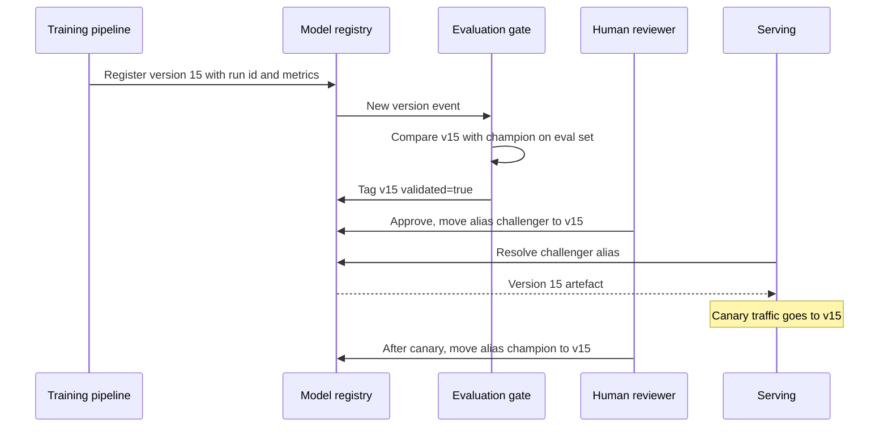

Experiment tracking records every run. Most of those runs are dead ends, and only a few produce models worth deploying. A **model registry** is the catalogue of those few: a central place where trained models are stored as named, versioned entries, with their lineage, their evaluation results and their status. It is the handover point between the people who build models and the systems that serve them. Instead of "copy `model.pkl` from Priya's laptop", deployment becomes "serve whatever version of `fraud-detector` currently has the `champion` alias".

## The core concepts

| Concept | Meaning | Example |
| --- | --- | --- |
| Registered model | A named slot for one modelling problem | `fraud-detector` |
| Model version | One immutable artefact registered under that name, numbered automatically | `fraud-detector` version 14 |
| Lineage | The link from a version back to the run, code and data that produced it | Run `a81f...`, commit `3c9e...`, dataset `v2026-03` |
| Alias | A movable, human-meaningful pointer to one version | `champion` points to version 14 |
| Tags and metadata | Free-form key-value annotations | `validated=true`, `owner=risk-team` |
| Description or model card | Intended use, limitations, evaluation summary | "Trained on EU card transactions only" |

Older registries used fixed **stages** (Staging, Production, Archived) instead of aliases. Aliases are more flexible: you can define any pointers you need (`champion`, `challenger`, `shadow`, `eu-production`), and a version can carry several. MLflow, for example, has deprecated stages in favour of aliases and tags.

> [!KEY]
> Serving code should reference an **alias**, never a hard-coded version number or file path. Promotion and rollback then become a metadata change in the registry, with no code change and no redeploy of the serving application's code.

## How the registry fits the workflow



The registry is the single source of truth throughout. Every actor reads and writes the same entries, so the question "what is in production?" always has one answer.

## A registry in miniature

Real registries add storage, access control, a UI and an API, but the data model is small. Writing it once makes the alias mechanics clear:

```python
from dataclasses import dataclass, field

@dataclass
class Version:
    number: int
    run_id: str
    metrics: dict
    tags: dict = field(default_factory=dict)

class Registry:
    def __init__(self):
        self.models = {}    # name -> list of Version
        self.aliases = {}   # (name, alias) -> version number

    def register(self, name, run_id, metrics):
        versions = self.models.setdefault(name, [])
        v = Version(len(versions) + 1, run_id, metrics)
        versions.append(v)
        return v.number

    def set_alias(self, name, alias, number):
        self.aliases[(name, alias)] = number

    def get(self, name, alias):
        number = self.aliases[(name, alias)]
        return self.models[name][number - 1]

reg = Registry()
reg.register("fraud-detector", "run-a1", {"auc": 0.91})
reg.register("fraud-detector", "run-b7", {"auc": 0.93})
reg.set_alias("fraud-detector", "champion", 1)
reg.set_alias("fraud-detector", "challenger", 2)
print("serving:", reg.get("fraud-detector", "champion"))

# Promotion is a pointer move; the old version still exists for rollback
reg.set_alias("fraud-detector", "champion", 2)
print("serving:", reg.get("fraud-detector", "champion").number)
reg.set_alias("fraud-detector", "champion", 1)   # rollback
print("serving:", reg.get("fraud-detector", "champion").number)
```

```output
serving: Version(number=1, run_id='run-a1', metrics={'auc': 0.91}, tags={})
serving: 2
serving: 1
```

Notice that nothing was copied or deleted. Versions are immutable records; only the pointer moved. That is why rollback in a well-run registry takes seconds.

## What to store with each version

A version that cannot be explained cannot be trusted. Aim to make every entry self-describing:

- **Lineage**: run id, Git commit, data version, training config.
- **Evaluation**: headline metrics and per-slice metrics (by region, device, customer segment), plus the eval set version they were computed on.
- **Signature**: expected input columns and types and the output format, so serving can validate requests. MLflow calls this a model signature.
- **Environment**: the library requirements needed to load it.
- **Governance**: who approved promotion, when, and why; known limitations.

> [!TIP]
> Make "validated" a tag that only your evaluation pipeline can set, and make promotion require it. A human approving a version should be approving something that has already passed automatic gates, not replacing them.

## Registry options

| Option | Notes |
| --- | --- |
| [MLflow Model Registry](/learn/mlops/mlflow) | Open source, self-hostable, versions, aliases, tags; also offered as a managed service by several platforms |
| Weights & Biases Registry | Built on W&B artefacts; links versions to runs and supports aliases |
| Cloud ML platforms | SageMaker, Vertex AI and Azure Machine Learning each include a model registry integrated with their deployment services |
| Hugging Face Hub | Model repositories versioned with Git revisions; common for sharing open models |
| Plain object storage with conventions | Workable for small teams, but you must build lineage, aliases and access control yourself |

Choose the one that integrates with where you train and serve. The concepts transfer directly between them.

## Registries for LLM applications

LLM applications register different things, but the same discipline applies:

- **Prompts.** A prompt registry stores named, versioned templates with aliases, so the application loads `support-reply@production` rather than a string in code. Changing the production prompt becomes a reviewed alias move. MLflow includes a prompt registry, and several LLM observability platforms offer one.
- **Fine-tuned models and adapters.** LoRA adapters and fine-tuned checkpoints are model versions like any other, with lineage back to the training data and base model.
- **Application configurations.** A registered "version" of a RAG assistant can be the bundle of prompt version, model identifier, retrieval settings and index version that was evaluated together. Promote the bundle, not the parts, because a prompt tuned for one model may behave differently on another.

## Exercises

**1.** Add a method `promote(name, from_alias, to_alias)` to `Registry` that points `to_alias` at whatever version `from_alias` points to, but refuses unless that version has the tag `validated=True`.

<details>
<summary>Show solution</summary>

```python
def promote(self, name, from_alias, to_alias):
    version = self.get(name, from_alias)
    if not version.tags.get("validated"):
        raise PermissionError(f"version {version.number} is not validated")
    self.set_alias(name, to_alias, version.number)

Registry.promote = promote

try:
    reg.promote("fraud-detector", "challenger", "champion")
except PermissionError as err:
    print(err)
reg.models["fraud-detector"][1].tags["validated"] = True
reg.promote("fraud-detector", "challenger", "champion")
print(reg.get("fraud-detector", "champion").number)
```

```output
version 2 is not validated
2
```

</details>

**2.** Your serving code currently loads `s3://models/fraud/model_v14.pkl`. List the steps needed to roll back to version 13, and compare with an alias-based setup.

<details>
<summary>Show solution</summary>

With a hard-coded path you must edit the code or config to say `model_v13.pkl`, review and redeploy the service, and hope nobody overwrote that file. With aliases you move `champion` to version 13 in the registry, and the service picks it up on its next reload or restart. No code change, and version 13 is guaranteed to be the same immutable artefact as before.

</details>

**3.** Why should a RAG assistant register the prompt, model identifier and retrieval settings as one bundle rather than as three independent versions?

<details>
<summary>Show solution</summary>

They were evaluated together. A prompt tuned for one model, or for chunks of a certain size, can perform worse when combined with a different model or retrieval setting. Promoting a bundle guarantees that production runs exactly the combination that passed evaluation.

</details>

```quiz
[
  {
    "q": "What is an alias in a model registry?",
    "options": [
      "A copy of the model file under a new name",
      "A movable pointer from a meaningful name to one specific version",
      "A second model trained on the same data",
      "The Git branch that trained the model"
    ],
    "answer": 1,
    "why": "Aliases such as `champion` point at a version and can be moved for promotion or rollback without copying artefacts."
  },
  {
    "q": "Why should serving code load a model by alias rather than a fixed version number?",
    "options": [
      "Aliases load faster",
      "Promotion and rollback become registry changes rather than code changes",
      "Version numbers are not unique",
      "Aliases compress the model"
    ],
    "answer": 1,
    "why": "The service resolves the alias at load time, so moving it changes what is served without editing or redeploying code."
  },
  {
    "q": "Which piece of information lets you trace a registered version back to how it was produced?",
    "options": ["Its alias", "Its file size", "Its lineage: run id, commit and data version", "Its description text"],
    "answer": 2,
    "why": "Lineage links the version to the run, code and data that produced it."
  },
  {
    "q": "In an LLM application, what does a prompt registry provide?",
    "options": [
      "Automatic prompt optimisation",
      "Named, versioned prompt templates that the application loads by alias",
      "Lower token prices",
      "A replacement for evaluation"
    ],
    "answer": 1,
    "why": "Prompts become versioned artefacts with aliases, so production prompt changes are explicit and reversible."
  }
]
```
