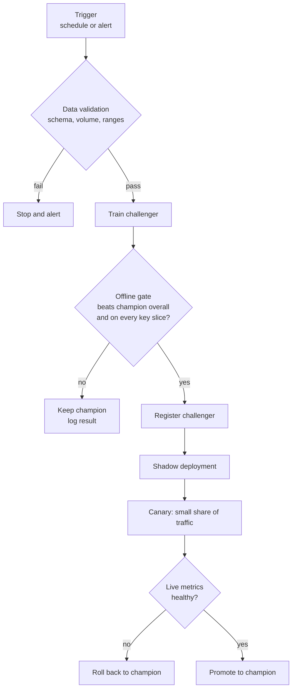

Monitoring tells you a model is getting worse; retraining is how you fix it. Retraining sounds simple (run the training script again on newer data), but done carelessly it is one of the riskiest operations in an ML system. A retrain can learn from corrupted data, overfit to a strange week, or quietly get worse on a small but important group of users. This lesson covers when to retrain, how to decide whether the new model is actually better, and how to release it in stages so that a bad model never reaches everyone.

## When to retrain

| Strategy | How it works | Good for | Risk |
| --- | --- | --- | --- |
| Scheduled | Retrain on a fixed cadence (nightly, weekly, monthly) on the latest window of data | Steadily changing domains such as demand forecasting or recommendations | Wasted compute when nothing changed; too slow when something changes suddenly |
| Triggered | Retrain when monitoring fires: drift above threshold, accuracy below target, enough new labels collected | Domains that are stable most of the time with occasional shifts | Thresholds that are too sensitive cause constant retraining; too lax miss problems |
| Continual or online | Update the model incrementally as new labelled data streams in | Very fast-moving data, such as ad click prediction | Hard to validate; a stream of bad data corrupts the model quickly |
| Manual | A person decides after investigation | Rare, high-stakes models with heavy governance | Slow, depends on people noticing |

Many teams combine a schedule with triggers: retrain weekly, and also whenever a drift or performance alert fires. Remember that retraining only helps if the new training data reflects the new reality. For [concept drift](/learn/mlops/model-drift) you need fresh labels; retraining on old labels just reproduces the old model.

### Choosing the training window

- **Sliding window** (for example, the last 90 days): adapts to change, forgets the distant past.
- **Expanding window** (all data so far): more data, but stale patterns dilute recent ones.
- **Weighted**: all data, with recent examples weighted more heavily.

Seasonal domains need the window to cover at least one full cycle, or the model forgets last December just before this one arrives.

## The retraining pipeline

Automated retraining is a pipeline with gates. Each gate can stop the process before a bad model gets near users.



## Champion versus challenger

The model currently in production is the **champion**. A newly trained model is a **challenger**. The challenger replaces the champion only if it wins a fair comparison: same evaluation data (recent, held out, not used for training either model), same metrics, and a margin large enough to be more than noise.

Here a champion trained on old data competes with a challenger trained on recent data, after the relationship between features and label has shifted. The gate also checks a slice, because overall wins can hide regressions.

```python
import numpy as np
from sklearn.linear_model import LogisticRegression
from sklearn.metrics import roc_auc_score

rng = np.random.default_rng(3)

def make_window(n, weight_on_x1):
    X = rng.normal(size=(n, 3))
    region = rng.choice(["north", "south"], size=n, p=[0.8, 0.2])
    logits = 1.5 * X[:, 0] + weight_on_x1 * X[:, 1]
    y = (rng.random(n) < 1 / (1 + np.exp(-logits))).astype(int)
    return X, y, region

X_old, y_old, _ = make_window(4000, weight_on_x1=0.0)
X_new, y_new, _ = make_window(4000, weight_on_x1=1.5)    # feature 1 now matters
X_eval, y_eval, region_eval = make_window(3000, weight_on_x1=1.5)

champion = LogisticRegression().fit(X_old, y_old)
challenger = LogisticRegression().fit(X_new, y_new)

def evaluate(model):
    scores = model.predict_proba(X_eval)[:, 1]
    result = {"overall": roc_auc_score(y_eval, scores)}
    for r in ["north", "south"]:
        mask = region_eval == r
        result[r] = roc_auc_score(y_eval[mask], scores[mask])
    return result

champ_m, chall_m = evaluate(champion), evaluate(challenger)
for key in champ_m:
    print(f"{key:8s} champion={champ_m[key]:.3f} challenger={chall_m[key]:.3f}")
```

```output
overall  champion=0.767 challenger=0.882
north    champion=0.770 challenger=0.879
south    champion=0.755 challenger=0.896
```

The challenger wins overall and on both slices, as it should: the champion never learned that feature 1 now matters. Now encode the decision as an explicit, logged rule rather than a judgement made by eye:

```python
def promotion_gate(champ, chall, min_gain=0.01, max_slice_drop=0.005):
    reasons = []
    if chall["overall"] - champ["overall"] < min_gain:
        reasons.append("overall gain below margin")
    for s in ["north", "south"]:
        if champ[s] - chall[s] > max_slice_drop:
            reasons.append(f"regression on slice {s}")
    return (len(reasons) == 0), reasons

print(promotion_gate(champ_m, chall_m))
print(promotion_gate(champ_m, champ_m))   # a model never beats itself
```

```output
(True, [])
(False, ['overall gain below margin'])
```

> [!KEY]
> A promotion gate is a regression test for models. Write it down as code, version it with the pipeline, and log its inputs and decision for every candidate. "It looked better on the dashboard" is not a release criterion.

## Releasing safely: shadow, canary, A/B

Offline evaluation cannot catch everything: serving-time feature bugs, latency problems or behaviour on traffic that differs from your evaluation set. Staged rollout exposes the challenger to real traffic gradually.

| Pattern | What users see | What you learn | Typical use |
| --- | --- | --- | --- |
| **Shadow deployment** | Only the champion's output; the challenger runs on a copy of each request and its output is logged, not returned | Latency, errors, prediction differences on real traffic, with zero user risk | First live test of any new model |
| **Canary release** | A small share of users (say 1% to 5%) get the challenger | Live metrics on real outcomes with limited blast radius | Before full rollout |
| **A/B test** | Traffic split for a fixed period, usually larger shares | Statistically sound comparison of business metrics | When the decision depends on user outcomes |
| **Blue-green** | Two full environments; switch all traffic at once, switch back to roll back | Fast, clean rollback | Infrastructure-level releases |

Canary and A/B routing should be **sticky**: the same user should see the same model across requests, or their experience flips back and forth and your measurements mix. A deterministic hash of the user id does this without storing any state:

```python
import hashlib

def route(user_id: str, canary_percent: int) -> str:
    bucket = int(hashlib.sha256(user_id.encode()).hexdigest(), 16) % 100
    return "challenger" if bucket < canary_percent else "champion"

users = [f"user-{i}" for i in range(10_000)]
share = sum(route(u, 5) == "challenger" for u in users) / len(users)
print(f"challenger share: {share:.2%}")
print(route("user-42", 5), route("user-42", 5))   # sticky
```

```output
challenger share: 5.04%
champion champion
```

Raising `canary_percent` from 5 to 20 keeps every user who was already on the challenger there, because their bucket number does not change.

## Safeguards

- **Validate the training data** before training: row counts, label balance, schema, value ranges. Most bad retrains come from bad data, not bad code.
- **Fixed, versioned evaluation set** alongside the recent holdout, so you can tell whether the model improved or the test got easier.
- **Slice checks** for important or vulnerable groups, and fairness metrics where relevant.
- **Automatic rollback** when canary metrics breach thresholds, and the previous champion kept warm.
- **Human approval** for high-stakes models, after the automatic gates pass.
- **Rate limits on retraining**, so a flapping drift alert cannot trigger ten retrains in a day.
- **Feedback loops**: a model whose predictions influence its future training data (a recommender trained on clicks it caused) can amplify its own biases. Keep some exploration or randomised traffic to collect unbiased data.

> [!WARNING]
> Never evaluate the challenger on data it was trained on, and do not reuse the canary period's data for training until the decision is made. Leakage between training and evaluation windows makes every challenger look like a winner.

## Retraining in LLM applications

For LLM systems, "retraining" usually means changing the prompt, the model identifier, retrieval settings or a fine-tuned adapter. The same machinery applies: the challenger is the new configuration, the offline gate runs the versioned eval set (with automatic checks and judge scores, plus cost and latency), shadow mode replays live requests through both configurations and compares outputs, and a canary exposes a small share of users before full rollout. Provider model upgrades deserve the same treatment: run your eval set against the new snapshot before switching, rather than discovering differences in production.

## Exercises

**1.** Modify the gate so it also rejects a challenger whose AUC on any slice is below an absolute floor of 0.75. Does the challenger above still pass?

<details>
<summary>Show solution</summary>

```python
def promotion_gate_v2(champ, chall, min_gain=0.01, max_slice_drop=0.005, floor=0.75):
    ok, reasons = promotion_gate(champ, chall, min_gain, max_slice_drop)
    for s in ["north", "south"]:
        if chall[s] < floor:
            reasons.append(f"slice {s} below floor")
    return (len(reasons) == 0), reasons

print(promotion_gate_v2(champ_m, chall_m))
```

```output
(True, [])
```

Yes: both slices are well above the floor. An absolute floor is useful when the champion itself is poor on a slice, because a relative check alone would let a challenger be equally poor there.

</details>

**2.** Explain why shadow deployment cannot measure the effect of a new recommendation model on click-through rate.

<details>
<summary>Show solution</summary>

In shadow mode users only see the champion's recommendations, so they can only click on those. The challenger's recommendations are never shown, so there are no clicks on them to measure. Shadow mode tests system behaviour and prediction differences; outcome metrics need a canary or A/B test.

</details>

**3.** A drift alert fires every Monday morning and triggers a retrain each time. What would you change?

<details>
<summary>Show solution</summary>

The alert is probably detecting a normal weekly cycle (weekend traffic differs from weekday traffic). Compare each window with the same weekday in the reference period, or use a reference that spans whole weeks. Add a cooldown so a retrain cannot be triggered more than once in a set period, and require the drift to persist before triggering.

</details>

```quiz
[
  {
    "q": "In a champion-challenger setup, what is the challenger?",
    "options": [
      "The model currently serving all traffic",
      "A newly trained or configured model competing to replace the current one",
      "A model trained by a different team",
      "An adversarial model that attacks the champion"
    ],
    "answer": 1,
    "why": "The champion serves production; a challenger must beat it under agreed rules to be promoted."
  },
  {
    "q": "What is the main benefit of shadow deployment?",
    "options": [
      "It measures the challenger's effect on user behaviour",
      "It tests the challenger on real traffic with no impact on users",
      "It replaces the need for offline evaluation",
      "It halves serving cost"
    ],
    "answer": 1,
    "why": "The challenger's outputs are logged, not returned, so you see live latency, errors and prediction differences without risk."
  },
  {
    "q": "Why route canary users with a hash of their user id rather than a random number per request?",
    "options": [
      "Hashes are faster than random numbers",
      "So each user consistently sees the same model, keeping experience and measurement clean",
      "Random routing is not allowed by law",
      "So the canary share is exactly 5% at all times"
    ],
    "answer": 1,
    "why": "Sticky assignment avoids users flipping between models and keeps per-user outcomes attributable to one model."
  },
  {
    "q": "A challenger improves overall AUC by 0.02 but drops 0.04 on a small region. A well-designed gate should:",
    "options": [
      "Promote it because overall AUC improved",
      "Reject it, or send it for review, because of the slice regression",
      "Average the two numbers and promote if positive",
      "Ignore slices smaller than 50% of traffic"
    ],
    "answer": 1,
    "why": "Slice checks exist precisely to stop overall gains hiding harm to a particular group."
  }
]
```
