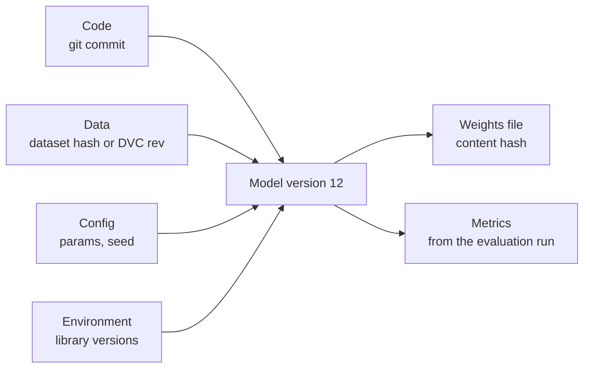

Code has Git: every change gets an identifier, you can see what changed, and you can go back. Models need the same, but a model is not just a file of weights. It is the product of code, data, configuration and environment, and if you cannot say which of each produced the file now serving traffic, you cannot reproduce it, debug it or roll back to it with confidence. **Model versioning** gives every trained model a stable identity and links it to everything that made it.

## What a model version really is

A model file on its own answers almost nothing. A useful version record ties together five things:



| Component | Identify it by | If you lose it |
| --- | --- | --- |
| Code | Git commit hash | You cannot see which preprocessing or architecture was used |
| Data | Content hash or [DVC](/learn/mlops/dvc) version | You cannot retrain or explain behaviour on specific examples |
| Config | The params file stored with the run | You cannot tell which hyperparameters won |
| Environment | Lock file or container image digest | Loading may fail or behave differently with other library versions |
| Weights | Content hash of the saved artefact | You cannot prove two servers run the same model |

> [!KEY]
> A model version should be **immutable**. Once version 12 is registered, its weights and metadata never change. A fix produces version 13. Mutable "latest" files are how teams end up with two servers that both claim to run the same model but give different answers.

## Content hashing: an identity you can verify

A cryptographic hash such as SHA-256 maps any sequence of bytes to a fixed-length fingerprint. Identical bytes always give the same hash; any change, however small, gives a completely different one. That makes a hash an excellent identifier for artefacts, and it is how Git, DVC and container registries name their content.

```python
import hashlib, pickle
from sklearn.datasets import load_iris
from sklearn.linear_model import LogisticRegression

def sha256_bytes(data: bytes) -> str:
    return hashlib.sha256(data).hexdigest()

X, y = load_iris(return_X_y=True)

def train(C):
    return LogisticRegression(C=C, max_iter=1000).fit(X, y)

h1 = sha256_bytes(pickle.dumps(train(1.0)))
h2 = sha256_bytes(pickle.dumps(train(1.0)))
h3 = sha256_bytes(pickle.dumps(train(0.5)))
print(h1[:16], h2[:16], h3[:16])
print("same config, same hash:", h1 == h2)
print("different config, same hash:", h1 == h3)
```

```output
e6b8110c3818bc05 e6b8110c3818bc05 8e7341b82a3183c3
same config, same hash: True
different config, same hash: False
```

Hashing the data works the same way. For a pandas DataFrame, hash a canonical serialisation such as sorted CSV bytes, or use `pd.util.hash_pandas_object` and hash the result:

```python
import pandas as pd

df = pd.DataFrame(X, columns=["sl", "sw", "pl", "pw"]).assign(label=y)

def dataset_hash(frame):
    row_hashes = pd.util.hash_pandas_object(frame, index=False).to_numpy()
    return hashlib.sha256(row_hashes.tobytes()).hexdigest()[:16]

print(dataset_hash(df))
print(dataset_hash(df.iloc[:-1]))   # drop one row
```

```output
4911941aa7dcdea9
72a59f4bb27016b3
```

> [!WARNING]
> Pickle bytes depend on the library and Python version. Two identical models pickled under different scikit-learn versions can hash differently, and a pickle may not even load under another version. Record library versions with every model, and never unpickle files from untrusted sources: loading a pickle can execute arbitrary code.

## Naming versions

Hashes identify; humans need something friendlier too. Common schemes, often used together:

| Scheme | Example | Good for |
| --- | --- | --- |
| Incrementing integer per model name | `churn-model` version 12 | Registries; easy to say "roll back to 11" |
| Content hash | `sha256:9f2c...` | Proving two artefacts are identical |
| Semantic version | `2.1.0` | Models shipped to others: bump major when inputs or outputs change incompatibly |
| Date or run id | `2026-03-04-run-a81f` | Linking back to a specific training run |

Semantic versioning is useful when other systems depend on your model's **interface**. If version 2 expects a new input feature or outputs probabilities instead of labels, callers must change, so that is a major version bump. A retrain on fresh data with the same interface is a minor or patch bump.

## Storage formats

Where and how you save the weights matters for safety and portability.

| Format | Typical use | Notes |
| --- | --- | --- |
| `pickle` / `joblib` | scikit-learn and general Python objects | Convenient; tied to library versions; unsafe to load from untrusted sources |
| PyTorch `state_dict` (`.pt`) | PyTorch models, see [saving and loading](/learn/pytorch/model-saving-and-loading) | Saves tensors only; you need the model class code to rebuild |
| `safetensors` | Hugging Face and LLM weights | Stores only tensors, cannot run code on load, supports fast memory-mapped loading |
| ONNX | Cross-framework serving | Portable graph format; useful when serving in a different runtime |
| Native booster formats | XGBoost and LightGBM model files | More stable across versions than pickling the Python object |

Large binaries do not belong in Git itself. Store them in object storage, a model registry or a DVC remote, and keep the small pointer (path plus hash) under version control.

## Versioning LLM applications

When the "model" is a hosted LLM plus a prompt, you version different artefacts, but the principle is identical: identify exactly what produced each output.

| Artefact | How to version it |
| --- | --- |
| Prompt template | Store in Git or a prompt registry; give it a name and version; hash the template text |
| Model identifier | Pin a dated snapshot when the provider offers one rather than a moving alias, and log the exact identifier with every call |
| Generation settings | Temperature, max tokens, stop sequences, tools: keep them in a versioned config file next to the prompt |
| Eval set | A versioned file (in Git or DVC); scores are only comparable on the same eval set version |
| Retrieval index | Record the corpus snapshot, chunking settings and embedding model used to build it |

A prompt hash takes one line and lets you detect silent edits:

```python
template = "You are a support assistant. Classify the message into one of: {labels}.\nMessage: {text}"
prompt_version = {"name": "intent-classifier", "version": 3,
                  "sha256": sha256_bytes(template.encode())[:12]}
print(prompt_version)
```

```output
{'name': 'intent-classifier', 'version': 3, 'sha256': '669007c3a5e8'}
```

Log `prompt_version` alongside the model identifier with every call. When answers change, you can then see immediately whether the prompt, the model or the inputs moved.

## Exercises

**1.** Train two `LogisticRegression` models on the iris data with identical settings, but shuffle the rows for the second. Do the pickled models hash the same? Explain.

<details>
<summary>Show solution</summary>

```python
import numpy as np
perm = np.random.default_rng(0).permutation(len(y))
m_a = LogisticRegression(max_iter=1000).fit(X, y)
m_b = LogisticRegression(max_iter=1000).fit(X[perm], y[perm])
print(sha256_bytes(pickle.dumps(m_a)) == sha256_bytes(pickle.dumps(m_b)))
print(np.abs(m_a.coef_ - m_b.coef_).max())
```

```output
False
0.005504888171034561
```

The hashes differ even though the models are practically the same. The optimiser stops once it is within a tolerance of the optimum, and with the rows in a different order its floating-point arithmetic follows a slightly different path, so the coefficients end up differing by up to about 0.006. Any difference in bytes changes the hash. A hash proves identity; it says nothing about similarity. Compare behaviour (predictions, metrics) to judge similarity.

</details>

**2.** Your team's model passes a new boolean feature `is_mobile` as input from now on. Under semantic versioning, should you go from 1.4.2 to 1.4.3, 1.5.0 or 2.0.0?

<details>
<summary>Show solution</summary>

2.0.0. Callers must now send an extra input, so the interface changed incompatibly. A retrain with the same inputs and outputs would be a minor or patch bump.

</details>

**3.** Write down the minimum set of fields you would log for every LLM call so that you could later explain a change in answer quality.

<details>
<summary>Show solution</summary>

Request id, timestamp, prompt name and version (or hash), exact model identifier, generation settings, retrieval index version if RAG is used, input and output (or references to them if privacy rules forbid storing them), token counts, latency and any user feedback.

</details>

```quiz
[
  {
    "q": "Why should a registered model version be immutable?",
    "options": [
      "Immutable files load faster",
      "So that a version identifier always refers to exactly the same artefact and metadata",
      "Because hashes cannot be computed for mutable files",
      "To save disk space"
    ],
    "answer": 1,
    "why": "If version 12 can be overwritten, two systems claiming to run version 12 may run different models. Changes must produce a new version."
  },
  {
    "q": "What does it mean if two model files have different SHA-256 hashes?",
    "options": [
      "Their predictions are very different",
      "One of them is corrupted",
      "Their bytes differ, which says nothing on its own about how different their behaviour is",
      "They were trained on different data"
    ],
    "answer": 2,
    "why": "Hashes detect any byte difference, including tiny floating-point ones from row order. Similarity must be judged by behaviour."
  },
  {
    "q": "Which format is designed so that loading weights cannot execute arbitrary code?",
    "options": ["pickle", "joblib", "safetensors", "A Python script that rebuilds the model"],
    "answer": 2,
    "why": "safetensors stores only tensor data and metadata, unlike pickle-based formats which can run code during loading."
  },
  {
    "q": "In an LLM application, which of these is the best thing to pin and log with every call?",
    "options": [
      "A moving model alias such as `latest`",
      "The exact dated model snapshot identifier",
      "Only the provider name",
      "The size of the context window"
    ],
    "answer": 1,
    "why": "A pinned snapshot does not change underneath you, and logging the exact identifier lets you attribute behaviour changes."
  }
]
```
