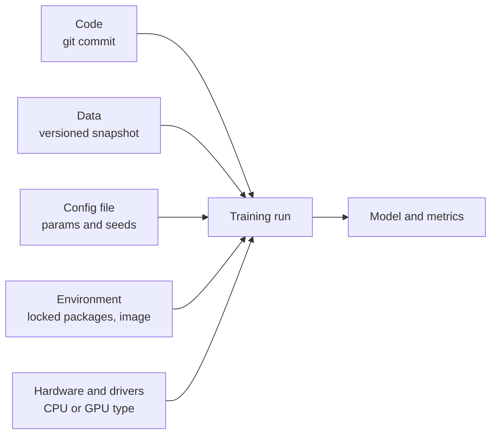

An experiment is **reproducible** when someone else, or you in six months, can rerun it and get the same result. That sounds like basic science, yet it is surprisingly rare in machine learning. Results depend on random initialisation, data shuffling, library versions, hardware and the exact rows in a dataset that someone has since "cleaned". Without reproducibility you cannot tell whether a change helped or whether you got a lucky seed, you cannot debug a production model by retraining it, and you cannot satisfy an auditor who asks how a model was built.

This lesson pulls together the threads from the earlier lessons in this module ([tracking](/learn/mlops/experiment-tracking), [versioning](/learn/mlops/model-versioning)) into a practical checklist, then looks honestly at where exact reproducibility is impossible.

## The ingredients of a run

A training run is a function of everything that goes into it. Pin every input and the output is fixed; leave one free and it is not.



| Ingredient | How to pin it | Tool |
| --- | --- | --- |
| Code | Commit before running; record the commit hash; refuse to run with uncommitted changes for "official" runs | Git |
| Data | Snapshot or version the exact data; record its hash | [DVC](/learn/mlops/dvc), object storage versioning, table snapshots |
| Config | All parameters in a file, not scattered through code; log the file with the run | YAML or TOML, Hydra-style config tools |
| Randomness | Explicit seeds for every random source | NumPy `Generator`, `random_state`, framework seeds |
| Environment | Lock exact package versions; ideally a container image | `pip freeze`, lock files from uv or Poetry, [Docker](/learn/docker-and-containers/dockerfile) |
| Hardware | Record device type, driver and library versions | Logged automatically by most trackers |

## Seeds: controlling randomness

Machine learning code uses randomness for train-test splits, shuffling, weight initialisation, dropout, bootstrapping and sampling. Each source must be seeded. Prefer passing an explicit generator or `random_state` over setting global state, because global state is shared by every library and changes depending on what ran before.

```python
import numpy as np

def noisy_experiment(seed):
    rng = np.random.default_rng(seed)
    data = rng.normal(size=1000)
    sample = rng.choice(data, size=100, replace=False)
    return round(float(sample.mean()), 6)

print(noisy_experiment(0), noisy_experiment(0))
print(noisy_experiment(1))
```

```output
0.006036 0.006036
0.111637
```

Same seed, same answer; different seed, different answer. The difference between seeds is not a bug: it is the variance of your result, and it is worth measuring. If two models differ by less than the spread across seeds, you have not shown that one is better.

```python
from sklearn.datasets import load_breast_cancer
from sklearn.ensemble import RandomForestClassifier
from sklearn.model_selection import train_test_split

X, y = load_breast_cancer(return_X_y=True)
scores = []
for seed in range(5):
    X_tr, X_te, y_tr, y_te = train_test_split(X, y, test_size=0.25, random_state=seed)
    model = RandomForestClassifier(n_estimators=100, random_state=seed).fit(X_tr, y_tr)
    scores.append(model.score(X_te, y_te))
print([round(s, 4) for s in scores])
print(f"mean {np.mean(scores):.4f}, std {np.std(scores):.4f}")
```

```output
[0.972, 0.9441, 0.9371, 0.9441, 0.9301]
mean 0.9455, std 0.0143
```

The accuracy moves across a range of about four percentage points purely from the split and the forest's randomness. Report the mean and spread across several seeds, not a single number.

For deep learning in PyTorch, seed every library involved:

```python
import random
import numpy as np
import torch

def seed_everything(seed: int):
    random.seed(seed)
    np.random.seed(seed)          # legacy global NumPy state, used by some libraries
    torch.manual_seed(seed)       # seeds CPU and all GPUs
```

DataLoader workers each have their own random state too; pass a seeded `torch.Generator` to the `DataLoader` and, if workers use NumPy, a `worker_init_fn` that seeds them. The [PyTorch reproducibility notes](https://pytorch.org/docs/stable/notes/randomness.html) list the details.

## Config files

Hyperparameters hard-coded in a notebook cell are invisible to everyone else. Put them in a config file, load it at the start of the run, and log the whole file with the run. A hash of the config gives each distinct configuration an identity:

```python
import hashlib, json

config = {
    "data": {"version": "2026-03-01", "test_size": 0.25},
    "model": {"type": "random_forest", "n_estimators": 200, "max_depth": 8},
    "seed": 42,
}
canonical = json.dumps(config, sort_keys=True).encode()
print("config id:", hashlib.sha256(canonical).hexdigest()[:10])
```

```output
config id: 347be9f8a8
```

Sorting the keys makes the hash independent of the order in which keys were written, so two identical configurations always get the same identity.

## Pinned environments

"Works on my machine" usually means different package versions. A `requirements.txt` with `scikit-learn>=1.0` will install a different version next year. Pin exact versions of everything, including transitive dependencies, with a lock file (`pip freeze > requirements.lock`, or the lock files produced by uv, Poetry or conda-lock), and for full control build a container image and record its digest. The [virtual environments](/learn/developer-tools/virtual-environments) lesson covers the mechanics.

> [!TIP]
> Have the training script record its own environment: Python version, key package versions (`importlib.metadata.version("scikit-learn")`), the Git commit and whether the working tree was clean. Then the evidence travels with every run automatically.

## Where exact reproducibility breaks down

Even with every seed fixed, results can differ in the last few digits, and in deep learning those differences can grow over thousands of training steps.

**Floating-point arithmetic is not associative.** The order of additions changes the result:

```python
a, b, c = 0.1, 0.2, 0.3
print((a + b) + c == a + (b + c))
print(f"{(a + b) + c:.17f}")
print(f"{a + (b + c):.17f}")
```

```output
False
0.60000000000000009
0.59999999999999998
```

Parallel hardware adds numbers in whatever order threads finish. On GPUs, several common operations use atomic additions with a non-deterministic order, and cuDNN may pick different convolution algorithms from run to run. PyTorch offers switches that trade speed for determinism:

```python
import os
import torch

os.environ["CUBLAS_WORKSPACE_CONFIG"] = ":4096:8"   # needed by cuBLAS for determinism
torch.use_deterministic_algorithms(True)            # error on known non-deterministic ops
torch.backends.cudnn.benchmark = False              # do not auto-select algorithms
```

Even then, results can differ across GPU models, driver versions, library versions and numbers of GPUs. The realistic goal is usually:

| Level | What it means | Achievable? |
| --- | --- | --- |
| Bitwise | Identical weights and outputs | Same machine, same versions, deterministic settings; often not across hardware |
| Statistical | Rerun lands within the seed-to-seed spread of the original | Yes, with pinned code, data, config and environment |
| Conclusion | The same model wins the same comparison | Yes, if the original conclusion was not within noise |

> [!KEY]
> Aim for bitwise reproducibility where it is cheap (classical ML on CPU) and statistical reproducibility everywhere. Always pin code, data, config and environment: those failures are avoidable, unlike floating-point noise.

## Reproducibility for LLM work

LLM outputs add their own sources of variation. Sampling with temperature above zero is random by design. Even at temperature zero, hosted APIs do not guarantee identical outputs, because batching and hardware vary on the provider's side; some APIs accept a seed parameter on a best-effort basis. Providers also update models behind aliases. Practical habits:

- Pin the model snapshot and log the exact identifier, prompt version and every generation setting.
- Evaluate with several samples per input when temperature is above zero, and report pass rates rather than single outputs.
- Store raw responses from evaluation runs, so you can re-score them later with a new metric without paying to regenerate (and getting different text).
- Version the eval set itself, since scores on different eval set versions are not comparable.

## Exercises

**1.** Rewrite this function so it is reproducible without touching NumPy's global state: `def bootstrap_mean(x): return np.mean(np.random.choice(x, size=len(x)))`.

<details>
<summary>Show solution</summary>

```python
def bootstrap_mean(x, seed):
    rng = np.random.default_rng(seed)
    return float(np.mean(rng.choice(x, size=len(x))))

values = np.arange(10)
print(bootstrap_mean(values, 7) == bootstrap_mean(values, 7))
```

```output
True
```

The generator is local to the call, so other code that uses NumPy's global state cannot change the result.

</details>

**2.** Show that the config hash above does not change when you build the same dictionary with keys in a different order, but does change if `seed` becomes 43.

<details>
<summary>Show solution</summary>

```python
def config_id(cfg):
    return hashlib.sha256(json.dumps(cfg, sort_keys=True).encode()).hexdigest()[:10]

reordered = {"seed": 42, "model": config["model"], "data": config["data"]}
print(config_id(config) == config_id(reordered))
print(config_id(config) == config_id({**config, "seed": 43}))
```

```output
True
False
```

</details>

**3.** A colleague reports that their new model beats the baseline by 0.4 percentage points of accuracy, from one run of each. Using the seed experiment above, what would you ask them to do?

<details>
<summary>Show solution</summary>

The seed-to-seed standard deviation above is about 1.4 points, several times larger than 0.4, so a single run cannot separate the models. Ask for several seeds (or cross-validation) for both models, with identical splits per seed, and compare the mean difference with its spread. Paired comparisons on the same splits reduce noise.

</details>

```quiz
[
  {
    "q": "Why is passing an explicit `np.random.default_rng(seed)` preferable to calling `np.random.seed(seed)`?",
    "options": [
      "It generates better random numbers",
      "The generator is local, so other code cannot change its state between your calls",
      "Global seeding is not supported in NumPy",
      "It makes code run on the GPU"
    ],
    "answer": 1,
    "why": "Global state is shared across libraries and changes depending on what ran earlier; a local generator isolates your randomness."
  },
  {
    "q": "Why can two GPU training runs with identical seeds still produce slightly different weights?",
    "options": [
      "Seeds are ignored on GPUs",
      "Some parallel operations add floating-point numbers in a varying order, and floating-point addition is not associative",
      "GPUs use a different random number generator every second",
      "The data is reshuffled by the operating system"
    ],
    "answer": 1,
    "why": "Non-deterministic reduction order and algorithm selection change rounding, and small differences can grow during training."
  },
  {
    "q": "Which of these does NOT help reproduce a run months later?",
    "options": [
      "A lock file with exact package versions",
      "The Git commit hash",
      "A dataset that has been edited in place since the run",
      "The logged config file"
    ],
    "answer": 2,
    "why": "If the data was modified in place without a version, you can no longer recover the exact inputs to the run."
  },
  {
    "q": "Setting temperature to 0 on a hosted LLM API guarantees:",
    "options": [
      "Bitwise identical outputs forever",
      "Identical outputs as long as the prompt is identical",
      "Nothing absolute: outputs are usually stable but can still vary, and the model behind an alias can change",
      "That the model will refuse to answer"
    ],
    "answer": 2,
    "why": "Provider-side batching and hardware differences, plus model updates, mean determinism is best-effort only."
  }
]
```
