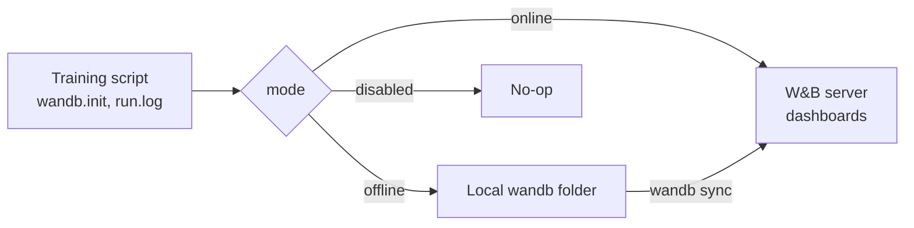
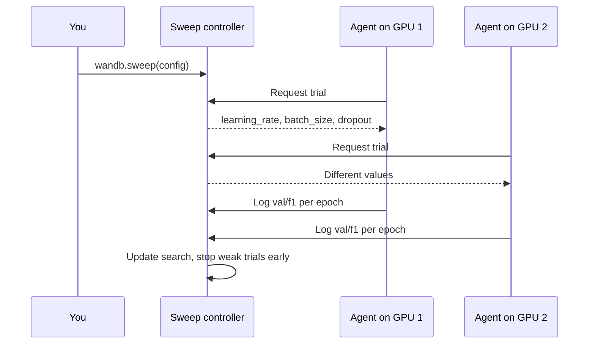

**Weights & Biases** (W&B, imported as `wandb`) is a hosted platform for experiment tracking, hyperparameter sweeps, dataset and model artefacts, and, through its Weave library, tracing and evaluation of LLM applications. Where [MLflow](/learn/mlops/mlflow) is often chosen because it is open source and self-hostable, W&B is often chosen for its polished collaborative dashboards and deep-learning integrations. The concepts are the same ones you met earlier in this module; this lesson shows how W&B expresses them in code.

W&B is a commercial service with a free tier for individuals; teams pay, and a self-managed server is available. Running the examples needs an account and an API key, or offline mode, so this lesson shows code without output: what you would see is an interactive dashboard, not printed text.

## Getting started

```bash
pip install wandb
wandb login        # paste your API key once; it is stored locally
```

In scripts and CI, set the `WANDB_API_KEY` environment variable instead of logging in interactively. Never commit the key to Git.

## Runs: `wandb.init` and `wandb.log`

A **run** starts with `wandb.init`, which takes a project name and a `config` dictionary of hyperparameters. You then call `run.log` with a dictionary of metrics as often as you like, typically once per step or epoch, and `run.finish` at the end (or use the run as a context manager).

```python
import wandb

config = {"learning_rate": 3e-4, "epochs": 5, "batch_size": 32, "seed": 0}

with wandb.init(project="intent-classifier", config=config, tags=["baseline"]) as run:
    lr = run.config["learning_rate"]           # read back from the run config
    for epoch in range(run.config["epochs"]):
        train_loss, val_f1 = train_one_epoch(lr)   # your own training code
        run.log({"epoch": epoch, "train/loss": train_loss, "val/f1": val_f1})
    run.summary["best_val_f1"] = val_f1         # single headline value for the runs table
```

| Concept | W&B term | Notes |
| --- | --- | --- |
| Group of related runs | Project (inside an entity, your user or team) | `wandb.init(project=...)` |
| Hyperparameters | `config` | Shown as columns in the runs table; used to group and filter |
| Metrics over time | `run.log({...})` | Each call advances an internal step; keys with `/` group charts into sections |
| Final values | `run.summary` | Defaults to the last logged value of each metric; override for "best" |
| Rich media | `wandb.Table`, `wandb.Image`, `wandb.Histogram` | Log predictions, images and distributions for inspection |

W&B also records the Git commit, the command line, system metrics such as GPU utilisation and memory, and the Python environment automatically, which covers much of the [reproducibility](/learn/mlops/reproducible-experiments) checklist for free.

Many libraries integrate directly. For example, the Hugging Face `Trainer` logs to W&B when you pass `report_to="wandb"` in `TrainingArguments`, and PyTorch Lightning has a `WandbLogger`.

## Offline mode

On machines without internet access (secure clusters, flights, CI jobs that must not call out), pass `mode="offline"` or set `WANDB_MODE=offline`. Runs are written to a local `wandb/` directory and can be uploaded later:

```bash
WANDB_MODE=offline python train.py
wandb sync wandb/offline-run-*      # upload when you are back online
```

`mode="disabled"` turns every `wandb` call into a no-op, which is handy in unit tests.



## Sweeps: hyperparameter search

A **sweep** runs many trials of your training function with hyperparameters chosen by a search strategy. You describe the search space in a config, W&B's sweep controller picks values, and one or more **agents** (processes on any machines) pull trials and run them. This makes it easy to spread a search across several GPUs or machines.

```python
sweep_config = {
    "method": "bayes",                     # also "grid" or "random"
    "metric": {"name": "val/f1", "goal": "maximize"},
    "parameters": {
        "learning_rate": {"distribution": "log_uniform_values", "min": 1e-5, "max": 1e-2},
        "batch_size": {"values": [16, 32, 64]},
        "dropout": {"distribution": "uniform", "min": 0.0, "max": 0.5},
    },
    "early_terminate": {"type": "hyperband", "min_iter": 2},
}

def train():
    with wandb.init() as run:              # the agent injects this trial's config
        cfg = run.config
        for epoch in range(10):
            val_f1 = train_one_epoch(cfg.learning_rate, cfg.batch_size, cfg.dropout)
            run.log({"val/f1": val_f1})

sweep_id = wandb.sweep(sweep_config, project="intent-classifier")
wandb.agent(sweep_id, function=train, count=20)   # run 20 trials in this process
```



The search methods map directly onto the ideas in [grid search](/learn/model-evaluation/grid-search), [random search](/learn/model-evaluation/random-search) and [hyperparameter tuning](/learn/model-evaluation/hyperparameter-tuning). Bayesian search uses results so far to propose promising values; Hyperband early termination stops trials whose metric is clearly behind, saving compute.

> [!WARNING]
> The sweep optimises the metric you name, on the data you evaluate. If that is your validation set, the winning trial's validation score is optimistically biased. Keep a held-out test set for the final choice.

## Artefacts: versioned datasets and models

A W&B **artefact** is a versioned collection of files (a dataset, a model checkpoint, an eval set) with automatic lineage: W&B records which run produced each version and which runs consumed it.

```python
# Producer: log a dataset version
with wandb.init(project="intent-classifier", job_type="data-prep") as run:
    dataset = wandb.Artifact(name="intent-eval-set", type="dataset",
                             description="Hand-labelled intents, 400 examples")
    dataset.add_file("data/eval_set.jsonl")
    run.log_artifact(dataset)          # becomes v0, v1, ... as the content changes

# Consumer: use a specific version in a later run
with wandb.init(project="intent-classifier", job_type="evaluate") as run:
    art = run.use_artifact("intent-eval-set:latest")    # or ":v3", or a custom alias
    eval_dir = art.download()
```

Artefacts are content-addressed: logging identical files again does not create a new version. Aliases such as `latest`, or your own such as `production`, point at versions, which mirrors the registry pattern from the [model registry](/learn/mlops/model-registry) lesson. W&B's Registry builds on this to publish selected model and dataset versions for the wider organisation.

> [!TIP]
> Version your **eval set** as an artefact and have every evaluation run `use_artifact` it. The lineage graph then proves which eval set version produced each score, and scores from different eval set versions are never compared by accident.

## LLM applications: tracing with Weave

For LLM applications, W&B provides **Weave**, a separate library for tracing and evaluation. Decorating functions records every call, with inputs, outputs, latency, token usage and nested calls, as traces you can browse and compare:

```python
import weave

weave.init("support-bot")

@weave.op()
def answer(question: str) -> str:
    # call your LLM here; Weave records inputs, outputs and timing
    ...
```

Weave also supports building evaluations over a dataset of examples with scoring functions. Its API is evolving, so follow the [Weave documentation](https://weave-docs.wandb.ai/) for the current details.

## Exercises

**1.** Write the `wandb.init` call for a run that must not contact the internet, and the command to upload it later.

<details>
<summary>Show solution</summary>

```python
run = wandb.init(project="intent-classifier", config=config, mode="offline")
```

```bash
wandb sync wandb/offline-run-*
```

Alternatively, set `WANDB_MODE=offline` in the environment and leave the code unchanged.

</details>

**2.** Write a sweep config for a random search over `max_depth` in `[3, 5, 8, 12]` and `n_estimators` uniformly between 50 and 500 (integers), maximising `val/auc`.

<details>
<summary>Show solution</summary>

```python
sweep_config = {
    "method": "random",
    "metric": {"name": "val/auc", "goal": "maximize"},
    "parameters": {
        "max_depth": {"values": [3, 5, 8, 12]},
        "n_estimators": {"distribution": "int_uniform", "min": 50, "max": 500},
    },
}
```

Random search needs a trial budget, so pass `count` to `wandb.agent`.

</details>

**3.** Your teammate overwrote `eval_set.jsonl` and re-ran evaluation; the score jumped. How do W&B artefacts help you check whether the model improved or the eval set got easier?

<details>
<summary>Show solution</summary>

If evaluation runs consume the eval set through `use_artifact`, each run records the artefact version it used. Comparing the two runs shows whether they used the same version (for example `v2` and `v3`). If the versions differ, re-run the old model on the new eval set version, or the new model on the old one, to separate the two effects.

</details>

```quiz
[
  {
    "q": "What is the role of `config` in `wandb.init(project=..., config=...)`?",
    "options": [
      "It stores the API key",
      "It records the run's hyperparameters so runs can be filtered and compared",
      "It chooses between online and offline mode",
      "It defines the metric to optimise"
    ],
    "answer": 1,
    "why": "The config holds the run's inputs and appears as columns in the runs table."
  },
  {
    "q": "How do you run W&B tracking on a machine with no internet access?",
    "options": [
      "It is not possible",
      "Use `mode=\"offline\"` (or `WANDB_MODE=offline`) and later `wandb sync`",
      "Use `mode=\"disabled\"` and copy the logs by hand",
      "Log to a CSV file instead"
    ],
    "answer": 1,
    "why": "Offline mode writes runs locally; `wandb sync` uploads them later. Disabled mode records nothing."
  },
  {
    "q": "In a W&B sweep, what does an agent do?",
    "options": [
      "Chooses the search method",
      "Requests hyperparameter values from the sweep controller and runs trials",
      "Uploads datasets",
      "Deploys the winning model"
    ],
    "answer": 1,
    "why": "Agents pull trial configurations from the controller and run your training function; you can run many in parallel."
  },
  {
    "q": "What does `run.use_artifact(\"intent-eval-set:latest\")` record besides downloading files?",
    "options": [
      "Nothing else",
      "A lineage link showing that this run consumed that artefact version",
      "A new version of the artefact",
      "The model's predictions"
    ],
    "answer": 1,
    "why": "Artefact usage is tracked, building a lineage graph from data to runs to models."
  }
]
```
