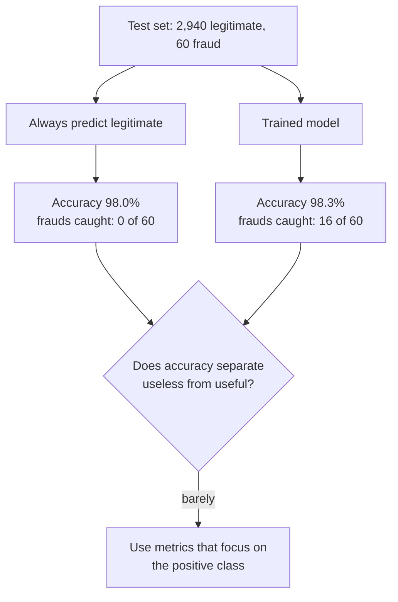

You have trained a model. The next question is always the same: how good is it? Training loss tells you how well the model fits the data it has already seen, which is not what you care about. You need a number computed on held-out data that reflects how the model will behave in the real world, and you need to choose that number carefully, because a badly chosen metric can make a useless model look excellent. This module is about choosing and computing those numbers, and about using them to tune models without fooling yourself.

**Accuracy** is the first metric everyone reaches for: the fraction of predictions that are correct. It is simple, intuitive and often exactly right. It is also the metric most likely to mislead you on the kind of problems AI engineers meet constantly: fraud, spam, disease, defects and any other task where the interesting class is rare.

## The running example: a fraud detector

Throughout the classification lessons of this module you will evaluate one model: a [logistic regression](/learn/supervised-learning-algorithms/logistic-regression) that flags fraudulent card transactions. The data is synthetic, with 10,000 transactions of which about 2% are fraud (class 1). Real fraud rates are often lower still.

```python
from sklearn.datasets import make_classification
from sklearn.linear_model import LogisticRegression
from sklearn.model_selection import train_test_split

# 10,000 synthetic transactions, about 2% fraudulent (class 1)
X, y = make_classification(n_samples=10_000, n_features=8, n_informative=4,
                           weights=[0.98], class_sep=1.5, flip_y=0, random_state=2)
X_train, X_test, y_train, y_test = train_test_split(
    X, y, test_size=0.3, stratify=y, random_state=0)

model = LogisticRegression(max_iter=1000).fit(X_train, y_train)
y_pred = model.predict(X_test)
print("test transactions:", len(y_test), " fraud cases:", y_test.sum())
```

```output
test transactions: 3000  fraud cases: 60
```

`stratify=y` keeps the 2% fraud rate the same in the training and test sets. Without it, a random split of rare data can leave the test set with noticeably more or fewer positives than reality.

## Four possible outcomes

For a binary classifier every prediction falls into one of four cells. By convention the rare class you are trying to detect is the **positive** class (here, fraud), whatever its moral colour.

| | Predicted fraud | Predicted legitimate |
| --- | --- | --- |
| **Actually fraud** | True positive (TP) | False negative (FN) |
| **Actually legitimate** | False positive (FP) | True negative (TN) |

The word *true* or *false* says whether the prediction was right; *positive* or *negative* says what was predicted. You will study this table properly in the [confusion matrix](/learn/model-evaluation/confusion-matrix) lesson. For now, the counts for our model on the 3,000 test transactions are:

| | Predicted fraud | Predicted legitimate |
| --- | --- | --- |
| **Actually fraud (60)** | TP = 16 | FN = 44 |
| **Actually legitimate (2,940)** | FP = 8 | TN = 2,932 |

## Accuracy, precisely

Accuracy is the share of all predictions that landed on the diagonal:

$$
\text{accuracy} = \frac{TP + TN}{TP + TN + FP + FN} = \frac{1}{n}\sum_{i=1}^{n} \mathbb{1}[\hat{y}_i = y_i]
$$

where $n$ is the number of examples, $y_i$ the true label, $\hat{y}_i$ the predicted label and $\mathbb{1}[\cdot]$ equals 1 when the condition holds and 0 otherwise. The second form shows that accuracy works unchanged for any number of classes.

By hand for the fraud model:

$$
\text{accuracy} = \frac{16 + 2932}{3000} = \frac{2948}{3000} \approx 0.983
$$

And in scikit-learn, either with the metric function or with the model's own `score` method, which returns accuracy for every classifier:

```python
from sklearn.metrics import accuracy_score

print(round(accuracy_score(y_test, y_pred), 4))
print(round(model.score(X_test, y_test), 4))
print(round((y_pred == y_test).mean(), 4))
```

```output
0.9827
0.9827
0.9827
```

98.3% sounds excellent. Is it?

## The accuracy paradox

Consider a "model" that ignores its input and declares every transaction legitimate. It catches no fraud at all. Its accuracy:

$$
\frac{0 + 2940}{3000} = 0.98
$$

Our trained model beats this do-nothing rule by a third of a percentage point, while missing 44 of the 60 frauds. This is the **accuracy paradox**: on imbalanced data, a model can achieve very high accuracy by favouring the majority class, and a better model at the task you care about can even have *lower* accuracy than a worse one. Accuracy is dominated by the large class, so it barely notices what happens to the small one.



scikit-learn's `DummyClassifier` makes these baselines explicit. Always fit one: it tells you what accuracy means on *this* dataset.

```python
from sklearn.dummy import DummyClassifier

dummy = DummyClassifier(strategy="most_frequent").fit(X_train, y_train)
print("dummy accuracy:", round(dummy.score(X_test, y_test), 4))
print("frauds caught by dummy:", int(dummy.predict(X_test).sum()))
```

```output
dummy accuracy: 0.98
frauds caught by dummy: 0
```

> [!KEY]
> An accuracy number means nothing until you compare it with the majority-class baseline. On a dataset that is 98% one class, 98% accuracy is the floor, not an achievement.

## Balanced accuracy

One fix that keeps the "fraction correct" spirit is **balanced accuracy**: compute the accuracy within each true class separately, then average them, so each class counts equally regardless of size.

$$
\text{balanced accuracy} = \frac{1}{2}\left(\frac{TP}{TP + FN} + \frac{TN}{TN + FP}\right) = \frac{1}{2}\left(\frac{16}{60} + \frac{2932}{2940}\right) \approx 0.632
$$

The first term is the share of frauds caught and the second the share of legitimate transactions correctly passed. The dummy classifier scores exactly 0.5 here (0 and 1 averaged), so the scale now has an honest floor.

```python
from sklearn.metrics import balanced_accuracy_score

print("model:", round(balanced_accuracy_score(y_test, y_pred), 4))
print("dummy:", balanced_accuracy_score(y_test, dummy.predict(X_test)))
```

```output
model: 0.632
dummy: 0.5
```

The model looks much less impressive now, and correctly so. The first term, the share of positives caught, is called **recall**, and you will meet it in its own lesson.

## When accuracy is the right metric

Accuracy is not wrong; it answers a specific question: "what fraction of decisions are correct, if every error costs the same?" It is a good choice when:

| Situation | Accuracy suitable? |
| --- | --- |
| Classes roughly balanced (for example digit recognition, 10 classes of similar size) | Yes |
| Every kind of mistake costs about the same | Yes |
| You need one number a non-specialist can understand | Yes, alongside a baseline |
| One class is rare (fraud, disease, defects) | No: use precision, recall, F1, PR-AUC |
| False positives and false negatives have very different costs | No: look at the error types separately |
| You need to compare models across different thresholds | No: use ROC-AUC or PR-AUC |

> [!WARNING]
> Accuracy also hides *which* classes are failing in multi-class problems. A model with 90% accuracy over ten classes could be perfect on nine classes and fail entirely on the tenth. Per-class metrics, covered next, reveal this.

## Exercises

**1.** A disease screening test is run on 1,000 people, 10 of whom have the disease. The test finds 6 of them and wrongly flags 30 healthy people. Compute the accuracy, the accuracy of a test that always says "healthy", and the balanced accuracy.

<details>
<summary>Show solution</summary>

TP = 6, FN = 4, FP = 30, TN = 990 - 30 = 960.

- Accuracy = (6 + 960) / 1000 = 0.966.
- Always "healthy": 990 / 1000 = 0.99, higher than the real test.
- Balanced accuracy = (6/10 + 960/990) / 2 = (0.6 + 0.970) / 2 ≈ 0.785.

The useful test has lower accuracy than the useless one, which is the accuracy paradox again.

</details>

**2.** Fit a `DummyClassifier(strategy="stratified")` on the fraud data. It predicts randomly in proportion to the class frequencies. Predict what its accuracy should be, then check.

<details>
<summary>Show solution</summary>

Each prediction is fraud with probability 0.02. It is correct when it predicts legitimate on a legitimate transaction (0.98 × 0.98) or fraud on a fraud (0.02 × 0.02), so expected accuracy is about 0.9604 + 0.0004 ≈ 0.961.

```python
strat = DummyClassifier(strategy="stratified", random_state=0).fit(X_train, y_train)
print(round(strat.score(X_test, y_test), 3))   # close to 0.96
```

Random guessing in proportion to the classes scores *lower* than always guessing the majority, which is why `most_frequent` is the baseline to beat for accuracy.

</details>

**3.** A colleague says: "Our new model raised accuracy from 98.0% to 98.6%, so it is clearly better." What two questions should you ask before agreeing?

<details>
<summary>Show solution</summary>

First, what is the class balance? If 98% of examples are one class, the old model may have been the trivial baseline and 0.6 points could be a handful of examples. Second, which errors changed? The new model may have traded missed frauds for false alarms or the reverse, and those have very different costs. Ask for the confusion matrix, or precision and recall, for both models.

</details>

```quiz
[
  {
    "q": "A dataset is 95% class 0. A model that always predicts class 0 has what accuracy?",
    "options": ["0.05", "0.5", "0.95", "It depends on the features"],
    "answer": 2,
    "why": "It is correct on every class 0 example, which is 95% of the data."
  },
  {
    "q": "What is the accuracy paradox?",
    "options": [
      "Accuracy can only be computed for balanced data",
      "On imbalanced data a model can have very high accuracy while failing at the rare class you care about",
      "Accuracy always increases when you lower the threshold",
      "Training accuracy is always higher than test accuracy"
    ],
    "answer": 1,
    "why": "Accuracy is dominated by the majority class, so a model that mostly predicts it scores well while missing the rare positives."
  },
  {
    "q": "What does balanced accuracy score for a classifier that always predicts the majority class in a binary problem?",
    "options": ["0.5", "The majority class share", "0", "1"],
    "answer": 0,
    "why": "It gets 100% of the majority class and 0% of the minority class, and balanced accuracy averages the two."
  },
  {
    "q": "Why use `stratify=y` in `train_test_split` for rare-event data?",
    "options": [
      "It balances the classes 50/50",
      "It removes the rare class from the test set",
      "It keeps the class proportions the same in both splits",
      "It makes the split deterministic"
    ],
    "answer": 2,
    "why": "Stratification preserves the class ratio, so the test set reflects reality. `random_state` is what makes it deterministic."
  }
]
```
