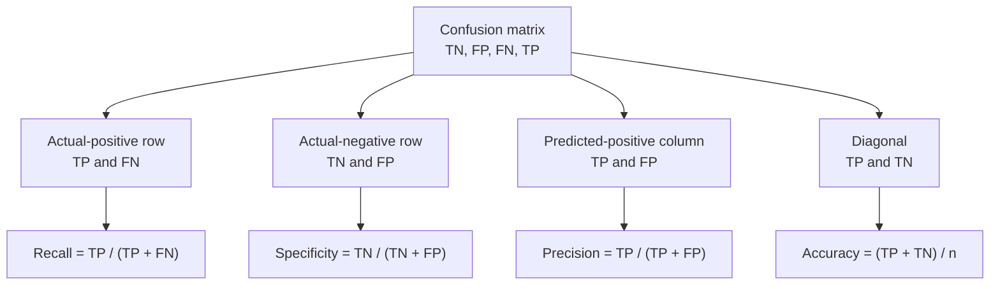

Accuracy, precision, recall, specificity and F1 are all just different ratios of the same few counts. The **confusion matrix** is the table that holds those counts: for every pair of (true class, predicted class), how many examples landed there. It is the single most informative view of a classifier's behaviour, because nothing has been averaged away yet. When a model disappoints, the confusion matrix tells you *which* mistakes it makes, which is the information you need to fix it. This lesson covers how scikit-learn lays the matrix out (a frequent source of bugs), how to derive every metric from it, how to normalise it, and how to read a multi-class matrix to diagnose a model.

## The binary matrix and scikit-learn's layout

You met the four outcomes in the [accuracy](/learn/model-evaluation/accuracy) lesson. scikit-learn arranges them with **true labels on the rows** and **predicted labels on the columns**, both in sorted label order. For labels 0 (negative) and 1 (positive) that gives:

$$
C = \begin{pmatrix} TN & FP \\ FN & TP \end{pmatrix}
$$

where $C_{ij}$ is the number of examples whose true class is $i$ and predicted class is $j$. The diagonal holds correct predictions; everything off the diagonal is an error.

```python
import numpy as np
from sklearn.datasets import make_classification
from sklearn.linear_model import LogisticRegression
from sklearn.model_selection import train_test_split
from sklearn.metrics import confusion_matrix

X, y = make_classification(n_samples=10_000, n_features=8, n_informative=4,
                           weights=[0.98], class_sep=1.5, flip_y=0, random_state=2)
X_train, X_test, y_train, y_test = train_test_split(
    X, y, test_size=0.3, stratify=y, random_state=0)
y_pred = LogisticRegression(max_iter=1000).fit(X_train, y_train).predict(X_test)

cm = confusion_matrix(y_test, y_pred)
print(cm)
tn, fp, fn, tp = cm.ravel()
print(f"tn={tn} fp={fp} fn={fn} tp={tp}")
```

```output
[[2932    8]
 [  44   16]]
tn=2932 fp=8 fn=44 tp=16
```

`cm.ravel()` flattens row by row, so the order is TN, FP, FN, TP. Memorise it; unpacking in the wrong order silently swaps your precision and recall.

> [!WARNING]
> Many textbooks and websites draw the matrix the other way round, with the positive class first or with predictions on the rows. scikit-learn's layout follows sorted label order, so with labels `["fraud", "legit"]` the *fraud* row comes first. Pass `labels=[...]` explicitly whenever the order matters, and always label rows and columns when you show a matrix to someone else.

## Every metric is a ratio of cells

Once you have the matrix, every metric in this module is a few cells divided by a few others. The diagram shows which part of the matrix each one reads.



Rows fix the truth, so row-based metrics (recall, specificity) describe how well each actual class is handled. Columns fix the prediction, so column-based metrics (precision) describe how much a prediction can be trusted.

| Metric | Formula | Fraud model |
| --- | --- | --- |
| Accuracy | (TP + TN) / n | 2948 / 3000 = 0.983 |
| Precision | TP / (TP + FP) | 16 / 24 = 0.667 |
| Recall (TPR, sensitivity) | TP / (TP + FN) | 16 / 60 = 0.267 |
| Specificity (TNR) | TN / (TN + FP) | 2932 / 2940 = 0.997 |
| False positive rate | FP / (TN + FP) | 8 / 2940 = 0.003 |
| F1 | 2TP / (2TP + FP + FN) | 32 / 84 = 0.381 |
| Prevalence | (TP + FN) / n | 60 / 3000 = 0.02 |

```python
print("precision  ", round(tp / (tp + fp), 3))
print("recall     ", round(tp / (tp + fn), 3))
print("specificity", round(tn / (tn + fp), 3))
print("F1         ", round(2 * tp / (2 * tp + fp + fn), 3))
```

```output
precision   0.667
recall      0.267
specificity 0.997
F1          0.381
```

## Normalising the matrix

Raw counts are hard to compare when classes differ in size by a factor of 50. The `normalize` argument divides by row totals, column totals or the grand total:

| `normalize=` | Each cell divided by | Diagonal shows | Answers |
| --- | --- | --- | --- |
| `"true"` | Its row total | Recall of each class | "Of the real frauds, what share went where?" |
| `"pred"` | Its column total | Precision of each class | "Of the fraud predictions, what share were right?" |
| `"all"` | Number of examples | Joint frequencies | "What share of all traffic is each outcome?" |

```python
print(confusion_matrix(y_test, y_pred, normalize="true").round(3))
```

```output
[[0.997 0.003]
 [0.733 0.267]]
```

The row-normalised matrix makes the problem obvious at a glance: 73% of the bottom row (actual fraud) falls in the "predicted legitimate" column.

## Multi-class matrices: diagnosing confusions

The real power of the matrix shows with many classes, where one accuracy number hides which pairs of classes the model mixes up. Here is a deliberately simple model on scikit-learn's built-in handwritten digits (8 by 8 pixel images, ten classes):

```python
from sklearn.datasets import load_digits
from sklearn.naive_bayes import GaussianNB

Xd, yd = load_digits(return_X_y=True)
Xd_tr, Xd_te, yd_tr, yd_te = train_test_split(Xd, yd, test_size=0.3,
                                              stratify=yd, random_state=0)
digits_pred = GaussianNB().fit(Xd_tr, yd_tr).predict(Xd_te)
cm_d = confusion_matrix(yd_te, digits_pred)
print(cm_d)
print("accuracy:", round(np.trace(cm_d) / cm_d.sum(), 3))
```

```output
[[54  0  0  0  0  0  0  0  0  0]
 [ 0 50  0  0  0  0  0  0  5  0]
 [ 0  6 31  1  0  0  0  0 15  0]
 [ 0  2  1 39  0  1  0  2  9  1]
 [ 0  0  0  0 49  2  0  2  1  0]
 [ 0  1  0  1  0 47  0  3  1  2]
 [ 0  0  0  0  0  1 53  0  0  0]
 [ 0  0  0  0  0  0  0 54  0  0]
 [ 0  3  0  0  0  1  0  1 47  0]
 [ 1  3  0  3  1  0  1  2  9 34]]
accuracy: 0.848
```

`np.trace` sums the diagonal, so accuracy is the trace over the total. To find the worst confusions automatically, zero the diagonal and look for the largest remaining cells:

```python
off = cm_d.copy()
np.fill_diagonal(off, 0)
for flat in np.argsort(off, axis=None)[::-1][:3]:
    true_c, pred_c = np.unravel_index(flat, off.shape)
    print(f"true {true_c} predicted as {pred_c}: {off[true_c, pred_c]} times")
```

```output
true 2 predicted as 8: 15 times
true 3 predicted as 8: 9 times
true 9 predicted as 8: 9 times
```

All three top confusions land in the same column: the model predicts 8 far too readily, and in particular reads many 2s as 8s. This is actionable in a way a single accuracy score never is. A [naive Bayes](/learn/supervised-learning-algorithms/naive-bayes) model assumes pixels are independent, which loses the stroke shapes that tell certain digits apart, so you would try a model that captures pixel interactions, or add features, or collect more examples of the confused pairs.

> [!TIP]
> To plot a matrix, `ConfusionMatrixDisplay.from_predictions(y_true, y_pred, normalize="true")` from `sklearn.metrics` draws a labelled heatmap with matplotlib. For a quick labelled table in a notebook, `pd.crosstab(pd.Series(y_true, name="true"), pd.Series(y_pred, name="pred"))` works too.

## Turning a matrix into money: cost matrices

Different cells cost different amounts. Multiply the confusion matrix element-wise by a **cost matrix** of the same shape and sum, and you get the total cost of a model's mistakes in business terms:

$$
\text{total cost} = \sum_{i}\sum_{j} C_{ij}\, K_{ij}
$$

where $K_{ij}$ is the cost of predicting class $j$ when the truth is $i$ (zero on the diagonal). With a missed fraud costing 50 units and a false alarm 1 unit:

```python
K = np.array([[0, 1],     # true legit:  correct, false alarm
              [50, 0]])   # true fraud:  missed,  correct
print("total cost:", (cm * K).sum())
```

```output
total cost: 2208
```

Comparing two models, or two thresholds, by total cost is often the most persuasive evaluation you can give to a non-technical stakeholder, because it is expressed in their units.

> [!KEY]
> Always look at the confusion matrix before trusting any summary metric. Summaries answer "how good?"; the matrix answers "good at what, and wrong how?"

## Exercises

**1.** A matrix from scikit-learn for labels `[0, 1]` is `[[50, 10], [5, 35]]`. Compute precision, recall and specificity for class 1.

<details>
<summary>Show solution</summary>

TN = 50, FP = 10, FN = 5, TP = 35. Precision = 35 / 45 ≈ 0.778, recall = 35 / 40 = 0.875, specificity = 50 / 60 ≈ 0.833.

</details>

**2.** A colleague computes `tp, fn, fp, tn = confusion_matrix(y_test, y_pred).ravel()`. On the fraud model, what wrong values of precision and recall will they report?

<details>
<summary>Show solution</summary>

Their names map to the real cells as tp = TN = 2932, fn = FP = 8, fp = FN = 44, tn = TP = 16. Their "precision" is 2932 / (2932 + 44) ≈ 0.985 and "recall" is 2932 / (2932 + 8) ≈ 0.997: they are actually reporting the legitimate class's metrics. A model that looked weak now looks excellent, which is why the order matters.

</details>

**3.** For the digits model, compute per-class recall straight from `cm_d` without any metric function, and find the class with the lowest recall.

<details>
<summary>Show solution</summary>

```python
recall_per_class = np.diag(cm_d) / cm_d.sum(axis=1)
print(recall_per_class.round(2))
print("worst class:", recall_per_class.argmin())
```

Class 2 has the lowest recall, 0.58, consistent with its 15 misreadings as 8. Recall uses rows (true classes), so divide the diagonal by the row sums. Dividing by column sums, `axis=0`, would give per-class precision instead.

</details>

```quiz
[
  {
    "q": "In scikit-learn's `confusion_matrix(y_true, y_pred)` for labels 0 and 1, what does `cm[1, 0]` contain?",
    "options": ["True positives", "False positives", "False negatives", "True negatives"],
    "answer": 2,
    "why": "Rows are true labels and columns are predictions, so row 1 column 0 counts true class 1 predicted as 0: false negatives."
  },
  {
    "q": "What order does `confusion_matrix(y, p).ravel()` return for binary 0/1 labels?",
    "options": ["TP, FP, FN, TN", "TN, FP, FN, TP", "TP, FN, FP, TN", "TN, FN, FP, TP"],
    "answer": 1,
    "why": "The matrix is [[TN, FP], [FN, TP]] and ravel reads it row by row."
  },
  {
    "q": "With `normalize=\"true\"`, the diagonal of the confusion matrix shows each class's:",
    "options": ["Recall", "Precision", "Share of all examples", "F1-score"],
    "answer": 0,
    "why": "Each row is divided by its total, the number of actual examples in that class, so the diagonal becomes correct / actual = recall."
  },
  {
    "q": "How do you compute accuracy from a multi-class confusion matrix `cm`?",
    "options": [
      "`cm[0, 0] / cm.sum()`",
      "`cm.max() / cm.sum()`",
      "`cm.sum(axis=0) / cm.sum()`",
      "`np.trace(cm) / cm.sum()`"
    ],
    "answer": 3,
    "why": "The diagonal holds all correct predictions; its sum (the trace) over the total count is accuracy."
  }
]
```
