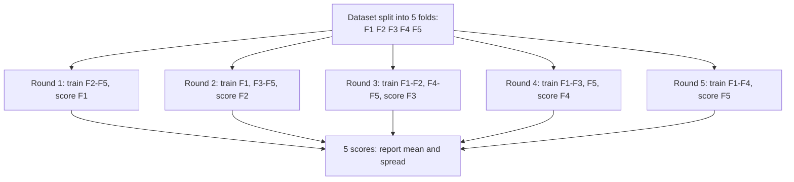

Every metric in this module so far was computed on a single test set. That number is an **estimate** of how the model will perform on new data, and like any estimate built from a sample it has noise in it. With a few thousand rows, or a rare positive class, a different random split can move the score by several points, enough to flip which of two models looks better. **Cross-validation** reduces that noise by evaluating the model on several different splits and averaging, and it lets you use all of your data for both training and evaluation. It is also the engine underneath threshold selection, [hyperparameter tuning](/learn/model-evaluation/hyperparameter-tuning) and every search tool in the rest of this module. You met the train, validation and test idea in [training, validation and testing](/learn/machine-learning-fundamentals/training-validation-and-testing); this lesson makes it rigorous.

## How noisy is a single split?

Take the fraud data from the classification lessons and score the same model on ten different random splits:

```python
import numpy as np
from sklearn.datasets import make_classification
from sklearn.linear_model import LogisticRegression
from sklearn.metrics import average_precision_score
from sklearn.model_selection import train_test_split

X, y = make_classification(n_samples=10_000, n_features=8, n_informative=4,
                           weights=[0.98], class_sep=1.5, flip_y=0, random_state=2)
scores = []
for seed in range(10):
    X_tr, X_te, y_tr, y_te = train_test_split(X, y, test_size=0.3, stratify=y, random_state=seed)
    proba = LogisticRegression(max_iter=1000).fit(X_tr, y_tr).predict_proba(X_te)[:, 1]
    scores.append(average_precision_score(y_te, proba))
print(np.round(scores, 3))
print(f"min {min(scores):.3f}  max {max(scores):.3f}")
```

```output
[0.407 0.401 0.424 0.42  0.463 0.443 0.448 0.388 0.5   0.342]
min 0.342  max 0.500
```

Nothing about the model changed, only which rows landed in the test set. A comparison between two models that differ by less than this spread, made on one split, is close to meaningless.

## K-fold cross-validation

**K-fold** splits the data into $k$ equal parts called **folds**. The model is trained $k$ times; each time one fold is held out for evaluation and the other $k - 1$ are used for training. Every row is used for evaluation exactly once.



The cross-validated score is the mean of the $k$ fold scores:

$$
\text{CV score} = \frac{1}{k}\sum_{j=1}^{k} \text{score}\big(f_{-j},\, D_j\big)
$$

where $D_j$ is fold $j$ and $f_{-j}$ is the model trained on every fold except $j$. $k = 5$ or $k = 10$ is standard: larger $k$ trains on more data each round but costs more fits.

Here is the loop written out by hand, so you can see there is no magic:

```trace
{
  "title": "3-fold cross-validation on 6 rows",
  "code": [
    "rows = [0, 1, 2, 3, 4, 5]",
    "folds = [[0, 1], [2, 3], [4, 5]]",
    "scores = []",
    "for held_out in folds:",
    "    train = [r for r in rows if r not in held_out]",
    "    model = fit(train)",
    "    scores.append(evaluate(model, held_out))",
    "print(sum(scores) / len(scores))"
  ],
  "steps": [
    { "line": 2, "vars": { "rows": "[0..5]", "folds": "[[0,1],[2,3],[4,5]]" }, "note": "Split the rows into 3 folds. With shuffling, the assignment would be random." },
    { "line": 5, "vars": { "held_out": "[0, 1]", "train": "[2, 3, 4, 5]", "scores": "[]" }, "note": "Round 1: hold out fold 1, train on the other four rows." },
    { "line": 7, "vars": { "held_out": "[0, 1]", "train": "[2, 3, 4, 5]", "scores": "[0.80]" }, "note": "A fresh model is fitted and scored only on rows it never saw." },
    { "line": 7, "vars": { "held_out": "[2, 3]", "train": "[0, 1, 4, 5]", "scores": "[0.80, 0.70]" }, "note": "Round 2: a brand new model, trained without rows 2 and 3." },
    { "line": 7, "vars": { "held_out": "[4, 5]", "train": "[0, 1, 2, 3]", "scores": "[0.80, 0.70, 0.75]" }, "note": "Round 3. Every row has now been evaluated exactly once." },
    { "line": 8, "vars": { "scores": "[0.80, 0.70, 0.75]" }, "out": ["0.75"], "note": "The CV estimate is the mean. The spread, 0.70 to 0.80, shows how uncertain it is. (Scores here are illustrative.)" }
  ]
}
```

In scikit-learn, `cross_val_score` runs the whole loop. Passing an integer `cv` to a classifier uses stratified folds (next section):

```python
from sklearn.model_selection import cross_val_score

model = LogisticRegression(max_iter=1000)
cv_scores = cross_val_score(model, X, y, cv=5, scoring="average_precision")
print(cv_scores.round(3))
print(f"mean {cv_scores.mean():.3f}, std {cv_scores.std():.3f}")
```

```output
[0.416 0.53  0.452 0.444 0.491]
mean 0.467, std 0.040
```

`cross_validate` does the same but accepts several metrics and also reports training scores and fit times, which helps diagnose overfitting:

```python
from sklearn.model_selection import cross_validate

res = cross_validate(model, X, y, cv=5, scoring=["roc_auc", "average_precision", "recall"],
                     return_train_score=True)
for key in ("test_roc_auc", "test_average_precision", "train_average_precision", "test_recall"):
    print(f"{key:24s} {res[key].mean():.3f}")
```

```output
test_roc_auc             0.906
test_average_precision   0.467
train_average_precision  0.468
test_recall              0.225
```

Training and validation average precision are almost identical, so this simple linear model is not overfitting; its limit is underfitting, or simply hard data. The low recall is the default 0.5 threshold at work, as the [recall](/learn/model-evaluation/recall) lesson showed.

## Stratified k-fold for imbalanced classes

Plain `KFold` cuts the data into contiguous or shuffled chunks without looking at the labels. With 2% positives, some folds can end up with noticeably more or fewer frauds than others, which adds noise to exactly the metrics you care about. **Stratified** k-fold keeps the class ratio the same in every fold:

```python
from sklearn.model_selection import KFold, StratifiedKFold

for name, splitter in (("KFold", KFold(5, shuffle=True, random_state=1)),
                       ("StratifiedKFold", StratifiedKFold(5, shuffle=True, random_state=1))):
    counts = [int(y[test].sum()) for _, test in splitter.split(X, y)]
    print(f"{name:16s} frauds per test fold: {counts}")
```

```output
KFold            frauds per test fold: [39, 41, 36, 42, 42]
StratifiedKFold  frauds per test fold: [40, 40, 40, 40, 40]
```

Use stratified splitting for every classification problem unless you have a specific reason not to. scikit-learn does this automatically when you pass `cv=5` with a classifier, but not if you pass a `KFold` object yourself.

## Group k-fold: when rows are not independent

K-fold assumes rows are independent. Often they are not: several transactions from the same customer, several scans from the same patient, several frames from the same video. If one customer's rows are split across training and validation, the model can recognise the customer instead of learning the pattern, and the score will be wildly optimistic.

Here is an extreme demonstration: 100 customers with 10 transactions each, where each customer's label is random. There is **nothing** generalisable to learn, so an honest score should be about 0.5.

```python
from sklearn.model_selection import GroupKFold
from sklearn.neighbors import KNeighborsClassifier

rng = np.random.default_rng(0)
customer_profile = rng.normal(size=(100, 5))
customer_label = rng.integers(0, 2, 100)          # random: no real signal
groups = np.repeat(np.arange(100), 10)            # customer id of each row
Xg = customer_profile[groups] + rng.normal(scale=0.1, size=(1000, 5))
yg = customer_label[groups]

knn = KNeighborsClassifier(n_neighbors=1)
leaky = cross_val_score(knn, Xg, yg, cv=KFold(5, shuffle=True, random_state=0))
honest = cross_val_score(knn, Xg, yg, cv=GroupKFold(5), groups=groups)
print(f"KFold accuracy:      {leaky.mean():.3f}")
print(f"GroupKFold accuracy: {honest.mean():.3f}")
```

```output
KFold accuracy:      1.000
GroupKFold accuracy: 0.506
```

Plain k-fold reports perfect accuracy on pure noise: every validation transaction has a near-identical sibling from the same customer in the training folds. `GroupKFold` keeps each customer entirely on one side of every split and reveals the truth. Ask "what will be *new* at prediction time?" (a new customer, a new patient, a new store) and split by that unit. `StratifiedGroupKFold` combines both constraints.

## Time-series split: never train on the future

For data ordered in time, such as daily demand or transactions in a fraud stream, a random split lets the model train on next month to predict last month, which can never happen in production. `TimeSeriesSplit` always trains on the past and evaluates on the period immediately after, with an expanding training window:

```python
from sklearn.model_selection import TimeSeriesSplit

days = np.arange(12)                     # 12 time-ordered observations
for train_idx, test_idx in TimeSeriesSplit(n_splits=4).split(days):
    print(f"train {train_idx.tolist()}  test {test_idx.tolist()}")
```

```output
train [0, 1, 2, 3]  test [4, 5]
train [0, 1, 2, 3, 4, 5]  test [6, 7]
train [0, 1, 2, 3, 4, 5, 6, 7]  test [8, 9]
train [0, 1, 2, 3, 4, 5, 6, 7, 8, 9]  test [10, 11]
```

The rows must already be sorted by time, and the splitter never shuffles. Its `gap` parameter can leave a buffer between training and test periods when features use information from the recent past.

| Splitter | Use when | Guards against |
| --- | --- | --- |
| `KFold` | Regression on independent rows | Single-split noise |
| `StratifiedKFold` | Classification, especially imbalanced | Folds with too few positives |
| `GroupKFold` | Several rows per customer, patient, device | Memorising entities across folds |
| `StratifiedGroupKFold` | Groups and imbalanced classes | Both of the above |
| `TimeSeriesSplit` | Time-ordered data | Training on the future |

## Preprocessing belongs inside the folds

If you scale, impute or select features using the whole dataset before cross-validating, statistics from the validation fold leak into training. Put preprocessing in a [pipeline](/learn/machine-learning-fundamentals/data-preprocessing) so it is refitted on the training folds only, in every round:

```python
from sklearn.pipeline import make_pipeline
from sklearn.preprocessing import StandardScaler

pipe = make_pipeline(StandardScaler(), LogisticRegression(max_iter=1000))
print(round(cross_val_score(pipe, X, y, cv=5, scoring="average_precision").mean(), 3))
```

```output
0.465
```

With plain standardisation the leak is tiny. With target encoding, oversampling or feature selection on the full data it can be enormous, and a pipeline prevents all of them.

> [!WARNING]
> Cross-validation estimates how well a *procedure* performs. If you then use those CV scores to pick the best of many models or settings, the winning score is optimistically biased. Keep a final test set that no choice ever touches, or use nested cross-validation, covered in [hyperparameter tuning](/learn/model-evaluation/hyperparameter-tuning).

> [!KEY]
> Use cross-validation to get a less noisy estimate and to see its spread. Choose the splitter that mimics production: stratify rare classes, group related rows, respect time order, and keep every preprocessing step inside the folds.

## Exercises

**1.** With 1,000 rows and 5-fold CV, how many rows does each model train on, and how many fits happen in total?

<details>
<summary>Show solution</summary>

Each fold holds 200 rows, so each model trains on 800 and is scored on 200. There are 5 fits. (If you then refit on all the data for deployment, that is a sixth.)

</details>

**2.** You have hospital scans from 300 patients, several scans each, and want to predict a diagnosis for new patients. Which splitter would you use, and what would go wrong with `StratifiedKFold`?

<details>
<summary>Show solution</summary>

`StratifiedGroupKFold` with patient ID as the group (or `GroupKFold` if classes are balanced). With `StratifiedKFold`, scans of the same patient land in both training and validation, so the model can match patient-specific features and the score overstates performance on genuinely new patients.

</details>

**3.** Use `cross_val_predict` with the pipeline above to get one out-of-fold probability for every row, then compute a single average precision over all of them. Why is this different from the mean of the five fold scores?

<details>
<summary>Show solution</summary>

```python
from sklearn.model_selection import cross_val_predict

oof = cross_val_predict(pipe, X, y, cv=5, method="predict_proba")[:, 1]
print(round(average_precision_score(y, oof), 3))
```

It prints `0.46`, close to the mean fold score of 0.465. The pooled score ranks all 10,000 predictions together, mixing five slightly different models, while the mean of fold scores averages five separate rankings. They are usually close but not identical. Out-of-fold predictions are ideal for threshold selection and error analysis; the mean and spread of fold scores are the standard way to report CV performance.

</details>

```quiz
[
  {
    "q": "In 10-fold cross-validation, how many times is each row used for evaluation?",
    "options": ["Once", "Ten times", "Nine times", "It depends on shuffling"],
    "answer": 0,
    "why": "Each row belongs to exactly one fold and is evaluated only in the round where that fold is held out."
  },
  {
    "q": "Your dataset has several transactions per customer and the model will be used on new customers. Which splitter fits?",
    "options": ["KFold with shuffling", "TimeSeriesSplit", "GroupKFold with customer ID as the group", "Leave-one-out"],
    "answer": 2,
    "why": "Grouping keeps all of a customer's rows on one side of each split, so validation simulates unseen customers."
  },
  {
    "q": "Why should a `StandardScaler` be inside a pipeline passed to `cross_val_score`?",
    "options": [
      "Pipelines run faster",
      "So it is fitted only on the training folds, preventing validation statistics leaking into training",
      "`cross_val_score` cannot scale data otherwise",
      "Scaling changes the labels"
    ],
    "answer": 1,
    "why": "Fitting preprocessing on the full data lets information from the held-out fold influence training, biasing the estimate."
  },
  {
    "q": "What does `TimeSeriesSplit` guarantee?",
    "options": [
      "Every fold has the same class balance",
      "Every row is used for training exactly once",
      "Folds are shuffled randomly",
      "Training indices always come before test indices in time"
    ],
    "answer": 3,
    "why": "It uses an expanding window of past observations for training and the following block for testing, never training on the future."
  }
]
```
