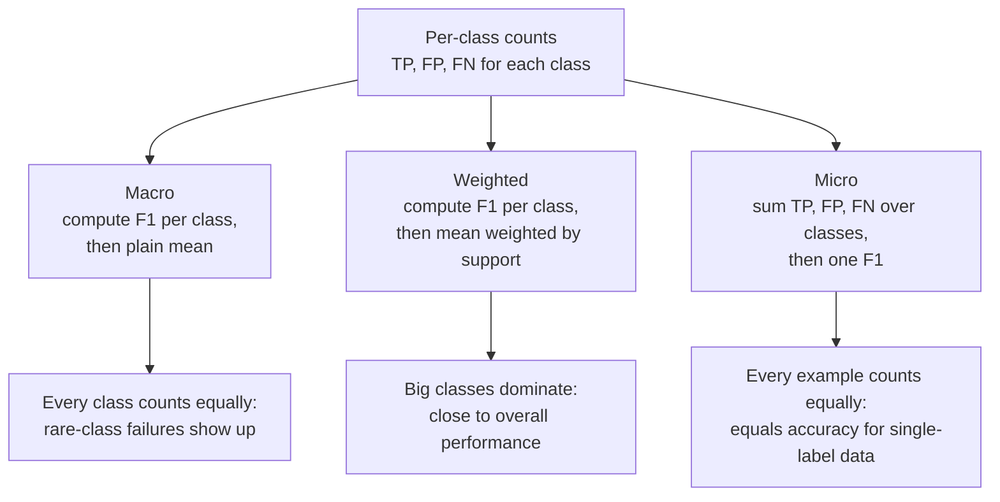

[Precision](/learn/model-evaluation/precision) and [recall](/learn/model-evaluation/recall) each tell half the story, and each can be pushed to a perfect score by a useless model. In practice you often need one number: to rank twenty candidate models, to pick a threshold, or to drive a hyperparameter search. The **F1-score** combines precision and recall into a single value that is only high when both are high. This lesson covers how it is built, its weighted cousin F-beta, and the averaging choices (macro, micro and weighted) that apply to every per-class metric in multi-class problems.

## Why not just average them?

Take the trivial "flag everything" model on the fraud data: recall 1.0 and precision 0.02. The ordinary (arithmetic) mean is 0.51, which makes a worthless model look like a coin flip of quality. You want a combination that is dragged down hard by whichever metric is worse.

The **harmonic mean** does exactly that. For two positive numbers $a$ and $b$ it is $2ab/(a+b)$, and it is always close to the smaller of the two:

| Precision | Recall | Arithmetic mean | Harmonic mean (F1) |
| --- | --- | --- | --- |
| 0.02 | 1.00 | 0.510 | 0.039 |
| 0.50 | 0.50 | 0.500 | 0.500 |
| 0.90 | 0.10 | 0.500 | 0.180 |
| 0.667 | 0.267 | 0.467 | 0.381 |

The last row is our running fraud model at the default 0.5 threshold.

## The definition

$$
F_1 = 2 \cdot \frac{\text{precision} \cdot \text{recall}}{\text{precision} + \text{recall}} = \frac{2\,TP}{2\,TP + FP + FN}
$$

where $TP$, $FP$ and $FN$ are the true positive, false positive and false negative counts. The second form is often easier by hand and shows something important: **true negatives do not appear anywhere**. F1 only cares about the positive class, which is why it suits rare-event problems where the huge pile of correctly ignored negatives would otherwise swamp the score.

For the fraud model (TP = 16, FP = 8, FN = 44):

$$
F_1 = \frac{2 \times 16}{2 \times 16 + 8 + 44} = \frac{32}{84} \approx 0.381
$$

```python
import numpy as np
from sklearn.datasets import make_classification
from sklearn.linear_model import LogisticRegression
from sklearn.model_selection import train_test_split
from sklearn.metrics import f1_score, fbeta_score

X, y = make_classification(n_samples=10_000, n_features=8, n_informative=4,
                           weights=[0.98], class_sep=1.5, flip_y=0, random_state=2)
X_train, X_test, y_train, y_test = train_test_split(
    X, y, test_size=0.3, stratify=y, random_state=0)
model = LogisticRegression(max_iter=1000).fit(X_train, y_train)
y_pred = model.predict(X_test)

print("F1:", round(f1_score(y_test, y_pred), 4))
```

```output
F1: 0.381
```

## F-beta: when one error matters more

F1 weights precision and recall equally. The general **F-beta** score lets you say how much more you care about recall:

$$
F_\beta = (1 + \beta^2) \cdot \frac{\text{precision} \cdot \text{recall}}{\beta^2 \cdot \text{precision} + \text{recall}}
$$

where $\beta$ is a positive number: recall is treated as $\beta$ times as important as precision. $\beta = 1$ gives F1, $\beta = 2$ (F2) favours recall, which suits fraud and screening, and $\beta = 0.5$ favours precision, which suits spam filtering where losing a real email is worse than letting some spam through.

```python
for beta in (0.5, 1, 2):
    print(f"F{beta}: {fbeta_score(y_test, y_pred, beta=beta):.3f}")
```

```output
F0.5: 0.513
F1: 0.381
F2: 0.303
```

The model has higher precision than recall, so F0.5 rewards it and F2 punishes it.

## Tuning the threshold for F1

Because F1 balances both errors, the threshold that maximises it is a sensible default when there is no business constraint. scikit-learn (version 1.5 and later) has a meta-estimator that does this properly, choosing the threshold by cross-validation on the training data:

```python
from sklearn.model_selection import TunedThresholdClassifierCV

tuned = TunedThresholdClassifierCV(LogisticRegression(max_iter=1000),
                                   scoring="f1", cv=5)
tuned.fit(X_train, y_train)
print("chosen threshold:", round(tuned.best_threshold_, 3))
print("test F1 at 0.5:   ", round(f1_score(y_test, y_pred), 3))
print("test F1 tuned:    ", round(f1_score(y_test, tuned.predict(X_test)), 3))
```

```output
chosen threshold: 0.332
test F1 at 0.5:    0.381
test F1 tuned:     0.4
```

The gain is modest here (0.381 to 0.400), which is itself informative: on this data the quality of the model's ranking, not the threshold, is the main limit. `tuned.predict` applies the learned threshold automatically, so the tuned model drops into any pipeline like an ordinary classifier.

## Multi-class: macro, micro and weighted averaging

With more than two classes, precision, recall and F1 are first computed **per class** (each class in turn treated as positive, all others as negative), then combined. The combination rule matters a lot when classes are imbalanced. Suppose the fraud team routes flagged cases into three categories, with this small validation set:

```python
labels = ["legit", "theft", "takeover"]
y_true = ["legit"] * 10 + ["theft"] * 4 + ["takeover"] * 2
y_hat  = (["legit"] * 9 + ["theft"]                  # 10 legit: 9 right
          + ["theft"] * 2 + ["legit", "takeover"]    # 4 theft: 2 right
          + ["legit"] * 2)                           # 2 takeover: 0 right

print(f1_score(y_true, y_hat, labels=labels, average=None).round(3))
```

```output
[0.818 0.571 0.   ]
```

Per class: legit has precision 9/12 and recall 9/10, giving F1 0.818; theft has precision 2/3 and recall 2/4, giving 0.571; takeover is never predicted correctly, giving 0. Now the three averages:



By hand, with supports 10, 4 and 2:

$$
\text{macro} = \frac{0.818 + 0.571 + 0}{3} \approx 0.463, \qquad
\text{weighted} = \frac{10(0.818) + 4(0.571) + 2(0)}{16} \approx 0.654
$$

For micro, add up the counts over all classes: 11 correct predictions, so total $TP = 11$; every wrong prediction is simultaneously a false positive for one class and a false negative for another, so total $FP = FN = 5$. Then micro-F1 $= 22 / (22 + 5 + 5) = 0.6875$, which is exactly the accuracy, 11/16.

```python
for avg in ("macro", "weighted", "micro"):
    print(f"{avg:>8}: {f1_score(y_true, y_hat, labels=labels, average=avg):.4f}")
```

```output
   macro: 0.4632
weighted: 0.6542
   micro: 0.6875
```

| Average | Treats equally | Use when |
| --- | --- | --- |
| `macro` | Every class | Rare classes matter as much as common ones (the usual case for imbalanced problems) |
| `weighted` | Every example, via class size | You want a summary that reflects the class mix, but beware: it hides rare-class failures |
| `micro` | Every example | Single-label multi-class: it equals accuracy. More useful for multi-label problems |
| `binary` (default) | Only `pos_label` | Two-class problems with a clear positive class |

> [!WARNING]
> The takeover class has an F1 of zero, yet the weighted F1 of 0.654 looks respectable. If someone reports a single "F1" for a multi-class model, ask which average. Macro is the honest default when minority classes matter.

### The classification report

`classification_report` prints every per-class metric and all averages at once, and is the first thing to run on any classifier:

```python
from sklearn.metrics import classification_report

print(classification_report(y_true, y_hat, labels=labels, zero_division=0))
```

```output
              precision    recall  f1-score   support

       legit       0.75      0.90      0.82        10
       theft       0.67      0.50      0.57         4
    takeover       0.00      0.00      0.00         2

    accuracy                           0.69        16
   macro avg       0.47      0.47      0.46        16
weighted avg       0.64      0.69      0.65        16
```

The "accuracy" row is micro-averaged F1 under another name, and "support" is the number of true examples per class.

> [!TIP]
> When you pass F1 to a hyperparameter search, use the scoring strings `"f1"` (binary), `"f1_macro"`, `"f1_micro"` or `"f1_weighted"`. Choosing the string is choosing the averaging rule, so do it deliberately.

## Exercises

**1.** A model has precision 0.8 and recall 0.4. Compute F1 and F2 by hand.

<details>
<summary>Show solution</summary>

F1 = 2(0.8)(0.4) / (0.8 + 0.4) = 0.64 / 1.2 ≈ 0.533.

F2 = 5(0.8)(0.4) / (4(0.8) + 0.4) = 1.6 / 3.6 ≈ 0.444.

F2 is lower because it weights the weak recall more heavily.

</details>

**2.** In the three-class example, change the two takeover predictions to `"takeover"` (both correct). Predict which average changes most, then check with code.

<details>
<summary>Show solution</summary>

Macro changes most, because takeover's F1 jumps from 0 to 1 and it counts as a full third of the macro average. Weighted gives takeover only 2/16 of the weight, and micro moves by just 2 correct examples out of 16.

```python
y_hat2 = y_hat[:14] + ["takeover", "takeover"]
for avg in ("macro", "weighted", "micro"):
    print(avg, round(f1_score(y_true, y_hat2, labels=labels, average=avg), 3))
```

</details>

**3.** Explain why F1 is unaffected by adding 10,000 extra correctly classified legitimate transactions to the fraud test set, while accuracy is.

<details>
<summary>Show solution</summary>

Those examples are true negatives. F1 = 2TP / (2TP + FP + FN) contains no TN term, so it does not change. Accuracy = (TP + TN) / n rises towards 1 as TN grows, which is precisely the accuracy paradox.

</details>

```quiz
[
  {
    "q": "Why does F1 use the harmonic mean of precision and recall?",
    "options": [
      "It is faster to compute",
      "It is pulled towards the smaller value, so both must be high for a high score",
      "It always equals accuracy",
      "It gives more weight to precision"
    ],
    "answer": 1,
    "why": "The harmonic mean is dominated by the lower of the two values, so a model cannot hide a terrible recall behind a perfect precision."
  },
  {
    "q": "Which F-beta score would you choose for a cancer screen where missed cases are the main concern?",
    "options": ["F0.5", "F1", "F0", "F2"],
    "answer": 3,
    "why": "Beta greater than 1 weights recall more heavily; F2 treats recall as twice as important as precision."
  },
  {
    "q": "For a single-label multi-class problem, micro-averaged F1 equals:",
    "options": ["Accuracy", "Macro F1", "Balanced accuracy", "The F1 of the largest class"],
    "answer": 0,
    "why": "Summed over classes, FP equals FN and both equal the number of wrong predictions, so micro precision, recall and F1 all reduce to accuracy."
  },
  {
    "q": "A model has F1 of 0.95 on the majority class and 0.05 on a rare class. Which average makes the rare-class failure most visible?",
    "options": ["Weighted", "Micro", "Macro", "None of them"],
    "answer": 2,
    "why": "Macro averaging gives each class equal weight, so the rare class's 0.05 pulls the average down sharply."
  }
]
```
