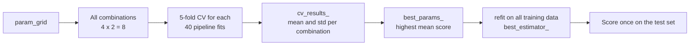

**Grid search** is the most straightforward tuning strategy: list a few candidate values for each hyperparameter, try every combination, score each with cross-validation, and keep the best. It is exhaustive, easy to reason about and trivially parallel, and scikit-learn's `GridSearchCV` wraps the whole procedure, including the final refit, into one estimator. This lesson shows how to use it properly with pipelines, how to read its results, how to search over different model types at once, and where its cost becomes a problem, which motivates [random search](/learn/model-evaluation/random-search). It builds on [cross-validation](/learn/model-evaluation/cross-validation) and the evaluation discipline from [hyperparameter tuning](/learn/model-evaluation/hyperparameter-tuning).

## The idea

Given candidate values for each hyperparameter, the grid is their **Cartesian product**. With 4 values of `C` and 2 values of `class_weight` there are $4 \times 2 = 8$ combinations; with 5-fold CV that means 40 model fits, plus one final refit of the winner. Written out by hand, grid search is just nested loops:

```trace
{
  "title": "grid search as nested loops",
  "code": [
    "best_score, best = -1, None",
    "for C in [0.1, 1]:",
    "    for cw in [None, 'balanced']:",
    "        score = mean_cv_score(C=C, class_weight=cw)",
    "        if score > best_score:",
    "            best_score, best = score, (C, cw)",
    "print(best, best_score)"
  ],
  "steps": [
    { "line": 1, "vars": { "best_score": "-1", "best": "None" }, "note": "Start with nothing. The grid is {0.1, 1} x {None, balanced}: 4 combinations." },
    { "line": 6, "vars": { "C": "0.1", "cw": "None", "score": "0.44", "best_score": "0.44", "best": "(0.1, None)" }, "note": "First combination. Its mean 5-fold CV score becomes the best so far." },
    { "line": 4, "vars": { "C": "0.1", "cw": "balanced", "score": "0.41", "best_score": "0.44", "best": "(0.1, None)" }, "note": "Lower score: best is unchanged." },
    { "line": 6, "vars": { "C": "1", "cw": "None", "score": "0.47", "best_score": "0.47", "best": "(1, None)" }, "note": "A new best." },
    { "line": 4, "vars": { "C": "1", "cw": "balanced", "score": "0.45", "best_score": "0.47", "best": "(1, None)" }, "note": "Every combination has now been scored exactly once." },
    { "line": 7, "vars": { "best_score": "0.47", "best": "(1, None)" }, "out": ["(1, None) 0.47"], "note": "The winner. GridSearchCV would now refit it on all the training data. Scores here are illustrative." }
  ]
}
```

## GridSearchCV with a pipeline

The fraud data again: 2% positives, scored by average precision, which the [ROC-AUC](/learn/model-evaluation/roc-auc) lesson recommended for rare positives. The test set is split off **first** and not touched until the end.

```python
import numpy as np
import pandas as pd
from sklearn.datasets import make_classification
from sklearn.linear_model import LogisticRegression
from sklearn.model_selection import GridSearchCV, StratifiedKFold, train_test_split
from sklearn.pipeline import Pipeline
from sklearn.preprocessing import StandardScaler

X, y = make_classification(n_samples=10_000, n_features=8, n_informative=4,
                           weights=[0.98], class_sep=1.5, flip_y=0, random_state=2)
X_train, X_test, y_train, y_test = train_test_split(
    X, y, test_size=0.3, stratify=y, random_state=0)

pipe = Pipeline([("scale", StandardScaler()),
                 ("clf", LogisticRegression(max_iter=1000))])
param_grid = {
    "clf__C": [0.01, 0.1, 1, 10],
    "clf__class_weight": [None, "balanced"],
}
cv = StratifiedKFold(n_splits=5, shuffle=True, random_state=0)
search = GridSearchCV(pipe, param_grid, cv=cv, scoring="average_precision", n_jobs=-1)
search.fit(X_train, y_train)

print("best params:", search.best_params_)
print("best CV score:", round(search.best_score_, 3))
```

```output
best params: {'clf__C': 10, 'clf__class_weight': None}
best CV score: 0.491
```

Points worth noticing:

- **Parameter names use `step__parameter`**, with a double underscore: `clf__C` is the `C` of the step named `clf`. Run `pipe.get_params().keys()` to list every name you can tune, including preprocessing settings such as `scale__with_mean`.
- **The scaler is inside the pipeline**, so it is refitted on the training folds in every one of the 40 fits. Scaling the data before the search would leak validation statistics into training.
- **A fixed splitter** (`StratifiedKFold` with a `random_state`) scores every combination on identical folds, so differences come from the hyperparameters, not from the split.
- **`n_jobs=-1`** runs fits in parallel on all CPU cores. Grid search is embarrassingly parallel.



## Reading the results

`best_score_` is a single number. The full table in `cv_results_` is far more informative, because it shows how much the hyperparameters actually matter and how noisy each score is:

```python
res = pd.DataFrame(search.cv_results_)
res["param_clf__class_weight"] = res["param_clf__class_weight"].fillna("None")
cols = ["param_clf__C", "param_clf__class_weight", "mean_test_score", "std_test_score", "rank_test_score"]
print(res[cols].sort_values("rank_test_score").to_string(index=False))
```

```output
 param_clf__C param_clf__class_weight  mean_test_score  std_test_score  rank_test_score
        10.00                    None         0.491102        0.022031                1
         1.00                    None         0.487660        0.025191                2
         0.10                    None         0.461454        0.045019                3
        10.00                balanced         0.384878        0.080872                4
         1.00                balanced         0.384784        0.081142                5
         0.10                balanced         0.384468        0.082848                6
         0.01                balanced         0.375557        0.088298                7
         0.01                    None         0.356093        0.091928                8
```

Three things stand out. First, `class_weight="balanced"` lowers average precision at every `C` except the smallest, and its fold-to-fold spread is much larger: reweighting changes how the model trades errors, which is not what a ranking metric rewards here. Second, the top two rows differ by less than their standard deviation across folds, so `C=10` and `C=1` are effectively tied; you could reasonably prefer the more regularised `C=1`. Third, the winner sits on the **edge** of the grid. Whenever that happens, extend the grid in that direction (here, try 100 and 1000) before concluding, since the true optimum may lie outside it.

## Searching over model types

`param_grid` can also be a **list of dictionaries**, each its own sub-grid. Combined with the fact that a pipeline step is itself a parameter, this lets one search compare entirely different models:

```python
from sklearn.ensemble import RandomForestClassifier

param_grid = [
    {"clf": [LogisticRegression(max_iter=1000)],
     "clf__C": [0.01, 0.1, 1, 10]},
    {"clf": [RandomForestClassifier(n_estimators=200, random_state=0)],
     "scale": ["passthrough"],                 # trees do not need scaling
     "clf__max_depth": [4, 8, None],
     "clf__min_samples_leaf": [1, 5]},
]
search2 = GridSearchCV(pipe, param_grid, cv=cv, scoring="average_precision", n_jobs=-1)
search2.fit(X_train, y_train)
print("best model:", type(search2.best_params_["clf"]).__name__)
print({k: v for k, v in search2.best_params_.items() if k != "clf"})
print("best CV score:", round(search2.best_score_, 3))
```

```output
best model: RandomForestClassifier
{'clf__max_depth': None, 'clf__min_samples_leaf': 1, 'scale': 'passthrough'}
best CV score: 0.825
```

The [random forest](/learn/supervised-learning-algorithms/random-forests) wins by a wide margin: the fraud signal in this data is non-linear, which a linear model cannot capture however well `C` is tuned. Tuning cannot rescue the wrong model family, which is why comparing families belongs in the search. Setting a step to `"passthrough"` skips it for that sub-grid.

## Refit, multiple metrics and the final test

By default `refit=True`: after the search, the best combination is retrained on the whole training set and exposed as `best_estimator_`. The search object then behaves like that model, so `search2.predict` and `search2.predict_proba` use it directly.

To record several metrics at once, pass a list or dictionary to `scoring` and tell `refit` which one picks the winner:

```python
search3 = GridSearchCV(pipe, param_grid, cv=cv, n_jobs=-1,
                       scoring=["average_precision", "roc_auc", "recall"],
                       refit="average_precision")
search3.fit(X_train, y_train)
best = search3.best_index_
for m in ("average_precision", "roc_auc", "recall"):
    print(f"{m:18s} {search3.cv_results_['mean_test_' + m][best]:.3f}")
```

```output
average_precision  0.825
roc_auc            0.976
recall             0.529
```

Only now, with every decision made, is the test set used, exactly once:

```python
from sklearn.metrics import average_precision_score

test_ap = average_precision_score(y_test, search3.predict_proba(X_test)[:, 1])
print("test average precision:", round(test_ap, 3))
```

```output
test average precision: 0.832
```

## The cost of a grid

The number of fits is the product of the grid sizes times the number of folds:

$$
\text{fits} = k \times \prod_{j=1}^{d} m_j
$$

where $k$ is the number of CV folds, $d$ the number of hyperparameters and $m_j$ the number of values tried for hyperparameter $j$. The product is what hurts:

| Hyperparameters | Values each | Combinations | Fits with 5-fold CV |
| --- | --- | --- | --- |
| 2 | 5 | 25 | 125 |
| 4 | 5 | 625 | 3,125 |
| 6 | 5 | 15,625 | 78,125 |

This exponential growth is the **curse of dimensionality** applied to search. Worse, if only one or two of those hyperparameters really matter, most of the fits are spent re-testing the same few values of the important ones. That inefficiency is exactly what random search fixes.

> [!TIP]
> Use a coarse-to-fine approach: a wide log-spaced grid first (for example `C` in 0.001 to 1000), then a finer grid around the best region. Two small grids are much cheaper than one dense one.

> [!KEY]
> `GridSearchCV` tries every combination, scores each by cross-validation, and refits the winner. Put preprocessing in the pipeline, fix the splitter, read `cv_results_` rather than just `best_score_`, and evaluate on the untouched test set once at the end. Use it when there are only a few hyperparameters with a few sensible values each.

## Exercises

**1.** A grid has `max_depth` in [3, 5, 7, 9], `min_samples_leaf` in [1, 5, 20] and `max_features` in ["sqrt", 0.5]. How many fits does `GridSearchCV` run with `cv=5`, including the refit?

<details>
<summary>Show solution</summary>

4 × 3 × 2 = 24 combinations, × 5 folds = 120 fits, + 1 refit = 121.

</details>

**2.** Why is `search.best_score_` not a good estimate of how the chosen model will perform on new data, and what does this lesson use instead?

<details>
<summary>Show solution</summary>

It is the maximum over many noisy CV estimates, so it is optimistically biased (the winner's curse from the hyperparameter tuning lesson). The lesson reports the score on a test set split off before the search and used once at the end. Nested CV is the alternative when data is scarce.

</details>

**3.** Extend the first grid to also tune whether the scaler centres the data (`with_mean`) and the logistic regression's `fit_intercept`. How many combinations is that, and would you expect it to change the result much?

<details>
<summary>Show solution</summary>

```python
param_grid = {
    "scale__with_mean": [True, False],
    "clf__fit_intercept": [True, False],
    "clf__C": [0.01, 0.1, 1, 10],
    "clf__class_weight": [None, "balanced"],
}
```

2 × 2 × 4 × 2 = 32 combinations, four times the original cost. Little change is expected: centring only matters to a linear model through the intercept, and dropping the intercept on imbalanced data mainly hurts. This is the trap of grids: adding unimportant hyperparameters multiplies the cost without improving the search.

</details>

```quiz
[
  {
    "q": "In a pipeline with steps named `scale` and `clf`, how do you refer to the classifier's `C` in `param_grid`?",
    "options": ["`C`", "`clf.C`", "`clf__C`", "`clf_C`"],
    "answer": 2,
    "why": "scikit-learn addresses nested parameters as step name, double underscore, parameter name."
  },
  {
    "q": "A grid of 3 hyperparameters with 10 values each is searched with 5-fold CV. How many fits, excluding the refit?",
    "options": ["150", "5,000", "1,000", "30"],
    "answer": 1,
    "why": "10 x 10 x 10 = 1,000 combinations, each fitted 5 times."
  },
  {
    "q": "What does `refit=True` (the default) do in `GridSearchCV`?",
    "options": [
      "Retrains the best combination on the whole training set after the search",
      "Repeats the search with a finer grid",
      "Refits every combination on the test set",
      "Resets the search when it fails"
    ],
    "answer": 0,
    "why": "After choosing the best parameters by CV, the search fits one final model on all the data passed to `fit`, available as `best_estimator_`."
  },
  {
    "q": "Why must the `StandardScaler` be a step inside the pipeline being searched rather than applied to `X_train` beforehand?",
    "options": [
      "`GridSearchCV` rejects scaled data",
      "It makes the search faster",
      "Scaling is a hyperparameter that must always be tuned",
      "So it is refitted on the training folds only, keeping validation folds unseen"
    ],
    "answer": 3,
    "why": "Pre-scaling uses statistics of the validation folds, leaking information into training and biasing every CV score."
  }
]
```
