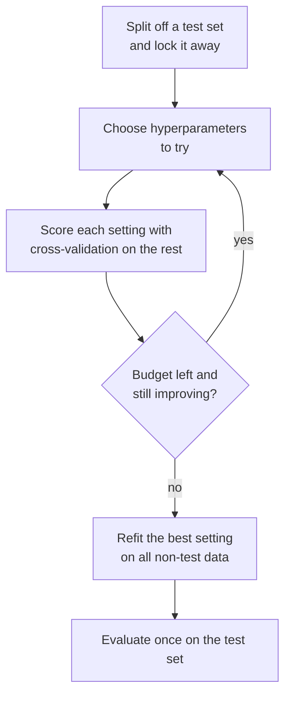
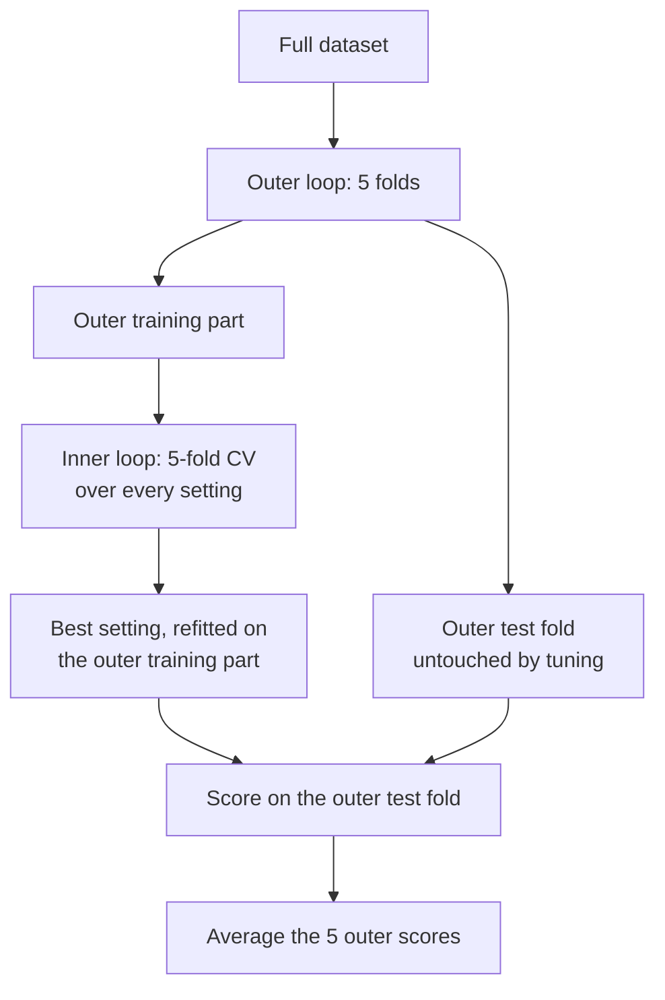

Every model in [Module 13](/learn/supervised-learning-algorithms) has settings you choose before training: the regularisation strength `C` of logistic regression, the depth of a decision tree, the number of neighbours in k-NN, the learning rate of gradient boosting. These **hyperparameters** often matter as much as the choice of algorithm, and their best values depend on your data, so they have to be found by experiment. **Hyperparameter tuning** is that experiment, done systematically. Done carelessly, it is also the most common way practitioners fool themselves: the more settings you try, the more the best-looking score reflects luck rather than skill. This lesson sets up the tuning loop, the strategies for exploring settings, and the evaluation discipline (including nested cross-validation) that keeps the final number honest.

## Parameters and hyperparameters

| | Parameters | Hyperparameters |
| --- | --- | --- |
| Set by | The training algorithm, from data | You, before training |
| Examples | Regression weights, tree split points, neural network weights | `C`, `max_depth`, `n_neighbors`, `learning_rate`, number of trees |
| In scikit-learn | Attributes ending in `_` after `fit`, such as `coef_` | Constructor arguments, listed by `get_params()` |
| Chosen by | Minimising the training loss | Maximising a validation score |

The last row is the key. Parameters are fitted to the **training** data. Hyperparameters cannot be: a tree's training error always falls as `max_depth` grows, so choosing depth by training score would always pick the deepest, most overfitted tree. They must be chosen by performance on data the model was not trained on.

```python
from sklearn.tree import DecisionTreeClassifier

print(DecisionTreeClassifier().get_params())
```

```output
{'ccp_alpha': 0.0, 'class_weight': None, 'criterion': 'gini', 'max_depth': None, 'max_features': None, 'max_leaf_nodes': None, 'min_impurity_decrease': 0.0, 'min_samples_leaf': 1, 'min_samples_split': 2, 'min_weight_fraction_leaf': 0.0, 'monotonic_cst': None, 'random_state': None, 'splitter': 'best'}
```

## The tuning loop



Three decisions shape every tuning job:

1. **The search space**: which hyperparameters, and what range for each. Scale-type values such as `C`, `alpha` and `learning_rate` should be searched on a **log scale** (0.001, 0.01, 0.1, 1, ...), because a change from 0.001 to 0.01 matters as much as one from 1 to 10.
2. **The strategy**: how to pick the next setting to try.
3. **The evaluation**: which metric, and which data. The metric should be the one that matters for the application, such as average precision for the fraud model, not accuracy by default.

| Algorithm (Module 13) | Hyperparameters most worth tuning |
| --- | --- |
| [Logistic regression](/learn/supervised-learning-algorithms/logistic-regression) | `C`, `class_weight` |
| [Decision trees](/learn/supervised-learning-algorithms/decision-trees) | `max_depth`, `min_samples_leaf` |
| [Random forests](/learn/supervised-learning-algorithms/random-forests) | `max_features`, `min_samples_leaf`, `n_estimators` (more is rarely worse, only slower) |
| [Support vector machines](/learn/supervised-learning-algorithms/support-vector-machines) | `C`, `gamma` |
| [K-nearest neighbours](/learn/supervised-learning-algorithms/k-nearest-neighbors) | `n_neighbors`, `weights` |
| [Gradient boosting](/learn/supervised-learning-algorithms/gradient-boosting) | `learning_rate`, number of trees, tree size, subsampling |

## Search strategies

| Strategy | How it picks settings | Good for |
| --- | --- | --- |
| Manual | You, from experience and plots | First exploration, one or two hyperparameters |
| [Grid search](/learn/model-evaluation/grid-search) | Every combination of listed values | Few hyperparameters with few sensible values |
| [Random search](/learn/model-evaluation/random-search) | Random samples from distributions | Many hyperparameters, fixed budget |
| Bayesian optimisation | A model of past results proposes promising settings | Expensive models, where each fit costs minutes or hours |

Grid and random search get a lesson each. Bayesian optimisation, available through libraries such as Optuna, is sketched at the end of the random search lesson.

## The winner's curse: tuning leaks into the score

Every validation score contains some noise. When you try many settings and keep the best, you select partly for good luck, so the best score is biased upwards. An extreme case makes this obvious: 200 "models" that guess at random, each scored on the same 100 validation examples.

```python
import numpy as np

rng = np.random.default_rng(0)
y_val = rng.integers(0, 2, 100)
y_test = rng.integers(0, 2, 100)

val_scores, test_scores = [], []
for _ in range(200):                       # 200 "hyperparameter settings"
    guess_val = rng.integers(0, 2, 100)    # every one is a coin flip
    guess_test = rng.integers(0, 2, 100)
    val_scores.append((guess_val == y_val).mean())
    test_scores.append((guess_test == y_test).mean())

best = int(np.argmax(val_scores))
print("best validation accuracy:", val_scores[best])
print("same model on test data: ", test_scores[best])
```

```output
best validation accuracy: 0.62
same model on test data:  0.44
```

None of these models has any skill, yet the "winner" looks clearly better than chance on validation. The test score exposes it. Real tuning is less extreme, but the effect is the same in kind, and it grows with the number of settings tried and shrinks with the size of the validation data.

> [!WARNING]
> The best cross-validation score from a search is **not** an unbiased estimate of performance. Do not report it as your model's expected accuracy. Use a held-out test set that no tuning decision has seen, or nested cross-validation.

## Nested cross-validation

When data is too scarce to set aside a large test set, **nested cross-validation** gives an honest estimate of the whole procedure "tune, then train". An **inner** CV loop chooses hyperparameters; an **outer** CV loop scores the result on folds the inner loop never saw.



In scikit-learn this is just a search object passed to `cross_val_score`. The search runs the inner loop each time it is fitted:

```python
from sklearn.datasets import make_classification
from sklearn.model_selection import GridSearchCV, StratifiedKFold, cross_val_score
from sklearn.pipeline import make_pipeline
from sklearn.preprocessing import StandardScaler
from sklearn.svm import SVC

# a small, noisy problem: 300 rows, 20% of labels flipped
X, y = make_classification(n_samples=300, n_features=20, n_informative=3,
                           flip_y=0.2, random_state=0)
pipe = make_pipeline(StandardScaler(), SVC())
grid = {"svc__C": np.logspace(-2, 3, 6), "svc__gamma": np.logspace(-4, 1, 6)}
inner = StratifiedKFold(5, shuffle=True, random_state=0)
outer = StratifiedKFold(5, shuffle=True, random_state=1)

search = GridSearchCV(pipe, grid, cv=inner).fit(X, y)
print("non-nested best CV score:", round(search.best_score_, 3))

nested = cross_val_score(GridSearchCV(pipe, grid, cv=inner), X, y, cv=outer)
print("nested CV estimate:      ", round(nested.mean(), 3))
```

```output
non-nested best CV score: 0.777
nested CV estimate:       0.747
```

The non-nested score, chosen as the best of 36 settings, is optimistic by about three points. The nested estimate is the honest one. Note what nested CV evaluates: not one specific model, but the procedure of tuning on this kind of data. For the model you deploy, you run the inner search once on all the data (`search.best_estimator_`) and quote the nested estimate as its expected performance.

The cost is real: here 5 outer folds × 36 settings × 5 inner folds = 900 fits, plus refits. With a large dataset, a single locked test set is cheaper and just as sound.

## Practical advice

- **Start with defaults and a baseline.** scikit-learn's defaults are sensible. Tuning should beat them by more than the CV spread to be worth keeping.
- **Tune what matters.** A few hyperparameters usually dominate (see the table above). Fix the rest.
- **Use log scales** for scale parameters, and widen a range if the best value lands on its edge.
- **Keep preprocessing in the pipeline** so it is tuned and cross-validated together with the model.
- **Use a fixed CV splitter** (with a `random_state`) so every setting is scored on identical folds and comparisons are fair.
- **Look at the spread.** If two settings differ by less than the standard deviation across folds, prefer the simpler or faster one.

> [!KEY]
> Hyperparameters are chosen by validation performance, never training performance, and never test performance. Every choice made by looking at a score, including thresholds, features and model type, counts as tuning and leaks optimism into that score. Lock the test set away, or use nested CV.

## Exercises

**1.** Classify each as a parameter or hyperparameter: a linear regression intercept, the `k` in k-NN, a random forest's number of trees, the split threshold at a tree's root node, the classification threshold of a fraud model.

<details>
<summary>Show solution</summary>

Intercept: parameter. `k`: hyperparameter. Number of trees: hyperparameter. Root split threshold: parameter (learned from data). Classification threshold: a hyperparameter of the decision rule. It is not learned by `fit`, and choosing it by looking at scores is tuning, so it must use validation data, as the [recall](/learn/model-evaluation/recall) lesson did.

</details>

**2.** In the winner's curse simulation, change the validation set size from 100 to 10,000 (for both `y_val` and the guesses). What happens to the best validation score, and why?

<details>
<summary>Show solution</summary>

The best validation score drops to only slightly above 0.5 (about 0.51). With more validation data each score has much less noise, so the luckiest of 200 coin-flip models cannot stray far from 0.5. Larger validation sets make tuning more trustworthy.

</details>

**3.** A team tunes 500 configurations by 5-fold CV, reports the best CV score as the model's accuracy in a slide deck, and is surprised when production accuracy is lower. Give two fixes.

<details>
<summary>Show solution</summary>

Hold out a test set before any tuning and report performance on it, evaluated once at the end; or report a nested cross-validation estimate. Also check that the CV splitter matches production (groups, time order), since a leaky splitter inflates every score regardless of tuning.

</details>

```quiz
[
  {
    "q": "Why can't hyperparameters such as `max_depth` be chosen by training score?",
    "options": [
      "Training score cannot be computed for trees",
      "Training score always improves with more complexity, so it would select the most overfitted model",
      "Hyperparameters do not affect training score",
      "scikit-learn forbids it"
    ],
    "answer": 1,
    "why": "Deeper trees fit the training data ever more closely, so training score is maximised by maximum complexity, not best generalisation."
  },
  {
    "q": "You try 300 settings and pick the best mean CV score. That score is most likely:",
    "options": [
      "An unbiased estimate of future performance",
      "Pessimistic",
      "Optimistically biased",
      "Equal to the test score"
    ],
    "answer": 2,
    "why": "Selecting the maximum of many noisy estimates favours lucky ones, so the winner's score tends to overstate true performance."
  },
  {
    "q": "In nested cross-validation, what is the inner loop for?",
    "options": [
      "Choosing hyperparameters",
      "Estimating final performance",
      "Preprocessing the data",
      "Selecting the test set"
    ],
    "answer": 0,
    "why": "The inner loop tunes; the outer loop scores the tuned procedure on folds the tuning never saw."
  },
  {
    "q": "Which search space is best for logistic regression's `C`?",
    "options": [
      "1, 2, 3, 4, 5",
      "0.1, 0.2, 0.3, 0.4",
      "Only the default value",
      "0.001, 0.01, 0.1, 1, 10, 100"
    ],
    "answer": 3,
    "why": "`C` is a scale parameter whose effect is multiplicative, so values should be spread on a log scale."
  }
]
```
