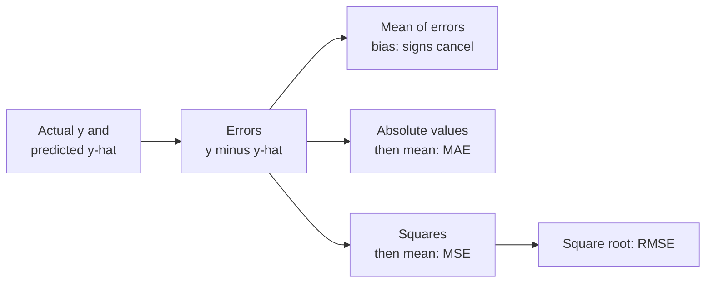

The classification metrics so far count right and wrong answers. A regression model, such as one that predicts house prices, is never exactly right: a prediction of 301,000 for a house that sells for 300,000 is not "wrong" in the way a missed fraud is, it is just off by 1,000. Regression metrics therefore measure **how far** predictions are from the truth. The **mean absolute error (MAE)** is the most direct answer: on average, how far off is the model, in the same units as the target? It is easy to explain to anyone, robust to a few wild errors, and the right first metric to report for most regression problems. The next two lessons, [MSE](/learn/model-evaluation/mse) and [RMSE](/learn/model-evaluation/rmse), use the same running example so you can compare all three.

## The running example: house prices

Five houses, with prices in thousands (the currency does not matter), and a model's predictions for them:

| House | Actual $y$ | Predicted $\hat{y}$ | Error $y - \hat{y}$ | Absolute error |
| --- | --- | --- | --- | --- |
| A | 250 | 265 | -15 | 15 |
| B | 310 | 300 | 10 | 10 |
| C | 180 | 200 | -20 | 20 |
| D | 420 | 390 | 30 | 30 |
| E | 275 | 280 | -5 | 5 |

The **error** (or **residual**) for each house is the actual value minus the prediction. Some are positive (the model under-predicted) and some negative (it over-predicted).

## Why not just average the errors?

The plain average of the errors is $(-15 + 10 - 20 + 30 - 5)/5 = 0$. A model whose errors average to zero is **unbiased** (it does not systematically guess too high or too low), but it is clearly not perfect: positive and negative errors cancelled. To measure the *size* of errors you must remove the sign. Taking absolute values gives MAE; squaring gives MSE.



## The definition

$$
\text{MAE} = \frac{1}{n}\sum_{i=1}^{n} \lvert y_i - \hat{y}_i \rvert
$$

where $n$ is the number of examples, $y_i$ the true value and $\hat{y}_i$ the prediction for example $i$. For the five houses:

$$
\text{MAE} = \frac{15 + 10 + 20 + 30 + 5}{5} = \frac{80}{5} = 16
$$

The model is off by 16 thousand on average. That sentence is the main strength of MAE: it is in the target's own units and needs no further explanation.

```python
import numpy as np
from sklearn.metrics import mean_absolute_error

y_true = np.array([250, 310, 180, 420, 275])
y_pred = np.array([265, 300, 200, 390, 280])

print("by hand:", np.mean(np.abs(y_true - y_pred)))
print("sklearn:", mean_absolute_error(y_true, y_pred))
```

```output
by hand: 16.0
sklearn: 16.0
```

## Robustness: every error counts in proportion

MAE grows **linearly** with the size of each error. An error twice as large contributes exactly twice as much. This makes MAE robust to outliers compared with squared-error metrics. Add a sixth house, a mansion that sold for 1,200 but was predicted at 600, an error of 600:

```python
y_true6 = np.append(y_true, 1200)
y_pred6 = np.append(y_pred, 600)
print("MAE, five houses:", mean_absolute_error(y_true, y_pred))
print("MAE, with mansion:", round(mean_absolute_error(y_true6, y_pred6), 1))
```

```output
MAE, five houses: 16.0
MAE, with mansion: 113.3
```

The mansion moves MAE from 16 to about 113, which is large but proportionate: one sixth of 600 is 100. In the MSE lesson you will see the same mansion inflate MSE by a factor of nearly 200. Which behaviour you want depends on whether big misses are disproportionately bad for your application.

## What MAE rewards: the median

A useful way to understand any loss or metric is to ask: if the model could only predict a single constant for every house, which constant would score best? For MAE the answer is the **median** of the targets; for MSE it is the **mean**. This follows from the fact that the median minimises the total absolute distance to a set of points.

```python
prices = np.array([180, 250, 275, 310, 420, 1200])
for c in (np.median(prices), np.mean(prices)):
    print(f"constant {c:7.1f}: MAE = {np.mean(np.abs(prices - c)):6.1f}")
```

```output
constant   292.5: MAE =  204.2
constant   439.2: MAE =  253.6
```

The median, 292.5, beats the mean, which is dragged up to 439 by the mansion. Practically, this means a model trained to minimise absolute error predicts something like the conditional *median* price: the typical value, unmoved by the occasional mansion. A model trained on squared error predicts the conditional *mean*. If your prices are skewed, those differ, and you should pick the training loss to match the metric you will be judged on (see [loss functions](/learn/essential-mathematics-for-machine-learning/loss-functions)).

## MAE on a real model and the baseline

As with accuracy, MAE means little without a baseline. Here is a larger synthetic dataset, 600 houses whose price depends on floor area and age plus noise, fitted with [linear regression](/learn/supervised-learning-algorithms/linear-regression) and compared with a `DummyRegressor` that always predicts the median training price:

```python
from sklearn.dummy import DummyRegressor
from sklearn.linear_model import LinearRegression
from sklearn.model_selection import train_test_split

rng = np.random.default_rng(0)
n = 600
size = rng.uniform(50, 250, n)          # floor area, square metres
age = rng.uniform(0, 60, n)             # years
price = 40 + 2.2 * size - 0.8 * age + rng.normal(0, 25, n)   # thousands
X = np.column_stack([size, age])
X_train, X_test, y_train, y_test = train_test_split(X, price, test_size=0.25, random_state=0)

reg = LinearRegression().fit(X_train, y_train)
base = DummyRegressor(strategy="median").fit(X_train, y_train)
print("model MAE:   ", round(mean_absolute_error(y_test, reg.predict(X_test)), 1))
print("baseline MAE:", round(mean_absolute_error(y_test, base.predict(X_test)), 1))
```

```output
model MAE:    20.5
baseline MAE: 108.3
```

The model cuts the typical error by a factor of about five relative to guessing the median. The noise term has a standard deviation of 25, so no model could get MAE close to zero on this data: some error is irreducible.

## Relative versions: MAPE and median absolute error

An error of 20 thousand is small on a 900-thousand house and large on a 150-thousand flat. When relative error matters more than absolute error, use the **mean absolute percentage error**:

$$
\text{MAPE} = \frac{1}{n}\sum_{i=1}^{n} \frac{\lvert y_i - \hat{y}_i \rvert}{\lvert y_i \rvert}
$$

```python
from sklearn.metrics import mean_absolute_percentage_error, median_absolute_error

print("MAPE:", round(mean_absolute_percentage_error(y_true, y_pred), 4))
print("median absolute error:", median_absolute_error(y_true, y_pred))
```

```output
MAPE: 0.0586
median absolute error: 15.0
```

scikit-learn returns MAPE as a fraction, so 0.0586 means about 6%, not 0.06%. The **median absolute error** goes one step further than MAE in robustness: it ignores the size of the largest errors entirely.

| Metric | Units | Outlier sensitivity | Watch out for |
| --- | --- | --- | --- |
| MAE | Target units | Moderate (linear) | Hides whether errors are a few big ones or many small ones |
| MAPE | Fraction or percentage | Moderate | Explodes when true values are near zero; penalises over-prediction more |
| Median absolute error | Target units | Very low | Ignores the tail completely, even when tail errors matter |
| MSE / RMSE | Squared / target units | High (quadratic) | Can be dominated by a handful of examples |

> [!WARNING]
> Never use MAPE when the target can be zero or close to it, such as daily sales of a slow-moving product. Division by a tiny $y_i$ produces huge percentages that swamp everything else.

> [!KEY]
> MAE is the average size of the error in the target's units. It treats all errors proportionally, is minimised by the median, and is the easiest regression metric to explain. Always report it next to a baseline.

## Exercises

**1.** Actual values 10, 20, 30 and predictions 12, 18, 35. Compute MAE and the mean error (bias) by hand.

<details>
<summary>Show solution</summary>

Errors (actual minus predicted): -2, 2, -5. MAE = (2 + 2 + 5) / 3 = 3. Mean error = -5 / 3 ≈ -1.67: on average the model over-predicts slightly.

</details>

**2.** Using the 600-house data, fit a `DummyRegressor(strategy="mean")` and compare its test MAE with the median baseline. Which should be lower, and is it?

<details>
<summary>Show solution</summary>

```python
mean_base = DummyRegressor(strategy="mean").fit(X_train, y_train)
print(round(mean_absolute_error(y_test, mean_base.predict(X_test)), 1))
```

It prints 107.4, slightly *lower* than the median baseline's 108.3. The median minimises MAE on the data it was computed from, the training set, but the test set is a different sample. Here prices are roughly symmetric, so the training mean and median are close and either can win on unseen data. With strongly skewed targets the median baseline would win clearly. The general lesson: a statistic that is optimal in-sample is not guaranteed to be optimal on new data.

</details>

**3.** A model predicting delivery times has MAE of 4 minutes. Write one sentence explaining this to a non-technical manager, and one question you would ask before calling it good.

<details>
<summary>Show solution</summary>

"On average, our predicted delivery time is 4 minutes away from the actual time." Question: what does a simple baseline achieve (for example always predicting the median time for that route), and are there occasional very large misses that the average hides?

</details>

```quiz
[
  {
    "q": "Errors of -10, +10, -10, +10. What are the mean error and the MAE?",
    "options": ["0 and 0", "10 and 0", "0 and 10", "10 and 10"],
    "answer": 2,
    "why": "The signed errors cancel to a mean of 0 (no bias), but their absolute values average to 10."
  },
  {
    "q": "If a model must predict one constant for every example, which constant minimises MAE?",
    "options": ["The median of the targets", "The mean of the targets", "Zero", "The mode of the targets"],
    "answer": 0,
    "why": "The median minimises the sum of absolute deviations; the mean minimises the sum of squared deviations."
  },
  {
    "q": "Why is MAE considered more robust to outliers than MSE?",
    "options": [
      "It ignores the largest error",
      "Each error contributes in proportion to its size, not its square",
      "It divides by the median",
      "It is always smaller than MSE"
    ],
    "answer": 1,
    "why": "MAE grows linearly with each error, so one huge error has a proportionate effect rather than a squared one."
  },
  {
    "q": "When is MAPE a poor choice?",
    "options": [
      "When targets are large positive numbers",
      "When you want a percentage",
      "When errors are symmetric",
      "When true values can be zero or near zero"
    ],
    "answer": 3,
    "why": "MAPE divides by the true value, so near-zero targets create enormous percentage errors."
  }
]
```
