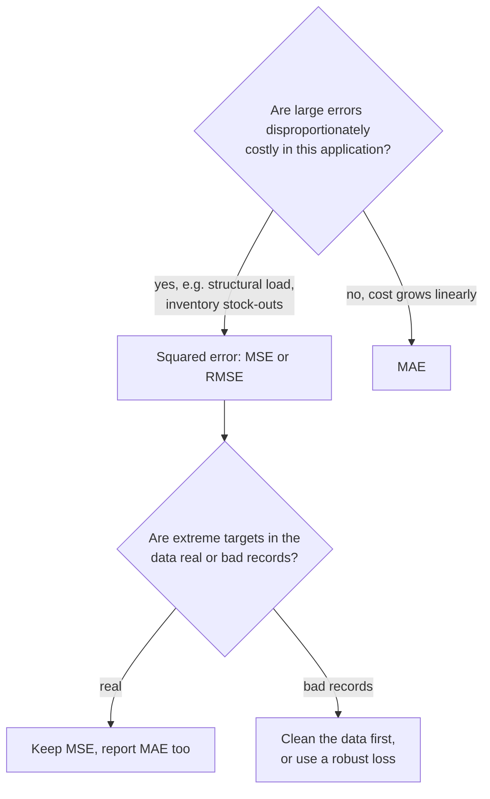

The **mean squared error (MSE)** is the average of the squared differences between predictions and true values. If [MAE](/learn/model-evaluation/mae) is the metric you explain to people, MSE is the one you train models with: it is the loss behind [linear regression](/learn/supervised-learning-algorithms/linear-regression), the default loss for most regression neural networks, and the basis of the R² score. Squaring has two big consequences that this lesson explores: it makes the metric smooth and mathematically convenient, and it makes large errors count far more than small ones, for better or worse.

## The definition

$$
\text{MSE} = \frac{1}{n}\sum_{i=1}^{n} (y_i - \hat{y}_i)^2
$$

where $n$ is the number of examples, $y_i$ the true value and $\hat{y}_i$ the prediction. Squaring removes the sign, like the absolute value in MAE, but it also changes the scale of each error.

Using the five houses from the MAE lesson (prices in thousands), with errors $-15, 10, -20, 30, -5$:

$$
\text{MSE} = \frac{225 + 100 + 400 + 900 + 25}{5} = \frac{1650}{5} = 330
$$

The unit is "thousands squared", which has no intuitive meaning. That is the main practical drawback of MSE, and the reason [RMSE](/learn/model-evaluation/rmse) exists.

```python
import numpy as np
from sklearn.metrics import mean_squared_error

y_true = np.array([250, 310, 180, 420, 275])
y_pred = np.array([265, 300, 200, 390, 280])

print("by hand:", np.mean((y_true - y_pred) ** 2))
print("sklearn:", mean_squared_error(y_true, y_pred))
```

```output
by hand: 330.0
sklearn: 330.0
```

## Squaring punishes big errors

Look at how much each house contributes. House D, with an error of 30, is 6 times as wrong as house E (error 5) but contributes 36 times as much to MSE: 900 against 25. In MAE it contributes only 6 times as much. Squared error weights each error by its own size.

| House | Absolute error | Share of MAE total | Squared error | Share of MSE total |
| --- | --- | --- | --- | --- |
| A | 15 | 19% | 225 | 14% |
| B | 10 | 13% | 100 | 6% |
| C | 20 | 25% | 400 | 24% |
| D | 30 | 38% | 900 | 55% |
| E | 5 | 6% | 25 | 2% |

Now add the mansion again: true price 1,200, predicted 600.

```python
y_true6 = np.append(y_true, 1200)
y_pred6 = np.append(y_pred, 600)
from sklearn.metrics import mean_absolute_error

for name, f in (("MAE", mean_absolute_error), ("MSE", mean_squared_error)):
    before, after = f(y_true, y_pred), f(y_true6, y_pred6)
    print(f"{name}: {before:8.1f} -> {after:8.1f}  (x{after / before:.0f})")
```

```output
MAE:     16.0 ->    113.3  (x7)
MSE:    330.0 ->  60275.0  (x183)
```

One house out of six makes MSE about 183 times larger, and that single squared error of 360,000 is over 99% of the total. With MSE, the evaluation of the whole model is effectively the evaluation of its worst prediction.



Whether this sensitivity is good depends on your problem. If a large error is genuinely catastrophic, such as underestimating the load on a bridge component, you *want* the metric to scream about it. If the outlier is a data entry mistake (a price typed with an extra zero), MSE lets one bad record dominate both training and evaluation.

## What MSE rewards: the mean

The constant that minimises MSE is the **mean** of the targets. Setting the derivative to zero shows why:

$$
\frac{d}{dc}\,\frac{1}{n}\sum_{i=1}^{n}(y_i - c)^2 = -\frac{2}{n}\sum_{i=1}^{n}(y_i - c) = 0 \;\Rightarrow\; c = \frac{1}{n}\sum_{i=1}^{n} y_i = \bar{y}
$$

where $c$ is the constant prediction and $\bar{y}$ the mean of the targets. So a model trained on squared error estimates the **conditional mean** of the target, which is pulled towards outliers, whereas MAE estimates the conditional median. This also explains why MSE is the standard training loss: it is differentiable everywhere with a gradient proportional to the error, so [gradient descent](/learn/calculus/gradient-descent) takes big steps when errors are big and small steps near the optimum. Absolute error has a kink at zero and a gradient of constant size.

## MSE splits into bias and variance of the errors

Write $e_i = y_i - \hat{y}_i$ for the errors. A short piece of algebra gives a useful decomposition:

$$
\text{MSE} = \bar{e}^{\,2} + \frac{1}{n}\sum_{i=1}^{n}(e_i - \bar{e})^2
$$

where $\bar{e}$ is the mean error. The first term is the squared **bias** (systematic over- or under-prediction); the second is the **variance** of the errors (scatter around that bias). A model can have a high MSE because it is consistently off in one direction, which a simple shift would fix, or because it is noisy, which needs a better model.

```python
e = y_true - y_pred
bias_sq = e.mean() ** 2
var = e.var()            # NumPy's var divides by n
print(f"bias^2 = {bias_sq}, variance = {var}, sum = {bias_sq + var}")
```

```output
bias^2 = 0.0, variance = 330.0, sum = 330.0
```

These five houses have zero bias, so all of the MSE is scatter.

## MSE and R²

The **coefficient of determination**, R², which `model.score` returns for every scikit-learn regressor, is MSE rescaled against the simplest possible baseline, predicting the mean:

$$
R^2 = 1 - \frac{\sum_i (y_i - \hat{y}_i)^2}{\sum_i (y_i - \bar{y})^2} = 1 - \frac{\text{MSE}_{\text{model}}}{\text{MSE}_{\text{predict the mean}}}
$$

R² = 1 is perfect, 0 means no better than predicting the mean, and it can be negative on test data when a model is worse than that. Because it is built from squared errors, R² inherits MSE's outlier sensitivity.

```python
from sklearn.metrics import r2_score

baseline_mse = mean_squared_error(y_true, np.full_like(y_true, y_true.mean(), dtype=float))
print("R2 by hand:", round(1 - mean_squared_error(y_true, y_pred) / baseline_mse, 4))
print("R2 sklearn:", round(r2_score(y_true, y_pred), 4))
```

```output
R2 by hand: 0.9471
R2 sklearn: 0.9471
```

## When outliers are in the training data

Outlier sensitivity matters for training as well as evaluation. Below, the 600-house dataset from the MAE lesson gets 15 corrupted training labels (prices recorded ten times too high, a realistic data-entry error). An ordinary least-squares model is compared with scikit-learn's `HuberRegressor`, which uses squared error for small residuals and absolute error for large ones:

```python
from sklearn.linear_model import HuberRegressor, LinearRegression
from sklearn.model_selection import train_test_split
from sklearn.pipeline import make_pipeline
from sklearn.preprocessing import StandardScaler

rng = np.random.default_rng(0)
n = 600
size = rng.uniform(50, 250, n)
age = rng.uniform(0, 60, n)
price = 40 + 2.2 * size - 0.8 * age + rng.normal(0, 25, n)
X = np.column_stack([size, age])
X_train, X_test, y_train, y_test = train_test_split(X, price, test_size=0.25, random_state=0)

y_dirty = y_train.copy()
bad = rng.choice(len(y_dirty), size=15, replace=False)
y_dirty[bad] *= 10                       # 15 records with an extra zero

for name, est in (("least squares", LinearRegression()),
                  ("Huber", make_pipeline(StandardScaler(), HuberRegressor(max_iter=1000)))):
    pred = est.fit(X_train, y_dirty).predict(X_test)
    print(f"{name:13s} test MAE {mean_absolute_error(y_test, pred):6.1f}   "
          f"test MSE {mean_squared_error(y_test, pred):8.1f}")
```

```output
least squares test MAE  128.5   test MSE  23234.4
Huber         test MAE   20.9   test MSE    690.7
```

Fifteen bad rows out of 450, about 3%, wreck the least-squares fit, because the squared loss bends the whole line towards them. The robust loss largely ignores them. The test set here is clean, so both metrics agree on which model is better.

> [!TIP]
> Before reaching for a robust loss, look at the largest residuals of your model. Large errors are often data problems you can fix at the source, which is better than training around them. See [data validation](/learn/data-engineering-fundamentals/data-validation).

> [!KEY]
> MSE squares each error, so it is smooth, ideal for training, minimised by the mean, and dominated by the biggest misses. Report it when large errors are disproportionately costly, and compare it with MAE: a large gap between them tells you a few big errors are driving the score.

## Exercises

**1.** Two models predict three values with these errors: model A has 2, 2, 2; model B has 0, 0, 6. Compute MAE and MSE for both. Which does each metric prefer?

<details>
<summary>Show solution</summary>

Model A: MAE = 2, MSE = 4. Model B: MAE = 2, MSE = 12. MAE calls them equal; MSE strongly prefers A, because B concentrates all its error in one large miss.

</details>

**2.** A model's test errors have mean 8 and variance 36 (dividing by n). What is its MSE, and what simple change would reduce it?

<details>
<summary>Show solution</summary>

MSE = 8² + 36 = 100. The model under-predicts by 8 on average (errors are actual minus predicted), so adding 8 to every prediction removes the bias term and drops MSE to 36, assuming the bias holds on new data. Estimate such a correction on validation data, not the test set.

</details>

**3.** Change the corruption in the Huber example from `*= 10` to `*= 1.2`. Does the gap between the two models shrink? Why?

<details>
<summary>Show solution</summary>

```python
y_dirty = y_train.copy()
y_dirty[bad] *= 1.2
```

Yes, the gap almost disappears. A 20% error on a few rows produces residuals that are not far outside the normal noise, so the squared loss is not dominated by them, and Huber treats most of them as ordinary points anyway.

</details>

```quiz
[
  {
    "q": "Errors of 1, 1, 1, 1 and 10 are made. Roughly what share of the MSE total comes from the error of 10?",
    "options": ["About 29%", "About 50%", "About 96%", "About 10%"],
    "answer": 2,
    "why": "Squared errors are 1, 1, 1, 1 and 100. 100 out of 104 is about 96%."
  },
  {
    "q": "Which constant prediction minimises MSE?",
    "options": ["The median", "The mean", "Zero", "The largest value"],
    "answer": 1,
    "why": "Differentiating the sum of squared deviations and setting it to zero gives the mean."
  },
  {
    "q": "A regression model has an R² of -0.2 on the test set. What does this mean?",
    "options": [
      "The model is worse than always predicting the mean of the targets",
      "The calculation is wrong, R² cannot be negative",
      "The model explains 20% of the variance",
      "The model is biased downwards by 20%"
    ],
    "answer": 0,
    "why": "R² = 1 - MSE_model / MSE_mean, which is negative when the model's MSE exceeds that of predicting the mean."
  },
  {
    "q": "Why is MSE preferred over MAE as a training loss for gradient-based methods?",
    "options": [
      "It is always smaller",
      "It ignores outliers",
      "It has the same units as the target",
      "It is smooth everywhere, with a gradient that shrinks as errors shrink"
    ],
    "answer": 3,
    "why": "Squared error is differentiable with gradient proportional to the error. Absolute error has a kink at zero and a constant-size gradient."
  }
]
```
