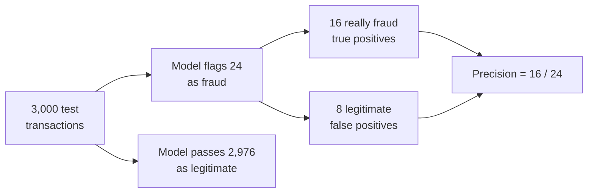

The [accuracy](/learn/model-evaluation/accuracy) lesson showed that a fraud detector can score 98% accuracy while being nearly useless. To see what a classifier is really doing you have to look at the positive class directly, and there are two natural questions to ask about it. This lesson covers the first: **when the model raises an alarm, how often is it right?** That is **precision**. It is the metric to watch whenever acting on a positive prediction costs something: a fraud analyst's time, a blocked customer card, a legitimate email lost to the spam folder.

## The intuition: trust in an alarm

Imagine you run the fraud team. Every transaction the model flags lands in an analyst's review queue. If most flagged transactions turn out to be legitimate, your analysts waste their days and start ignoring the alerts. Precision measures exactly this: of everything the model called positive, what fraction really was positive?



Notice what precision ignores: everything in the "passed" branch. A model that flags only one transaction, and gets it right, has perfect precision while missing almost every fraud. Precision alone is never the full story; its partner metric, [recall](/learn/model-evaluation/recall), covers the other branch.

## The definition

$$
\text{precision} = \frac{TP}{TP + FP}
$$

where $TP$ is the number of true positives (flagged and really fraud) and $FP$ the number of false positives (flagged but legitimate). The denominator $TP + FP$ is the total number of positive *predictions*. Precision is also called **positive predictive value** (PPV) in medicine.

For the fraud model from the accuracy lesson, which flagged 24 transactions of which 16 were fraud:

$$
\text{precision} = \frac{16}{16 + 8} = \frac{16}{24} \approx 0.667
$$

Two out of three alerts are real fraud. Whether that is good depends on the business: if a manual review costs a few minutes and a missed fraud costs hundreds, 0.667 is excellent. If every flag blocks a customer's card at the checkout, it may be unacceptable.

## Precision in scikit-learn

Here is the same model as in the previous lesson, rebuilt so this page runs on its own:

```python
from sklearn.datasets import make_classification
from sklearn.linear_model import LogisticRegression
from sklearn.model_selection import train_test_split
from sklearn.metrics import precision_score

X, y = make_classification(n_samples=10_000, n_features=8, n_informative=4,
                           weights=[0.98], class_sep=1.5, flip_y=0, random_state=2)
X_train, X_test, y_train, y_test = train_test_split(
    X, y, test_size=0.3, stratify=y, random_state=0)
model = LogisticRegression(max_iter=1000).fit(X_train, y_train)
y_pred = model.predict(X_test)

print(round(precision_score(y_test, y_pred), 4))
```

```output
0.6667
```

`precision_score` treats label `1` as positive by default. If your labels are strings, say which is positive with `pos_label`, for example `pos_label="fraud"`.

### The zero-division case

If a model predicts no positives at all, $TP + FP = 0$ and precision is undefined. scikit-learn then returns 0 and emits a warning, unless you choose the value explicitly with `zero_division`:

```python
import numpy as np

never_flags = np.zeros_like(y_test)
print(precision_score(y_test, never_flags, zero_division=0))
```

```output
0.0
```

> [!WARNING]
> An undefined precision is a red flag, not a detail. It usually means the model has collapsed to always predicting the majority class, often because the classes are very imbalanced and nothing was done about it. Set `zero_division` deliberately so the case is handled consistently, and investigate why it happens.

## Precision depends on the threshold

`model.predict` labels a transaction as fraud when the predicted probability is at least 0.5. That cut-off is a choice, not a law. Raising it means the model only flags cases it is very sure about, which usually raises precision and flags fewer transactions.

```python
proba = model.predict_proba(X_test)[:, 1]   # probability of fraud

for t in (0.1, 0.3, 0.5, 0.7, 0.9):
    flagged = proba >= t
    tp = int((flagged & (y_test == 1)).sum())
    print(f"threshold {t:.1f}: flagged {flagged.sum():4d}, true frauds {tp:2d}, "
          f"precision {precision_score(y_test, flagged, zero_division=0):.3f}")
```

```output
threshold 0.1: flagged  113, true frauds 32, precision 0.283
threshold 0.3: flagged   38, true frauds 19, precision 0.500
threshold 0.5: flagged   24, true frauds 16, precision 0.667
threshold 0.7: flagged   13, true frauds  9, precision 0.692
threshold 0.9: flagged    3, true frauds  3, precision 1.000
```

Read the "true frauds" column too. At a threshold of 0.9 every alert is correct, but only 3 of 60 frauds are caught. Precision went up because the model said less. This is the precision and recall trade-off, which the [recall](/learn/model-evaluation/recall) lesson explores and uses to choose a threshold.

> [!NOTE]
> Precision usually rises with the threshold, but not always strictly. Removing one correct flag from a small set can lower it. The trend is reliable; the individual steps are noisy, especially with few positives.

## Precision at k: when the queue has a fixed size

Often the real constraint is capacity: the fraud team can review 20 transactions a day, or a search page shows 10 results. Then the useful question is "how many of the top $k$ ranked items are positive?", which is **precision at k**:

$$
\text{precision@}k = \frac{\text{number of positives among the } k \text{ highest-scoring items}}{k}
$$

```python
order = np.argsort(-proba)           # most suspicious first
for k in (10, 20, 50):
    top_k = order[:k]
    print(f"precision@{k}: {y_test[top_k].mean():.2f}")
```

```output
precision@10: 0.80
precision@20: 0.65
precision@50: 0.42
```

If the team reviews the 20 highest-scoring transactions, 13 will be fraud. Precision@k does not need a threshold at all, only a ranking, so it is a natural metric for recommendation and retrieval systems you will build later in the curriculum.

## Precision for more than two classes

For multi-class problems, precision is computed per class by treating that class as positive and every other class as negative ("one-vs-rest"). Pass `average=None` to get one value per class:

```python
y_true = ["cat", "cat", "dog", "dog", "dog", "bird"]
y_hat  = ["cat", "dog", "dog", "dog", "cat", "bird"]
print(precision_score(y_true, y_hat, average=None, labels=["bird", "cat", "dog"]))
```

```output
[1.         0.5        0.66666667]
```

The model said "cat" twice and was right once, so cat precision is 0.5. How to combine per-class values into one number (macro, micro or weighted averaging) is covered in the [F1-score](/learn/model-evaluation/f1-score) lesson, because the same choice applies to every per-class metric.

## Exercises

**1.** A spam filter moves 400 emails to the spam folder. 380 are spam. There were 500 spam emails in total. What is the precision? Which number in the question did you not need?

<details>
<summary>Show solution</summary>

Precision = 380 / 400 = 0.95. The 500 total spam emails are not needed: precision only looks at what was flagged. (That number is needed for recall, 380 / 500 = 0.76.)

</details>

**2.** Using `proba` and `y_test` from this lesson, find the lowest threshold that gives a precision of at least 0.8.

<details>
<summary>Show solution</summary>

```python
for t in np.arange(0.05, 1.0, 0.01):
    if precision_score(y_test, proba >= t, zero_division=0) >= 0.8:
        print(round(t, 2))
        break
```

It prints `0.74`. Scan thresholds from low to high and stop at the first one that meets the target. Because precision is not perfectly monotonic, a slightly higher threshold could drop back below 0.8, so check the neighbourhood as well before committing to it.

</details>

**3.** Why is precision a poor single metric for a cancer screening programme?

<details>
<summary>Show solution</summary>

In screening, the costly error is a missed cancer (a false negative), and precision ignores false negatives entirely. A test that flags only the most obvious cases would have high precision while missing many patients. Screening is judged mainly on recall (sensitivity), with precision as a secondary check on how many healthy people are sent for follow-up tests.

</details>

```quiz
[
  {
    "q": "What does precision measure?",
    "options": [
      "The fraction of actual positives the model finds",
      "The fraction of positive predictions that are correct",
      "The fraction of all predictions that are correct",
      "The fraction of negatives correctly rejected"
    ],
    "answer": 1,
    "why": "Precision = TP / (TP + FP): of everything flagged positive, how much really was."
  },
  {
    "q": "A model flags 50 items, 40 correctly. There are 200 actual positives. What is its precision?",
    "options": ["0.2", "0.25", "0.8", "0.4"],
    "answer": 2,
    "why": "40 / 50 = 0.8. The 200 actual positives matter for recall, not precision."
  },
  {
    "q": "What usually happens to precision when you raise the classification threshold?",
    "options": [
      "It tends to increase, because the model only flags cases it is surer about",
      "It always decreases",
      "It stays the same",
      "It becomes undefined"
    ],
    "answer": 0,
    "why": "A higher threshold keeps only the most confident positives, which are more often correct, though the trend is not strictly monotonic."
  },
  {
    "q": "Why is precision@k useful for a fraud team that can review 20 cases a day?",
    "options": [
      "It does not need the true labels",
      "It works without a model",
      "It always equals recall",
      "It measures quality of exactly the items the team will look at, using a ranking instead of a threshold"
    ],
    "answer": 3,
    "why": "Precision@k scores the top k ranked items, matching a fixed review capacity without choosing a probability threshold."
  }
]
```
