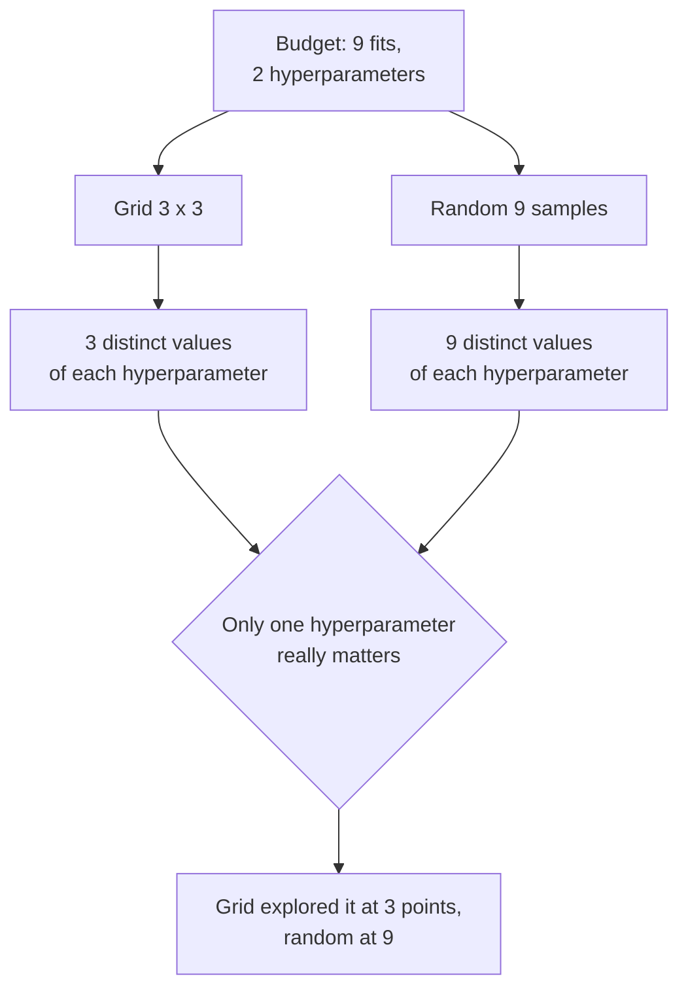
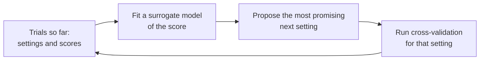

[Grid search](/learn/model-evaluation/grid-search) spends its budget evenly over a lattice of combinations, and the [cost table](/learn/model-evaluation/grid-search) showed that budget exploding as hyperparameters are added. **Random search** takes a different approach: instead of listing values, you describe a *distribution* for each hyperparameter, sample a fixed number of random combinations, and cross-validate each. It sounds cruder, yet for anything beyond two or three hyperparameters it usually finds as good a setting or better for the same number of fits. This lesson explains why, shows `RandomizedSearchCV` with proper distributions and pipelines, and closes with a short look at Bayesian optimisation, the next step up when each fit is expensive.

## Why random beats grid: the important dimension

In most models only a few hyperparameters strongly affect performance, and you rarely know in advance which ones. Bergstra and Bengio made this argument in their 2012 paper *Random Search for Hyper-Parameter Optimization* (Journal of Machine Learning Research), and it is easiest to see with a picture in words: a 3 × 3 grid over two hyperparameters uses 9 fits but tests only **3 distinct values** of each. If one hyperparameter matters and the other does not, 6 of the 9 fits merely repeat earlier values of the one that matters. Nine random points test **9 distinct values** of every hyperparameter.



A small simulation makes it concrete. The score below depends almost entirely on hyperparameter `a`, with a narrow peak near 0.63; `b` barely matters:

```python
import numpy as np

def score(a, b):
    return np.exp(-((a - 0.63) / 0.1) ** 2) + 0.01 * b   # b is nearly irrelevant

grid = np.linspace(0.1, 0.9, 3)
A, B = np.meshgrid(grid, grid)
print("grid:   distinct a =", len(np.unique(A)), " best score =", score(A, B).max().round(3))

rng = np.random.default_rng(0)
a, b = rng.uniform(size=9), rng.uniform(size=9)
print("random: distinct a =", len(np.unique(a)), " best score =", score(a, b).max().round(3))

wins = [score(rng.uniform(size=9), rng.uniform(size=9)).max() > score(A, B).max()
        for _ in range(1000)]
print("random beats grid in", round(np.mean(wins) * 100, 1), "% of 1,000 repeats")
```

```output
grid:   distinct a = 3  best score = 0.194
random: distinct a = 9  best score = 1.005
random beats grid in 92.9 % of 1,000 repeats
```

The grid's three values of `a` (0.1, 0.5, 0.9) all miss the peak. Random sampling probes `a` at nine places and usually lands near it. The advantage grows with the number of hyperparameters: with five, a grid of $3^5 = 243$ fits still tests only three values of each, while 243 random samples test 243 values of each.

### How many samples are enough?

A simple argument gives a useful rule of thumb. If a random sample has probability $p$ of landing in the best-scoring fraction of the search space, then after $n$ independent samples the chance that at least one does is $1 - (1 - p)^n$. For the top 5% ($p = 0.05$):

$$
1 - 0.95^{60} \approx 0.95
$$

So **60 random trials give about a 95% chance of at least one setting in the top 5% of the space**, regardless of how many hyperparameters there are. That does not guarantee a great model (the top 5% of a poorly chosen space may still be mediocre), but it shows why a few dozen samples usually suffice.

## Distributions instead of lists

Random search needs a distribution to sample from for each hyperparameter. `scipy.stats` provides them, and scikit-learn calls their `rvs` method. Lists are also accepted and are sampled uniformly.

| Hyperparameter type | Distribution | Example |
| --- | --- | --- |
| Scale parameter (`C`, `alpha`, `learning_rate`) | `loguniform(low, high)` | `loguniform(1e-3, 1e2)` |
| Integer count or size | `randint(low, high)` (high excluded) | `randint(2, 64)` |
| Fraction between bounds | `uniform(loc, scale)` covers loc to loc + scale | `uniform(0.5, 0.5)` for 0.5 to 1.0 |
| Categorical choice | A plain list | `["sqrt", "log2", None]` |

```python
from scipy.stats import loguniform, randint

print(loguniform(1e-3, 1e2).rvs(size=5, random_state=0).round(4))
print(randint(8, 64).rvs(size=5, random_state=0))
```

```output
[0.5547 3.7666 1.0323 0.5302 0.1313]
[52 55 61  8 11]
```

Log-uniform samples are spread evenly across orders of magnitude, which is what you want for scale parameters: a plain `uniform(0, 100)` would put almost all samples above 1.

> [!WARNING]
> `scipy.stats.uniform(loc, scale)` covers `loc` to `loc + scale`, not `loc` to `scale`. `uniform(0.1, 0.5)` samples from 0.1 to 0.6. This trips up many people.

## RandomizedSearchCV in practice

Here is a gradient boosting model on the fraud data, tuned over four hyperparameters with 20 random combinations. The structure is identical to `GridSearchCV`, with `param_distributions` and `n_iter` in place of the grid:

```python
from sklearn.datasets import make_classification
from sklearn.ensemble import HistGradientBoostingClassifier
from sklearn.metrics import average_precision_score
from sklearn.model_selection import RandomizedSearchCV, StratifiedKFold, cross_val_score, train_test_split

X, y = make_classification(n_samples=10_000, n_features=8, n_informative=4,
                           weights=[0.98], class_sep=1.5, flip_y=0, random_state=2)
X_train, X_test, y_train, y_test = train_test_split(
    X, y, test_size=0.3, stratify=y, random_state=0)
cv = StratifiedKFold(n_splits=5, shuffle=True, random_state=0)

param_distributions = {
    "learning_rate": loguniform(0.01, 0.3),
    "max_leaf_nodes": randint(8, 64),
    "min_samples_leaf": randint(5, 100),
    "l2_regularization": loguniform(1e-3, 10),
}
search = RandomizedSearchCV(HistGradientBoostingClassifier(random_state=0),
                            param_distributions, n_iter=20, cv=cv,
                            scoring="average_precision", random_state=0, n_jobs=-1)
search.fit(X_train, y_train)

default_cv = cross_val_score(HistGradientBoostingClassifier(random_state=0),
                             X_train, y_train, cv=cv, scoring="average_precision").mean()
print("default settings, CV AP:", round(default_cv, 3))
print("best of 20 random, CV AP:", round(search.best_score_, 3))
print({k: float(round(v, 3)) if isinstance(v, float) else int(v) for k, v in search.best_params_.items()})
default = HistGradientBoostingClassifier(random_state=0).fit(X_train, y_train)
print("test AP, default model:  ", round(average_precision_score(y_test, default.predict_proba(X_test)[:, 1]), 3))
print("test AP, tuned model:    ", round(average_precision_score(y_test, search.predict_proba(X_test)[:, 1]), 3))
```

```output
default settings, CV AP: 0.816
best of 20 random, CV AP: 0.837
{'l2_regularization': 0.079, 'learning_rate': 0.083, 'max_leaf_nodes': 23, 'min_samples_leaf': 18}
test AP, default model:   0.793
test AP, tuned model:     0.787
```

Tuning lifted the cross-validated score about two points above the defaults. On the test set, though, the tuned model is no better than the default one; it is marginally worse. This is a common and instructive outcome, not a bug. The best of 20 noisy CV estimates is optimistic, exactly as the [hyperparameter tuning](/learn/model-evaluation/hyperparameter-tuning) lesson warned, and with only 60 frauds in the test set, differences of a point or two in average precision are within noise. The honest conclusion is that the defaults were already good for this data, and that a two-point CV gain should not be trusted without checking it against the fold-to-fold spread in `cv_results_`. The test numbers are the ones to report. Everything from grid search carries over: put preprocessing in a pipeline and use `step__param` names, read `cv_results_`, pass several metrics with `refit`, and nest the search inside `cross_val_score` for an honest estimate on small data.

`random_state` on the search controls which combinations are sampled, so the experiment is reproducible. The budget is now **your choice** (`n_iter` times the number of folds) rather than a product you discover after writing the grid, and adding another hyperparameter does not change the cost at all.

| | Grid search | Random search |
| --- | --- | --- |
| You specify | Lists of values | Distributions (or lists) |
| Number of fits | Product of list lengths × folds | `n_iter` × folds, fixed by you |
| Distinct values per hyperparameter | Length of its list | Up to `n_iter` |
| Adding an unimportant hyperparameter | Multiplies the cost | Costs nothing extra |
| Best for | 1 to 3 hyperparameters, few sensible values | 3 or more, or continuous ranges |
| Reproducible | Always | With `random_state` |

## Spending less per trial: successive halving

Many random candidates are obviously bad after a little training. scikit-learn's `HalvingRandomSearchCV` exploits this: it scores many candidates on a small resource (by default, a subset of the training rows), keeps the best fraction, gives the survivors more, and repeats. It is still marked experimental and must be enabled with `from sklearn.experimental import enable_halving_search_cv` before it can be imported from `sklearn.model_selection`; check the current documentation before relying on it.

## Beyond random: Bayesian optimisation

Random search ignores everything it has learned: trial 50 is sampled exactly as blindly as trial 1. **Bayesian optimisation** fits a cheap model of "score as a function of hyperparameters" to the trials so far, and uses it to propose the next setting where improvement looks most likely, balancing exploring unknown regions against refining promising ones.



The open-source library **Optuna** is a popular way to do this in Python; its default sampler is a Bayesian-style method called TPE. You write an objective function that asks a `trial` object for values and returns a score. The sketch below shows the core of the API; Optuna is not installed in this course's environment, so no output is shown:

```python
import optuna
from sklearn.model_selection import cross_val_score

def objective(trial):
    params = {
        "learning_rate": trial.suggest_float("learning_rate", 0.01, 0.3, log=True),
        "max_leaf_nodes": trial.suggest_int("max_leaf_nodes", 8, 64),
        "min_samples_leaf": trial.suggest_int("min_samples_leaf", 5, 100),
    }
    model = HistGradientBoostingClassifier(random_state=0, **params)
    return cross_val_score(model, X_train, y_train, cv=cv, scoring="average_precision").mean()

study = optuna.create_study(direction="maximize")
study.optimize(objective, n_trials=50)
print(study.best_params, study.best_value)
```

Bayesian methods pay off most when each trial is expensive (large gradient boosting models, neural networks) so that choosing trials cleverly saves hours. For cheap models, random search with a sensible budget is often just as good and simpler to run in parallel. Either way the evaluation rules do not change: the best trial's score is optimistic, and the final number comes from untouched test data. The same discipline applies when you later evaluate large language models, covered in [model evaluation for LLMs](/learn/working-with-llms/model-evaluation).

> [!KEY]
> Random search samples a fixed budget of combinations from distributions. Because every trial tests a new value of every hyperparameter, it explores the few important ones far better than a grid of the same size. Use log-uniform distributions for scale parameters, about 20 to 60 trials as a starting budget, and Bayesian optimisation when trials are expensive.

## Exercises

**1.** You have 4 hyperparameters and a budget of 81 fits per fold. Compare a grid with 3 values each against random search with `n_iter=81` in terms of distinct values tested per hyperparameter.

<details>
<summary>Show solution</summary>

The grid is 3⁴ = 81 combinations but tests only 3 distinct values of each hyperparameter. Random search with 81 samples tests up to 81 distinct values of each (all of them, for continuous distributions). Same cost, 27 times finer exploration of whichever hyperparameter matters.

</details>

**2.** Write a `param_distributions` for a `RandomForestClassifier` that samples `n_estimators` from 100 to 500, `max_depth` from 3 to 30 or no limit, `max_features` as a fraction from 0.2 to 1.0, and `min_samples_leaf` from 1 to 20.

<details>
<summary>Show solution</summary>

```python
from scipy.stats import randint, uniform

param_distributions = {
    "n_estimators": randint(100, 501),
    "max_depth": list(range(3, 31)) + [None],
    "max_features": uniform(0.2, 0.8),      # 0.2 to 1.0
    "min_samples_leaf": randint(1, 21),
}
```

`randint`'s upper bound is excluded, so use 501 and 21. `uniform(0.2, 0.8)` covers 0.2 to 0.2 + 0.8. A list mixing integers and `None` is sampled uniformly from its items.

</details>

**3.** How many random trials give at least a 99% chance of hitting the top 1% of the search space? Solve $1 - 0.99^n \ge 0.99$.

<details>
<summary>Show solution</summary>

$n \ge \log(0.01) / \log(0.99) \approx 458.2$, so 459 trials. Tighter targets get expensive quickly, which is where successive halving and Bayesian optimisation help.

```python
import math
print(math.ceil(math.log(0.01) / math.log(0.99)))   # 459
```

</details>

```quiz
[
  {
    "q": "Why does random search often beat grid search for the same number of fits?",
    "options": [
      "It uses more cross-validation folds",
      "It tests many more distinct values of each hyperparameter, which matters when only a few are important",
      "It always finds the global optimum",
      "It does not need cross-validation"
    ],
    "answer": 1,
    "why": "A grid repeats the same few values of each hyperparameter; random samples give a new value of every hyperparameter on every trial."
  },
  {
    "q": "Which distribution suits logistic regression's `C`, searched from 0.001 to 100?",
    "options": ["`uniform(0.001, 100)`", "`randint(0, 100)`", "`loguniform(1e-3, 1e2)`", "A list `[0.001, 100]`"],
    "answer": 2,
    "why": "Log-uniform spreads samples evenly across orders of magnitude, which matches how `C` affects the model."
  },
  {
    "q": "In `RandomizedSearchCV(..., n_iter=30, cv=5)`, how many fits run, excluding the final refit?",
    "options": ["150", "30", "35", "It depends on the number of hyperparameters"],
    "answer": 0,
    "why": "Each of the 30 sampled combinations is cross-validated with 5 folds, regardless of how many hyperparameters are searched."
  },
  {
    "q": "What distinguishes Bayesian optimisation, as in Optuna, from random search?",
    "options": [
      "It does not need an objective function",
      "It only works with neural networks",
      "It guarantees the best possible hyperparameters",
      "It uses the results of earlier trials to choose promising settings for later ones"
    ],
    "answer": 3,
    "why": "A surrogate model of past results guides each new proposal, which saves trials when each one is expensive."
  }
]
```
