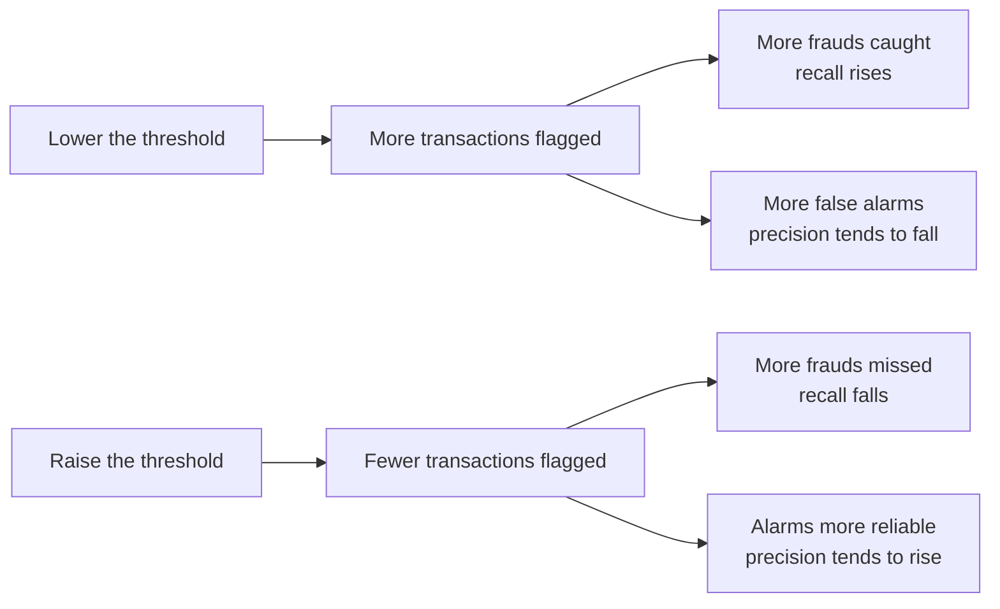
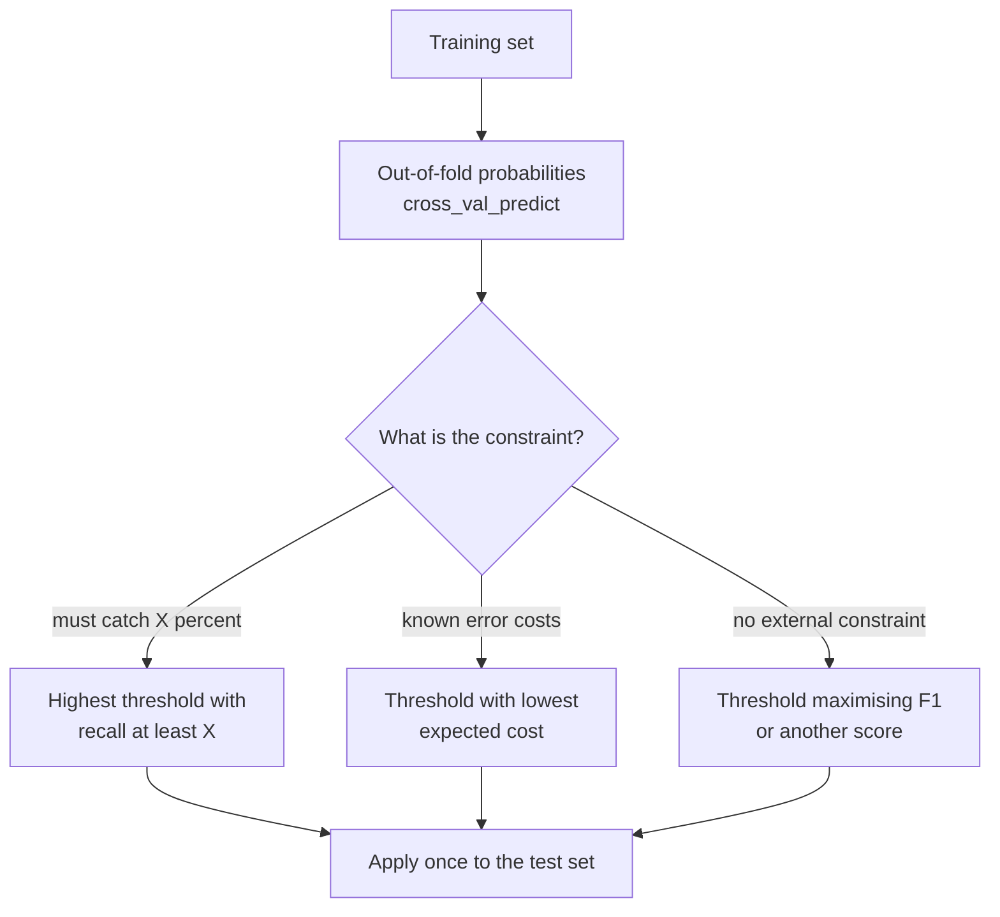

[Precision](/learn/model-evaluation/precision) asked how trustworthy the model's alarms are. **Recall** asks the opposite question: **of all the real positives out there, how many did the model find?** For a fraud detector, recall is the share of fraud you actually stop. For a cancer screen, it is the share of patients with cancer who get referred. Whenever a miss is the expensive mistake, recall is the metric you protect first, and because precision and recall pull against each other, this lesson is also where you learn to choose a classification threshold deliberately instead of accepting the default 0.5.

## The definition

$$
\text{recall} = \frac{TP}{TP + FN}
$$

where $TP$ counts true positives (frauds the model flagged) and $FN$ counts false negatives (frauds it let through). The denominator $TP + FN$ is the number of *actual* positives, which is fixed by the data and does not depend on the model at all. Recall goes by several names depending on the field:

| Name | Field |
| --- | --- |
| Recall | Machine learning, information retrieval |
| Sensitivity | Medicine, statistics |
| True positive rate (TPR) | ROC analysis |
| Hit rate, detection rate | Signal detection, security |

Our running fraud model caught 16 of the 60 frauds in the test set:

$$
\text{recall} = \frac{16}{16 + 44} = \frac{16}{60} \approx 0.267
$$

Its precision was 0.667, so two-thirds of alerts are genuine, but nearly three-quarters of fraud goes undetected. Seeing the two numbers side by side tells a story that the 98.3% accuracy completely hid.

### Specificity, recall's mirror image

The same calculation applied to the negative class gives **specificity** (true negative rate): the share of legitimate transactions correctly passed.

$$
\text{specificity} = \frac{TN}{TN + FP} = \frac{2932}{2940} \approx 0.997, \qquad \text{FPR} = 1 - \text{specificity} = \frac{FP}{TN + FP}
$$

The **false positive rate** (FPR) is the share of legitimate transactions wrongly flagged. Recall (TPR) and FPR are the two axes of the [ROC curve](/learn/model-evaluation/roc-auc).

## Recall in scikit-learn

The setup is identical to the precision lesson:

```python
import numpy as np
from sklearn.datasets import make_classification
from sklearn.linear_model import LogisticRegression
from sklearn.model_selection import train_test_split
from sklearn.metrics import recall_score

X, y = make_classification(n_samples=10_000, n_features=8, n_informative=4,
                           weights=[0.98], class_sep=1.5, flip_y=0, random_state=2)
X_train, X_test, y_train, y_test = train_test_split(
    X, y, test_size=0.3, stratify=y, random_state=0)
model = LogisticRegression(max_iter=1000).fit(X_train, y_train)
y_pred = model.predict(X_test)
proba = model.predict_proba(X_test)[:, 1]

print("recall:     ", round(recall_score(y_test, y_pred), 4))
print("specificity:", round(recall_score(y_test, y_pred, pos_label=0), 4))
```

```output
recall:      0.2667
specificity: 0.9973
```

Specificity is just recall with the negative class treated as positive, hence `pos_label=0`.

## The precision and recall trade-off

Recall is easy to maximise on its own: flag everything. Every fraud is caught (recall 1.0) and precision collapses to the base rate of 0.02. Precision is easy to maximise on its own too: flag only the single most suspicious transaction. Each metric can be gamed by moving the threshold, and moving it helps one at the expense of the other.



`precision_recall_curve` computes both metrics at every distinct threshold in one pass, so you can see the whole trade-off:

```python
from sklearn.metrics import precision_recall_curve

prec, rec, thr = precision_recall_curve(y_test, proba)
for target in (0.25, 0.5, 0.75):
    i = np.argmin(np.abs(thr - target))
    print(f"threshold {thr[i]:.2f}: precision {prec[i]:.3f}, recall {rec[i]:.3f}")
print("number of thresholds evaluated:", len(thr))
```

```output
threshold 0.25: precision 0.429, recall 0.350
threshold 0.50: precision 0.667, recall 0.267
threshold 0.75: precision 0.818, recall 0.150
number of thresholds evaluated: 3000
```

Halving the threshold from 0.5 to 0.25 lifts recall from 0.267 to 0.350 but drops precision from 0.667 to 0.429. Neither setting is "correct"; the right one depends on what the errors cost.

> [!NOTE]
> `precision_recall_curve` returns one more precision and recall value than thresholds: the final point (precision 1, recall 0) has no threshold. Index with care when you line the arrays up.

## Choosing a threshold

There are three common, defensible ways to pick a threshold. All of them must use data that is **not the test set**: if you choose the threshold by looking at test results, the test score is no longer an honest estimate. Here the threshold is chosen from out-of-fold predictions on the training set, produced by `cross_val_predict` (explained in [cross-validation](/learn/model-evaluation/cross-validation)), and only then checked on the test set.



### Strategy 1: a recall target

Suppose the business requires catching at least 60% of fraud. Find the highest threshold that achieves it, since a higher threshold means fewer false alarms:

```python
from sklearn.model_selection import cross_val_predict

oof = cross_val_predict(LogisticRegression(max_iter=1000), X_train, y_train,
                        cv=5, method="predict_proba")[:, 1]
p_tr, r_tr, t_tr = precision_recall_curve(y_train, oof)
ok = r_tr[:-1] >= 0.60                 # drop the last point, which has no threshold
threshold = t_tr[ok].max()
print("chosen threshold:", round(threshold, 3))

test_pred = (proba >= threshold).astype(int)
print("test recall:   ", round(recall_score(y_test, test_pred), 3))
print("test precision:", round((y_test[test_pred == 1] == 1).mean(), 3))
```

```output
chosen threshold: 0.111
test recall:    0.5
test precision: 0.312
```

The test recall falls short of the 0.6 target. With only 60 frauds in the test set each one is worth almost two points of recall, and the threshold was tuned on different data, so some gap is expected. That gap is honest information, which is exactly why the threshold must not be tuned on the test set: if you truly need 60%, aim higher on validation data and accept the lower precision.

### Strategy 2: expected cost

If you can put rough costs on each error, choose the threshold that minimises the total. Say a missed fraud costs 50 times as much as reviewing a false alarm:

$$
\text{cost}(t) = c_{FN} \cdot FN(t) + c_{FP} \cdot FP(t)
$$

where $t$ is the threshold, $FN(t)$ and $FP(t)$ are the error counts at that threshold, and $c_{FN}$, $c_{FP}$ the cost per error.

```python
c_fn, c_fp = 50, 1
grid = np.linspace(0.01, 0.99, 99)
costs = [c_fn * ((oof < t) & (y_train == 1)).sum() +
         c_fp * ((oof >= t) & (y_train == 0)).sum() for t in grid]
best_t = grid[int(np.argmin(costs))]
print("cost-minimising threshold:", round(best_t, 2))
print("test recall at that threshold:", round(recall_score(y_test, proba >= best_t), 3))
```

```output
cost-minimising threshold: 0.04
test recall at that threshold: 0.733
```

With misses fifty times as costly, the best threshold is far below 0.5. This is the most principled approach whenever costs are even approximately known, and it explains why the default threshold is rarely right for imbalanced problems.

### Strategy 3: a balanced score

With no external constraint, pick the threshold that maximises a score combining both metrics, usually the [F1-score](/learn/model-evaluation/f1-score), which is the next lesson.

> [!KEY]
> A classifier that outputs probabilities is really a family of classifiers, one per threshold. Precision and recall describe one member of the family. Choose the member using costs or constraints, on validation data, then report precision and recall together.

## Exercises

**1.** A screening test is applied to 2,000 people, 50 of whom have a condition. It flags 120 people, 45 of whom have the condition. Compute recall, precision and specificity.

<details>
<summary>Show solution</summary>

TP = 45, FN = 5, FP = 75, TN = 1950 - 75 = 1875.

- Recall = 45 / 50 = 0.90
- Precision = 45 / 120 = 0.375
- Specificity = 1875 / 1950 ≈ 0.962

A typical screening profile: catch almost everyone, accept many false alarms that a second test will clear.

</details>

**2.** Repeat Strategy 1 with a recall target of 0.8. What happens to precision on the test set, and why?

<details>
<summary>Show solution</summary>

```python
ok = r_tr[:-1] >= 0.80
threshold = t_tr[ok].max()
test_pred = (proba >= threshold).astype(int)
print(round(threshold, 3), round(recall_score(y_test, test_pred), 3),
      round((y_test[test_pred == 1] == 1).mean(), 3))
```

It prints a threshold of about 0.024, a test recall of 0.783 and a test precision of 0.113. The threshold drops sharply and precision falls far below its value at 0.5. The last frauds are hard to separate from legitimate transactions, so catching them means flagging many legitimate ones too. The final few points of recall are usually the most expensive.

</details>

**3.** Why is it wrong to pick the threshold that maximises recall on the test set and then report the test recall?

<details>
<summary>Show solution</summary>

The threshold was fitted to the test set, so the reported recall is optimistically biased: it includes the luck of that particular sample. The test set must be used once, after every choice has been made. Tune the threshold on a validation set or out-of-fold predictions.

</details>

```quiz
[
  {
    "q": "Recall is defined as:",
    "options": ["TP / (TP + FP)", "TN / (TN + FP)", "TP / (TP + FN)", "(TP + TN) / n"],
    "answer": 2,
    "why": "Recall divides the true positives by all actual positives, TP + FN."
  },
  {
    "q": "Which trivial classifier achieves a recall of 1.0?",
    "options": [
      "One that predicts the positive class for every example",
      "One that predicts the negative class for every example",
      "One that predicts randomly",
      "None; recall of 1.0 requires a perfect model"
    ],
    "answer": 0,
    "why": "Flagging everything catches every actual positive, so FN = 0, at the cost of terrible precision."
  },
  {
    "q": "Missed frauds cost far more than false alarms. Compared with 0.5, the cost-minimising threshold will usually be:",
    "options": ["Exactly 0.5", "Lower", "Higher", "Undefined"],
    "answer": 1,
    "why": "When false negatives are expensive, it pays to flag more transactions, which means a lower threshold."
  },
  {
    "q": "Which data should you use to choose a classification threshold?",
    "options": [
      "The test set, since it is the most realistic",
      "The training predictions of the fitted model",
      "Validation data or out-of-fold predictions, never the test set",
      "Any data, as thresholds do not cause overfitting"
    ],
    "answer": 2,
    "why": "A threshold is a tuned parameter. Choosing it on the test set biases the test score; in-sample training predictions are overconfident."
  }
]
```
