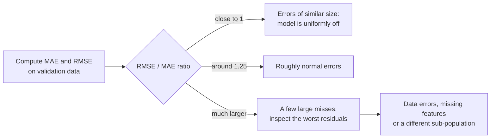

The **root mean squared error (RMSE)** is the square root of [MSE](/learn/model-evaluation/mse). That one extra step brings the metric back into the target's own units, so you can say "the model is typically off by about 18 thousand" while keeping squared error's extra weight on large misses. RMSE is probably the most widely reported regression metric, from house-price models to weather forecasts, and it sits naturally next to [MAE](/learn/model-evaluation/mae): the gap between the two tells you something about the shape of your errors. This lesson covers the definition, how to read RMSE against MAE and against a baseline, its log-scale variant for skewed targets, and a few traps when averaging or optimising it.

## The definition

$$
\text{RMSE} = \sqrt{\text{MSE}} = \sqrt{\frac{1}{n}\sum_{i=1}^{n} (y_i - \hat{y}_i)^2}
$$

where $n$ is the number of examples, $y_i$ the true value and $\hat{y}_i$ the prediction. For the five houses used throughout these lessons, MSE was 330 (thousands squared):

$$
\text{RMSE} = \sqrt{330} \approx 18.17 \text{ thousand}
$$

Compare MAE = 16 thousand. Both are in thousands, so they can sit side by side in a report.

```python
import numpy as np
from sklearn.metrics import mean_absolute_error, mean_squared_error, root_mean_squared_error

y_true = np.array([250, 310, 180, 420, 275])
y_pred = np.array([265, 300, 200, 390, 280])

print("by hand:   ", round(np.sqrt(np.mean((y_true - y_pred) ** 2)), 2))
print("sklearn:   ", round(root_mean_squared_error(y_true, y_pred), 2))
print("sqrt(MSE): ", round(np.sqrt(mean_squared_error(y_true, y_pred)), 2))
```

```output
by hand:    18.17
sklearn:    18.17
sqrt(MSE):  18.17
```

`root_mean_squared_error` was added in scikit-learn 1.4. In older code you will see `mean_squared_error(..., squared=False)`, an argument that has since been removed, so prefer the dedicated function.

## RMSE against MAE: reading the gap

RMSE is never smaller than MAE on the same predictions. Both are averages of error sizes, but RMSE is a *quadratic* mean, which leans towards the larger values:

$$
\text{MAE} \;\le\; \text{RMSE} \;\le\; \sqrt{n}\cdot\text{MAE}
$$

The two are equal only when every error has the same size. The more unequal the errors, the bigger the gap. So the ratio RMSE / MAE is a quick diagnostic:

```python
cases = {
    "all errors equal":     np.array([10, -10, 10, -10, 10, -10]),
    "mixed sizes":          np.array([5, -15, 10, -20, 8, -12]),
    "one big miss":         np.array([0, 0, 0, 0, 0, 60]),
}
for name, e in cases.items():
    mae, rmse = np.mean(np.abs(e)), np.sqrt(np.mean(e ** 2))
    print(f"{name:18s} MAE {mae:5.1f}  RMSE {rmse:5.1f}  ratio {rmse / mae:.2f}")
```

```output
all errors equal   MAE  10.0  RMSE  10.0  ratio 1.00
mixed sizes        MAE  11.7  RMSE  12.6  ratio 1.08
one big miss       MAE  10.0  RMSE  24.5  ratio 2.45
```

The first and last cases have the same MAE of 10 but very different RMSEs: one miss of 60 among five perfect predictions more than doubles RMSE. A ratio near 1 means errors are uniform; a ratio well above 1.25 or so (the value for normally distributed errors is about 1.25) suggests a heavy tail of large misses worth investigating.



## Putting RMSE in context

An RMSE of 25 thousand is excellent for a city where houses vary by hundreds of thousands and poor where they vary by 30 thousand. The natural reference is the RMSE of predicting the mean, which is exactly the **standard deviation** of the target (with the $1/n$ convention). The ratio of the two is related to R² by $R^2 = 1 - (\text{RMSE}/\sigma_y)^2$, with $\sigma_y$ the target's standard deviation.

```python
from sklearn.linear_model import LinearRegression
from sklearn.model_selection import train_test_split

rng = np.random.default_rng(0)
n = 600
size = rng.uniform(50, 250, n)
age = rng.uniform(0, 60, n)
price = 40 + 2.2 * size - 0.8 * age + rng.normal(0, 25, n)
X = np.column_stack([size, age])
X_train, X_test, y_train, y_test = train_test_split(X, price, test_size=0.25, random_state=0)

pred = LinearRegression().fit(X_train, y_train).predict(X_test)
print("test RMSE:          ", round(root_mean_squared_error(y_test, pred), 1))
print("test MAE:           ", round(mean_absolute_error(y_test, pred), 1))
print("std of test prices: ", round(y_test.std(), 1))
print("noise std (known):   25")
```

```output
test RMSE:           25.7
test MAE:            20.5
std of test prices:  125.2
noise std (known):   25
```

The model's RMSE is close to the standard deviation of the noise that generated the data, 25. That is the best any model could do on average: the remaining error is irreducible noise. In real problems you do not know the noise level, but the comparison with the target's spread still tells you how much of the variation the model explains.

## RMSLE: errors on a log scale

House prices are skewed: most homes are modest and a few are very expensive. A 50-thousand error on a mansion is a small relative mistake, but RMSE counts it the same as a 50-thousand error on a cheap flat, and the expensive houses dominate. Applying a logarithm first makes the metric measure **relative** error:

$$
\text{RMSLE} = \sqrt{\frac{1}{n}\sum_{i=1}^{n} \big(\log(1 + y_i) - \log(1 + \hat{y}_i)\big)^2}
$$

The $+1$ keeps zero values defined; targets must be greater than $-1$.

```python
from sklearn.metrics import root_mean_squared_log_error

cheap = (np.array([100.0]), np.array([150.0]))       # 50% too high
mansion = (np.array([2000.0]), np.array([2050.0]))   # 2.5% too high
for name, (t, p) in (("cheap flat", cheap), ("mansion", mansion)):
    print(f"{name:10s} RMSE {root_mean_squared_error(t, p):5.1f}   "
          f"RMSLE {root_mean_squared_log_error(t, p):.3f}")
```

```output
cheap flat RMSE  50.0   RMSLE 0.402
mansion    RMSE  50.0   RMSLE 0.025
```

Both errors are 50 in absolute terms, so RMSE scores them identically. RMSLE scores the flat's 50% miss as far worse than the mansion's 2.5% miss. A common, equivalent approach is to train the model on `np.log1p(price)` directly and evaluate RMSE on that scale.

## Traps when averaging and comparing

**Do not average RMSEs and call it the RMSE.** If you evaluate on several folds or several stores, the mean of the per-group RMSEs is not the RMSE of all the predictions together, because the square root is applied at a different point. Both are legitimate summaries, but say which one you report.

```python
groups = [np.array([2.0, -2.0]), np.array([20.0, -20.0])]   # errors in two groups
mean_of_rmse = np.mean([np.sqrt(np.mean(g ** 2)) for g in groups])
pooled_rmse = np.sqrt(np.mean(np.concatenate(groups) ** 2))
print(round(mean_of_rmse, 2), round(pooled_rmse, 2))
```

```output
11.0 14.21
```

**Higher is better in scikit-learn scoring.** Model selection tools in scikit-learn always *maximise* a score, so error metrics are negated: the scoring string is `"neg_root_mean_squared_error"` and results come back negative. A cross-validation score of -25.6 means an RMSE of 25.6. You will use these strings in the [cross-validation](/learn/model-evaluation/cross-validation) and [grid search](/learn/model-evaluation/grid-search) lessons.

| Scoring string | Metric | Sign |
| --- | --- | --- |
| `"neg_mean_absolute_error"` | MAE | Negated |
| `"neg_mean_squared_error"` | MSE | Negated |
| `"neg_root_mean_squared_error"` | RMSE | Negated |
| `"r2"` | R² | As is |

> [!KEY]
> RMSE is MSE brought back to the target's units. It is always at least as large as MAE, and the RMSE / MAE ratio reveals whether a few large errors dominate. Compare it with the target's standard deviation, and use RMSLE or a log target when relative errors matter.

## Exercises

**1.** Errors are 3, -4, 0, 5. Compute MAE, MSE and RMSE by hand, and the RMSE / MAE ratio.

<details>
<summary>Show solution</summary>

MAE = (3 + 4 + 0 + 5) / 4 = 3. MSE = (9 + 16 + 0 + 25) / 4 = 12.5. RMSE = √12.5 ≈ 3.54. Ratio ≈ 1.18: fairly even errors.

</details>

**2.** Model A has RMSE 20 and MAE 18. Model B has RMSE 20 and MAE 10. They have the same RMSE: how do their errors differ, and which would you prefer for a pricing tool that customers see?

<details>
<summary>Show solution</summary>

A's ratio is 1.11, so its errors are fairly uniform: almost every prediction is off by around 18 to 20. B's ratio is 2: most predictions are very good, but a few are far off. For customer-facing prices, B's rare large misses may be embarrassing, while A is consistently mediocre. The right choice depends on whether you can detect and handle B's big misses (for example, by flagging low-confidence cases), which is worth investigating before deciding.

</details>

**3.** Show that the RMSE of predicting the mean of `y_test` equals `y_test.std()` on the 600-house data.

<details>
<summary>Show solution</summary>

```python
const = np.full_like(y_test, y_test.mean())
print(round(root_mean_squared_error(y_test, const), 4), round(y_test.std(), 4))
```

Both print the same value. NumPy's `std` divides by n by default, matching the definition of RMSE.

</details>

```quiz
[
  {
    "q": "A model's MSE on house prices (in thousands) is 400. What is its RMSE?",
    "options": ["400 thousand", "200 thousand", "20 thousand", "160,000"],
    "answer": 2,
    "why": "RMSE is the square root of MSE, which brings it back to the target's units: the square root of 400 is 20."
  },
  {
    "q": "Which statement about MAE and RMSE on the same predictions is always true?",
    "options": ["RMSE is less than or equal to MAE", "RMSE is greater than or equal to MAE", "They are always equal", "RMSE is exactly MAE squared"],
    "answer": 1,
    "why": "The quadratic mean is never smaller than the arithmetic mean of absolute values; they are equal only when all errors have the same size."
  },
  {
    "q": "`cross_val_score(..., scoring=\"neg_root_mean_squared_error\")` returns -31.2. What does this mean?",
    "options": [
      "The RMSE is 31.2",
      "The model is worse than random",
      "The RMSE is -31.2, which is impossible",
      "The R² is -31.2"
    ],
    "answer": 0,
    "why": "scikit-learn negates error metrics so that higher scores are always better. Flip the sign to get the RMSE."
  },
  {
    "q": "When is RMSLE preferable to RMSE?",
    "options": [
      "When the target can be negative and large",
      "When all errors are the same size",
      "When you want large absolute errors to dominate",
      "When the target is skewed and relative errors matter more than absolute ones"
    ],
    "answer": 3,
    "why": "Taking logs turns ratios into differences, so RMSLE measures relative error and stops expensive items dominating."
  }
]
```
