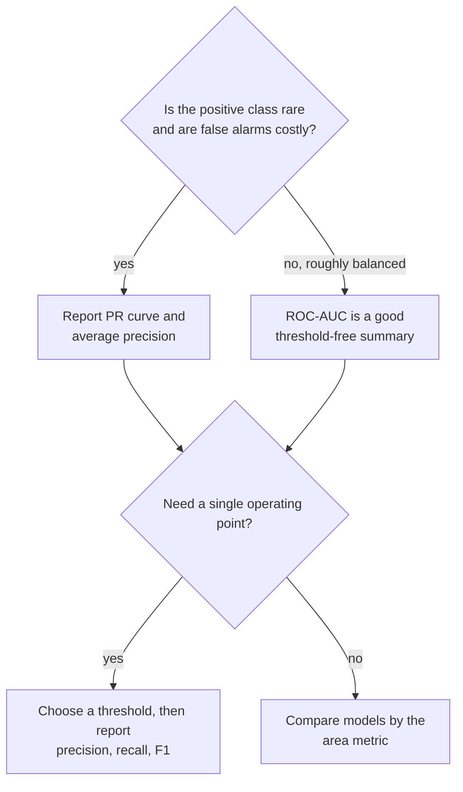

Precision, recall and F1 all judge a classifier at **one** threshold. But a model that outputs probabilities is really a whole family of classifiers, one per threshold, and when you compare two models you often want to know which one *ranks* examples better before anyone has chosen a threshold. The **ROC curve** shows a model's behaviour at every threshold at once, and the **area under it (ROC-AUC)** condenses that into one number with a beautifully simple meaning. This lesson builds the curve by hand, explains what AUC measures, and shows why on heavily imbalanced data like fraud you should usually report the precision-recall curve and its area alongside, or instead.

## Building the ROC curve

The ROC (receiver operating characteristic, a name from radar engineering) curve plots two rates against each other as the threshold sweeps from high to low:

$$
\text{TPR} = \frac{TP}{TP + FN} \quad (\text{recall}), \qquad \text{FPR} = \frac{FP}{FP + TN}
$$

where TPR is the share of positives caught and FPR the share of negatives wrongly flagged. At a threshold above every score, nothing is flagged: the point (0, 0). At a threshold below every score, everything is flagged: (1, 1). The curve joins them.

The simplest way to build it: sort examples by score, highest first, and lower the threshold past one example at a time. Each positive you pass moves the curve **up** by $1/P$ (with $P$ the number of positives); each negative moves it **right** by $1/N$ (with $N$ the number of negatives). Step through it for seven transactions, three of them fraud:

```trace
{
  "title": "sweeping the threshold to build an ROC curve",
  "code": [
    "scores = [0.9, 0.8, 0.6, 0.4, 0.35, 0.2, 0.1]",
    "labels = [1, 0, 1, 0, 1, 0, 0]",
    "tp = fp = 0",
    "for s, l in zip(scores, labels):",
    "    if l == 1:",
    "        tp += 1",
    "    else:",
    "        fp += 1",
    "    print(f\"t={s}: FPR={fp}/4 TPR={tp}/3\")"
  ],
  "steps": [
    { "line": 3, "vars": { "tp": "0", "fp": "0" }, "note": "Threshold above every score: nothing flagged. The curve starts at (0, 0). Scores are already sorted from highest to lowest." },
    { "line": 9, "vars": { "s": "0.9", "l": "1", "tp": "1", "fp": "0" }, "out": ["t=0.9: FPR=0/4 TPR=1/3"], "note": "Lower the threshold to 0.9. The top example is fraud, so the curve moves straight up." },
    { "line": 9, "vars": { "s": "0.8", "l": "0", "tp": "1", "fp": "1" }, "out": ["t=0.9: FPR=0/4 TPR=1/3", "t=0.8: FPR=1/4 TPR=1/3"], "note": "The next example is legitimate: a false positive. The curve moves right by 1/4." },
    { "line": 9, "vars": { "s": "0.6", "l": "1", "tp": "2", "fp": "1" }, "out": ["t=0.9: FPR=0/4 TPR=1/3", "t=0.8: FPR=1/4 TPR=1/3", "t=0.6: FPR=1/4 TPR=2/3"], "note": "Another fraud: up again." },
    { "line": 9, "vars": { "s": "0.4", "l": "0", "tp": "2", "fp": "2" }, "out": ["t=0.9: FPR=0/4 TPR=1/3", "t=0.8: FPR=1/4 TPR=1/3", "t=0.6: FPR=1/4 TPR=2/3", "t=0.4: FPR=2/4 TPR=2/3"], "note": "Legitimate: right." },
    { "line": 9, "vars": { "s": "0.35", "l": "1", "tp": "3", "fp": "2" }, "out": ["t=0.9: FPR=0/4 TPR=1/3", "t=0.8: FPR=1/4 TPR=1/3", "t=0.6: FPR=1/4 TPR=2/3", "t=0.4: FPR=2/4 TPR=2/3", "t=0.35: FPR=2/4 TPR=3/3"], "note": "The last fraud: recall reaches 1 with half the legitimate transactions flagged." },
    { "line": 9, "vars": { "s": "0.1", "l": "0", "tp": "3", "fp": "4" }, "out": ["t=0.9: FPR=0/4 TPR=1/3", "t=0.8: FPR=1/4 TPR=1/3", "t=0.6: FPR=1/4 TPR=2/3", "t=0.4: FPR=2/4 TPR=2/3", "t=0.35: FPR=2/4 TPR=3/3", "t=0.2: FPR=3/4 TPR=3/3", "t=0.1: FPR=4/4 TPR=3/3"], "note": "The remaining two legitimate examples move the curve right to (1, 1). The area under this staircase is 0.75." }
  ]
}
```

The area under the staircase is three rectangles: width 1/4 at height 1/3, width 1/4 at height 2/3, and width 1/2 at height 1, giving $\frac{1}{12} + \frac{2}{12} + \frac{6}{12} = 0.75$.

## What AUC means: a ranking probability

The ROC-AUC has an interpretation that is worth memorising:

$$
\text{AUC} = P\big(s(x^+) > s(x^-)\big)
$$

where $x^+$ is a randomly chosen positive example, $x^-$ a randomly chosen negative, and $s(\cdot)$ the model's score; ties count as one half. In words: **the probability that the model scores a random fraud above a random legitimate transaction.** Check it on the seven examples: there are $3 \times 4 = 12$ fraud/legitimate pairs. The fraud at 0.9 beats all 4 legitimate scores, the one at 0.6 beats 3, and the one at 0.35 beats 2, so 9 of 12 pairs are ranked correctly: $9/12 = 0.75$, the same as the area.

```python
import numpy as np
from sklearn.metrics import roc_auc_score, roc_curve

scores = np.array([0.9, 0.8, 0.6, 0.4, 0.35, 0.2, 0.1])
labels = np.array([1, 0, 1, 0, 1, 0, 0])

pairs = [(p > n) + 0.5 * (p == n) for p in scores[labels == 1] for n in scores[labels == 0]]
print("pairwise:", np.mean(pairs))
print("sklearn: ", roc_auc_score(labels, scores))
fpr, tpr, thr = roc_curve(labels, scores, drop_intermediate=False)
print("FPR:", fpr.round(2))
print("TPR:", tpr.round(2))
```

```output
pairwise: 0.75
sklearn:  0.75
FPR: [0.   0.   0.25 0.25 0.5  0.5  0.75 1.  ]
TPR: [0.   0.33 0.33 0.67 0.67 1.   1.   1.  ]
```

| AUC | Meaning |
| --- | --- |
| 1.0 | Every positive is scored above every negative: a perfect ranking |
| 0.5 | No better than random ordering (the diagonal line) |
| Below 0.5 | Worse than random: the scores are probably inverted |

Two properties follow from the ranking view. AUC does **not depend on a threshold**, and it does **not depend on the scores' actual values**, only their order. Multiply every score by 0.1 and AUC is unchanged, so a good AUC says nothing about whether the probabilities are well calibrated.

## ROC-AUC on the fraud model

`roc_auc_score` needs **scores or probabilities**, not hard 0/1 predictions. Passing `predict` output collapses the curve to a single point and gives a misleading number.

```python
from sklearn.datasets import make_classification
from sklearn.linear_model import LogisticRegression
from sklearn.model_selection import train_test_split

X, y = make_classification(n_samples=10_000, n_features=8, n_informative=4,
                           weights=[0.98], class_sep=1.5, flip_y=0, random_state=2)
X_train, X_test, y_train, y_test = train_test_split(
    X, y, test_size=0.3, stratify=y, random_state=0)
model = LogisticRegression(max_iter=1000).fit(X_train, y_train)
proba = model.predict_proba(X_test)[:, 1]

print("ROC-AUC from probabilities:", round(roc_auc_score(y_test, proba), 3))
print("ROC-AUC from 0/1 labels:   ", round(roc_auc_score(y_test, model.predict(X_test)), 3))
```

```output
ROC-AUC from probabilities: 0.914
ROC-AUC from 0/1 labels:    0.632
```

The 0/1 version is not a real ROC-AUC: with only one threshold the "curve" is a single point, and the result equals the balanced accuracy of 0.632 from the accuracy lesson. An AUC above 0.9 sounds strong, and in ranking terms it is. Yet at the default threshold this same model catches only 27% of fraud, and the [recall](/learn/model-evaluation/recall) lesson showed that pushing recall up costs a lot of precision. Both facts are true at once, and the next section explains why.

## PR-AUC: the better summary for rare positives

The ROC curve's x-axis, FPR, divides by the number of negatives, $N$. With 2,940 legitimate transactions, flagging 30 of them by mistake is an FPR of only about 0.01, a barely visible step on the ROC plot. But to a fraud analyst, 30 false alarms next to 16 real frauds is a queue that is mostly noise. ROC-AUC is insensitive to the class ratio by design, which is useful when you want a ratio-free comparison and misleading when the ratio is what makes the problem hard.

The **precision-recall curve** plots precision against recall over all thresholds, and precision *does* feel every false positive. Its area is usually computed as **average precision** (AP), a weighted mean of precision at each threshold:

$$
\text{AP} = \sum_{k} (R_k - R_{k-1})\, P_k
$$

where $P_k$ and $R_k$ are the precision and recall at the $k$-th threshold. A random classifier scores the prevalence (here 0.02) rather than 0.5, so the baseline moves with the class balance.

```python
from sklearn.metrics import average_precision_score

print("ROC-AUC:", round(roc_auc_score(y_test, proba), 3), " random baseline: 0.5")
print("AP:     ", round(average_precision_score(y_test, proba), 3), " random baseline:", y_test.mean())
```

```output
ROC-AUC: 0.914  random baseline: 0.5
AP:      0.407  random baseline: 0.02
```

To see the difference in sensitivity directly, simulate a deployment with ten times more legitimate traffic, by repeating each legitimate test example ten times. The model and its ranking quality are unchanged; only the class ratio moves.

```python
neg = y_test == 0
proba_big = np.concatenate([proba[~neg]] + [proba[neg]] * 10)
y_big = np.concatenate([y_test[~neg]] + [y_test[neg]] * 10)
print("prevalence:", round(y_big.mean(), 4))
print("ROC-AUC:", round(roc_auc_score(y_big, proba_big), 3))
print("AP:     ", round(average_precision_score(y_big, proba_big), 3))
```

```output
prevalence: 0.002
ROC-AUC: 0.914
AP:      0.153
```

ROC-AUC does not move. AP falls sharply, because every threshold now flags ten times as many legitimate transactions per fraud. AP describes the experience of whoever acts on the alerts; ROC-AUC does not.



> [!KEY]
> ROC-AUC measures ranking quality independent of class balance. Average precision measures how useful the positive predictions are at the actual class balance. On rare-event problems, report AP (and its baseline, the prevalence) alongside ROC-AUC, and never quote ROC-AUC alone.

## Multi-class ROC-AUC

For more than two classes, pass the full probability matrix and choose a strategy: `multi_class="ovr"` (each class against the rest, then averaged) or `"ovo"` (every pair of classes, then averaged). Here is the naive Bayes digits model from the [confusion matrix](/learn/model-evaluation/confusion-matrix) lesson:

```python
from sklearn.datasets import load_digits
from sklearn.naive_bayes import GaussianNB

Xd, yd = load_digits(return_X_y=True)
Xd_tr, Xd_te, yd_tr, yd_te = train_test_split(Xd, yd, test_size=0.3,
                                              stratify=yd, random_state=0)
digits_proba = GaussianNB().fit(Xd_tr, yd_tr).predict_proba(Xd_te)
print(round(roc_auc_score(yd_te, digits_proba, multi_class="ovr"), 3))
```

```output
0.973
```

That model's accuracy was only about 0.85, yet its one-vs-rest AUC is far higher. Each class's ranking can be good even when the top-scoring class is often wrong, another reminder that AUC and threshold metrics answer different questions.

## Exercises

**1.** Four examples have scores 0.7, 0.6, 0.5, 0.3 and labels 0, 1, 1, 0. Compute ROC-AUC by counting pairs.

<details>
<summary>Show solution</summary>

Positives score 0.6 and 0.5; negatives 0.7 and 0.3. Each positive beats 0.3 and loses to 0.7, so 2 of 4 pairs are correct: AUC = 0.5. Check with `roc_auc_score([0, 1, 1, 0], [0.7, 0.6, 0.5, 0.3])`.

</details>

**2.** A colleague's model has ROC-AUC 0.3 on a balanced dataset. What quick fix would you check first?

<details>
<summary>Show solution</summary>

An AUC well below 0.5 means the ranking is systematically inverted, so `1 - score` would give AUC 0.7. The usual cause is using the wrong probability column, `predict_proba(X)[:, 0]` instead of `[:, 1]`, or a positive label that is the opposite of what the code assumes. Fix the column or `pos_label`, not the scores.

</details>

**3.** Explain in one or two sentences why ROC-AUC stayed the same when the legitimate examples were repeated ten times, using the pairwise definition.

<details>
<summary>Show solution</summary>

AUC is the fraction of (positive, negative) pairs ranked correctly. Repeating every negative ten times multiplies both the correct and the incorrect pairs by ten, so the fraction is unchanged.

</details>

```quiz
[
  {
    "q": "What are the axes of an ROC curve?",
    "options": [
      "Precision against recall",
      "True positive rate against false positive rate",
      "Accuracy against threshold",
      "Recall against threshold"
    ],
    "answer": 1,
    "why": "ROC plots TPR (recall) on the y-axis against FPR on the x-axis as the threshold varies."
  },
  {
    "q": "A model has ROC-AUC of 0.85. Which statement is correct?",
    "options": [
      "85% of its predictions are correct",
      "Its precision is 0.85 at threshold 0.5",
      "A random positive is scored above a random negative 85% of the time",
      "Its probabilities are well calibrated"
    ],
    "answer": 2,
    "why": "AUC is a ranking probability. It says nothing directly about accuracy, precision at a threshold, or calibration."
  },
  {
    "q": "On a dataset with 1% positives, what score does a random classifier get for average precision?",
    "options": ["About 0.01", "0.5", "0", "1.0"],
    "answer": 0,
    "why": "A random ranking has precision equal to the prevalence at every recall level, so AP is about 0.01."
  },
  {
    "q": "Why can ROC-AUC look excellent on a fraud model whose alerts are mostly false alarms?",
    "options": [
      "ROC-AUC ignores true positives",
      "ROC-AUC requires a 0.5 threshold",
      "ROC-AUC only works on balanced data",
      "FPR divides by the huge number of negatives, so many false alarms are still a tiny FPR"
    ],
    "answer": 3,
    "why": "With thousands of negatives, even many false positives barely move the FPR axis, while precision is hit hard."
  }
]
```
