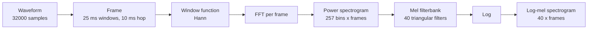

Every speech and audio model, from Whisper to a TTS vocoder to a voice activity detector, starts from the same raw material: a long array of numbers sampled from a microphone. Most bugs in audio pipelines are not model bugs but signal bugs: a file at the wrong sampling rate, a stereo channel fed where mono was expected, clipped or silent input, a spectrogram computed with different settings from the ones the model was trained with. This lesson builds the core audio representations from scratch with NumPy and SciPy, so you know exactly what a model receives and can debug it when something sounds, or transcribes, wrong.

## Sampling: from sound to numbers

Sound is a continuous pressure wave. A microphone converts it to a voltage, and an analogue-to-digital converter measures that voltage at regular intervals. The number of measurements per second is the **sampling rate** $f_s$, in hertz (Hz).

| Sampling rate | Typical use |
| --- | --- |
| 8 kHz | Traditional telephone audio |
| 16 kHz | Most speech recognition models |
| 22.05 or 24 kHz | Many TTS models |
| 44.1 kHz | CD audio, music |
| 48 kHz | Video and professional audio |

A pure tone of frequency $f$ Hz sampled at $f_s$ is the array $x[n] = A \sin(2\pi f n / f_s)$ for sample index $n = 0, 1, 2, \dots$, where $A$ is the amplitude. Let us build a two-second test signal that you will reuse throughout the lesson: half a second of near-silence, half a second of a 440 Hz tone, half a second of a 1000 Hz tone, and half a second of near-silence.

```python
import numpy as np

sr = 16_000                                   # samples per second
rng = np.random.default_rng(0)

def tone(freq, seconds, amp=0.5):
    n = np.arange(int(sr * seconds))
    return amp * np.sin(2 * np.pi * freq * n / sr)

silence = lambda s: 0.003 * rng.standard_normal(int(sr * s))   # faint background noise
x = np.concatenate([silence(0.5), tone(440, 0.5), tone(1000, 0.5), silence(0.5)])

print("samples:", x.shape[0], "duration:", x.shape[0] / sr, "s")
print("peak amplitude:", round(float(np.abs(x).max()), 3))

# Which frequencies are present? The FFT of the tonal middle second:
middle = x[sr // 2 : 3 * sr // 2]
magnitudes = np.abs(np.fft.rfft(middle))
freqs = np.fft.rfftfreq(len(middle), d=1 / sr)
print("two strongest frequencies:", sorted(float(f) for f in freqs[np.argsort(magnitudes)[-2:]]))
```

```output
samples: 32000 duration: 2.0 s
peak amplitude: 0.5
two strongest frequencies: [440.0, 1000.0]
```

The **Fourier transform** (computed by the FFT) re-expresses a signal as a sum of sine waves and tells you how strong each frequency is. It recovers exactly the two tones we put in.

## Nyquist and aliasing

How fast must you sample? The **Nyquist-Shannon sampling theorem** says a signal can be reconstructed exactly if it contains no frequencies at or above half the sampling rate. That limit, $f_s / 2$, is the **Nyquist frequency**. Human speech intelligibility lives mostly below about 4 kHz, which is why 8 kHz telephone audio is understandable and 16 kHz (Nyquist 8 kHz) is comfortable for ASR.

If a frequency above the Nyquist limit reaches the sampler, it does not disappear: it folds back and masquerades as a lower frequency. This is **aliasing**.

```python
fs_low = 8_000
n = np.arange(fs_low)                                   # one second at 8 kHz
y = np.sin(2 * np.pi * 7_000 * n / fs_low)              # a 7 kHz tone, above the 4 kHz Nyquist limit
f = np.fft.rfftfreq(len(y), d=1 / fs_low)
print("7000 Hz tone sampled at 8 kHz appears at", f[np.argmax(np.abs(np.fft.rfft(y)))], "Hz")
```

```output
7000 Hz tone sampled at 8 kHz appears at 1000.0 Hz
```

A 7 kHz tone looks exactly like a 1 kHz tone ($8000 - 7000$). Once aliased, the two cannot be told apart, so hardware and resampling code apply a **low-pass anti-aliasing filter** before reducing the sampling rate.

## Quantisation and bit depth

Each sample must also be stored with finite precision. **Bit depth** is the number of bits per sample: 16-bit audio has $2^{16} = 65{,}536$ possible levels. Rounding to the nearest level adds **quantisation noise**. The signal-to-noise ratio improves by about 6 dB for every extra bit:

```python
def quantise(signal, bits):
    levels = 2 ** (bits - 1) - 1                       # signed integers, e.g. 32767 for 16-bit
    return np.round(signal * levels) / levels

tonal = x[sr // 2 : 3 * sr // 2]
for bits in [16, 8, 4]:
    noise = tonal - quantise(tonal, bits)
    snr_db = 10 * np.log10(np.mean(tonal ** 2) / np.mean(noise ** 2))
    print(f"{bits:2d}-bit: SNR {snr_db:5.1f} dB")
```

```output
16-bit: SNR  92.0 dB
 8-bit: SNR  44.0 dB
 4-bit: SNR  17.3 dB
```

In code, audio usually arrives as 16-bit integers (WAV files) and models expect floating-point values in the range -1 to 1. Dividing `int16` samples by 32768 is the standard conversion; forgetting it gives a model input thousands of times too loud.

> [!WARNING]
> Check four things whenever you load audio: sampling rate, number of channels (average stereo to mono if the model wants mono), dtype and value range, and duration. A model fed 44.1 kHz audio while expecting 16 kHz hears everything slowed down and pitched low, and often produces fluent nonsense rather than an error.

## Spectrograms: frequency over time

The FFT of a whole recording tells you which frequencies occur but not *when*. Speech changes every few tens of milliseconds, so we use the **short-time Fourier transform (STFT)**: slide a short window along the signal, and take the FFT of each window. Stack the magnitudes and you get a **spectrogram**, a matrix with frequency on one axis and time on the other.



At 16 kHz, a 25 ms window is 400 samples and a 10 ms hop is 160 samples. We pad each frame to 512 points for the FFT, which gives $512/2 + 1 = 257$ frequency bins.

```python
from scipy import signal

freqs, times, Z = signal.stft(x, fs=sr, window="hann", nperseg=400,
                              noverlap=400 - 160, nfft=512)
power = np.abs(Z) ** 2
print("spectrogram shape (bins, frames):", power.shape)
print("frequency resolution:", freqs[1], "Hz per bin")

for t_sec in [0.75, 1.25]:
    frame = np.argmin(np.abs(times - t_sec))
    print(f"t={t_sec}s strongest bin at {freqs[np.argmax(power[:, frame])]:.1f} Hz")
```

```output
spectrogram shape (bins, frames): (257, 201)
frequency resolution: 31.25 Hz per bin
t=0.75s strongest bin at 437.5 Hz
t=1.25s strongest bin at 1000.0 Hz
```

The strongest bins sit at the nearest multiples of 31.25 Hz to 440 and 1000 Hz. The window length is a trade-off: longer windows give finer frequency resolution but blur fast changes in time.

## Mel spectrograms

Human hearing is roughly linear in pitch at low frequencies and logarithmic at high ones: the step from 100 to 200 Hz sounds much larger than from 7,000 to 7,100 Hz. The **mel scale** models this:

$$
m = 2595 \log_{10}\!\left(1 + \frac{f}{700}\right)
$$

where $f$ is frequency in Hz and $m$ is in mels. A **mel filterbank** is a set of triangular filters whose centres are equally spaced on the mel scale (so they are narrow at low frequencies and wide at high ones). Multiplying the power spectrogram by the filterbank sums the energy in each band. Taking the logarithm then compresses the huge dynamic range of audio, much as loudness perception does.

```python
def hz_to_mel(f):
    return 2595 * np.log10(1 + f / 700)

def mel_to_hz(m):
    return 700 * (10 ** (m / 2595) - 1)

def mel_filterbank(n_mels, n_fft, sr):
    mel_points = np.linspace(hz_to_mel(0), hz_to_mel(sr / 2), n_mels + 2)
    bin_points = np.floor((n_fft + 1) * mel_to_hz(mel_points) / sr).astype(int)
    fb = np.zeros((n_mels, n_fft // 2 + 1))
    for i in range(1, n_mels + 1):
        left, centre, right = bin_points[i - 1], bin_points[i], bin_points[i + 1]
        for k in range(left, centre):
            fb[i - 1, k] = (k - left) / (centre - left)          # rising edge
        for k in range(centre, right):
            fb[i - 1, k] = (right - k) / (right - centre)        # falling edge
    return fb

fb = mel_filterbank(n_mels=40, n_fft=512, sr=sr)
log_mel = np.log10(fb @ power + 1e-10)
print("filterbank:", fb.shape, " log-mel:", log_mel.shape)

centres = mel_to_hz(np.linspace(hz_to_mel(0), hz_to_mel(sr / 2), 42))[1:-1]
print("first five band centres (Hz):", np.round(centres[:5]).astype(int))
print("last band centre (Hz):", int(round(centres[-1])))
for t_sec in [0.25, 0.75, 1.25]:
    frame = np.argmin(np.abs(times - t_sec))
    band = int(np.argmax(log_mel[:, frame]))
    print(f"t={t_sec}s loudest mel band {band} (centre ~{centres[band]:.0f} Hz), "
          f"level {log_mel[band, frame]:.1f}")
```

```output
filterbank: (40, 257)  log-mel: (40, 201)
first five band centres (Hz): [ 44  92 142 195 252]
last band centre (Hz): 7481
t=0.25s loudest mel band 38 (centre ~6994 Hz), level -6.3
t=0.75s loudest mel band 7 (centre ~445 Hz), level -1.0
t=1.25s loudest mel band 14 (centre ~1060 Hz), level -1.1
```

The bands near 0 Hz are about 50 Hz apart while the top bands are hundreds of Hz apart. In the silent frame even the loudest band (just background noise) is about five orders of magnitude weaker (the levels are base-10 logarithms) than the tonal frames. This 40 by 201 matrix is, in miniature, exactly the kind of input an ASR encoder receives; Whisper-style models use 80 or 128 bands, and libraries such as `librosa` and `torchaudio` provide tested implementations of these functions. Always compute features with the same parameters the model was trained with.

## Resampling

Your audio rarely arrives at the rate your model wants. Phone recordings are 8 kHz, video soundtracks 48 kHz, the model wants 16 kHz. **Resampling** changes the rate; downsampling must low-pass filter first to avoid aliasing. SciPy's `resample_poly` upsamples by an integer, filters and downsamples by another integer:

```python
from scipy.signal import resample_poly

x48 = np.sin(2 * np.pi * 440 * np.arange(48_000) / 48_000)     # 1 s of 440 Hz at 48 kHz
x16 = resample_poly(x48, up=1, down=3)                          # 48 kHz -> 16 kHz
f16 = np.fft.rfftfreq(len(x16), d=1 / 16_000)
print(len(x48), "->", len(x16), "samples; peak at",
      f16[np.argmax(np.abs(np.fft.rfft(x16)))], "Hz")
```

```output
48000 -> 16000 samples; peak at 440.0 Hz
```

The length shrinks by three and the tone stays at 440 Hz. Simply taking every third sample (`x48[::3]`) would also give 16,000 samples, but any content between 8 and 24 kHz would alias into the speech band.

## Voice activity detection

**Voice activity detection (VAD)** labels each frame as speech or non-speech. It trims silence before ASR (saving compute and reducing hallucinated text on silent stretches), segments long recordings, and drives endpointing in voice assistants. The simplest VAD thresholds frame energy:

```python
frame_len, hop = 400, 160
n_frames = 1 + (len(x) - frame_len) // hop
energy_db = np.array([
    10 * np.log10(np.mean(x[i * hop : i * hop + frame_len] ** 2) + 1e-12)
    for i in range(n_frames)
])
threshold_db = energy_db.max() - 30          # 30 dB below the loudest frame
is_speech = energy_db > threshold_db

changes = np.flatnonzero(np.diff(is_speech.astype(int))) + 1
starts, ends = changes[::2], changes[1::2]
for s, e in zip(starts, ends):
    print(f"active from {s * hop / sr:.2f}s to {e * hop / sr:.2f}s")
```

```output
active from 0.48s to 1.50s
```

It finds the tonal region, give or take a frame. Energy VAD works on clean audio but fails in noise: a fan or traffic is loud and not speech, while a quiet speaker can fall below the threshold. Production systems use small neural VAD models trained to distinguish speech from noise, and add **hangover** smoothing (keep the speech label for a few hundred milliseconds after energy drops) so short pauses between words do not split utterances.

> [!TIP]
> Before blaming an ASR model for a bad transcript, plot or listen to the exact array you fed it. A quick check of `sr`, `x.shape`, `x.min()`, `x.max()` and a spectrogram image catches most pipeline bugs in seconds.

## Exercises

**1.** A 5 kHz tone is sampled at 8 kHz. At what frequency will it appear? Verify with the FFT approach used above.

<details>
<summary>Show solution</summary>

The Nyquist frequency is 4 kHz, so 5 kHz folds back to $8000 - 5000 = 3000$ Hz.

```python
y5 = np.sin(2 * np.pi * 5_000 * np.arange(8_000) / 8_000)
f = np.fft.rfftfreq(8_000, d=1 / 8_000)
print(f[np.argmax(np.abs(np.fft.rfft(y5)))])
```

```output
3000.0
```

</details>

**2.** How many frames and frequency bins does the STFT produce for 30 seconds of 16 kHz audio with a 400-sample window, a 160-sample hop and a 512-point FFT, ignoring padding at the edges? How many with an 80-band mel filterbank?

<details>
<summary>Show solution</summary>

Frames: $1 + (480{,}000 - 400) / 160 = 2998$ (libraries that pad the edges return about 3,000, which is why Whisper-style models talk about 3,000 frames per 30 s window). Bins: $512/2 + 1 = 257$. After the mel filterbank: 80 bands by about 3,000 frames.

</details>

**3.** Add hangover smoothing to the energy VAD: once a frame is speech, keep labelling frames as speech until 20 consecutive frames (200 ms) fall below the threshold.

<details>
<summary>Show solution</summary>

```python
def smooth(is_speech, hangover=20):
    out, quiet = np.zeros_like(is_speech), hangover
    for i, active in enumerate(is_speech):
        quiet = 0 if active else quiet + 1
        out[i] = quiet <= hangover
    return out

print(int(is_speech.sum()), "->", int(smooth(is_speech).sum()), "speech frames")
```

```output
102 -> 122 speech frames
```

The smoothed label stays on for 20 extra frames after the tone ends, so short pauses inside an utterance would no longer split it.

</details>

```quiz
[
  {
    "q": "Audio is sampled at 16 kHz. What is the highest frequency it can represent without aliasing?",
    "options": ["16 kHz", "32 kHz", "8 kHz", "4 kHz"],
    "answer": 2,
    "why": "The Nyquist frequency is half the sampling rate: 8 kHz."
  },
  {
    "q": "Why is a mel filterbank applied to a power spectrogram for speech models?",
    "options": [
      "To increase the sampling rate",
      "To group frequencies into bands spaced like human pitch perception, reducing dimensions",
      "To remove the need for an FFT",
      "To convert stereo to mono"
    ],
    "answer": 1,
    "why": "Mel bands are narrow at low frequencies and wide at high ones, matching perception and compressing 257 bins into, say, 80 bands."
  },
  {
    "q": "What goes wrong if you downsample 48 kHz audio to 16 kHz by keeping every third sample?",
    "options": [
      "Nothing; it is equivalent to `resample_poly`",
      "Content between 8 and 24 kHz aliases into lower frequencies",
      "The audio becomes stereo",
      "The duration triples"
    ],
    "answer": 1,
    "why": "Without a low-pass filter first, frequencies above the new Nyquist limit fold back into the audible band."
  },
  {
    "q": "Roughly how much does each extra bit of depth improve the quantisation signal-to-noise ratio?",
    "options": ["1 dB", "3 dB", "6 dB", "20 dB"],
    "answer": 2,
    "why": "Each bit doubles the number of levels, halving the noise amplitude: about 6 dB, as the 16, 8 and 4-bit results showed."
  }
]
```
