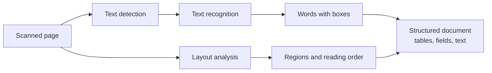
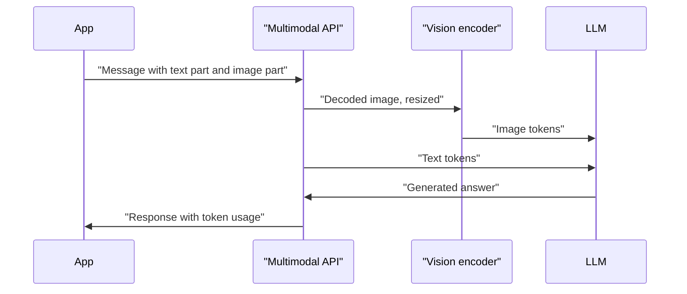

Most of the information people care about does not arrive as clean text. Invoices are scanned PDFs, bug reports come with screenshots, insurance claims include photos of damage, and dashboards are charts. An AI engineer who can only handle text has to ask someone else to turn all of that into words first. Image understanding is the set of techniques that let a system read, describe and answer questions about images directly, and today much of it is available through the same LLM APIs you already use.

This lesson recaps the classic vision tasks, then focuses on the tasks that matter most for building applications: reading text in images, understanding documents, captioning, visual question answering, and sending images to a multimodal LLM.

## From classic vision tasks to open-ended understanding

The [Computer Vision](/learn/computer-vision/image-classification) module covered the three classic tasks. **Classification** assigns one label to a whole image ("cat"). **Object detection** finds objects and draws a box around each ("cat at x=40, y=60, 120 by 90 pixels"), as in [YOLO](/learn/computer-vision/yolo-fundamentals). **Segmentation** labels every pixel, giving exact object shapes. All three share a limitation: the model can only output what it was trained to output, a fixed set of classes.

Image *understanding* in the modern sense is open-ended. The output is free text, and the question can be anything: "What is the total on this receipt?", "Is the forklift in this photo blocking the fire exit?", "Summarise this chart". This flexibility comes from combining a vision encoder (a CNN or a [Vision Transformer](/learn/computer-vision/vision-transformers)) with a language model, which the next lesson examines in detail.

| Task | Output | Typical tool |
| --- | --- | --- |
| Classification | One label from a fixed set | CNN or ViT classifier |
| Detection | Boxes plus labels | YOLO-style detector |
| Segmentation | A label per pixel | U-Net, Mask R-CNN style models |
| OCR | The text in the image, often with positions | OCR engine or VLM |
| Document understanding | Structured fields, tables, reading order | Layout-aware models or VLM |
| Captioning | A sentence describing the image | VLM |
| Visual question answering | An answer to a free-text question | VLM |

> [!KEY]
> Classic vision models answer a fixed question with a fixed set of answers. Vision-language models answer arbitrary questions in free text. Use the classic models when you need speed, precise coordinates and a stable label set; use VLMs when the question varies or needs reasoning.

## OCR and document understanding

**Optical character recognition (OCR)** turns pixels containing text into characters. A traditional OCR pipeline has two stages: **text detection** finds regions that contain text, and **text recognition** reads the characters in each region. Engines such as Tesseract follow this pattern and return each word with a bounding box and a confidence score.

Raw OCR is rarely enough. A scanned invoice read top to bottom produces a soup of words: the column headers of a table end up far from their values, and a two-column page gets its columns interleaved. **Document understanding** adds structure on top of the characters:

- **Layout analysis**: which regions are headings, paragraphs, tables, figures, footers.
- **Reading order**: the order a human would read the regions in.
- **Table extraction**: rows, columns and merged cells.
- **Key-value extraction**: "Invoice number: 4471" becomes `{"invoice_number": "4471"}`.



There are now two broad routes. The **pipeline route** uses a dedicated OCR engine plus layout models, which gives exact character positions, works offline and is cheap per page. The **VLM route** sends the page image to a multimodal LLM and asks for the fields directly, often as [structured output](/learn/working-with-llms/structured-outputs). It handles messy layouts and handwriting better in many cases but costs more per page and can produce plausible text that is not on the page. Many production systems combine both: OCR for the text and positions, a VLM to interpret layout and fill gaps, and a check that every extracted value actually appears in the OCR text.

## Captioning and visual question answering

**Image captioning** generates a short description of an image. Captions are useful for accessibility (alt text), for search (index the caption as text), and as a cheap way to turn images into something a text-only pipeline can handle.

**Visual question answering (VQA)** answers a question about an image. Captioning is really a special case: the question is "describe this image". The important practical difference is that a targeted question extracts targeted information. A generic caption of a dashboard might say "a line chart showing revenue over time"; the question "Which month had the lowest revenue, and roughly what was it?" gets you an answer you can use.

Good prompts for VQA follow the same rules as text prompts from [Prompt Engineering](/learn/prompt-engineering/structured-prompting), plus a few image-specific ones:

- Ask about what is visible, and tell the model to say when something is not visible or not legible rather than guess.
- Ask for a structured answer (JSON fields) when the result feeds code.
- For several images, label them in the text ("Image 1 is the before photo, image 2 is the after photo") so the model can refer to them unambiguously.

## Sending images to a multimodal LLM

Multimodal chat APIs extend the message format you met in the [OpenAI API](/learn/working-with-llms/openai-api) lesson. Instead of a message's `content` being one string, it becomes a list of **content parts**, each with a type: some are text, some are images. Providers differ in field names, but the concepts are shared:

| Concept | What it means |
| --- | --- |
| Content parts | A user message holds an ordered list of text and image parts |
| Image by URL | You pass a public (or pre-signed) HTTPS URL and the provider fetches it |
| Image by base64 | You embed the file bytes, base64-encoded, usually as a `data:` URL with a media type |
| Detail or resolution setting | Some APIs let you trade image fidelity for fewer tokens |
| Token cost | Images are converted to tokens, so they count against the context window and the bill |

A URL is convenient when the image is already hosted. Base64 is necessary for private files, local files and images you generate on the fly, at the cost of a larger request (base64 inflates bytes by about a third). Building the `data:` URL needs only the standard library:

```python
import base64

# The first 8 bytes of every PNG file (its "signature"), standing in for a real image
png_bytes = bytes([0x89, 0x50, 0x4E, 0x47, 0x0D, 0x0A, 0x1A, 0x0A])

def to_data_url(data: bytes, media_type: str) -> str:
    encoded = base64.b64encode(data).decode("ascii")
    return f"data:{media_type};base64,{encoded}"

url = to_data_url(png_bytes, "image/png")
print(url)
print(len(png_bytes), "bytes ->", len(url.split(",")[1]), "base64 characters")
```

```output
data:image/png;base64,iVBORw0KGgo=
8 bytes -> 12 base64 characters
```

In a real application you would read the bytes with `open(path, "rb").read()`. Here is the message shape used by OpenAI-style Chat Completions APIs, with one text part and one image part. It needs an API key, so no output is shown:

```python
from openai import OpenAI

client = OpenAI()

with open("receipt.jpg", "rb") as f:
    image_url = to_data_url(f.read(), "image/jpeg")

response = client.chat.completions.create(
    model="your-vision-capable-model",
    messages=[
        {
            "role": "user",
            "content": [
                {"type": "text", "text": "What is the total amount on this receipt? "
                                         "Reply with just the number, or UNREADABLE."},
                {"type": "image_url", "image_url": {"url": image_url}},
            ],
        }
    ],
)
print(response.choices[0].message.content)
```

To pass a hosted image instead, put its HTTPS URL in the same `url` field. Other providers use different field names for the image part (for example a `source` object with a media type and data), so check the provider's documentation rather than assuming this exact shape works everywhere.



> [!WARNING]
> Images are not free context. Each image becomes many tokens, often hundreds or more depending on its resolution and the provider's settings. Ten screenshots in a conversation can cost more than pages of text. Resize images to the smallest size that keeps the detail you need, and read the token usage the API returns.

## Practical pitfalls

- **Resolution and small text.** APIs typically downscale large images. A full-page screenshot may be shrunk until body text is unreadable. Crop to the region of interest, or split a tall page into tiles.
- **Orientation and metadata.** Phone photos often store rotation in EXIF metadata rather than in the pixels. Apply the rotation before sending, or the model sees a sideways image.
- **Hallucinated details.** A model asked to read a blurred number may produce a confident, plausible one. Ask it to flag illegible content and validate extracted values (totals that add up, dates that parse).
- **Privacy.** Images contain far more than you asked about: faces, addresses on envelopes, screens in the background. Treat them as sensitive data, and strip EXIF location data when you store them.
- **Prompt injection.** Text inside an image is input like any other. A screenshot containing "ignore your instructions" can affect the model, as discussed in [prompt injection awareness](/learn/prompt-engineering/prompt-injection-awareness).

## Exercises

**1.** Write a function `image_part(path)` that reads a local file, chooses the media type from the extension (`.png`, `.jpg`/`.jpeg`, `.webp`), and returns an OpenAI-style image content part. Raise `ValueError` for other extensions.

<details>
<summary>Show solution</summary>

```python
import base64
from pathlib import Path

MEDIA_TYPES = {".png": "image/png", ".jpg": "image/jpeg", ".jpeg": "image/jpeg", ".webp": "image/webp"}

def image_part(path):
    suffix = Path(path).suffix.lower()
    if suffix not in MEDIA_TYPES:
        raise ValueError(f"unsupported image type: {suffix}")
    data = base64.b64encode(Path(path).read_bytes()).decode("ascii")
    return {"type": "image_url", "image_url": {"url": f"data:{MEDIA_TYPES[suffix]};base64,{data}"}}
```

</details>

**2.** You need to extract the invoice number, date and total from 50,000 scanned invoices a month, most of them from a dozen suppliers with fixed layouts. Would you choose an OCR pipeline, a VLM, or both? Justify the choice.

<details>
<summary>Show solution</summary>

Mostly an OCR pipeline: fixed layouts mean simple rules or a small layout model can locate the fields reliably and cheaply, with exact positions for auditing. Route the minority of unfamiliar layouts, or documents where OCR confidence is low or validation fails (total does not equal the sum of line items, date does not parse), to a VLM. This keeps cost low while handling the long tail.

</details>

**3.** A user uploads a 4000 by 3000 pixel photo of a whiteboard and the model misreads several words. List three changes you could make before blaming the model.

<details>
<summary>Show solution</summary>

Crop to the whiteboard so the text occupies more of the image the model actually sees; check the API's detail or resolution setting and use high detail; correct the orientation from EXIF; increase contrast or split the board into tiles sent as separate images; ask the model to mark words it cannot read instead of guessing.

</details>

```quiz
[
  {
    "q": "Why does a plain OCR engine often produce poor results on a two-column scanned report?",
    "options": [
      "OCR cannot read printed text",
      "Without layout analysis and reading order, text from the two columns gets interleaved",
      "OCR only works on handwriting",
      "OCR outputs images, not text"
    ],
    "answer": 1,
    "why": "Character recognition can be accurate while the order and structure are wrong. Layout analysis restores reading order."
  },
  {
    "q": "When should you send an image as base64 rather than by URL?",
    "options": [
      "When the image is a local or private file the provider cannot fetch",
      "Always, because it uses fewer tokens",
      "Only for images larger than the context window",
      "Never; URLs are required by all providers"
    ],
    "answer": 0,
    "why": "Base64 embeds the bytes in the request, so it works for files that have no public URL. Token cost depends on the image, not on how it is sent."
  },
  {
    "q": "In an OpenAI-style chat request, how is an image attached to a user message?",
    "options": [
      "As a separate `image` field next to `messages`",
      "As a file upload header",
      "As an element in the message's `content` list, alongside text parts",
      "By pasting the base64 string into the text prompt"
    ],
    "answer": 2,
    "why": "Multimodal messages use a list of typed content parts; an image part sits in the same list as text parts."
  },
  {
    "q": "A VLM returns a confident total from a blurry receipt. What is the best safeguard?",
    "options": [
      "Raise the temperature",
      "Send the image twice",
      "Convert the image to greyscale",
      "Ask the model to say UNREADABLE when unsure and validate the value against other fields"
    ],
    "answer": 3,
    "why": "VLMs can hallucinate plausible details. Explicit permission to abstain plus validation catches many errors."
  }
]
```
